# UCCD3053 Information Technology Professional Ethics — Comprehensive Short Notes

> [!abstract] Course Summary Overview
> These short notes synthesize the core lecture units of **UCCD3053 Information Technology Professional Ethics** into a high-yield, structured, exam-ready revision reference directly derived from the official lecture slides. They cover fundamental concepts of ethics, morality, Malaysian statutory frameworks, cyberspace jurisdiction, intellectual property, malware topologies, hacking classifications, and network defense strategies.

---

## Quick Navigation
- [[#Topic 1: Introduction to Law & Professional Ethics in IT]]
  - [[#1.1 Professional Ethics in Information Technology]]
  - [[#1.2 The Three Invisible Rulebooks: Morality, Ethics, and Law]]
  - [[#1.3 Nature and Five Defining Features of Law]]
  - [[#1.4 Malaysia's Dual Legal System Architecture]]
  - [[#1.5 Malaysian Cyber Law Landscape & Digital Watchdogs]]
- [[#Topic 2: Legal Issues in IT]]
  - [[#2.1 Digital Signatures & Cryptographic Foundations]]
  - [[#2.2 Domain Names, Trademarks & Cyberspace Disputes]]
  - [[#2.3 Trade Secrets & Intellectual Property Protection]]
  - [[#2.4 Antitrust, Anticompetition & Market Regulation]]
  - [[#2.5 Cyberspace Jurisdiction & Cross-Border Enforcement]]
- [[#Topic 3: Computer Crime and Computer Network Security]]
  - [[#3.1 Computer Crime vs. Cybercrime]]
  - [[#3.2 The Nine Faces of Cybercrime]]
  - [[#3.3 Security Threats: Viruses, Worms, and Trojans]]
  - [[#3.4 Unauthorised Access, Hacking & Statutory Penalties]]
  - [[#3.5 Cyberterrorism and Denial of Service (DoS/DDoS) Attacks]]
  - [[#3.6 Quick Revision Checklist & Self-Test Questions]]
- [[#Topic 4: Intellectual Property (IP)]]
  - [[#4.1 Nature of Intellectual Property & Core Principles]]
  - [[#4.2 Copyright Protection & Statutory Exclusive Rights]]
  - [[#4.3 The Fair Use Doctrine & Four-Factor Balancing Test]]
  - [[#4.4 Artificial Intelligence & Copyright: The Generative AI Frontier]]
  - [[#4.5 Trade Secrets & Confidential Business Information]]
  - [[#4.6 Patents & Utility Innovation Framework]]
  - [[#4.7 Trademarks, Passing Off & Brand Defense]]
  - [[#4.8 MyIPO & The Malaysian IP Legislative Framework]]
  - [[#4.9 Quick Revision Checklist & Self-Test Questions (Topic 4)]]
- [[#Topic 5: Business Intellectual Property & Digital Ethics]]
  - [[#5.1 IP Ownership, Employment Law & Contractor Rights]]
  - [[#5.2 Co-Ownership, Assignment & Investor Due Diligence]]
  - [[#5.3 Digital Copyright, DRM & The Zero-Marginal-Cost Dilemma]]
  - [[#5.4 Peer-to-Peer (P2P) Architecture, BitTorrent & Legal Evolution]]
  - [[#5.5 Software Copyright, API Protection & Clean Room Design]]
  - [[#5.6 Open Source vs. Proprietary Software Ethics & Licensing]]
  - [[#5.7 Quick Revision Checklist & Self-Test Questions (Topic 5)]]
- [[#Topic 6: Ethical Theories & Computer Ethics in Information Systems]]
  - [[#6.1 Foundational Moral Concepts & The Three Tests of a Moral Standard]]
  - [[#6.2 Normative vs. Descriptive Morality]]
  - [[#6.3 Rights Theory & The 2x2 Legality-Ethics Matrix]]
  - [[#6.4 Why Ethics Matters in IT & The Three Levels of Ethical Issues]]
  - [[#6.5 The Business Ethics Debate: Universal Duty vs. Friedmanism]]
  - [[#6.6 Case Studies in Corporate Failure: Theranos & Pfizer]]
  - [[#6.7 Four Tech Trends & Four Moral Dimensions of the Information Age]]
  - [[#6.8 Social Contract Theory & The Bill's Data Dilemma]]
  - [[#6.9 Quick Revision Checklist & Self-Test Questions (Topic 6)]]

---

# Topic 1: Introduction to Law & Professional Ethics in IT

## 1.1 Professional Ethics in Information Technology

> [!info] Definition: Professional Ethics
> **Professional Ethics** is the formal set of standards and values established by a professional governing body (e.g., ACM, IEEE, BCS) prescribing how practitioners must conduct themselves, make decisions, and interact with clients, employers, colleagues, and the public.
> 
> *Core Principle*: Professional ethics is not merely about getting the job done, but ensuring the job is done the **right way** with appropriate safeguards, transparency, and respect for stakeholders.

### The Cambridge Analytica Scandal (2018)
- **The Incident**: Whistleblower Christopher Wylie revealed that political consulting firm Cambridge Analytica harvested personal data from approximately **87 million Facebook users** without their informed consent.
- **Mechanism**:
  ```mermaid
  flowchart LR
      QuizApp["Personality Quiz App<br>(thisisyourdigitallife)"] -->|"Taken by ~300k users"| AppAccess["App granted access to user data"]
      AppAccess -->|"Harvested friends' data without consent"| FriendsData["87 Million Facebook Profiles Harvested"]
      FriendsData -->|"Algorithmic profiling"| TargetedAds["Micro-targeted Political Campaigns"]
  ```
- **Ethical Breach**: The application exploited Facebook's Open Graph API permissions to harvest data not only from the direct quiz-takers, but also from millions of friends in their social graph who never gave consent.
- **Key Takeaway**: **Consent** and **data minimization** (collecting only the minimum data strictly required) form the absolute baseline of professional IT ethics.

### Why IT Professionals Require Dedicated Ethics
1. **Decisions Run at Scale**: Code runs silently and repeatedly. A design flaw or unethical algorithmic bias programmed once can affect millions of users simultaneously long after the engineer has left the office.
2. **Asymmetry of Technical Power**: Non-technical users, clients, and regulators trust engineers to build secure, transparent systems without hidden backdoors, unauthorized telemetry, or surveillance.
3. **Prevention of Societal Breakdown**: Without shared ethical baselines, subjective moral interpretations lead to systemic exploitation and collapse of digital trust.

### Modern IT Dilemmas in the Age of Generative AI
Every classic dilemma in computing has gained sharper, more volatile edges with generative AI:

| Ethical Dilemma | Classic Computing Context | Modern Generative AI Context |
| :--- | :--- | :--- |
| **Confidentiality** | Leaking customer database records | Pasting confidential client contracts or trade secrets into public AI chatbots for summarization |
| **Competence** | Deploying unverified third-party libraries | Shipping AI-written code into production without understanding, verifying, or testing it |
| **Integrity** | Plagiarizing source code | Passing off AI-generated work, assignments, or architectural designs as entirely one's own |
| **Accuracy** | Software calculation bugs | Trusting and publishing unverified, hallucinated citations or fabricated factual outputs |
| **Privacy** | Unauthorized telemetry tracking | Training massive foundation models on user interactions, location trails, and personal histories |
| **Responsibility** | Software failure liability | Allocating legal and moral blame when autonomous systems (e.g., self-driving vehicles) cause harm |
| **Fairness** | Discriminatory UI/UX gating | Algorithmic recruitment tools or credit scoring models discriminating against protected demographic groups |
| **Professional Judgement** | Blindly trusting compiler output | Over-relying on automated AI suggestions and abandoning rigorous domain expertise |

> [!example] Case in Point: Uber Autonomous Vehicle Fatality (March 2018)
> In Tempe, Arizona, an Uber self-driving test vehicle struck and killed pedestrian Elaine Herzberg—the first recorded pedestrian death involving an autonomous vehicle. The car's software detected the pedestrian but misclassified her and suppressed emergency braking, while the human safety operator was distracted.
> - **The Legal/Ethical Dilemma**: Who carries **liability** (legal responsibility to answer and compensate for harm)? The software engineering team, the perception algorithms, the human safety backup driver, or the executive leadership that rushed deployment?

### Six Universal Professional Values
Most professional engineering and computing codes (such as the ACM Code of Ethics) rest upon six foundational values:

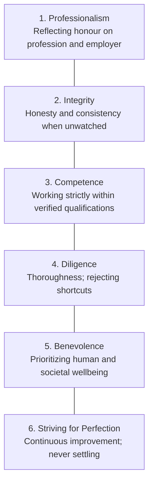

> [!tip] Memory Hook: P-I-C-D-B-S
> **P**rofessionals **I**n **C**omputing **D**eliver **B**etter **S**ystems:
> **P**rofessionalism, **I**ntegrity, **C**ompetence, **D**iligence, **B**enevolence, **S**triving for perfection.

---

## 1.2 The Three Invisible Rulebooks: Morality, Ethics, and Law

Human behavior and societal interactions are governed by three overlapping yet distinct normative systems:

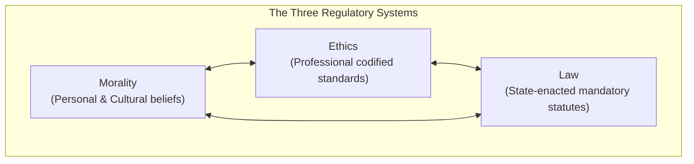

### Comprehensive Comparison Matrix

| Dimension | Morality | Ethics | Law |
| :--- | :--- | :--- | :--- |
| **Source / Origin** | Individual conscience, religious doctrine, cultural upbringing, family traditions | Professional organizations, academic research, reasoned consensus (e.g., ACM, IEEE) | Governing state bodies, sovereign parliament, statutory enactments, court precedent |
| **Enforcement Mechanism** | Internal guilt, conscience, informal social pressure or ostracization | Professional sanctions, censure, expulsion from professional associations | Coercive state apparatus: police, judicial courts, administrative regulatory agencies |
| **Codification** | Generally unwritten; internalized cultural norms | Formally codified in professional Codes of Conduct and Best Practices | Strictly codified into written Acts, statutes, enactments, and gazetted regulations |
| **Obligation / Mandate** | Voluntary / Subjective; varies across communities | Conditional; binds members of a profession or contracted employees | **Mandatory**; applies universally across the jurisdiction regardless of personal belief |
| **Consequence of Breach** | Remorse, loss of reputation, social disapproval | Loss of license, disciplinary hearings, termination of employment | Fines, injunctions, restitution damages, criminal imprisonment |
| **Practical Example** | Believing that lying under any circumstance is fundamentally wrong | Refusing to sell or monetize confidential customer telemetry data | Complying with mandatory data security and breach notification mandates under the PDPA |

> [!note] The Critical Takeaway
> **Legal $\neq$ Ethical**: An action can be completely legal while remaining ethically reprehensible. Conversely, an action may be ethical (e.g., civil disobedience or well-intentioned whistleblowing) while technically violating a statutory law.

### The Legal vs. Ethical 2×2 Decision Matrix

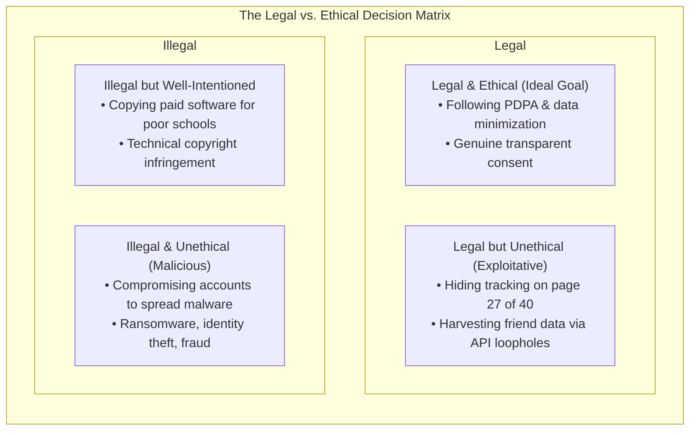

1. **Legal AND Ethical (Top-Right - Goal)**:
   - Full compliance with the Personal Data Protection Act (PDPA) while actively practicing data minimization and obtaining transparent user consent.
2. **Legal BUT Unethical (Top-Left - Exploitative Compliance)**:
   - Technical compliance buried in fine print: Disclosing invasive background location tracking on page 27 of a dense 40-page terms-of-service document that users will never read.
   - Platform compliance loophole: Operating within platform API rules to harvest friend data (as Cambridge Analytica initially argued regarding Facebook).
3. **Illegal BUT Well-Intentioned (Bottom-Right)**:
   - Illegally copying paid proprietary software to distribute free copies to an impoverished rural school. While the motivation is benevolent, it constitutes statutory copyright infringement under the Copyright Act 1987.
4. **Illegal AND Unethical (Bottom-Left - Malicious Criminality)**:
   - Unauthorized intrusion into a user's messaging account to distribute malware or defraud contacts (violating Section 4 of the Computer Crimes Act 1997).

---

## 1.3 Nature and Five Defining Features of Law

> [!info] Positive vs. Negative View of Law
> - **Negative View (Punisher)**: The flawed perception that law exists exclusively to punish criminals after a violation has already occurred.
> - **Positive View (Protector)**: The accurate understanding that law primarily functions like a **seatbelt**: quietly creating societal order, protecting property rights, ensuring consumer safety, and establishing trust from the moment one wakes up.

### The Five Defining Features of Law
1. **Law Protects Fundamental Freedoms**:
   - Guarantees personal liberty, equality before the law, and freedom of expression. In the digital sphere, these rights dictate what content platforms can moderate, what citizens may publish online, and how data privacy is protected.
2. **Law Keeps the Peace and Balances Public Order**:
   - Laws trade off a degree of individual liberty to guarantee collective security (e.g., airport security screenings, or Malaysia's *Security Offences (Special Measures) Act 2012 [SOSMA]*). This liberty-versus-security debate plays out continuously in cyberspace regarding encryption backdoors and state surveillance.
3. **Law Plays No Favourites (Universal Application)**:
   - Law applies equally without exception to private citizens, startups, multinational corporations, civil servants, and cabinet ministers. 
   > [!example] May 2025 Malaysian WhatsApp Case
   > When the Malaysian Home Minister's official WhatsApp account was compromised via a foreign VPN to blast phishing links, police investigated under **Section 4(1) of the Computer Crimes Act 1997**—the exact same statute applied to ordinary citizens.
4. **You Do Not Get to Opt Out**:
   - Legal compliance is non-negotiable. Unlike software subscriptions or email newsletters, citizens and corporations cannot "unsubscribe" from statutory duties.
5. **Law Keeps Moving (Evolutionary Nature)**:
   - Legal frameworks adapt to technological and societal transformations via three mechanisms:
     - **Enactment**: Creating entirely new statutes (e.g., *Cyber Security Act 2024*).
     - **Amendment**: Modifying existing statutes to close newly emerged loopholes (e.g., *PDPA 2024 Amendments* introducing mandatory breach notification).
     - **Repeal**: Abolishing outdated laws that no longer fit technological realities (e.g., the *Cybercrimes Bill 2026* designed to repeal the *Computer Crimes Act 1997*).

---

## 1.4 Malaysia's Dual Legal System Architecture

Malaysian jurisprudence combines English Common Law traditions inherited from the colonial era (early 1800s to 1957/1963) with statutory enactments and an Islamic legal track.

### The Federal Constitution
- **Supreme Law**: The Federal Constitution (*Perlembagaan Persekutuan*) outranks all other laws. Any federal statute or state enactment inconsistent with the Constitution is void to the extent of the inconsistency.
- **Constitutional Supremacy (Article 75)**: If any state law (including Syariah enactments) conflicts with a federal law passed by Parliament, **Federal law prevails**, and the state enactment is void to the extent of inconsistency.
- **Digital Intersections**:
  - Freedom of Speech (Article 10) $\leftrightarrow$ Content regulation under CMA 1998 Section 233.
  - Personal Liberty (Article 5) $\leftrightarrow$ Data protection, digital privacy, and police search powers.

### The Two Parallel Legal Tracks

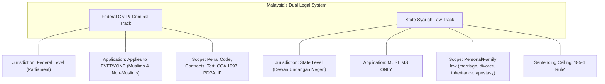

> [!warning] The Syariah Sentencing Limit ("3-5-6 Rule")
> Under the *Syariah Courts (Criminal Jurisdiction) Act 1965 (Act 355)*, Syariah criminal punishments are strictly capped at:
> - Maximum **3 years** imprisonment
> - Maximum fine of **RM5,000**
> - Maximum **6 strokes** of the cane

### Criminal Law vs. Civil Law

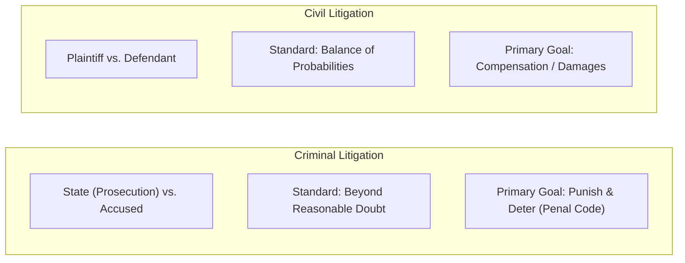

- **Anatomy of a Crime**:
  - A crime is an illegal act or **omission** (failure to act when legally obligated) prohibited by an Act of Parliament.
  - **Attempt Counts**: Attempting to commit a computer crime carries criminal liability even if the technical breach fails.
  - **Strict Elements**: The prosecution must prove every distinct element of an offence; if a single element is disproven, the charge fails.
- **Five Primary Routes into Civil Court**:
  1. **Tort Claims**: Civil wrongs causing injury, negligence, or harm.
  2. **Breach of Contract Claims**: Broken business agreements (e.g., failure of an IT software vendor to deliver contracted deliverables).
  3. **Equitable Claims**: Requests for fair injunctions rather than pure monetary awards.
  4. **Class Action Claims**: Representative lawsuits brought by an aggregated group of plaintiffs.
  5. **Complaints Against Public Authorities**: Judicial reviews against municipal or governmental overreach.

### Separation of Powers & Court Hierarchy
1. **The Legislature**: Debates and passes laws (Parliament at Federal level: *Dewan Rakyat* and *Dewan Negara*; State Assemblies: *Dewan Undangan Negeri*).
2. **The Executive**: Enforces and implements laws via the Prime Minister, Cabinet, and ministries.
3. **The Judiciary**: Interprets laws, hears prosecutions, and resolves civil disputes.
- **Court Jurisdiction Limits**:
  - **High Court**: Unlimited monetary jurisdiction; constitutional reach; cannot hear matters exclusively reserved for Syariah courts.
  - **Subordinate Courts (Sessions and Magistrates' Courts)**: Bound by strict **Monetary Jurisdiction** (statutory damage caps) and **Geographic Jurisdiction** (authorized regional boundaries). Exceeding these limits renders a judgment null and void on appeal.

---

## 1.5 Malaysian Cyber Law Landscape & Digital Watchdogs

### Key Cyber Legislation in Malaysia

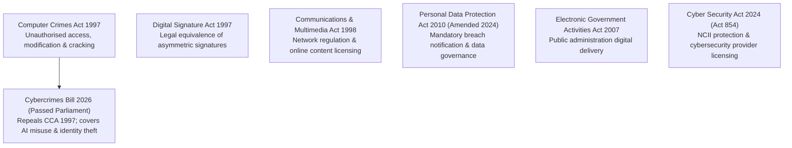

- **Computer Crimes Act 1997 (CCA 1997)**:
  - `Section 3`: Unauthorised access to computer material (hacking).
  - `Section 4`: Unauthorised access with intent to commit or facilitate a further offence (e.g., accessing a database to commit fraud).
  - `Section 5`: Unauthorised modification of computer contents (tampering, data wiping).
  - `Section 6`: Wrongful communication of passwords or access codes.
- **Cyber Security Act 2024 (Act 854)**:
  - Gazetted on 26 June 2024; in force from **26 August 2024**.
  - Establishes the **National Cyber Security Committee**.
  - Protects **National Critical Information Infrastructure (NCII)** across vital sectors (Banking & Finance, Energy, Healthcare, Transportation, Water, Government, InfoComm).
  - Imposes mandatory cybersecurity licensing for service providers and regulatory oversight via NACSA.
- **Communications and Multimedia Act 1998 (CMA 1998)**:
  - Regulates telecommunications infrastructure, Internet service providers, and online content transmission.
  - Effective 1 January 2025: Imposes mandatory licensing obligations on major social media and messaging platforms operating in Malaysia exceeding designated user thresholds.
- **Personal Data Protection Act 2010 & 2024 Amendments**:
  - Governs processing of personal data in commercial transactions.
  - *Historical Context*: In 2017, a massive breach exposed **46.2 million Malaysian mobile subscriber records** (IC numbers, addresses, SIM details). At that time, no mandatory breach disclosure existed.
  - *2024 Amendments*: Formally introduced mandatory **Data Breach Notifications** to the Commissioner and affected data subjects, defined **Data Controller vs. Processor** obligations, formalized the role of **Data Protection Officers (DPO)**, mandated **Data Protection Impact Assessments (DPIA)**, and regulated **Automated Decision-Making / Profiling**.

### Malaysian Digital Watchdogs Matrix

| Agency / Entity | Primary Functional Responsibility | Incident Escalation Trigger |
| :--- | :--- | :--- |
| **NACSA** (National Cyber Security Agency) | National cybersecurity coordination, NCII defense, Cyber Security Act 2024 implementation | Critical infrastructure cyberattacks, national threats |
| **MCMC** (Malaysian Communications & Multimedia Commission) | Regulates internet platforms, telcos, digital broadcast, and digital signature CAs | Unlicensed platforms, content defamation, telecom abuse |
| **PDPC** (Personal Data Protection Commissioner) | Administers and enforces the PDPA 2010/2024 | Data leaks, corporate privacy misuse, breach reporting |
| **PDRM** (Royal Malaysia Police - Commercial Crime / Cyber) | Criminal investigations, arrests, digital search and seizure under CCA 1997 / Penal Code | Scams, commercial fraud, unauthorized intrusions |
| **CyberSecurity Malaysia (CSM)** | Specialized technical incident response, digital forensics, capacity building | Forensic analysis, malware triage, technical assistance |
| **Attorney General's Chambers (AGC)** | State prosecution and government legal advisory | Formal filing of criminal charges in court |

---

# Topic 2: Legal Issues in IT

## 2.1 Digital Signatures & Cryptographic Foundations

> [!info] Definition: Digital Signature
> An electronic signature mathematically tied to both the signatory's identity and the document's content, verifying authenticity, integrity, and non-repudiation in electronic transactions.

### The Four Essential Security Properties
1. **Confidentiality**: Ensuring ciphertext can only be decrypted and read by the authorized recipient.
2. **Identity Authentication**: Mathematically proving that the message originated from the specific signer.
3. **Non-Repudiation**: The signer cannot plausibly deny having executed the transaction.
4. **Data Integrity**: Guarantees that not a single bit of the document has been altered since the signature was applied.

### Cryptographic Workflow
Digital signatures combine two fundamental components: a **cryptographic hash function** and **asymmetric public-key cryptography**.

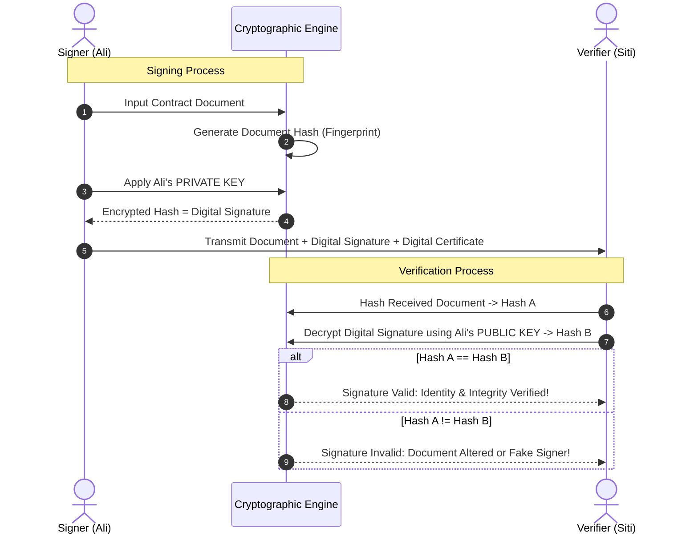

### Statutory Framework: Digital Signature Act 1997 (DSA 1997)
- **Commencement**: In force since **1 October 1998**; administered by **MCMC**.
- **Legal Equivalence Rule**: An electronic message possesses the exact same legal validity, enforceability, and effect as a signed paper document **if and only if** two cumulative conditions are met:
  1. It bears a valid digital signature covering the document in its entirety.
  2. The signature is verifiable by the public key listed in a valid digital certificate issued by an **MCMC-licensed Certification Authority (CA)**.

### Licensed Certification Authorities in Malaysia
Only digital certificates issued by CAs licensed under the DSA 1997 carry full statutory legal weight:
1. **Pos Digicert Sdn Bhd**
2. **MSC Trustgate.Com Sdn Bhd**
3. **Telekom Applied Business Sdn Bhd**
4. **Raffcomm Technologies Sdn Bhd**

> [!warning] Non-Signable Documents under DSA 1997
> Due to high fraud risks, solemnity, and strict physical witness requirements, the following documents **cannot** be executed via digital signatures:
> 1. **Powers of Attorney** (authorizing an agent to act on one's legal behalf)
> 2. **Wills and Codicils** (testamentary distribution of estates and amendments)
> 3. **Trusts** (legal arrangements holding property for beneficiaries)
> 4. **Negotiable Instruments** (promissory notes, cheques, drafts)

---

## 2.2 Domain Names, Trademarks & Cyberspace Disputes

### The Core Conflict: Trademarks vs. Domain Registrations
- **Trademarks**: Granted by geographical intellectual property offices to protect commercial goodwill and brand identity.
- **Domain Names**: Assigned globally on a **"first come, first served"** basis. Owning a registered trademark does not automatically confer ownership of the corresponding web domain.

### Four Problematic Domain Registration Categories

| Category | Definition | Real-World Example | Primary Perpetrator Motive |
| :--- | :--- | :--- | :--- |
| **Cybersquatting** | Registering a domain identical or confusingly similar to an established trademark in bad faith | `madonna.com` registered by Dan Parisi for adult entertainment | Extort trademark owner into buying domain at exorbitant markup, or block owner |
| **Typosquatting** | Registering domains exploiting common keyboard or phonetic misspellings of trademarks | `dicitionary.com` vs. `dictionary.com` | Phishing, scamming, malware distribution, or illicit advertising revenue |
| **Gripe Sites** | Incorporating a target's trademark into a domain dedicated to criticism or complaint | `lockheedsucks.com` vs. `lockheed.com` | Public protest, exposing corporate misconduct (clashes with Freedom of Expression) |
| **Foreign Language Variation** | Translating a protected brand name into another language for domain registration | Registering the direct Malay or Mandarin translation of a global brand | Siphon international brand traffic; exploit cross-border linguistic confusion |

> [!example] Landmark Precedent: Madonna v. Parisi (WIPO 2000)
> Pop icon Madonna filed a WIPO complaint against Dan Parisi, who operated `madonna.com` as an adult entertainment site. WIPO held that Parisi lacked legitimate rights to the name and registered it in bad faith, ordering the immediate transfer of the domain to Madonna.

### Domain Dispute Resolution via MYNIC
In Malaysia, the **Malaysian Network Information Centre (MYNIC)** administers the `.my` country-code top-level domain. Since 2003, it has provided the **Domain Name Dispute Resolution Service** as an expedited, cost-effective alternative to protracted court litigation.

To succeed in a MYNIC domain dispute, the complainant must prove **all three** grounds:
1. **Reasonable Similarity**: The disputed domain name is identical or confusingly similar to a trademark or service mark in which the complainant has rights.
2. **No Legitimate Right or Interest**: The respondent has no legitimate commercial right, license, or bona fide interest in the name.
3. **Bad Faith Registration and Use**: The domain was registered and is being used in bad faith (e.g., hoarding for resale, disrupting competitors, confusing consumers).
- **Remedies Available**: If proven, the administrative panel can either **Cancel** the domain registration or **Transfer** the domain to the trademark owner.

---

## 2.3 Trade Secrets & Intellectual Property Protection

> [!info] Trade Secret
> Confidential proprietary business information (algorithms, chemical formulas, pricing models, customer databases) that provides a commercial competitive edge as long as it remains confidential.

### Lawful Methods of Breaching Confidentiality
Unlike patents, trade secrets offer **no monopoly rights against independent discovery**:
1. **Reverse Engineering**:
   - The process of deconstructing a legally purchased product to discover its underlying architecture, code, or chemical formula.
   - *Example*: Purchasing a commercially available soft drink and chemically deducing its formula to produce an identical beverage is **entirely lawful** under intellectual property law.
2. **Employee Mobility & Knowledge Retention**:
   - When key technical staff move to competing organizations, they carry non-tangible general experience, domain knowledge, and memory.
   - While Non-Disclosure Agreements (NDAs) legally prohibit stealing source code files or confidential documents, they cannot erase internalized skills, creating unavoidable information leakage.

---

## 2.4 Antitrust, Anticompetition & Market Regulation

### Purpose of Antitrust Legislation
Antitrust law prevents anti-competitive collusive agreements, prohibits the abuse of dominant market power, and stops unwarranted monopolies from forming. By forcing organizations to compete aggressively, antitrust laws foster technological innovation, ensure market efficiency, and protect consumer pricing.

### The Four Prohibited Anti-Competitive Practices
1. **Price Fixing**: Colluding with direct market competitors to artificially set, raise, or stabilize retail prices (e.g., competing retail chains agreeing on price floors).
2. **Cartel Formation & Market Sharing**: Secretly carving up geographical territories or customer segments to eliminate active rivalry (e.g., "you take the northern corridor, we take the southern corridor").
3. **Predatory Pricing**: Deliberately slashing prices below operational cost to bankrupt smaller competitors, followed by monopolistic price hikes once rivals exit.
4. **Monopoly Abuse**: Exploiting dominant market share to stifle competitors (e.g., mandatory tying/bundling of unrelated software products, or refusing interoperability).

### Malaysian Regulatory Framework: Competition Act 2010
- **Enforcement Authority**: The **Malaysia Competition Commission (MyCC)**.
- **Concentrated Markets**: Sectors dominated by a handful of large operators (such as Malaysia's mobile telecommunications sector: CelcomDigi, Maxis) are subjected to strict regulatory surveillance.

> [!example] Landmark Case: The MAS & AirAsia Collaboration Agreement
> - **2011**: Malaysia Airlines (MAS) and AirAsia entered a comprehensive Collaboration Agreement, effectively partitioning commercial flight routes to avoid direct head-to-head competition.
> - **2014**: MyCC concluded the agreement violated Section 4 of the Competition Act 2010 (market sharing) and fined each airline **RM10 million**.
> - **2016–2021**: The dispute underwent a decade-long judicial journey: overturned by the Competition Appeal Tribunal (2016), reinstated by the High Court (2018), and finally dismissed by the Federal Court on procedural judicial review grounds (2021).

---

## 2.5 Cyberspace Jurisdiction & Cross-Border Enforcement

> [!info] Cyberspace Jurisdiction Dilemma
> **Jurisdiction** is the constitutional and statutory authority of a court to adjudicate a dispute. While sovereign legal systems are tethered to physical borders, cyberspace is **borderless, ubiquitous, instantaneous, and accessible worldwide**.

### Passive vs. Interactive Websites
Courts evaluate cross-border online jurisdiction using the level of commercial interactivity:

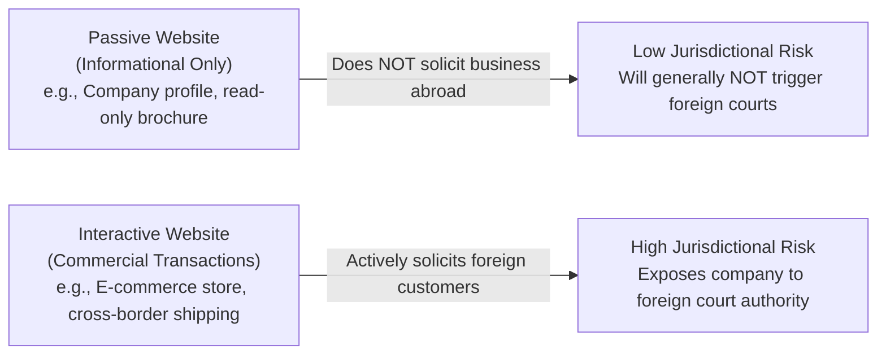

> [!example] Landmark Precedent: Yahoo! v. France (2000)
> French anti-racism organizations sued Yahoo! in a Paris court because French citizens could access auctions of Nazi memorabilia hosted on Yahoo!'s US servers. Although Nazi memorabilia sales were fully protected in the US under the First Amendment, the French court ruled that because the content **reached French territory**, French criminal law applied. Yahoo! was ordered to deploy IP-filtering to block French users, demonstrating that **courts assert jurisdiction where online content produces harm, not merely where the server is physically housed**.

### Enforcement Hurdles in International Cybercrime
1. **Jurisdiction Shopping**: Sophisticated cybercriminals deliberately locate command infrastructure in states with nonexistent cyber laws, weak extradition treaties, or corrupted law enforcement.
2. **Deficits in Technical Forensics**: Many local policing units lack trained forensic examiners capable of establishing unbroken chains of digital custody.
3. **Forensic Anti-Detection**: Criminals systematically route traffic through bulletproof VPN chains, use anonymizing networks (Tor), wipe server logs, and use ephemeral memory exploits, eliminating evidentiary audit trails.

---

# Topic 3: Computer Crime and Computer Network Security

## 3.1 Computer Crime vs. Cybercrime

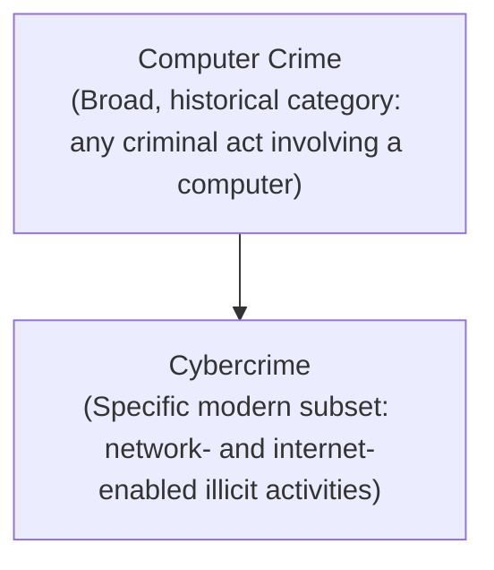

- **Core Difference**: Every cybercrime is a computer crime, but not every computer crime is a cybercrime. Computer crime encompasses offline physical hardware sabotage and early mainframe abuse predating the ARPANET/Internet. Cybercrime represents the internet-era evolution of these offenses.

### Statutory Prohibitions in Computer Crime Legislation
Computer crime legislation universally criminalizes unauthorized acts across five domains:
1. **Improper Access**: Gaining entry into a computer system or network without lawful authority.
2. **Data Offences**: Altering, damaging, deleting, copying, or exfiltrating proprietary records without permission.
3. **Introducing Malware**: Knowingly injecting viruses, worms, or Trojan code into computing infrastructure.
4. **Fraud and System Interference**: Using computers to orchestrate deception or deliberately disrupting service availability.
5. **Identity & Service Theft**: Forging electronic transmission headers, impersonating credentials, or siphoning paid cloud/network bandwidth.

### The Legislative Transition: Computer Crimes Act 1997 vs. Cybercrimes Bill 2026

> [!important] Crucial Legal Update for Examinations
> - **Law Currently in Force**: The **Computer Crimes Act 1997 (Act 563)** remains the governing statute on hacking and computer misuse in Malaysia today.
> - **Upcoming Replacement**: In **July 2026**, Parliament passed the **Cybercrimes Bill 2026** through both houses (*Dewan Rakyat* and *Dewan Negara*). It is currently awaiting **Royal Assent** from the Yang di-Pertuan Agong and official publication in the **Gazette** to set its formal commencement date.
> - **Why Replace It?**: The 1997 Act is nearly 30 years old and lacks explicit statutory definitions for modern online phenomena such as **identity theft, AI-assisted exploitation, deepfake manipulation, and cloud infrastructure sabotage**.

---

## 3.2 The Nine Faces of Cybercrime

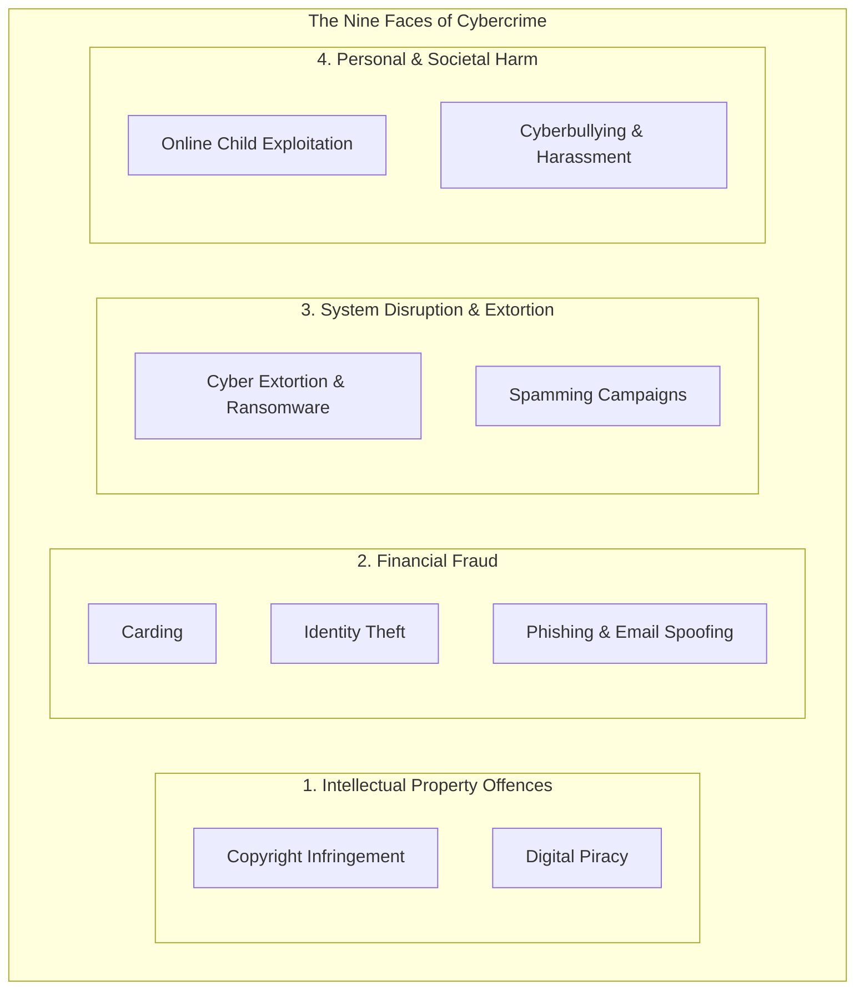

### Comprehensive Breakdown

1. **Copyright Infringement**:
   - Unauthorized reproduction, public distribution, or modification of legally protected intellectual property (e.g., sharing unauthorized textbook PDFs, mirroring proprietary digital artwork).
2. **Online Child Pornography & Exploitation**:
   - Visual depictions of minors engaged in sexually explicit conduct. 
   - *Universal Criminality*: Unlike adult pornography laws which vary by jurisdiction, child sexual abuse material is universally illegal worldwide.
   - *Malaysian Statute*: Under the *Sexual Offences Against Children Act 2017*, the entire operational chain is criminalized: **producing, sharing, buying, exchanging, selling, possessing, and even merely accessing** such material.
3. **Digital Piracy**:
   - Unauthorized illicit duplication and commercial syndication of copyrighted audio, video games, cracked software, and unauthorized video streams.
4. **Cyber Extortion (Ransomware)**:
   - Leveraging digital disruption or malicious access to extort ransom payments.
   - Attackers deploy cryptographic ransomware to encrypt entire enterprise databases or threaten public leakage of exfiltrated records unless cryptocurrency is paid.
5. **Identity Theft**:
   - Unlawfully acquiring and exploiting an individual's personal identifiers (IC number, banking credentials, biometric data) to obtain fraudulent loans, deplete bank balances, or evade criminal detection.
6. **Phishing & Email Spoofing**:
   - Using deceptive emails with forged transmission headers to trick recipients into revealing passwords, credit card numbers, or MFA tokens.
   - *Inspection Safeguards*: Scrutinizing domain sender headers for subtle misspellings, identifying manufactured emotional urgency ("Act immediately or be arrested"), inspecting hyperlink target URLs via hovering, and verifying generic greetings.
7. **Spamming**:
   - Automated mass distribution of unsolicited, irrelevant electronic messages used as a primary carrier vector for phishing URLs, malware payloads, and fraudulent scams.
8. **Carding**:
   - Trafficking and executing fraudulent transactions using stolen credit card credentials (primary account number, expiration date, CVV code, and billing ZIP).
9. **Cyberbullying**:
   - Deliberate, repetitive online harassment, doxxing, or character defamation across social networks and gaming forums intended to induce emotional trauma and psychological distress.

---

## 3.3 Security Threats: Viruses, Worms, and Trojans

All three represent forms of **malware** (malicious software), yet each operates on distinct technical mechanisms:

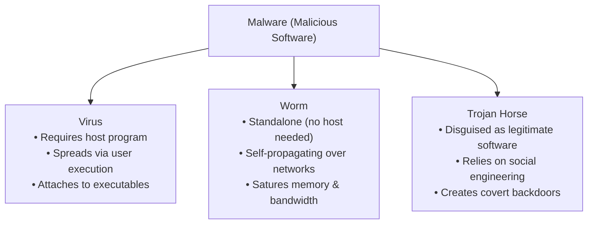

### Malware Comparison Table

| Feature | Computer Virus | Computer Worm | Trojan Horse |
| :--- | :--- | :--- | :--- |
| **Host Program Requirement** | **Yes**: Must attach to an executable file or document macro | **No**: Standalone, independent executable code | **No**: Standalone program disguised as a harmless/useful tool |
| **Replication Mechanism** | Replicates by injecting its code into other local programs | Replicates automatically and exponentially across networks | **Does not self-replicate**; relies on users downloading/installing |
| **Transmission Vector** | Shared files, infected USB flash drives, email attachments | Exploits unpatched network port/daemon vulnerabilities | Phony utility downloads, cracked games, disguised attachments |
| **Primary Operational Impact** | File corruption, operating system crash, data destruction | Severe bandwidth consumption and memory exhaustion | Provides backdoor control, data exfiltration, system surveillance |
| **Memory Hook** | **The Passenger** (needs a vehicle) | **The Driver** (travels autonomously) | **The Gift** (Greek horse hiding soldiers) |

### Notable Historical Virus Case Studies
- **Brain Virus (1986)**: The first IBM PC-compatible virus, created by two Pakistani brothers (Basit and Amjad Farooq Alvi) to track illegal copies of medical software. It infected 360KB floppy disk boot sectors. Though technically non-malicious (displaying a copyright notice), it proved that self-replicating code could spread across the globe.
- **Michelangelo Virus (1991)**: Designed to trigger every year on March 6 (artist Michelangelo's birthday). It overwrote critical master boot records and FAT file systems on an estimated **two million PCs worldwide**, causing irrecoverable data loss.
- **Melissa Macro Virus (1999)**: Written by David L. Smith as a Microsoft Word macro. Upon opening, it hijacked Microsoft Outlook to blast copies of itself to the first **50 contacts** in the victim's address book, infecting over **100,000 corporate and military computers** within its first week. Smith was apprehended and sentenced to **20 months in federal prison** and a **$5,000 fine**.

---

## 3.4 Unauthorised Access, Hacking & Statutory Penalties

> [!info] Legal Essence of Hacking
> Hacking is legally defined as **unauthorised access** to a computer system or network. The exact same technical keystrokes (running a penetration test script) are fully legal when authorized by contract, but constitute a serious crime when executed without permission.

### The Hacker Ethics
A historical cultural norm within computing subcultures holding that information, source code, and computing access should be freely accessible and shared collectively. While hacker ethics fostered collaborative breakthroughs (and the open-source movement), it provides **zero legal defense** against criminal charges of unauthorized intrusion.

> [!example] Real-World Case: EasyJet Cyberattack (May 2020)
> Attackers compromised the systems of budget carrier EasyJet, gaining access to the personal travel itineraries of **9 million customers** and the full credit card records (including CVV security codes) of over **2,000 passengers**. The airline discovered the breach in January but required four months to determine its scope, highlighting the severe commercial and regulatory repercussions of unauthorized network access.

### The Hacker Classification Spectrum

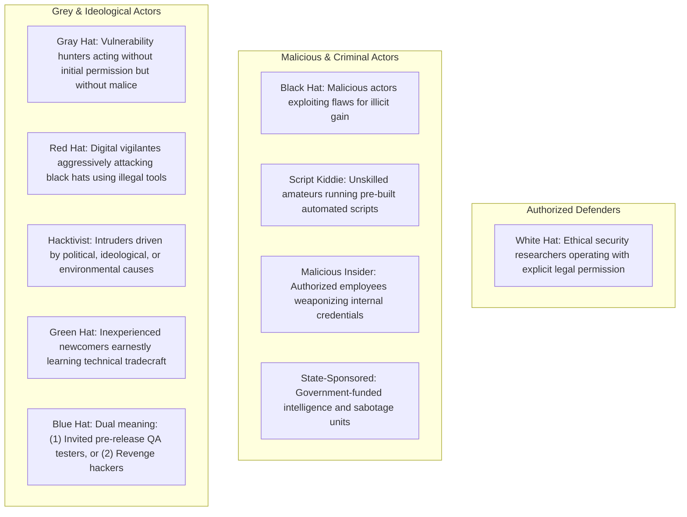

### Statutory Penalties under the Computer Crimes Act 1997

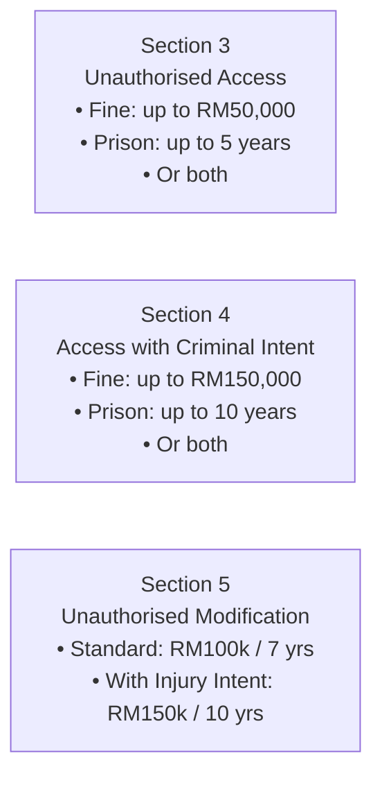

| Section | Offense Description | Maximum Fine | Maximum Imprisonment |
| :--- | :--- | :--- | :--- |
| **Section 3** | Unauthorised access to computer material (basic hacking/intrusion) | **RM 50,000** | Up to **5 years**, or both |
| **Section 4** | Unauthorised access with intent to commit or facilitate a further criminal offense (e.g., fraud, extortion) | **RM 150,000** | Up to **10 years**, or both |
| **Section 5** | Unauthorised modification of computer contents (tampering, data wiping, ransomware) | **RM 100,000** | Up to **7 years**, or both |
| **Section 5 (Aggravated)** | Unauthorised modification committed with intent to cause physical injury or damage | **RM 150,000** | Up to **10 years**, or both |
| **Section 6** | Wrongful communication of passwords, access codes, or decryption keys | Discretionary statutory penalty | Fines and imprisonment |

---

## 3.5 Cyberterrorism and Denial of Service (DoS/DDoS) Attacks

> [!info] Cyberterrorism
> The premeditated use of disruptive cyberattacks by recognized terrorist entities against computers, networks, and public critical infrastructure to generate mass fear, physical destruction, or systemic collapse in furtherance of political, religious, or ideological objectives.

### Denial of Service: Accidental Outage vs. Malicious Attack
- **Natural / Accidental Failure**: Web servers display `404 Not Found` or `503 Service Unavailable` when an unexpected surge of legitimate users simultaneously overwhelms server bandwidth or database connection pools (e.g., concert ticket drops, exam result releases).
- **Deliberate DoS Attack**: Malicious actors deliberately forge millions of fraudulent network packets to artificially overwhelm server memory, connection sockets, or bandwidth. The target server collapses because it cannot distinguish between valid user requests and forged attack packets.

### DoS vs. DDoS Architecture

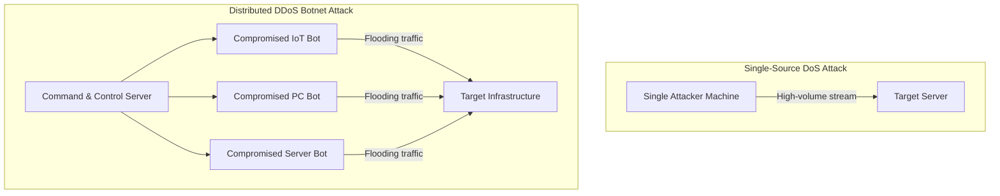

- **DoS (Denial of Service)**: Single attack vector originating from a single IP address/host; relatively straightforward to mitigate by blocking the offending IP address at the firewall.
- **DDoS (Distributed Denial of Service)**: Coordinated, distributed attack utilizing a botnet of thousands of geographically dispersed, compromised zombie hosts (PCs, IoT smart cameras, routers). Mitigating DDoS is difficult because incoming traffic appears from thousands of unique, legitimate IP addresses worldwide.

### Specialized Volumetric Attack Topologies
1. **Smurf Attack (ICMP Amplification)**:
   ```mermaid
   sequenceDiagram
       autonumber
       actor Attacker
       participant Broadcast as Intermediate Broadcast Network (Amplifier)
       actor Target as Target Victim Server
       
       Attacker->>Broadcast: Send ICMP Echo Request (Ping)<br>[SPOOFED Source IP = Target's IP]
       Note over Broadcast: Broadcasts packet to ALL nodes in network
       Broadcast->>Target: 100s of ICMP Echo Replies flood victim simultaneously!
       Note over Target: Target bandwidth & CPU exhausted
   ```
   - The attacker transmits ICMP Echo Request (ping) packets to a network broadcast address, spoofing the source IP address to match the target victim.
   - Every node on the broadcast amplifier network responds by sending an ICMP Echo Reply directly to the unsuspecting target, amplifying traffic hundreds of times and inducing immediate system paralysis.
2. **Email Bombing**: Flooding an organization's mail gateway with massive volumes of automated messages to fill disk quotas, crash mail transfer agents, and halt corporate communication.
3. **Worm Flooding**: Releasing aggressive, fast-propagating worms whose automated propagation consumes entire network backbones.
4. **Data Exfiltration alongside Disruption**: Blinding security operations center (SOC) analysts with a loud volumetric DDoS smoke screen while quietly exfiltrating sensitive database records through an alternate pathway.

### Multi-Layered Organizational Defense Strategies

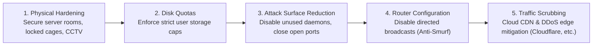

1. **Physical Infrastructure Hardening**: Restricting physical access to server rooms, wiring closets, and emergency power supplies to prevent physical tampering.
2. **Disk Quota Enforcement**: Implementing strict operating-system-level disk storage ceilings to stop rogue processes or email bombs from exhausting available disk space.
3. **Attack Surface Reduction**: Auditing and terminating unused services, background daemons, and open ports; every active listening port represents a potential attack gateway.
4. **Anti-Smurf Network Configuration**: Disabling IP-directed broadcasts on edge routers and firewalls, eliminating the ability of external attackers to weaponize local network subnets as broadcast amplifiers.
5. **Upstream Rate Limiting & Edge Scrubbing**: Deploying Web Application Firewalls (WAF) and Anycast DNS routing networks to inspect and absorb anomalous traffic surges before they hit core servers.

---

## 3.6 Quick Revision Checklist & Self-Test Questions

> [!tip] Quick Revision Self-Test
> Verify your exam readiness across the three topics with these key questions:

- [ ] **Q1**: What is the key distinction between a computer virus and a computer worm?
  - *Answer*: A virus requires an executable host program and human execution to spread; a worm is an independent, standalone program that replicates autonomously across computer networks.
- [ ] **Q2**: Which legal statute currently governs hacking in Malaysia, and what is the status of the Cybercrimes Bill 2026?
  - *Answer*: The *Computer Crimes Act 1997* is the law in force today. The *Cybercrimes Bill 2026* passed both houses of Parliament in July 2026 and is awaiting Royal Assent and gazetting before replacing it.
- [ ] **Q3**: What are the statutory maximum penalties under Sections 3, 4, and 5 of the Computer Crimes Act 1997?
  - *Answer*: Section 3: RM50,000 / 5 yrs; Section 4: RM150,000 / 10 yrs; Section 5: RM100,000 / 7 yrs (RM150,000 / 10 yrs if intending physical injury).
- [ ] **Q4**: What are the two cryptographic ingredients required to construct a digital signature, and which key is used for signing?
  - *Answer*: A cryptographic hash function and asymmetric key pair. Signing is performed using the signer's **private key**; verification is performed using the signer's **public key**.
- [ ] **Q5**: Name the four documents that cannot be executed via digital signatures under Malaysia's Digital Signature Act 1997.
  - *Answer*: Powers of Attorney, Wills and Codicils, Trusts, and Negotiable Instruments.
- [ ] **Q6**: What three grounds must a complainant prove to prevail in a MYNIC domain dispute?
  - *Answer*: (1) The domain is identical or confusingly similar to their trademark; (2) The respondent has no legitimate rights or interests; and (3) The domain was registered and used in bad faith.
- [ ] **Q7**: In Malaysia's dual legal system, what constitutional rule resolves conflicts between federal and state laws?
  - *Answer*: **Article 75 of the Federal Constitution**: Federal law prevails over inconsistent state enactments, including Syariah laws.
- [ ] **Q8**: What is a Smurf attack, and how is it mitigated at the router level?
  - *Answer*: An amplification attack sending ICMP echo requests with spoofed victim IP addresses to an IP broadcast network; mitigated by disabling directed broadcasts on routers.

---

# Topic 4: Intellectual Property (IP)

## 4.1 Nature of Intellectual Property & Core Principles

> [!info] Definition: Intellectual Property (IP)
> **Intellectual Property (IP)** encompasses creations of the human mind that possess commercial or economic value. It represents intangible property rights protecting unique expressions, ideas reduced to material form, industrial designs, technical inventions, and commercial identifiers.
> 
> *Core Principle*: The protected asset is the underlying **intangible creation or idea**, not the physical medium carrying it. Deleting an MP3 file does not destroy the musical composition, nor does smashing a smartphone extinguish the patent rights in its processor.

### Physical Property Theft vs. Intellectual Property Theft

The fundamental economic difference between physical property and intellectual property lies in **rivalry in consumption**:

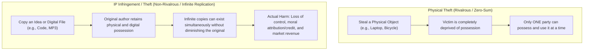

| Dimension | Physical Property (Tangible) | Intellectual Property (Intangible) |
| :--- | :--- | :--- |
| **Rivalry** | **Rivalrous**: Consumption by one diminishes availability for others. | **Non-Rivalrous**: Infinite reproduction does not deplete the source. |
| **Possession After Theft** | The owner loses physical custody and use. | The author still possesses the file/idea, but loses exclusive control. |
| **Nature of Harm** | Tangible deprivation, physical replacement cost. | Deprivation of statutory monopoly, commercial royalties, and attribution. |
| **Marginal Cost of Duplication** | High: Materials, manufacturing, shipping ($MC > 0$). | Approaching zero: Digital transmission takes milliseconds ($MC \approx 0$). |

### The Core Tension in Intellectual Property Law

All intellectual property legislation navigates a delicate social compromise:

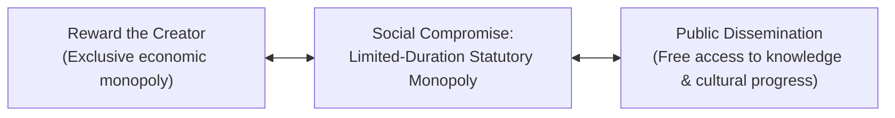

1. **Incentivizing the Creator**: Developing the **first copy** involves massive upfront investments in time, research, capital, and mental effort (e.g., a pharmaceutical compound or AAA video game costs millions). Without an exclusive right to recoup capital and earn a profit, creators have little incentive to innovate.
2. **Promoting Social Progress**: Knowledge, science, and cultural works benefit humanity most when widely shared, studied, and built upon. Permanent monopolies would stifle future innovation.
3. **The Legal Compromise**: Society grants the creator an **exclusive monopoly for a strictly limited time**. Once the term expires, the creation passes into the **Public Domain**, allowing anyone to freely utilize, build upon, or distribute it.

### Four Primary Avenues of IP Commercialization

An intellectual property holder can convert ownership into income through four primary pathways:
1. **Direct Manufacturing & Sale**: Fabricate and sell the invention directly through your own manufacturing and retail operations.
2. **Licensing for Royalties**: Grant contractual permission to third parties to manufacture or distribute the asset in exchange for recurring **royalties** (a fixed percentage or fee per unit sold).
3. **Outright Assignment / Sale**: Permanently sell all intellectual property rights to another entity for a lump-sum acquisition fee.
4. **Market Differentiation & Competitive Advantage**: Maintain exclusive deployment of the proprietary asset to elevate product quality, strengthen brand barriers, and command premium pricing.

---

## 4.2 Copyright Protection & Statutory Exclusive Rights

> [!info] Definition: Copyright
> **Copyright** is the exclusive legal bundle of rights granted to creators of original literary, musical, dramatic, artistic, and digital works (including computer software) to control how their work is reproduced, distributed, displayed, and adapted.
> 
> *Automatic Protection Principle*: Under the Berne Convention and Malaysia's *Copyright Act 1987*, copyright protection is **automatic upon creation and fixation in a material form**. Registration is **not mandatory**, and the omission of the copyright notice symbol ($\textcopyright$) does not invalidate copyright ownership.

### The Five Exclusive Economic Rights

Copyright vests the owner with the exclusive authority to authorize or prohibit five primary activities:

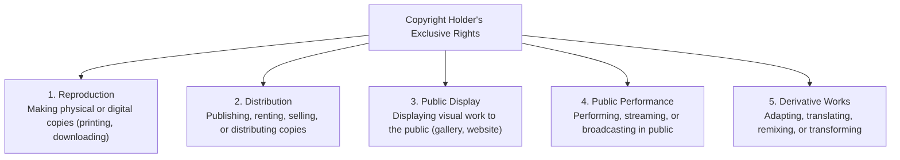

1. **Reproduction**: Copying the work in any material form (e.g., burning code onto storage, photocopying a book).
2. **Distribution**: Disseminating copies to the public via commercial sale, rental, or file distribution.
3. **Public Display**: Displaying an artistic work, UI layout, or graphic publicly.
4. **Public Performance**: Playing music or broadcasting films in public venues. In Malaysia, collective management organizations collect royalties on behalf of rights holders:
   - **MACP (Music Authors' Copyright Protection)**: Collects royalties on behalf of songwriters, lyricists, and composers.
   - **PPM (Public Performance Malaysia)**: Collects licensing fees on behalf of recording artists and record labels.
5. **Derivative Works**: Creating a transformative new work based directly upon the pre-existing copyrighted work:
   - *Examples*: A TV drama or webtoon adapted from a novel; a video game based on a feature film; a language translation of a technical manuscript; a musical remix or software fork.

### Statutory Duration of Copyright Protection

| Work Category | Statutory Duration (Malaysia *Copyright Act 1987*) |
| :--- | :--- |
| **Literary, Musical, and Artistic Works** (including software source code) | **Life of the Author + 50 Years** post-mortem (measured from the end of the calendar year of death). |
| **Published Editions, Sound Recordings, Films, and Photographs** | **50 Years** from the date of first publication or creation. |
| **Public Domain Transition** | Once statutory protection expires, the work enters the **Public Domain**, permitting unrestricted copying, modification, and commercialization without authorization or royalties. |

### Copyright Infringement & Liability Allocation

> [!warning] Common Mistake: "I Didn't Know" or "My Boss Ordered It"
> In copyright litigation, ignorance or employer instructions do not provide an absolute legal defense. Liability extends across the entire execution chain:
> 1. **Direct Infringer**: The specific employee, graphic designer, or software developer who copied or incorporated unlicensed assets.
> 2. **Supervisors and Managers**: Managers and project leads who authorized, directed, or negligently failed to supervise the infringing activity.
> 3. **The Corporate Entity**: The corporate enterprise whose commercial products, services, or websites commercially exploit the infringing content.
> 4. **Publishers and Distributors**: Media platforms, printing presses, or hosting providers that reproduce or broadcast the material, even without malicious intent.

---

## 4.3 The Fair Use Doctrine & Four-Factor Balancing Test

> [!info] Definition: Fair Use / Fair Dealing
> **Fair Use** (in US jurisprudence) and **Fair Dealing** (under Section 13(2) of Malaysia's *Copyright Act 1987* and UK law) is a legal defense and exception permitting limited use of copyrighted material without prior authorization or license fees.
> 
> *Core Principle*: Fair Use is **not an automatic entitlement**, but a **balancing test** evaluated holistically across four statutory factors.

### The Four-Factor Balancing Test

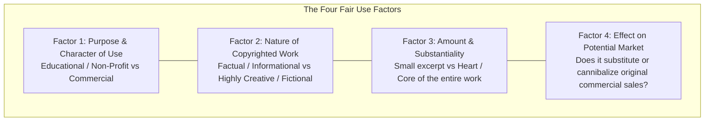

1. **Purpose and Character of the Use**: Non-profit educational study, scholarship, criticism, and parody lean heavily in favor of fair use; commercial exploitation or monetization weighs sharply against it.
2. **Nature of the Copyrighted Work**: Copying purely factual, technical, or informational content (e.g., scientific reports, statistical charts) leans toward fair use more readily than copying highly creative, fictional works (e.g., novels, musical compositions, movies).
3. **Amount and Substantiality Taken**: Copying a tiny excerpt or isolated paragraph leans toward fair use; copying the entire work or extracting the qualitative "heart" of the work weighs heavily against it.
4. **Market Effect (The Economic Factor)**: Does the unauthorized copy substitute for the original work in the marketplace? If prospective buyers download or consume the copy instead of purchasing the original, this factor cuts decisively against fair use.

### Practical Scenarios: Fair Use Applied

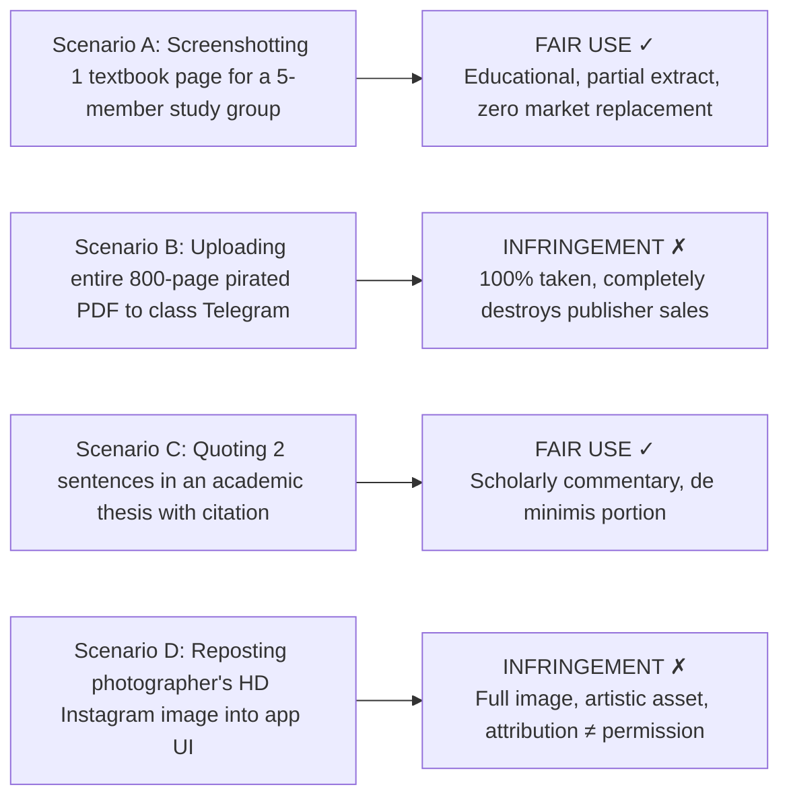

> [!tip] Extra Notes: Attribution vs. Permission
> A widespread misconception among computer science students is that appending an author citation or photo credit excuses copyright infringement. **Credit is an ethical requirement, not a legal license**. Attributing a photographer while publishing their uncredited photo in a commercial application remains actionable copyright infringement.

### Statutory Exceptions to Copyright (Fair Dealing Scenarios)
Under Malaysian law, explicit statutory exemptions where authorization is unnecessary include:
1. **Non-Profit Research & Private Study**: Short excerpts copied strictly for individual educational research.
2. **Criticism, Review, or Parody**: Utilizing illustrative clips or quotes to critique, evaluate, or satirize an original work.
3. **Reporting Current Events**: Brief news broadcasts or articles displaying relevant portions of work in reporting breaking news.
4. **Judicial Proceedings & Statutory Enquiries**: Reproducing documents as evidence in court hearings or legal advisory proceedings.

---

## 4.4 Artificial Intelligence & Copyright: The Generative AI Frontier

The rapid ascendancy of Generative AI has ignited profound legal and ethical clashes between foundation model developers and copyright holders:

```mermaid
sequenceDiagram
    autonumber
    actor Creator as Content Creators (Artists / Photographers)
    participant Scraper as AI Web Crawler & Dataset Curators
    participant Training as Neural Network (Model Training)
    actor EndUser as End User Prompting AI
    
    Creator->>Scraper: Original copyrighted works published online
    Scraper->>Training: Millions of images/texts scraped without consent
    Note over Training: Compresses statistical patterns into model weights (θ)
    EndUser->>Training: "Generate image in artist's style"
    Training->>EndUser: Synthetic image generated<br>(Cannibalizes human creator's commercial commissions!)
```

### Landmark Case Study: *Getty Images (US) Inc. v. Stability AI Ltd.* (UK High Court, 2025)

In one of the most consequential AI IP disputes to date, stock photography giant Getty Images sued Stability AI (creator of the open-source Stable Diffusion diffusion model):

```mermaid
flowchart TD
    Lawsuit["Getty Images v. Stability AI<br>(UK High Court, Nov 2025)"]
    Lawsuit --> Claim1["Claim 1: Copyright Infringement<br>AI model weights constitute an illegal infringing copy of scraped photos"]
    Lawsuit --> Claim2["Claim 2: Trademark Infringement<br>Generated outputs reproduced visible, garbled Getty Images watermarks"]
    
    Claim1 --> Ruling1["Ruling: FAILED (Nov 2025)<br>Neural network weights are mathematical parameters (θ), not bitwise stored copies. Model does not 'contain' the photos."]
    Claim2 --> Ruling2["Ruling: SUCCESS<br>Stability liable for trademark infringement where visible watermarks misled viewers regarding origin."]
    
    Ruling1 --> Appeal["Dec 2025: UK Court of Appeal grants Getty permission to appeal core copyright issues."]
```

- **The Copyright Argument**: Getty asserted that the latent weights of the diffusion model constituted an infringing digital compilation of millions of copyrighted images.
- **The Judicial Finding**: The High Court held that model weights are **numerical parameters capturing latent statistical associations**, not stored digital facsimiles of the underlying training images. Because the images themselves are not housed inside the weights, the direct copyright storage claim failed.
- **The Trademark Finding**: Getty prevailed on a narrow trademark infringement count because early iterations of Stable Diffusion generated hallucinations of the distinctive Getty watermark on synthetic photos, creating trademark confusion.
- **Ethical Takeaway**: While model training may escape literal reproduction claims in some jurisdictions, the **market substitution effect** (Factor 4 of Fair Use) severely harms creators whose distinct artistic styles are mimicked at zero marginal cost.

---

## 4.5 Trade Secrets & Confidential Business Information

> [!info] Definition: Trade Secret
> A **Trade Secret** comprises confidential, proprietary business information that confers an enterprise a distinct **competitive advantage** over rivals who do not possess or know it.
> 
> *Key Characteristics*:
> - Covers formulas, source code algorithms, chemical processes, customer lists, pricing heuristics, and supply chain designs.
> - Classic Examples: The secret formula for Coca-Cola, the KFC blend of 11 herbs and spices, Google's proprietary search ranking algorithms.

```mermaid
flowchart LR
    A["Proprietary Knowledge"] --> B{"Active Security Measures?<br>(NDAs, encryption, restricted access)"}
    B -- Yes --> C["Legally Protected Trade Secret<br>(No expiry; protected by silence)"]
    B -- No --> D["Public Domain / Unprotected<br>(Cannot enforce breach of confidence)"]
```

### Trade Secrets: Operational Principles
1. **Indefinite Duration**: A trade secret has **no statutory expiration date**. It remains protected for decades or centuries—so long as it remains confidential.
2. **Obligation of Reasonable Security**: Protection evaporates if the owner fails to implement reasonable safeguards (Non-Disclosure Agreements [NDAs], role-based access control, encrypted repositories).
3. **Legality of Reverse Engineering**: It is **entirely legal** for a competitor to buy a finished commercial product, dismantle it, analyze its components or code, and build a competing product based on those discoveries. Trade secret law prohibits only **unlawful misappropriation** (theft, industrial espionage, breach of confidence).

### Fatal Risks of Relying Exclusively on Trade Secrets

```mermaid
flowchart TD
    Risk1["1. Employee Leaks<br>Departing staff steal or disclose the secret"] --> Lawsuit["Lawsuit can punish, but CANNOT make the secret private again!"]
    Risk2["2. Independent Discovery<br>Rival discovers identical method legitimately"] --> Lawsuit
    Risk3["3. Rival Patents First<br>Competitor patents the invention, legally blocking the original inventor!"] --> Lawsuit
```

### Landmark Case Study: *Waymo LLC v. Uber Technologies, Inc.* (2017–2018)

```mermaid
sequenceDiagram
    autonumber
    actor AL as Anthony Levandowski (Waymo Lead Engineer)
    participant W as Google / Waymo (Autonomous Unit)
    participant O as Otto (Self-Driving Truck Startup)
    participant U as Uber Technologies, Inc.
    
    AL->>W: Downloads 14,000+ confidential CAD/LiDAR files
    AL->>O: Leaves Google and founds Otto
    U->>O: Uber acquires Otto for $680 Million; AL leads Uber AV
    W->>U: Waymo files federal lawsuit for trade secret misappropriation
    Note over W,U: 5 days into trial: Uber settles for 0.34% equity (~$245 Million)
    Note over AL: Levandowski criminally prosecuted: 18 months prison, $95k fine, $756k restitution
```

- **The Misappropriation**: Star engineer Anthony Levandowski downloaded over 9.7 gigabytes of proprietary trade secrets (including 14,000 files detailing Waymo's specialized LiDAR sensors) onto an external SSD before resigning.
- **The Acquisition**: Levandowski founded autonomous trucking startup Otto, which Uber acquired for approximately $680 million, placing Levandowski at the helm of Uber's self-driving division.
- **The Outcome**: Five days into the 2018 federal trial, Uber agreed to a settlement granting Alphabet a **0.34% equity stake in Uber (worth approximately $245 million)**.
- **Criminal Penalties**: Levandowski pleaded guilty to federal trade secret theft, receiving an 18-month prison sentence, a $95,000 fine, and an order to pay $756,000 in restitution (subsequently pardoned in January 2021).

### Comparison: Trade Secrets vs. Patents

| Dimension | Trade Secret | Patent |
| :--- | :--- | :--- |
| **Protective Philosophy** | **Protected by Silence & Secrecy** | **Protected by Public Disclosure** |
| **Statutory Duration** | Indefinite (as long as secrecy is maintained) | Strictly **20 Years** from date of filing |
| **Registration Required?** | No registration (filing would destroy secrecy) | Mandatory registration and examination by patent office |
| **Reverse Engineering** | **Permitted**: Legal if deduced from finished goods | **Prohibited**: Absolute monopoly prevents all use |
| **Cost** | Internal security & NDA enforcement costs | Substantial patent drafting, filing, and renewal fees |

---

## 4.6 Patents & Utility Innovation Framework

> [!info] Definition: Patent
> A **Patent** is an exclusive, state-sanctioned monopoly granted to an inventor for a limited period, conferring the right to exclude all others from manufacturing, using, importing, or selling the patented invention without permission.
> 
> *The Grand Bargain*: The state grants a temporary monopoly in direct exchange for **full public disclosure** of how the invention works, ensuring that technical knowledge enters the public domain upon patent expiration.

### The Three Mandatory Tests for Patentability

To qualify for patent grant under the *Patents Act 1983*, an invention must satisfy three cumulative criteria:

```mermaid
flowchart TD
    subgraph PatentTests ["The Three Patentability Tests"]
        T1["1. Novelty<br>Must be completely new worldwide; never disclosed, sold, or published prior to filing."]
        T2["2. Inventive Step (Non-Obviousness)<br>Must not be obvious to a Person Having Ordinary Skill in the Art (PHOSITA)."]
        T3["3. Industrial Applicability (Utility)<br>Must have practical utility and be capable of being made or used in an industry."]
    end
    T1 --- T2 --- T3
```

### Malaysia's Statutory Patent Term
- **Standard Patent**: Lasts for **20 years** from the official **date of filing**.
- **Uniform Application**: Unlike certain foreign jurisdictions that offer patent term extensions, Malaysia applies the 20-year term uniformly across all technical industries, including pharmaceuticals and biotechnology.

### Malaysia's Utility Innovation Certificate (UIC)

Recognizing that many local innovations represent practical, incremental enhancements that do not meet the stringent "inventive step / non-obviousness" threshold, Malaysian law provides the **Utility Innovation Certificate**:

```mermaid
flowchart LR
    Invention{"Does it have an inventive step (non-obvious)?"}
    Invention -- Yes --> StandardPatent["Standard Patent<br>(20 Years from filing)"]
    Invention -- No (Minor/incremental improvement) --> UIC["Utility Innovation Certificate (UIC)<br>10 Years Initial + 5 + 5 Years Extension<br>(Maximum 20 Years Total, subject to commercial use)"]
```

- **Definition**: Protects any innovation that creates a new or improved technical product or process, without requiring an inventive step.
- **Statutory Term**: **10 years** from filing date, extendable for two consecutive periods of **5 years each** (maximum 20 years total), conditioned upon demonstrating commercial working in Malaysia.

---

## 4.7 Trademarks, Passing Off & Brand Defense

> [!info] Definition: Trademark
> A **Trademark** is any distinctive sign, word, letter, numeral, logo, shape of goods, color combination, packaging, sound, or scent used in trade to distinguish the goods or services of one enterprise from those of competitors.
> 
> *Service Mark*: Functionally identical to a trademark, but identifies commercial **services** (e.g., Grab, Maybank, AirAsia) rather than tangible physical goods.

### The Common Law Tort of Passing Off

When an unregistered brand or established trader is mimicked by a rival, common law protects their business reputation via the tort of **Passing Off** ("no one has the right to represent their goods as the goods of somebody else"):

```mermaid
flowchart TD
    subgraph FiveElements ["Five Essential Requirements for Passing Off"]
        E1["1. Misrepresentation<br>A false impression created by the defendant"]
        E2["2. In the Course of Trade<br>Committed during active commercial operations"]
        E3["3. To Prospective Customers<br>Directed toward purchasers or end-users"]
        E4["4. Reasonably Foreseeable Injury to Goodwill<br>Damages the reputation and customer loyalty of the claimant"]
        E5["5. Actual or Probable Damage<br>Causes demonstrable financial loss (e.g., diverted sales)"]
    end
    E1 --> E2 --> E3 --> E4 --> E5
```

### Landmark Case Studies in Malaysian Trademark Law

#### 1. *McDonald's Corp. v. McCurry Restaurant (KL) Sdn. Bhd.* (2001–2025)

```mermaid
flowchart TD
    subgraph DisputeHistory ["The 24-Year Battle: Passing Off vs. Trademark Registration"]
        Phase1["2001: McDonald's sues small KL restaurant 'McCurry' for Passing Off"] --> Phase2["2009: Federal Court rules FOR McCurry!<br>- 'Mc' stood for Malaysian Chicken Curry.<br>- Distinctive Indian cuisine, different signage, different clientele.<br>- Zero reasonable likelihood of customer confusion. McDonald's pays costs."]
        Phase2 --> Phase3["2025: High Court Cancels McCurry's Registered Trademark!<br>- Governed by statutory registration rules under Trademarks Act.<br>- High Court ruled the mark should not remain on the official register."]
    end
```

> [!note] Crucial Distinction: Passing Off vs. Trademark Registration
> The *McCurry* saga illustrates the vital legal distinction between common law and statutory regimes:
> - **Passing Off** (Common Law) asks: *Are consumers in the real world actually being deceived or confused into buying the wrong product?* (McCurry won).
> - **Trademark Registration** (Statutory Law) asks: *Does the mark meet statutory distinctiveness criteria and avoid conflicting with prior registered marks on the official register?* (McCurry lost).

#### 2. *Ferrari S.p.A. v. Wee Power Marketing* (High Court, 2025)
- **The Lawsuit**: Italian luxury automotive manufacturer Ferrari sued Malaysian beverage distributor Wee Power, alleging its energy drink packaging featuring a rearing horse infringed Ferrari's globally famous "Prancing Horse" trademark.
- **The Judicial Ruling**: The High Court dismissed Ferrari's lawsuit, ruling that ordinary Malaysian consumers can readily differentiate an affordable canned energy drink from an ultra-luxury sports automobile. The goods belonged to entirely distinct commercial sectors, obviating market confusion.

### Genericide: When a Brand Becomes a Victim of its Own Success

> [!danger] Definition: Genericide
> **Genericide** occurs when a trademark becomes so universally accepted by the public as the common generic name for that category of product that it loses its distinctiveness, resulting in cancellation of the trademark.
> 
> *Historical Casualties*: Aspirin, Escalator, Thermos, Trampoline, Cellophane, Linoleum, and Xerox. In Malaysia, consumers frequently use **"Maggi"** to refer generically to instant noodles.

```mermaid
flowchart LR
    A["Unique Proprietary Brand Name<br>(e.g., 'Photoshop')"] 
    -->|"Public begins using brand as a common noun or verb"| B["Erosion of Distinctiveness<br>('to photoshop an image')"]
    -->|"Failure to enforce or correct misuse"| C["Court Declares Mark Generic<br>(Loss of exclusive legal ownership)"]
```

### Corporate Strategies to Prevent Genericide
1. **Insist on Adjective Usage**: Brands mandate that the trademark must always be used as an adjective modifying a generic noun, never as a noun or verb:
   - *Correct*: "Adobe $\text{\textregistered}$ Photoshop $\text{\textregistered}$ image-editing software"
   - *Incorrect*: "Can you photoshop this photo?" or "Send me the photoshop."
2. **Public Education & Legal Enforcement**: Corporate counsel actively send cease-and-desist warnings to publishers, dictionaries, and media outlets misusing the trademark as a common verb.
3. **The Google Ruling (*Elliott v. Google, Inc.*, 9th Cir. 2017)**: The US Federal Court affirmed that everyday verb usage ("google it") does not automatically invalidate a trademark, so long as consumers still understand Google as a specific, identifiable search engine service provider rather than a generic term for all search engines.

---

## 4.8 MyIPO & The Malaysian IP Legislative Framework

> [!info] Definition: MyIPO
> **MyIPO** (**Perbadanan Harta Intelek Malaysia** / Intellectual Property Corporation of Malaysia) is the statutory body under the Ministry of Domestic Trade and Cost of Living responsible for the registration, administration, and public awareness of intellectual property rights throughout Malaysia.

### The Six Primary Statutes Administered by MyIPO

```mermaid
flowchart TD
    MyIPO["MyIPO (Perbadanan Harta Intelek Malaysia)"]
    MyIPO --> L1["1. Trademarks Act 2019<br>Brand logos, trade names, slogans, non-traditional marks"]
    MyIPO --> L2["2. Patents Act 1983<br>Technical inventions (20 yrs) & Utility Innovations (10+5+5 yrs)"]
    MyIPO --> L3["3. Copyright Act 1987<br>Software code, literature, music, artistic & audiovisual works"]
    MyIPO --> L4["4. Industrial Designs Act 1996<br>Aesthetic shape, configuration, or ornamental pattern of articles"]
    MyIPO --> L5["5. Layout-Designs of Integrated Circuits Act 2000<br>Three-dimensional topographical configurations of microchips"]
    MyIPO --> L6["6. Geographical Indications Act 2000 / 2022<br>Goods originating from specific locales (e.g., Sarawak Pepper)"]
```

| Statute | Protected Subject Matter | Registration Requirement | Typical Duration |
| :--- | :--- | :--- | :--- |
| **Trademarks Act 2019** | Brand names, logos, package trade dress, sounds, scents | Mandatory registration with MyIPO | **10 years**, renewable indefinitely every 10 years |
| **Patents Act 1983** | Technological processes, machines, compositions of matter | Mandatory examination and grant | **20 years** from filing date |
| **Patents Act 1983 (UIC)** | Incremental practical inventions lacking inventive step | Mandatory examination and certificate | **10 + 5 + 5 years** (maximum 20 years) |
| **Copyright Act 1987** | Literary, software, musical, and artistic works | Automatic upon creation (voluntary notification optional) | **Life of author + 50 years** (or 50 years from publication) |
| **Industrial Designs Act 1996** | Visual aesthetic appearance, lines, colors, contours | Mandatory registration with MyIPO | **5 years**, renewable up to **25 years** total |
| **Layout-Designs of Integrated Circuits Act 2000** | Topography of semiconductor microchips | Protected automatically upon commercial fixation | **10 years** from commercial exploitation (or max 15 years from creation) |
| **Geographical Indications Act 2022** | Goods associated with geographic origin/qualities | Mandatory registration | **10 years**, renewable indefinitely |

### Practical IP Mapping for Computer Science Undergraduates

When developing a commercial technology product (e.g., a capstone mobile app called *"MakanNow"*):

```mermaid
flowchart TD
    App["Commercial Mobile Application Project<br>'MakanNow'"]
    App --> P1["Source Code & SQL Schemas<br>Protected automatically by COPYRIGHT"]
    App --> P2["App Name, Logo, & Visual App Icon<br>Protected via TRADEMARK (MyIPO Registration)"]
    App --> P3["Novel Algorithmic Routing Engine<br>Protected via PATENT (or Utility Innovation Certificate)"]
    App --> P4["Private Recommendation Algorithm & Database<br>Protected internally as TRADE SECRET (NDAs & Security)"]
```

---

## 4.9 Quick Revision Checklist & Self-Test Questions (Topic 4)

> [!tip] Quick Revision Self-Test
> Assess your comprehension of Topic 4 with these key exam-focused questions:

- [ ] **Q1**: What is the fundamental economic distinction between stealing a physical asset and infringing intellectual property?
  - *Answer*: Physical theft is rivalrous (zero-sum); the victim loses physical possession and use. IP infringement is non-rivalrous; infinite identical copies can be generated without depleting the original, harming the owner via loss of control, moral credit, and economic revenue.
- [ ] **Q2**: Is copyright registration mandatory in Malaysia to initiate an infringement action?
  - *Answer*: No. Under the Berne Convention and Malaysia's *Copyright Act 1987*, copyright is automatic upon creation in a material form. (Voluntary notification via MyIPO is available to facilitate evidence, but not legally required for protection).
- [ ] **Q3**: What are the four factors evaluated in the Fair Use / Fair Dealing balancing test?
  - *Answer*: (1) Purpose and character of the use (educational vs. commercial); (2) Nature of the copyrighted work (factual vs. creative); (3) Amount and substantiality taken; (4) Effect on the potential market value or sales of the original.
- [ ] **Q4**: In the 2025 UK High Court case *Getty Images v. Stability AI*, why did Getty's core copyright storage claim fail?
  - *Answer*: The court determined that neural network model weights consist of statistical mathematical parameters ($\theta$), not stored digital facsimiles of the training images. The AI model does not "house" or "store" copies of the training photos.
- [ ] **Q5**: Can an organization initiate legal action against a rival who legitimately reverse-engineers its trade secret?
  - *Answer*: No. Reverse engineering lawfully acquired commercial products is entirely legal. Trade secret law prohibits only unlawful misappropriation, theft, espionage, or contractual breach of confidence.
- [ ] **Q6**: What are the three statutory tests an invention must satisfy to receive a patent in Malaysia, and what is the patent term?
  - *Answer*: Novelty, Inventive Step (Non-Obviousness), and Industrial Applicability (Utility). The Malaysian patent term is strictly **20 years** from the date of filing.
- [ ] **Q7**: How does Malaysia's Utility Innovation Certificate (UIC) differ from a standard patent?
  - *Answer*: UIC protects minor, incremental improvements that do not meet the high "inventive step" bar. Its statutory duration is 10 years, extendable by two 5-year tranches to a maximum of 20 years, provided it is commercially worked.
- [ ] **Q8**: What five elements must be established to prevail in a common law passing off action?
  - *Answer*: (1) Misrepresentation; (2) Made by a trader in the course of trade; (3) To prospective customers; (4) Reasonably foreseeable injury to goodwill; and (5) Actual or probable commercial damage.
- [ ] **Q9**: Why did McCurry win its passing-off case against McDonald's in 2009, but have its trademark cancelled in 2025?
  - *Answer*: Passing off evaluated actual customer deception (consumers clearly distinguished the different cuisine, signage, and style), whereas the 2025 decision applied the statutory criteria of the *Trademarks Act* regarding official register entry and similarity bars.
- [ ] **Q10**: What is genericide, and how do brand owners defend against it?
  - *Answer*: Genericide occurs when a trademark becomes the generic term for an entire category of goods (e.g., Aspirin, Escalator, Maggi). Owners defend against it by insisting the mark be used exclusively as a capitalized adjective modifying a generic noun (e.g., "Photoshop software") and issuing legal notices against verb usage.

---

# Topic 5: Business Intellectual Property & Digital Ethics

## 5.1 IP Ownership, Employment Law & Contractor Rights

> [!info] Core Concept: The IP Ownership Dilemma
> When software is built, ownership is not determined solely by who typed the code. It is dictated by the **legal nature of the working relationship**, the **scope of duties**, and the **explicit terms of the employment contract**.

### Conception vs. Reduction to Practice

In technological development, invention divides into two distinct phases:

```mermaid
flowchart LR
    Conception["1. Conception<br>The mental formulation of a novel idea, algorithm, or system architecture."]
    --> Reduction["2. Reduction to Practice<br>Writing the actual code, constructing hardware, and building the functional codebase."]
    --> LegalRule["Legal Reality:<br>Ideas alone CANNOT be copyrighted.<br>Only the specific tangible expression or implementation is protected!"]
```

- **The Idea vs. Expression Dichotomy**: You cannot copyright the abstract concept of "a ride-hailing app" or "a social media feed". Anyone is legally free to build an application based on that concept. However, the specific source code, API schemas, and UI design assets created to implement it are protected by copyright.

### Landmark Precedent: *Apple Computer, Inc. v. Microsoft Corp.* (1994) & Xerox PARC

```mermaid
sequenceDiagram
    autonumber
    participant X as Xerox PARC (Alto Computer)
    participant A as Apple Computer (Lisa & Macintosh)
    participant M as Microsoft (Windows 2.03 / 3.0)
    
    X->>A: 1979: Apple inspects Xerox GUI in exchange for pre-IPO stock options
    A->>A: Apple releases Lisa & Macintosh using GUI elements
    X->>A: 1989: Xerox sues Apple; DISMISSED under statute of limitations
    A->>M: Apple sues Microsoft, claiming Windows copied the Mac 'look and feel'
    Note over A,M: 1994 Ruling: Overlapping windows and desktop icons are unprotectable ideas.<br>Copyright protects only specific artistic expression, not general UI metaphors!
```

- **The Legal Precedent**: The court ruled that general interface elements (such as overlapping windows, file icons, and drop-down menus) are unprotectable functional concepts under copyright law. A developer can adopt similar UX metaphors without infringement, provided they do not literally copy the graphics or underlying code.

### Types of Working Relationships: Contract OF Service vs. Contract FOR Service

```mermaid
flowchart TD
    Relationship{"What is the Working Relationship?"}
    
    Relationship -- "Contract OF Service (COS)" --> COS["Employee Relationship<br>- Salaried monthly payroll<br>- Employer directs hours & methodology<br>- Uses company-issued hardware & infrastructure<br>- DEFAULT: Employer automatically owns all IP!"]
    
    Relationship -- "Contract FOR Service (CFS)" --> CFS["Independent Contractor / Freelancer<br>- Paid on milestones, deliverables, or invoice<br>- Retains operational autonomy (how to do work)<br>- Supplies own equipment & tools<br>- DEFAULT: Contractor owns the IP unless explicitly assigned!"]
```

| Dimension | Employee (Contract OF Service) | Independent Contractor (Contract FOR Service) |
| :--- | :--- | :--- |
| **Default IP Ownership** | **The Employer** owns all IP created within the scope of employment. | **The Contractor** retains ownership unless a written contract transfers it. |
| **IP Transfer Mechanism** | **Automatic statutory vesting** (no separate assignment deed needed). | **Requires an explicit, written IP Assignment Clause**. |
| **Equipment & Tools** | Supplied and maintained by the enterprise. | Self-provided by the contractor/freelancer. |
| **Supervision & Control** | High direct supervision over manner and hours of work. | Low supervision; evaluated strictly on final deliverable. |

> [!warning] Critical Corporate Pitfall: Paying Does Not Equal Ownership
> A pervasive mistake among tech startups is assuming that paying an invoice to a freelance developer or software house transfers copyright. Under copyright law, **payment alone does not transfer copyright ownership**. Without an explicit, signed **IP Assignment Clause**, the contractor legally owns the source code and could license it to your competitors.

### The Role of Company Resources in IP Ownership Disputes

```mermaid
flowchart TD
    Scenario{"Under What Conditions Was the Code Written?"}
    
    Scenario -- "Scenario A" --> SA["Employed as Developer + Uses company laptops/servers<br>→ 100% Employer-Owned"]
    Scenario -- "Scenario B" --> SB["Employed in unrelated role (QA) + Built at home on personal gear<br>→ Employee-Owned (if outside company business scope)"]
    Scenario -- "Scenario C" --> SC["Non-R&D staff + Uses company servers, datasets, or work hours<br>→ Employer claims full ownership OR Shop-Rights!"]
```

> [!info] Definition: Shop-Right
> A **Shop-Right** is a common-law non-exclusive, royalty-free, non-transferable license granted to an employer to utilize an employee's personal invention within the company's business, arising when the employee used company time, facilities, materials, or data to develop it.

---

## 5.2 Co-Ownership, Assignment & Investor Due Diligence

### Joint Inventions & Co-Ownership Rules

When two or more developers contribute significantly to the inventive concept of an IP asset:

```mermaid
flowchart LR
    subgraph CoOwnership ["Co-Ownership Rules"]
        CO1["Independent Commercial Working<br>A co-owner may use or manufacture the asset without consent or paying royalties to peers (varies by country)."]
        CO2["Exclusive Licensing Restriction<br>Granting an EXCLUSIVE license to a third party requires UNANIMOUS consent of all co-owners."]
        CO3["Whole Assignment<br>A co-owner can sell their entire ownership share (e.g., 50%) to an outsider without peer consent."]
        CO4["Partial Assignment<br>Dividing or selling a fractional slice of their share requires mutual consent of all co-owners."]
    end
```

### Investor Due Diligence & Clean Chain-of-Title

When tech startups seek Venture Capital (VC) funding or an Initial Public Offering (IPO), investors perform exhaustive **IP Due Diligence**:

```mermaid
flowchart TD
    VC["Venture Capital Investors"] --> DD["Due Diligence Audit"]
    DD --> Check1["1. Chain-of-Title Audit<br>Verify unbroken legal paper trail connecting every commit to the company."]
    DD --> Check2["2. PIIA Verification<br>Ensure every past and present employee signed an Invention Assignment agreement."]
    DD --> Check3["3. Contractor Assignments<br>Verify explicit copyright assignment in all external agency contracts."]
    DD --> Check4["4. Open-Source Dependency Scan<br>Ensure no viral copyleft (GPL) code infects proprietary repositories."]
    
    Check1 & Check2 & Check3 & Check4 --> Result{"Clean IP Paper Trail?"}
    Result -- Yes --> Fund["Funding Approved / Acquisition Completed"]
    Result -- No --> Terminate["Deal Cancelled or Valuation Slashed (Litigation Risk)"]
```

### Landmark Case Study: *ConnectU v. Facebook* (2004–2008)

```mermaid
sequenceDiagram
    autonumber
    participant W as Winklevoss Twins & Divya Narendra (ConnectU)
    participant Z as Mark Zuckerberg
    participant F as TheFacebook / Facebook, Inc.
    
    W->>Z: Hire Zuckerberg to complete code for HarvardConnection (ConnectU)
    Note over W,Z: Oral understanding and informal emails; NO formal signed IP assignment!
    Z->>F: Zuckerberg delays ConnectU project; launches TheFacebook independently
    W->>F: ConnectU sues Facebook for copyright infringement, trade secret theft, and breach of contract
    Note over W,F: 2008 Settlement: Facebook pays $20M in cash + 1.25M Facebook shares (~$65M total at the time, later worth billions)
```

- **The Core Lesson**: Informal understandings and handshake agreements among university students create existential legal risks. Formal written contracts specifying IP ownership must precede any software development.

### Developer Pre-Signing Checklist
Before accepting a software engineering position or launching a side project:
1. **Read the PIIA (Proprietary Information and Inventions Agreement)**: Examine the scope of inventions assigned to the company. Does it claim everything you build, or only projects related to the employer's business?
2. **Scrutinize Moonlighting Clauses**: Ensure contract provisions permit working on unrelated side projects during off-hours.
3. **Carve-Out Pre-Existing IP**: Explicitly list all pre-existing software projects, libraries, and open-source contributions in the contract exhibits prior to starting work.
4. **Air-Gap Hardware and Networks**: Never open, commit, test, or host personal side projects on company-issued laptops, cloud instances, or office Wi-Fi.

---

## 5.3 Digital Copyright, DRM & The Zero-Marginal-Cost Dilemma

### The Zero-Marginal-Cost Dilemma

```mermaid
flowchart TD
    subgraph AnalogEra ["Analog Media (Physical)"]
        A1["High Manufacturing Cost per Copy"] --> A2["Physical tape/paper consumption"]
        A2 --> A3["Generational loss (quality degrades with each copy)"]
    end

    subgraph DigitalEra ["Digital Media (Binary)"]
        D1["Zero Marginal Cost (MC ≈ 0)"] --> D2["Bitwise identical duplication in milliseconds"]
        D2 --> D3["Worldwide dissemination via broadband and P2P"]
    end
```

### Digital Fair Use: *Authors Guild, Inc. v. Google, Inc.* (2015)
- **The Initiative**: Google scanned over 20 million library books without prior publisher consent to create a comprehensive full-text searchable database.
- **The Snippet Defense**: Rather than providing the full text, search queries returned only brief "snippets" (isolated sentences surrounding the search term), alongside bibliographic data.
- **The Supreme Court Ruling**: The Second Circuit and US Supreme Court held Google's snippet search was **transformative fair use**. It created a revolutionary research locator that enhanced public access without substituting for book sales.

### The Modern Frontier: Generative AI Web Scraping
The digital copyright struggle has shifted from search snippets to large language models (LLMs) and image diffusion models:
- **The Tech Position**: Training an AI model on publicly accessible web data extracts statistical grammar and latent conceptual relationships, constituting transformative fair use analogous to *Google Books*.
- **The Creators' Position**: Scraped training generates commercial synthetic mimics that directly replace human artists and writers in the commercial market, failing Factor 4 of the Fair Use balancing test.

### Technological Response: Ex-Post Litigation to Ex-Ante Technical Prevention

```mermaid
flowchart LR
    ExPost["Ex-Post Legal Enforcement<br>(Suing infringers in court after copying has occurred)"]
    -->|"Ineffective against anonymous global internet distribution"| ExAnte["Ex-Ante Technical Prevention<br>(Digital Rights Management - DRM locks access before copying is possible)"]
```

### Digital Rights Management (DRM) Implementations

> [!info] Definition: Digital Rights Management (DRM)
> **DRM** refers to access-control technologies, encryption protocols, and hardware restrictions designed to regulate how digital content, software, and hardware can be accessed, viewed, copied, and modified.

1. **Encrypted Media Pipelines**: Technologies like **HDCP (High-bandwidth Digital Content Protection)** and **Google Widevine DRM** encrypt audio/video streams from the server to the display hardware. (This prevents screen recorders from capturing streaming movies, resulting in a black screen).
2. **Always-Online Licensing Checks**: Demands that single-player software games or productivity tools maintain continuous telemetry with remote authentication servers to validate licenses.
3. **Platform Ecosystem Walled Gardens**: Encrypting digital books, apps, or media so they function exclusively inside proprietary hardware or closed reader applications (e.g., Kindle, iOS App Store).

### Technical and Ethical Perils of DRM

```mermaid
flowchart TD
    DRM["Digital Rights Management (DRM)"]
    DRM --> P1["1. Fair Use Destruction<br>Automated cryptographic gates cannot distinguish illegal piracy from legitimate scholarship or parody."]
    DRM --> P2["2. Ownership Erosion<br>Purchasers receive a fragile, revocable digital license rather than true ownership of the asset."]
    DRM --> P3["3. Server Shutdown / Abandonware<br>When remote DRM auth servers go dark, paid games and e-books become permanently unplayable."]
    DRM --> P4["4. Anti-Competitive Lock-In<br>Traps consumers inside closed proprietary silos, penalizing switching to competing open platforms."]
```

> [!example] Case Study: The Abandonware Crisis (Video Game History Foundation, 2023)
> According to a 2023 study by the Video Game History Foundation, **87% of classic video games released in the United States before 2010 are out of print and commercially unavailable**. Because anti-circumvention provisions (such as Section 1201 of the US DMCA) make cracking DRM illegal even for historical preservation, vast swaths of digital cultural heritage face permanent technological extinction.

---

## 5.4 Peer-to-Peer (P2P) Architecture, BitTorrent & Legal Evolution

### The Ethics of Dual-Use Technologies

```mermaid
flowchart TD
    Tool["Dual-Use Technology (e.g., P2P Protocol, Kitchen Knife, Cryptography)"]
    Tool --> Good["Beneficial / Lawful Applications<br>- Distributing Linux ISOs<br>- Fast game patch delivery<br>- Open scientific dataset sharing"]
    Tool --> Bad["Harmful / Infringing Applications<br>- Distributing pirated films<br>- Unlicensed proprietary software<br>- Mass copyright evasion"]
    
    Good & Bad --> Ethics["Core Ethical Principle:<br>Technology itself is neutral. Ethical and legal culpability rests upon intent, architecture, knowledge, and profit!"]
```

### Architectural Contrast: Client-Server vs. Peer-to-Peer

```mermaid
flowchart TD
    subgraph ClientServer ["Client-Server Architecture"]
        Server["Centralized File Server"] --> C1["Client 1"]
        Server --> C2["Client 2"]
        Server --> C3["Client 3"]
        Note over Server: Server bears 100% of bandwidth cost.<br>Single point of failure and bottleneck!
    end

    subgraph P2PNet ["Peer-to-Peer (P2P) Architecture"]
        Node1["Peer 1 (Leecher / Seeder)"] <--> Node2["Peer 2 (Leecher / Seeder)"]
        Node2 <--> Node3["Peer 3 (Leecher / Seeder)"]
        Node3 <--> Node1
        Note over Node1,Node3: Every node is BOTH a client and a server.<br>Network bandwidth scales dynamically with user demand!
    end
```

| Dimension | Client-Server Architecture | Peer-to-Peer (P2P) Architecture |
| :--- | :--- | :--- |
| **Data Storage** | Centralized in dedicated server farms or cloud clusters. | Distributed across storage drives of participating peers. |
| **Node Roles** | Asymmetric: Server transmits data; client passively receives. | Symmetric: Every node acts simultaneously as client and server. |
| **Scalability & Cost** | Bandwidth expenses surge linearly with user growth. | Bandwidth capacity expands naturally as new peers join the swarm. |
| **Resilience & Vulnerability** | Vulnerable to DDoS attacks, server outages, or domain seizures. | Highly resilient; no single central server can be terminated to halt transfers. |

### BitTorrent Protocol Mechanics

```mermaid
flowchart TD
    File["Large File (e.g., 4GB Linux ISO)"] --> Segments["1. File Segmentation<br>Split into thousands of uniform 256KB-2MB pieces."]
    Segments --> Meta["2. Torrent File / Magnet Link<br>Contains SHA-1 cryptographic hashes of pieces & Tracker URLs."]
    Meta --> Swarm["3. The Swarm<br>Trackers coordinate connected peers."]
    
    Swarm --> Peers["4. Simultaneous Transfer<br>- Leechers: Peers actively downloading pieces.<br>- Seeders: Peers holding 100% of the file, uploading pieces."]
    Peers --> Reassembly["5. Integrity Check & Reassembly<br>Hashes verify each piece against corruption before writing to disk."]
```

### The Four Landmark Eras of P2P Legal Jurisprudence

The legal standards governing technology manufacturers and file-sharing networks evolved across four landmark eras:

```mermaid
flowchart LR
    E1["1. Sony Betamax (1984)<br>Substantial non-infringing uses = NOT LIABLE"]
    --> E2["2. Napster (2001)<br>Centralized server index + knowledge = LIABLE"]
    --> E3["3. Grokster (2005)<br>Decentralized architecture + INDUCEMENT = LIABLE"]
    --> E4["4. The Pirate Bay (2009)<br>Hosting tracker links + intent = CRIMINAL CONVICTION"]
```

#### 1. *Sony Corp. of America v. Universal City Studios, Inc.* (1984) — The Betamax Doctrine
- **The Controversy**: Movie studios sued Sony for selling Betamax VCRs, asserting Sony was contributorily liable for users taping TV shows.
- **The Supreme Court Rule**: The sale of copying equipment does not constitute contributory infringement if the device is **capable of substantial non-infringing uses** (e.g., legitimate television "time-shifting" for personal viewing).

#### 2. *A&M Records, Inc. v. Napster, Inc.* (2001) — Centralized P2P
- **The Architecture**: Napster utilized client-to-client MP3 transfers, but maintained a **centralized master database index** on its own servers mapping which users had which songs.
- **The Verdict**: The Ninth Circuit held Napster liable for **contributory and vicarious copyright infringement**. Because Napster operated centralized servers, it possessed actual knowledge of specific infringing files, possessed the technical ability to block infringers, and drew commercial financial benefit.

#### 3. *MGM Studios, Inc. v. Grokster, Ltd.* (2005) — The Inducement Doctrine
- **The Architectural Defense**: Grokster and StreamCast developed fully decentralized P2P networks (Gnutella / FastTrack) with **no centralized index servers**, arguing they had no technical ability to filter files and were shielded by the *Sony Betamax* doctrine.
- **The Supreme Court Rule**: Even without central servers, a distributor is liable under the **Inducement Doctrine** if they distribute a device or software with the **clear objective of promoting its use to infringe copyright**, as demonstrated by affirmative steps taken to foster infringement (e.g., actively soliciting former Napster users and monetizing ad impressions driven by piracy).

#### 4. *The Pirate Bay Criminal Trial* (Sweden, 2009)
- **The Defense**: Founders claimed their site stored zero copyrighted material, acting merely as a search engine and tracker indexing metadata and `.torrent` pointers.
- **The Verdict**: Swedish courts sentenced the founders to one year of imprisonment and multi-million-dollar fines for **assisting copyright infringement**, establishing that intentionally facilitating access to pirated torrent swarms constitutes criminal misconduct.

### Summary: Judicial Scrutiny of P2P Technologies

| Case / Platform | Architecture Type | Legal Defense | Judicial Outcome & Core Legal Principle |
| :--- | :--- | :--- | :--- |
| **Sony Betamax (1984)** | Standalone consumer hardware | Substantial lawful use (time-shifting) | **Not Liable**: Capable of substantial non-infringing uses. |
| **Napster (2001)** | Centralized index server | Peer users perform the actual file transfer | **Liable**: Contributory & vicarious infringement; central control. |
| **Grokster (2005)** | Fully decentralized overlay | No central server; no architectural control | **Liable**: Actively induced copyright infringement through marketing. |
| **The Pirate Bay (2009)** | BitTorrent tracker & torrent index | Host only search pointers, no media files | **Criminally Guilty**: Intentionally assisting and facilitating piracy. |

### Market Adaptation: Piracy as a Service Problem

```mermaid
flowchart TD
    GabePrinciple["Gabe Newell's Axiom (Valve / Steam):<br>'Piracy is almost always a service problem and not a pricing problem.'"]
    
    GabePrinciple --> PastProblem["Early 2000s Media Landscape (Friction)<br>- Forced to buy $20 CDs for one desired track<br>- Arbitrary regional release delays of 6-12 months<br>- Clunky, invasive DRM software breaking PC stability"]
    
    GabePrinciple --> ModernSolution["The Digital Streaming Revolution (Frictionless Access)<br>- Apple iTunes (2003): Unbundled songs ($0.99/track)<br>- Spotify (2008): Frictionless on-demand global catalog<br>- Steam (2003): Instant PC game downloads & automated updates"]
```

- **The Industry Shift**: Mass lawsuits against retail downloaders failed to suppress file sharing. The tech industry successfully diminished piracy by providing **superior, legal, friction-free platforms** that offered greater convenience and reliability than pirated channels.

---

## 5.5 Software Copyright, API Protection & Clean Room Design

### What Copyright Protects in Software

```mermaid
flowchart TD
    Software["Software Assets"]
    
    Software --> Protected["PROTECTED by Copyright<br>- Source code files (C++, Python, Java, Rust)<br>- Compiled binaries, bytecodes, and .exe files<br>- UI graphics, icons, fonts, sound effects<br>- Technical documentation and architecture manuals"]
    
    Software --> Unprotected["UNPROTECTED by Copyright<br>- Underlying mathematical algorithms (e.g., Quicksort, Dijkstra)<br>- Programming language syntax (if-else, for loops)<br>- General system logic and abstract functional concepts"]
```

### The API Battleground: *Google LLC v. Oracle America, Inc.* (2021)

```mermaid
flowchart TD
    subgraph APIElements ["Components of an Application Programming Interface (API)"]
        Declaring["Declaring Code (The Method Header / Menu)<br>e.g., public static int max(int a, int b)"]
        Implementing["Implementing Code (The Internal Logic / Kitchen Recipe)<br>The internal lines of code computing the maximum value."]
    end

    Declaring --> Dispute["The Dispute: Google copied 11,500 lines of Java's declaring code for Android, but wrote all implementing code from scratch."]
    Dispute --> SupremeCourt["Supreme Court Verdict (2021):<br>Google's copying of the declaring code constituted FAIR USE.<br>- Re-using declarations was essential for Java developers to build Android apps without learning new headers.<br>- Transformative purpose: created a new mobile smartphone ecosystem."]
```

### Common Forms of Software Copyright Infringement
1. **Unauthorized Redistribution**: Duplicating proprietary commercial software onto physical media or web portals for unauthorized download.
2. **Hard-Disk Loading**: Computer retailers pre-installing unlicensed operating systems or software onto laptops to make hardware bundles appear more attractive.
3. **Reverse Code Re-use**: Former employees carrying proprietary source code repositories to a new employer and integrating them into competitive commercial software.
4. **SaaS Seat License Violations**: Purchasing a 10-seat enterprise license while configuring pooled credentials to enable 100 concurrent workers to access the service.

### Clean Room Software Engineering

> [!info] Definition: Clean Room Software Engineering
> **Clean Room Design** is an engineering and legal technique used to reverse-engineer and clone software functionality or create interoperable platforms without infringing the original manufacturer's copyright.
> 
> *Golden Rule*: The team that inspects and analyzes the competitor's code **must NEVER** write the functional replacement code.

```mermaid
sequenceDiagram
    autonumber
    actor Comp as Competitor's Product (e.g., IBM PC BIOS)
    participant Dirty as Team 1: 'Dirty Room' (Reverse Engineers)
    participant Spec as Functional Specification Document
    participant Clean as Team 2: 'Clean Room' (Implementation Developers)
    actor Product as Clean-Room Compatible Product (e.g., Phoenix BIOS)
    
    Comp->>Dirty: Reverse engineers & decompiles binary machine code
    Note over Dirty: Analyzes protocols, opcodes, memory addresses, inputs & outputs
    Dirty->>Spec: Authors exhaustive Functional Specification (NO CODE ALLOWED!)
    Spec->>Clean: Hands specification document to Clean Team
    Note over Clean: Developers who have NEVER viewed the original code read specs
    Clean->>Product: Codes clean-room implementation from scratch
    Note over Product: Legally Defensible clone with complete copyright immunity!
```

### Historical Landmark: Phoenix Technologies and the IBM PC Clones (1984)
- In 1981, IBM dominated the computing industry with the IBM PC, whose proprietary BIOS was protected by copyright.
- Phoenix Technologies deployed a two-team clean-room procedure: one engineer disassembled the IBM BIOS and authored an exhaustive functional specification; an independent engineer who had never seen the IBM code wrote a clean BIOS from the specifications.
- This clean-room BIOS withstood all legal scrutiny, establishing the multi-billion-dollar IBM PC-compatible clone market (Compaq, Dell, HP).

> [!tip] Extra Notes: Disambiguation — SAFe vs. Clean Room
> Do not confuse **SAFe (Scaled Agile Framework)** with **Clean Room Design**:
> - **SAFe**: An enterprise project management framework designed to coordinate agile software development across hundreds of developers.
> - **Clean Room Design**: A legal-engineering method isolating development teams to establish a legal defense of independent creation against copyright infringement claims.

---

## 5.6 Open Source vs. Proprietary Software Ethics & Licensing

### The Philosophical Clash: Proprietary Software vs. Free Software

```mermaid
flowchart TD
    Philosophy["Software Development Philosophy"]
    
    Philosophy --> Prop["Proprietary (Closed Source)<br>- Model: Commercial exclusivity & secret source code.<br>- Ethics: Monetization funds deep R&D, enterprise customer support, and dedicated QA.<br>- Examples: Windows, Photoshop, Oracle DB."]
    
    Philosophy --> FOSS["Free & Open Source (FOSS)<br>- Model: Public source code & universal collaborative access.<br>- Ethics (Free Software Movement): Software freedom (inspect, modify, share); sharing code is a moral right.<br>- Examples: Linux, Python, React, PostgreSQL."]
```

### The Four Essential Freedoms (Free Software Movement)
Coined by Richard Stallman (Free Software Foundation), "Free" refers to **liberty (free speech), not price (free beer)**:
1. **Freedom 0**: The freedom to run the program for any purpose.
2. **Freedom 1**: The freedom to study how the program works, and modify it to your needs.
3. **Freedom 2**: The freedom to redistribute copies to help your neighbor.
4. **Freedom 3**: The freedom to distribute copies of your modified versions to others.

### Open Source Initiative (OSI) Core Criteria
To qualify as Open Source Software (OSS), a license must guarantee:
1. **Free Redistribution**: No royalties or license fees required for selling or sharing the software.
2. **Source Code Availability**: Unrestricted access to complete, human-readable source code.
3. **Derived Works Allowed**: Modification and derivative creations under the same license terms.
4. **No Discrimination**: Cannot discriminate against any persons, groups, or fields of endeavor (e.g., a license stating "free for non-military use only" fails OSI criteria).

### The Two Major Open Source Licensing Archetypes

```mermaid
flowchart TD
    Licenses["Open Source Licensing Archetypes"]
    
    Licenses --> Permissive["1. Permissive Licenses (e.g., MIT, Apache 2.0, BSD)<br>- Minimal conditions; grants broad commercial freedom.<br>- Developers can modify code and embed it inside closed proprietary commercial products.<br>- Rule: Maintain author credit & original license notice."]
    
    Licenses --> Copyleft["2. Copyleft / Share-Alike Licenses (e.g., GNU GPL v2 / v3)<br>- Reciprocal obligation ('Viral License').<br>- Any derivative work distributed must be open-sourced under the SAME GPL license.<br>- Rule: Prevents proprietary privatization of open code."]
```

### The Startup Licensing Trap: Viral Copyleft Infection

```mermaid
flowchart LR
    StartupApp["Proprietary Startup SaaS App<br>(Intended to be closed-source commercial product)"]
    --> AddLib{"Developer Integrates an Open Source Library"}
    
    AddLib -- "MIT / Apache 2.0 (Permissive)" --> Safe["Safe ✓<br>Keep license header; proprietary codebase remains private and commercially closed."]
    AddLib -- "GNU GPL v2/v3 (Copyleft)" --> Viral["Viral Infection Trap ✗<br>Distributing the app forces the ENTIRE proprietary codebase to be published under GPL!"]
```

### Comparison Matrix: Proprietary vs. Permissive vs. Copyleft Software

| Feature | Proprietary (Closed) | Permissive (MIT / Apache) | Copyleft (GNU GPL) |
| :--- | :--- | :--- | :--- |
| **Source Code Access** | Strictly closed / trade secret | Publicly accessible | Publicly accessible |
| **Can Modify Code?** | No, prohibited | Yes, permitted | Yes, permitted |
| **Can Re-close in Commercial App?** | Yes (native state) | **Yes** (unrestricted commercial inclusion) | **No** (derivative works must stay open under GPL) |
| **Monetization Engine** | Seat licenses, subscriptions | Cloud hosting, managed services | Consulting, enterprise support, dual-licensing |
| **Prominent Examples** | Microsoft Office, Photoshop | React, Node.js, Python | Linux kernel, Git, WordPress |

### Open Source Advantages & Systemic Supply Chain Vulnerabilities

```mermaid
flowchart TD
    subgraph Benefits ["Advantages of Open Source"]
        B1["Rapid Innovation: Global peer collaboration accelerates feature development."]
        B2["Linus's Law: 'Given enough eyeballs, all bugs are shallow' (Security transparency)."]
        B3["Zero Vendor Lock-In: Community can fork and maintain projects if a vendor vanishes."]
    end

    subgraph Risks ["Systemic Risks & Vulnerabilities"]
        R1["Maintainer Burnout: Critical internet plumbing maintained by exhausted, unpaid volunteers."]
        R2["Version Fragmentation: Incompatible forks dilute ecosystem interoperability."]
        R3["Software Supply Chain Poisoning: Malicious actors inject zero-days into unvetted open dependencies."]
    end
```

> [!danger] Case Study: The Log4Shell Catastrophe (CVE-2021-44228, Dec 2021)
> In December 2021, security researchers discovered **Log4Shell**, a critical remote code execution (RCE) zero-day flaw in Apache Log4j—an ubiquitous open-source Java logging library maintained by a tiny volunteer team. Because thousands of multinational corporations and cloud providers incorporated Log4j as a deeply nested dependency without tracking it, millions of enterprise servers globally became vulnerable to arbitrary takeover.
> - **Ethical Takeaway**: Modern software engineering relies heavily on external open-source building blocks. Developers have an ethical obligation to maintain an accurate **Software Bill of Materials (SBOM)** and promptly patch upstream vulnerabilities.

---

## 5.7 Quick Revision Checklist & Self-Test Questions (Topic 5)

> [!tip] Quick Revision Self-Test
> Verify your exam readiness across Topic 5 with these essential questions:

- [ ] **Q1**: What is the default legal rule regarding copyright ownership for code written by an employee vs. an independent contractor?
  - *Answer*: Code written by an employee within the scope of employment belongs automatically to the employer. Code created by an independent contractor belongs to the contractor by default, unless transferred via a written IP assignment clause.
- [ ] **Q2**: What is a "Shop-Right", and when does an employer acquire one?
  - *Answer*: A shop-right is an employer's non-exclusive, royalty-free license to use an employee's personal invention without paying royalties, arising when the employee used company time, facilities, equipment, or data to develop it.
- [ ] **Q3**: Why did the court in *Apple v. Microsoft* (1994) rule against Apple regarding graphical user interfaces?
  - *Answer*: The court held that general GUI metaphors (such as overlapping windows and desktop file icons) are unprotectable ideas under the idea-expression dichotomy; copyright protects only the specific artistic expression of code or icons.
- [ ] **Q4**: How did the judicial rule in *Sony Betamax* (1984) differ from the decision in *MGM v. Grokster* (2005)?
  - *Answer*: *Sony Betamax* established that distributors are not liable if a technology is capable of substantial non-infringing uses. *Grokster* established that even if a technology lacks central control, the distributor is liable if they actively induce copyright infringement through promotional conduct.
- [ ] **Q5**: What was the critical architectural difference between Napster and Grokster that impacted their legal strategies?
  - *Answer*: Napster relied on centralized index servers (establishing knowledge and ability to police files), whereas Grokster used a fully decentralized peer-to-peer network without centralized servers (attempting to claim lack of control).
- [ ] **Q6**: In *Google v. Oracle* (2021), what type of code did Google copy, and what was the Supreme Court's ruling?
  - *Answer*: Google copied approximately 11,500 lines of Java's declaring code (method declarations), while writing all implementing code from scratch. The Supreme Court ruled this constituted fair use to allow Java developers to build for Android.
- [ ] **Q7**: Explain the operational methodology of Clean Room Software Engineering.
  - *Answer*: Clean room engineering utilizes two completely separated teams: a "dirty team" analyzes/decompiles competitor software and authors a functional specification containing zero code; an independent "clean team" (who has never seen the original code) writes the functional implementation from scratch based only on the specification.
- [ ] **Q8**: What is the fundamental difference between permissive open-source licenses and copyleft licenses?
  - *Answer*: Permissive licenses (e.g., MIT, Apache) permit developers to modify and embed open-source code inside closed-source proprietary software. Copyleft licenses (e.g., GNU GPL) impose reciprocal obligations, requiring any distributed derivative work to be released under the same open-source copyleft license.
- [ ] **Q9**: What are the four essential freedoms of the Free Software Movement?
  - *Answer*: Freedom 0 (run the program for any purpose), Freedom 1 (study and modify source code), Freedom 2 (redistribute copies), and Freedom 3 (distribute modified versions to others).
- [ ] **Q10**: How does the Log4j (*Log4Shell*) crisis illustrate the systemic risks of modern open-source software supply chains?
  - *Answer*: It demonstrated that vast enterprise architectures depend on unpaid volunteer-maintained open-source libraries; an unpatched zero-day in a deeply nested dependency leaves millions of global servers vulnerable to remote compromise.

---

# Topic 6: Ethical Theories & Computer Ethics in Information Systems

## 6.1 Foundational Moral Concepts & The Three Tests of a Moral Standard

> [!info] Defining the Three Core Rulebooks
> - **Morality**: The foundational personal or communal beliefs and values regarding right and wrong human conduct.
> - **Ethics**: The systematic, philosophical inquiry into those moral standards, evaluating whether they are justifiable and how they should be applied.
> - **Law**: The formal, written statutes enacted by a governing state, enforced through external state sanctions, police power, and judicial penalties.

### Key Conceptual Definitions

```mermaid
flowchart TD
    subgraph MoralVocabulary ["Key Moral Terminology"]
        MS["Moral Standard<br>Norms or principles prescribing which actions are right or wrong, and which outcomes are good or bad."]
        MQ["Moral Quandary (Dilemma)<br>A state of genuine ethical uncertainty arising when two or more valid duties, values, or obligations conflict."]
        MO["Moral Obligation<br>A duty to act or refrain from acting rooted purely in conscience and moral reasoning, distinct from external legal coercion."]
        ML["Moral Lesson & Support<br>Principles extracted from real-world narratives (Lesson) and non-material, emotional encouragement for ethical action (Support)."]
    end
```

### The Three Tests of a Moral Standard

An ethical principle or rule qualifies as a genuine **Moral Standard** if and only if it satisfies three cumulative tests:

```mermaid
flowchart TD
    Rule["Candidate Rule or Standard"] --> T1{"Test 1: Serious Harm or Benefit?<br>Does it involve significant physical, emotional, economic, or environmental welfare?"}
    T1 -- No --> NotMoral["Etiquette / Social Custom<br>(e.g., dress codes, eating conventions, table manners)"]
    T1 -- Yes --> T2{"Test 2: Independent of Law & Authority?<br>Does it persist regardless of what governments, police, or corporate executives decree?"}
    T2 -- No --> NotMoral
    T2 -- Yes --> T3{"Test 3: Overridingness & Impartiality?<br>Does it override selfish interests and apply universally and impartially to all rational agents?"}
    T3 -- No --> NotMoral
    T3 -- Yes --> GenuineMoral["GENUINE MORAL STANDARD<br>(e.g., Do not deploy spyware; Protect patient safety; Honor client confidentiality)"]
```

1. **Test 1: Serious Harm or Benefit**: Moral standards address matters of profound human consequence:
   - *Harm Side*: Fraud (deception for profit), theft, extortion, physical assault, deliberate security backdoors.
   - *Benefit Side*: Absolute truthfulness, protecting user privacy, safeguarding public safety, ensuring fairness.
2. **Test 2: Independent of Law and Authority**: Moral standards are not manufactured by sovereign decree or corporate policy:
   - A government or manager cannot make an immoral act moral simply by passing a law or issuing a directive.
   - *Example*: Retaliatory firing of a whistleblower may be technically legal under an at-will employment statute, but it violates universal moral standards.
3. **Test 3: Overridingness and Impartiality**:
   - **Overridingness**: Moral considerations take absolute precedence over personal convenience, corporate bonuses, or self-interest.
   - **Impartiality**: Moral standards demand an objective standpoint that assigns equal weight to everyone's interests, prohibiting self-serving exceptions.

---

## 6.2 Normative vs. Descriptive Morality

In the academic study of ethics, scholars approach morality through two fundamentally distinct methodologies:

```mermaid
flowchart LR
    EthicsStudy["The Study of Morality"]
    
    EthicsStudy --> Normative["1. Normative Morality<br>- Asks: 'How OUGHT rational agents act?'<br>- Prescriptive: Formulates universal rules, duties, and virtues.<br>- Language: 'Should', 'Ought', 'Must', 'Right', 'Wrong'."]
    
    EthicsStudy --> Descriptive["2. Descriptive Morality<br>- Asks: 'How DO human beings actually act?'<br>- Empirical: Observes, surveys, and documents actual cultural customs.<br>- Language: 'Is', 'Are', '70% of surveyed users believe...'"]
```

### Comparative Analysis: Normative vs. Descriptive Ethics

| Dimension | Normative Morality | Descriptive Morality |
| :--- | :--- | :--- |
| **Epistemological Nature** | **Prescriptive & Evaluative**: Establishes standards of conduct. | **Factual & Empirical**: Measures and observes existing conduct. |
| **Guiding Question** | *What is the morally right course of action?* | *What do people in this culture or industry actually do?* |
| **Primary Disciplines** | Moral Philosophy, Bioethics, Professional Codes of Conduct (ACM/IEEE). | Sociology, Cultural Anthropology, Behavioral Psychology. |
| **Software Context Example** | *"Software engineers must conduct exhaustive vulnerability testing prior to deploying medical software."* | *"A 2024 survey revealed that 45% of tech startups deploy code without security audits due to budget constraints."* |

> [!tip] Exam Heuristic: Verb Detection
> To distinguish between normative and descriptive statements on an exam:
> - Look for **prescriptive modal verbs** (*should, ought, must, prohibited, permissible*) $\rightarrow$ **Normative**.
> - Look for **observational or statistical verbs** (*is, was, surveyed, reported, observed, 60% of people*) $\rightarrow$ **Descriptive**.

---

## 6.3 Rights Theory & The 2x2 Legality-Ethics Matrix

### Nature of Rights and Correlative Duties

> [!info] Definition: Right
> A **Right** is an individual's justified moral or legal entitlement to something. In rights theory, every right creates a **correlative duty** imposed upon other individuals or institutions to respect or fulfill that entitlement.

Rights are categorized into two primary classes:

```mermaid
flowchart TD
    RightsClass["Classification of Rights"]
    
    RightsClass --> NegRights["Negative Rights ('Leave Me Alone' Rights)<br>- Requires others to REFRAIN from interfering with you.<br>- Requires inaction and forbearance from the state and third parties.<br>- Examples: Freedom of speech, right to private property, freedom from unlawful digital surveillance."]
    
    RightsClass --> PosRights["Positive Rights ('Help Me' Rights)<br>- Requires others to ACTIVELY PROVIDE goods, services, or resources.<br>- Requires positive action, taxation, and state infrastructure.<br>- Examples: Right to legal counsel, police protection, public healthcare, universal education."]
```

### The 2x2 Legality-Ethics Grid

Because law and ethics belong to distinct evaluative domains, actions fall into one of four possible quadrants:

```mermaid
quadrantChart
    title The 2x2 Matrix of Legality and Ethics
    x-axis "Illegal" --> "Legal"
    y-axis "Unethical" --> "Ethical"
    quadrant-1 "Quadrant 1: Legal & Ethical"
    quadrant-2 "Quadrant 3: Illegal but Ethical"
    quadrant-3 "Quadrant 4: Illegal & Unethical"
    quadrant-4 "Quadrant 2: Legal but Unethical"
    "Deploying Ransomware": [0.15, 0.2]
    "Software Piracy for Commercial Resale": [0.25, 0.35]
    "Personal Software Backup": [0.35, 0.75]
    "Civil Disobedience against Oppressive Law": [0.2, 0.85]
    "Selling User Profiles via Hidden Gaps": [0.8, 0.25]
    "Uncredited Code Re-use": [0.75, 0.35]
    "Purchasing Genuine Software License": [0.85, 0.85]
    "Fair Employee Dismissal": [0.8, 0.75]
```

#### Quadrant Deep Dive:
1. **Legal AND Ethical (Quadrant 1)**:
   - Dismissing an incompetent employee in accordance with fair contractual procedures.
   - Transparently increasing SaaS subscription prices due to verifiable infrastructure cost increases.
   - Purchasing legitimate commercial licenses for team development environments.
2. **Legal but UNETHICAL (Quadrant 2)**:
   - Selling granular consumer profiling data by exploiting obscure, buried clauses in a 40-page terms of service.
   - Relying heavily on open-source libraries or student code without attribution where legal enforcement is absent.
   - Operating predatory data brokers in legal jurisdictions that lack comprehensive privacy statutes.
3. **ILLEGAL but Ethical (Quadrant 3)**:
   - Cracking DRM to create a permanent backup archive of legally purchased abandonware facing server sunset.
   - Engaging in whistleblowing that violates broad, draconian state secrecy acts to expose systemic human rights abuses or medical fraud.
4. **ILLEGAL and UNETHICAL (Quadrant 4)**:
   - Deploying malicious ransomware or botnets to extort healthcare infrastructure.
   - Duplicating and distributing commercial enterprise software packages for illicit commercial gain.

---

## 6.4 Why Ethics Matters in IT & The Three Levels of Ethical Issues

### Why Technology Professionals Require Dedicated Ethical Frameworks

```mermaid
flowchart TD
    WhyEthics["Why Study Ethics in Information Systems?"]
    WhyEthics --> R1["1. Policy Vacuums<br>Technological innovation outpaces legislation, leaving statutory voids where only ethics can guide conduct."]
    WhyEthics --> R2["2. Failure of Offline Common Sense<br>Digital properties (anonymity, global reach, instant speed) invalidate intuitive physical rules."]
    WhyEthics --> R3["3. Agency and Accountability<br>Computer scientists are free, rational agents; 'my boss told me to' does not excuse harm."]
    WhyEthics --> R4["4. Scale of Autonomous Harm<br>A single biased algorithm deployed to the cloud can impact millions of citizens simultaneously."]
```

- **Policy Vacuums**: Situations where emerging technical capabilities emerge years before legislators enact governing statutes (e.g., deepfake generation, facial recognition telemetry, autonomous drone liability, generative AI training).
- **Selfish vs. Community Perspective**: The selfish perspective makes software decisions exclusively based on private convenience or corporate bonuses (e.g., rushing buggy code into production). The community perspective views decisions through the lens of collective safety, user dignity, and long-term societal trust.

### The Three Analytical Levels of Ethical Issues in Business

To conduct a rigorous ethical evaluation of an organization or technology, you must examine it across **three hierarchical tiers**:

```mermaid
flowchart TD
    L1["1. Individual Level<br>Focuses on personal choices, moral duties, integrity, and whistleblowing decisions of specific employees."]
    --> L2["2. Corporate Level<br>Focuses on enterprise policies, board governance, organizational culture, profit models, and executive strategy."]
    --> L3["3. Systemic Level<br>Focuses on the overarching political, economic, legal, and regulatory systems governing industries."]
```

### Applied Framework: Gig-Economy Food Delivery App

```mermaid
flowchart TD
    App["Food Delivery Platform Ethics Case"]
    
    App --> Ind["Individual Level<br>A delivery rider runs red lights and speeds dangerously to beat the delivery countdown timer.<br>Moral Question: Does personal financial pressure justify endangering pedestrian lives?"]
    
    App --> Corp["Corporate Level<br>The platform's dispatch algorithm docks driver pay or suspends accounts for late arrivals, engineering reckless driving.<br>Moral Question: Is it ethical to design algorithms that incentivize traffic violations for company metrics?"]
    
    App --> Sys["Systemic Level<br>State labor laws classify gig workers as independent contractors rather than employees, stripping medical coverage.<br>Moral Question: Does the legal framework provide adequate protections for platform economy workers?"]
```

---

## 6.5 The Business Ethics Debate: Universal Duty vs. Friedmanism

```mermaid
flowchart TD
    Debate["Does Ethics Have a Legitimate Place in Business?"]
    
    Debate --> Pro["Arguments FOR Business Ethics<br>- Universal Domain: Ethics governs ALL deliberate human choices.<br>- Anti-Corruption: Ethical standards prevent bribery, fraud, and kickbacks.<br>- Long-Term Profit Alignment: Fosters customer trust and talent retention."]
    
    Debate --> Contra["Objections AGAINST Business Ethics<br>- Legal Determinism: If it is legal, it is permissible; follow the law and stop there.<br>- Friedmanism (Milton Friedman): An executive's sole duty is maximizing shareholder returns.<br>- Free Market Optimism: Unfettered market competition automatically maximizes social welfare."]
```

### Deconstructing the Objections

1. **Rebuttal to Legal Determinism**: The law constantly lags behind technology, creating dangerous **policy vacuums**. Relying solely on the law means that whenever an unethical act is technically legal, an enterprise is free to exploit it until someone is harmed and a new law is passed.
2. **Rebuttal to Friedmanism**: The shareholder primacy theory argued by Milton Friedman claims that managers are agents solely for shareholders. However, this fiduciary duty cannot supersede basic moral duties to avoid inflicting harm on customers, employees, or the public.
3. **Rebuttal to Free Market Optimism**: Free markets operate efficiently only under conditions of perfect information. In technology, severe **information asymmetry** exists: non-technical consumers cannot inspect proprietary source code to detect surveillance or security backdoors until catastrophic damage has occurred.

---

## 6.6 Case Studies in Corporate Failure: Theranos & Pfizer

### Landmark Case Study 1: *Theranos & Elizabeth Holmes* (2014–2022)

```mermaid
sequenceDiagram
    autonumber
    actor EH as Elizabeth Holmes (CEO) & Sunny Balwani (COO)
    participant Dev as Engineering & Lab Staff (Theranos)
    participant Whistle as Whistleblowers (Tyler Shultz & Erika Cheung)
    actor Patient as Public & Medical Patients
    participant DOJ as US Dept of Justice & Regulators
    
    EH->>Dev: Demands 200+ blood tests from a single finger-prick drop on proprietary 'Edison' machine
    Dev->>EH: Edison machine repeatedly fails validation tests; results are inaccurate and dangerous
    EH->>Dev: Order: Suppress failure data! Dilute samples and run on commercial Siemens machines in secret
    EH->>Patient: Marketed to Walgreens pharmacies; thousands receive faulty medical test results
    Whistle->>DOJ: Report massive fraud despite extreme legal threats and private investigator surveillance
    DOJ->>EH: Federal criminal indictment: Convicted of wire fraud & conspiracy; sentenced to 11+ years prison!
```

- **The Myth vs. Reality**: Theranos promised to revolutionize global diagnostics by performing comprehensive blood tests using a tiny finger-prick drop of blood. In reality, the technology was scientifically defective and never functional.
- **The Ethical Breakdown**: Management actively fabricated quality control records, deceived health regulators, lied to investors, and exposed real patients to inaccurate medical results (including false cancer diagnostics and miscalculated medication dosages).
- **The Whistleblowers**: Young lab researchers **Tyler Shultz** and **Erika Cheung** demonstrated profound moral integrity, refusing to compromise scientific standards despite severe corporate retaliation and legal intimidation.

#### Theranos Analyzed Across the Three Levels

```mermaid
flowchart TD
    Theranos["Theranos Multi-Level Analysis"]
    Theranos --> L1["Individual Level: Executives choosing fraud; lab workers deciding whether to sign off on flawed tests or blow the whistle."]
    Theranos --> L2["Corporate Level: A culture of paranoia, extreme NDAs, compartmentalized secrecy, and intimidation of dissent."]
    Theranos --> L3["Systemic Level: Silicon Valley's 'fake it till you make it' culture and regulatory loopholes in Laboratory-Developed Tests (LDTs)."]
```

### Case Study 2: *Pfizer COVID-19 Vaccine Efficacy Lawsuit* (Texas AG, 2023)

In November 2023, the Texas Attorney General filed suit against pharmaceutical giant Pfizer, alleging deceptive practices in public communications regarding the COVID-19 vaccine:
- **The Allegations**: The state alleged Pfizer made misleading statements regarding vaccine efficacy (emphasizing a 95% relative risk reduction while downplaying absolute risk reduction metrics) and overstated the vaccine's ability to halt viral transmission.
- **The Ethical Tension (Speed vs. Precision)**:
  - In a global public health catastrophe, public health authorities and corporations faced immense pressure to communicate rapid, decisive guidance to encourage vaccination and save lives.
  - Concurrently, pharmaceutical companies had an ethical and regulatory obligation to communicate scientific clinical trial limitations with complete, unvarnished precision.
- **The Ethical Takeaway (Theranos vs. Pfizer)**:
  - *Theranos* was an open-and-shut case of deliberate, criminal **fraud** involving a non-existent technology.
  - *Pfizer* represents a genuine **moral quandary** involving communicative accuracy, scientific disclosure, and commercial incentives during an unprecedented international health crisis.

---

## 6.7 Four Tech Trends & Four Moral Dimensions of the Information Age

### Four Driving Technological Trends Reshaping Ethics

```mermaid
flowchart LR
    Trends["Technological Trends"]
    Trends --> T1["1. Doubling Computing Power<br>Enables real-time mass surveillance, algorithmic scoring, and biometric tracking."]
    Trends --> T2["2. Collapsing Storage Costs<br>Enables permanent retention of digital footprints; nothing is ever forgotten."]
    Trends --> T3["3. Big Data Analytics<br>Enables behavioral profiling that infers private medical or personal traits."]
    Trends --> T4["4. Pervasive Networking<br>Enables instant worldwide propagation of exfiltrated personal data."]
```

### The Four Moral Dimensions of Information Systems

Formulated in modern information systems theory (Laudon & Laudon), digital technology presents four core moral dimensions:

```mermaid
flowchart TD
    Dim["Four Moral Dimensions of the Information Age"]
    
    Dim --> D1["1. Information Rights & Obligations<br>What rights do individuals hold over their personal digital data? What obligations bind data collectors?<br>Governed in Malaysia by the Personal Data Protection Act 2010 (PDPA)."]
    
    Dim --> D2["2. Property Rights & Obligations<br>How can intellectual property (copyrights, patents, trade secrets) be defended in a digital world of zero marginal duplication costs?"]
    
    Dim --> D3["3. Accountability & Control<br>Who bears legal and moral responsibility when autonomous systems, medical algorithms, or self-driving cars cause catastrophic harm?"]
    
    Dim --> D4["4. Quality of Life<br>How do information technologies affect workplace dignity, surveillance, work-life balance (after-hours messaging), and job displacement?"]
```

---

## 6.8 Social Contract Theory & The Bill's Data Dilemma

### Foundational Principles of Social Contract Theory

> [!info] Definition: Social Contract Theory
> **Social Contract Theory** is a normative ethical and political framework (pioneered by Thomas Hobbes, John Locke, and Jean-Jacques Rousseau) asserting that moral obligations and civil rights arise from an **implicit or explicit mutual agreement** among individuals in a society.
> 
> *The Fundamental Trade-off*: Rational individuals mutually agree to surrender absolute, unbounded personal freedoms in exchange for civil order, personal security, and the cooperative benefits of organized society.

```mermaid
flowchart LR
    StateOfNature["State of Nature<br>(Absolute freedom, but life is solitary, poor, nasty, brutish, and short)"]
    -->|"Mutual Agreement"| SocialContract["The Social Contract<br>(Surrender freedom to harm others)"]
    --> Order["Civil Society<br>(Mutual protection, property rights, rule of law)"]
```

### Scenario Analysis: Bill's DVD Rental Chain

- **The Context**: Bill owns a chain of video rental stores. Over years of operation, his point-of-sale systems compile comprehensive records of customers' viewing and rental histories.
- **The Action**: Bill aggregates these records into detailed consumer behavioral profiles and sells them to third-party direct marketing agencies. Some customers enjoy tailored promotional catalogs; others angrily protest receiving unsolicited promotional junk mail.
- **The Core Ethical Question**: *Does a business possess the moral right to commercialize customer behavioral data gathered during ordinary commercial transactions, without obtaining prior explicit consent?*

```mermaid
flowchart TD
    subgraph AnalysisFramework ["Social Contract Evaluation of Bill's Dilemma"]
        direction TB
        ArgFor["Arguments FOR Bill (Ethically Acceptable)<br>- Lawful Transaction: The data was gathered during legal business operations.<br>- Proprietary Asset: The transaction logs reside on Bill's physical database hardware; he has property rights.<br>- No Explicit Prohibition: Neither statutory law nor store rules explicitly prohibited commercial resale."]
        
        ArgAgainst["Arguments AGAINST Bill (Ethically Unacceptable)<br>- Breach of Implied Trust: Consumers reasonably expect that rental data is collected solely to process the rental.<br>- Violation of Contextual Integrity: Monetizing profiles without an explicit opt-in violates the implicit covenant of business.<br>- 'Not Forbidden' ≠ 'Permitted': The absence of an explicit warning does not grant a moral license to exploit data."]
    end
```

### Strengths and Limitations of Social Contract Theory

| Strengths | Limitations |
| :--- | :--- |
| **Objective Terminology**: Employs clear concepts of mutual rights, reciprocal duties, and formal obligations. | **Historical & Conceptual Fiction**: No citizen ever signed a literal, formal contract upon entering society. |
| **Explains Rational Cooperation**: Demonstrates why rational agents cooperate and respect rules without relying on pure altruism. | **Clashing Legitimate Rights**: Struggles to resolve deadlocks when two valid rights collide (e.g., Bill's property right vs. customer privacy right). |
| **Institutional Conflict Resolution**: Provides a practical framework for adjudicating disputes between citizens, enterprises, and governments. | **Exclusion of Vulnerable Groups**: Fails to protect populations unable to enter reciprocal bargaining (e.g., minors, future generations, non-human animals). |

### Four-Step Application Framework for Social Contract Dilemmas

When analyzing an IT professional ethics case using Social Contract Theory on an examination:

```mermaid
flowchart TD
    Step1["Step 1: Identify the Agreement<br>Define the explicit terms and the reasonable implicit expectations held by each stakeholder."]
    --> Step2["Step 2: Formulate Arguments FOR<br>Demonstrate how the action respects property rights, lawful operations, and reciprocal benefits."]
    --> Step3["Step 3: Formulate Arguments AGAINST<br>Demonstrate how the action breaches implied trust, exploits power asymmetry, or lacks informed consent."]
    --> Step4["Step 4: Reach a Principled Conclusion<br>Determine which side aligns more closely with the preservation of mutual trust and social cooperation."]
```

---

## 6.9 Quick Revision Checklist & Self-Test Questions (Topic 6)

> [!tip] Quick Revision Self-Test
> Assess your mastery of Topic 6 with these exam-focused revision questions:

- [ ] **Q1**: What are the three cumulative tests an ethical principle must pass to qualify as a genuine moral standard?
  - *Answer*: (1) It involves serious harm or benefit to people/environment; (2) It exists independently of law and authority; and (3) It overrides self-interest while applying impartially to all agents.
- [ ] **Q2**: What is the core distinction between normative morality and descriptive morality?
  - *Answer*: Normative morality is prescriptive, formulating universal rules on how rational agents *ought* to act. Descriptive morality is empirical and factual, documenting how individuals in a society *actually* behave without making moral judgments.
- [ ] **Q3**: Contrast negative rights with positive rights, providing an IT-specific example of each.
  - *Answer*: Negative rights require others to refrain from interfering (e.g., freedom from unauthorized surveillance of personal devices). Positive rights require others to actively provide a good or service (e.g., an enterprise's statutory obligation under data privacy laws to provide users a mechanism to access and correct their personal data).
- [ ] **Q4**: Provide an example of an action that is legal but unethical, and an action that is illegal but ethical.
  - *Answer*: Legal but unethical: Selling user behavioral profiles by exploiting obscure clauses in a terms-of-service agreement. Illegal but ethical: Bypassing digital DRM locks to create a permanent archival copy of abandonware facing server shutdown.
- [ ] **Q5**: What is a "policy vacuum" in computer ethics?
  - *Answer*: A temporal gap that occurs when emerging technologies develop and deploy capabilities faster than legislative bodies can draft and enact governing laws (e.g., generative AI scraping, deepfakes).
- [ ] **Q6**: Explain the three hierarchical levels of ethical issues in business using the example of a tech startup.
  - *Answer*: Individual level (an engineer's decision to report a backdoor), Corporate level (an enterprise policy to monetize telemetry data), and Systemic level (national data protection regulations like Malaysia's PDPA or the gig-economy regulatory framework).
- [ ] **Q7**: What is Friedmanism, and what is the primary ethical rebuttal against it?
  - *Answer*: Friedmanism asserts that a manager's sole social responsibility is to maximize profits for shareholders within the law. The rebuttal is that corporate agents retain universal moral obligations to avoid inflicting harm on society, and legal boundaries contain policy vacuums where corporate conduct can cause severe harm.
- [ ] **Q8**: In the Theranos scandal, how did management violate the three tests of a moral standard?
  - *Answer*: (1) They inflicted grave medical harm on patients by issuing faulty blood diagnostic results; (2) They hid failures behind corporate authority and intimidation; and (3) They prioritized executive self-interest and corporate valuation over human life and impartiality.
- [ ] **Q9**: What are the four moral dimensions of information systems according to Laudon & Laudon?
  - *Answer*: (1) Information Rights and Obligations; (2) Property Rights and Obligations; (3) Accountability and Control; and (4) Quality of Life.
- [ ] **Q10**: How does Social Contract Theory resolve whether Bill has the moral right to sell customer DVD rental records?
  - *Answer*: It evaluates whether selling profiles was part of the explicit or implied contract. While Bill argues the records are lawful business property without an explicit ban, the stronger argument is that customers enter transactions with an implicit expectation of privacy, and commercializing profiles without an explicit opt-in breaches the implied trust underpinning the social contract.
