# UCCD3053 Information Technology Professional Ethics — Comprehensive Short Notes

> [!abstract] Course Summary Overview
> These short notes synthesize the core lecture units of **UCCD3053 Information Technology Professional Ethics** into a high-yield, structured, exam-ready revision reference directly derived from the official lecture slides. They cover fundamental concepts of ethics, morality, Malaysian statutory frameworks, cyberspace jurisdiction, intellectual property, malware topologies, hacking classifications, and network defense strategies.

---

## Quick Navigation
- [[#Topic 1: Introduction to Law & Professional Ethics in IT]]
  - [[#1.1 Professional Ethics in Information Technology]]
  - [[#1.2 The Three Invisible Rulebooks: Morality, Ethics, and Law]]
  - [[#1.3 Nature and Five Defining Features of Law]]
  - [[#1.4 Malaysia's Dual Legal System Architecture]]
  - [[#1.5 Malaysian Cyber Law Landscape & Digital Watchdogs]]
- [[#Topic 2: Legal Issues in IT]]
  - [[#2.1 Digital Signatures & Cryptographic Foundations]]
  - [[#2.2 Domain Names, Trademarks & Cyberspace Disputes]]
  - [[#2.3 Trade Secrets & Intellectual Property Protection]]
  - [[#2.4 Antitrust, Anticompetition & Market Regulation]]
  - [[#2.5 Cyberspace Jurisdiction & Cross-Border Enforcement]]
- [[#Topic 3: Computer Crime and Computer Network Security]]
  - [[#3.1 Computer Crime vs. Cybercrime]]
  - [[#3.2 The Nine Faces of Cybercrime]]
  - [[#3.3 Security Threats: Viruses, Worms, and Trojans]]
  - [[#3.4 Unauthorised Access, Hacking & Statutory Penalties]]
  - [[#3.5 Cyberterrorism and Denial of Service (DoS/DDoS) Attacks]]

---

# Topic 1: Introduction to Law & Professional Ethics in IT

## 1.1 Professional Ethics in Information Technology

> [!info] Definition: Professional Ethics
> **Professional Ethics** is the formal set of standards and values established by a professional governing body (e.g., ACM, IEEE, BCS) prescribing how practitioners must conduct themselves, make decisions, and interact with clients, employers, colleagues, and the public.
> 
> *Core Principle*: Professional ethics is not merely about getting the job done, but ensuring the job is done the **right way** with appropriate safeguards, transparency, and respect for stakeholders.

### The Cambridge Analytica Scandal (2018)
- **The Incident**: Whistleblower Christopher Wylie revealed that political consulting firm Cambridge Analytica harvested personal data from approximately **87 million Facebook users** without their informed consent.
- **Mechanism**:
  ```mermaid
  flowchart LR
      QuizApp["Personality Quiz App<br>(thisisyourdigitallife)"] -->|"Taken by ~300k users"| AppAccess["App granted access to user data"]
      AppAccess -->|"Harvested friends' data without consent"| FriendsData["87 Million Facebook Profiles Harvested"]
      FriendsData -->|"Algorithmic profiling"| TargetedAds["Micro-targeted Political Campaigns"]
  ```
- **Ethical Breach**: The application exploited Facebook's Open Graph API permissions to harvest data not only from the direct quiz-takers, but also from millions of friends in their social graph who never gave consent.
- **Key Takeaway**: **Consent** and **data minimization** (collecting only the minimum data strictly required) form the absolute baseline of professional IT ethics.

### Why IT Professionals Require Dedicated Ethics
1. **Decisions Run at Scale**: Code runs silently and repeatedly. A design flaw or unethical algorithmic bias programmed once can affect millions of users simultaneously long after the engineer has left the office.
2. **Asymmetry of Technical Power**: Non-technical users, clients, and regulators trust engineers to build secure, transparent systems without hidden backdoors, unauthorized telemetry, or surveillance.
3. **Prevention of Societal Breakdown**: Without shared ethical baselines, subjective moral interpretations lead to systemic exploitation and collapse of digital trust.

### Modern IT Dilemmas in the Age of Generative AI
Every classic dilemma in computing has gained sharper, more volatile edges with generative AI:

| Ethical Dilemma | Classic Computing Context | Modern Generative AI Context |
| :--- | :--- | :--- |
| **Confidentiality** | Leaking customer database records | Pasting confidential client contracts or trade secrets into public AI chatbots for summarization |
| **Competence** | Deploying unverified third-party libraries | Shipping AI-written code into production without understanding, verifying, or testing it |
| **Integrity** | Plagiarizing source code | Passing off AI-generated work, assignments, or architectural designs as entirely one's own |
| **Accuracy** | Software calculation bugs | Trusting and publishing unverified, hallucinated citations or fabricated factual outputs |
| **Privacy** | Unauthorized telemetry tracking | Training massive foundation models on user interactions, location trails, and personal histories |
| **Responsibility** | Software failure liability | Allocating legal and moral blame when autonomous systems (e.g., self-driving vehicles) cause harm |
| **Fairness** | Discriminatory UI/UX gating | Algorithmic recruitment tools or credit scoring models discriminating against protected demographic groups |
| **Professional Judgement** | Blindly trusting compiler output | Over-relying on automated AI suggestions and abandoning rigorous domain expertise |

> [!example] Case in Point: Uber Autonomous Vehicle Fatality (March 2018)
> In Tempe, Arizona, an Uber self-driving test vehicle struck and killed pedestrian Elaine Herzberg—the first recorded pedestrian death involving an autonomous vehicle. The car's software detected the pedestrian but misclassified her and suppressed emergency braking, while the human safety operator was distracted.
> - **The Legal/Ethical Dilemma**: Who carries **liability** (legal responsibility to answer and compensate for harm)? The software engineering team, the perception algorithms, the human safety backup driver, or the executive leadership that rushed deployment?

### Six Universal Professional Values
Most professional engineering and computing codes (such as the ACM Code of Ethics) rest upon six foundational values:

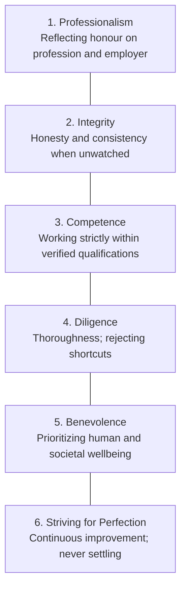

> [!tip] Memory Hook: P-I-C-D-B-S
> **P**rofessionals **I**n **C**omputing **D**eliver **B**etter **S**ystems:
> **P**rofessionalism, **I**ntegrity, **C**ompetence, **D**iligence, **B**enevolence, **S**triving for perfection.

---

## 1.2 The Three Invisible Rulebooks: Morality, Ethics, and Law

Human behavior and societal interactions are governed by three overlapping yet distinct normative systems:

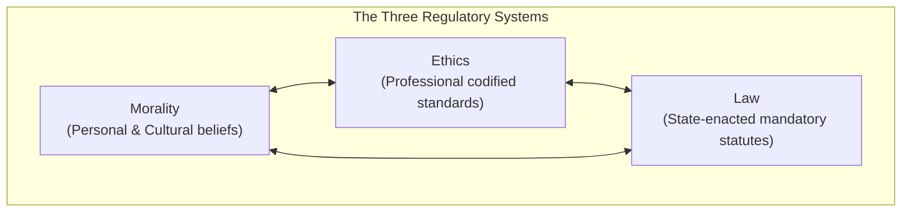

### Comprehensive Comparison Matrix

| Dimension | Morality | Ethics | Law |
| :--- | :--- | :--- | :--- |
| **Source / Origin** | Individual conscience, religious doctrine, cultural upbringing, family traditions | Professional organizations, academic research, reasoned consensus (e.g., ACM, IEEE) | Governing state bodies, sovereign parliament, statutory enactments, court precedent |
| **Enforcement Mechanism** | Internal guilt, conscience, informal social pressure or ostracization | Professional sanctions, censure, expulsion from professional associations | Coercive state apparatus: police, judicial courts, administrative regulatory agencies |
| **Codification** | Generally unwritten; internalized cultural norms | Formally codified in professional Codes of Conduct and Best Practices | Strictly codified into written Acts, statutes, enactments, and gazetted regulations |
| **Obligation / Mandate** | Voluntary / Subjective; varies across communities | Conditional; binds members of a profession or contracted employees | **Mandatory**; applies universally across the jurisdiction regardless of personal belief |
| **Consequence of Breach** | Remorse, loss of reputation, social disapproval | Loss of license, disciplinary hearings, termination of employment | Fines, injunctions, restitution damages, criminal imprisonment |
| **Practical Example** | Believing that lying under any circumstance is fundamentally wrong | Refusing to sell or monetize confidential customer telemetry data | Complying with mandatory data security and breach notification mandates under the PDPA |

> [!note] The Critical Takeaway
> **Legal $\neq$ Ethical**: An action can be completely legal while remaining ethically reprehensible. Conversely, an action may be ethical (e.g., civil disobedience or well-intentioned whistleblowing) while technically violating a statutory law.

### The Legal vs. Ethical 2×2 Decision Matrix

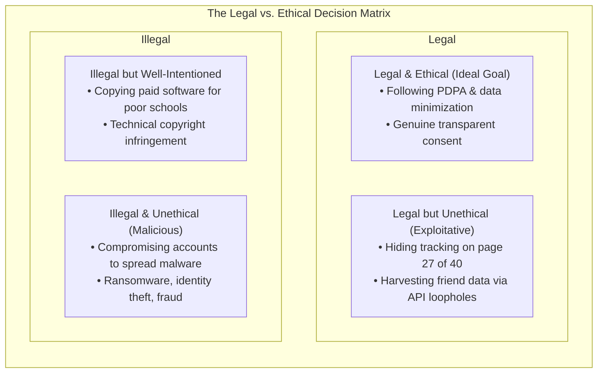

1. **Legal AND Ethical (Top-Right - Goal)**:
   - Full compliance with the Personal Data Protection Act (PDPA) while actively practicing data minimization and obtaining transparent user consent.
2. **Legal BUT Unethical (Top-Left - Exploitative Compliance)**:
   - Technical compliance buried in fine print: Disclosing invasive background location tracking on page 27 of a dense 40-page terms-of-service document that users will never read.
   - Platform compliance loophole: Operating within platform API rules to harvest friend data (as Cambridge Analytica initially argued regarding Facebook).
3. **Illegal BUT Well-Intentioned (Bottom-Right)**:
   - Illegally copying paid proprietary software to distribute free copies to an impoverished rural school. While the motivation is benevolent, it constitutes statutory copyright infringement under the Copyright Act 1987.
4. **Illegal AND Unethical (Bottom-Left - Malicious Criminality)**:
   - Unauthorized intrusion into a user's messaging account to distribute malware or defraud contacts (violating Section 4 of the Computer Crimes Act 1997).

---

## 1.3 Nature and Five Defining Features of Law

> [!info] Positive vs. Negative View of Law
> - **Negative View (Punisher)**: The flawed perception that law exists exclusively to punish criminals after a violation has already occurred.
> - **Positive View (Protector)**: The accurate understanding that law primarily functions like a **seatbelt**: quietly creating societal order, protecting property rights, ensuring consumer safety, and establishing trust from the moment one wakes up.

### The Five Defining Features of Law
1. **Law Protects Fundamental Freedoms**:
   - Guarantees personal liberty, equality before the law, and freedom of expression. In the digital sphere, these rights dictate what content platforms can moderate, what citizens may publish online, and how data privacy is protected.
2. **Law Keeps the Peace and Balances Public Order**:
   - Laws trade off a degree of individual liberty to guarantee collective security (e.g., airport security screenings, or Malaysia's *Security Offences (Special Measures) Act 2012 [SOSMA]*). This liberty-versus-security debate plays out continuously in cyberspace regarding encryption backdoors and state surveillance.
3. **Law Plays No Favourites (Universal Application)**:
   - Law applies equally without exception to private citizens, startups, multinational corporations, civil servants, and cabinet ministers. 
   > [!example] May 2025 Malaysian WhatsApp Case
   > When the Malaysian Home Minister's official WhatsApp account was compromised via a foreign VPN to blast phishing links, police investigated under **Section 4(1) of the Computer Crimes Act 1997**—the exact same statute applied to ordinary citizens.
4. **You Do Not Get to Opt Out**:
   - Legal compliance is non-negotiable. Unlike software subscriptions or email newsletters, citizens and corporations cannot "unsubscribe" from statutory duties.
5. **Law Keeps Moving (Evolutionary Nature)**:
   - Legal frameworks adapt to technological and societal transformations via three mechanisms:
     - **Enactment**: Creating entirely new statutes (e.g., *Cyber Security Act 2024*).
     - **Amendment**: Modifying existing statutes to close newly emerged loopholes (e.g., *PDPA 2024 Amendments* introducing mandatory breach notification).
     - **Repeal**: Abolishing outdated laws that no longer fit technological realities (e.g., the *Cybercrimes Bill 2026* designed to repeal the *Computer Crimes Act 1997*).

---

## 1.4 Malaysia's Dual Legal System Architecture

Malaysian jurisprudence combines English Common Law traditions inherited from the colonial era (early 1800s to 1957/1963) with statutory enactments and an Islamic legal track.

### The Federal Constitution
- **Supreme Law**: The Federal Constitution (*Perlembagaan Persekutuan*) outranks all other laws. Any federal statute or state enactment inconsistent with the Constitution is void to the extent of the inconsistency.
- **Constitutional Supremacy (Article 75)**: If any state law (including Syariah enactments) conflicts with a federal law passed by Parliament, **Federal law prevails**, and the state enactment is void to the extent of inconsistency.
- **Digital Intersections**:
  - Freedom of Speech (Article 10) $\leftrightarrow$ Content regulation under CMA 1998 Section 233.
  - Personal Liberty (Article 5) $\leftrightarrow$ Data protection, digital privacy, and police search powers.

### The Two Parallel Legal Tracks

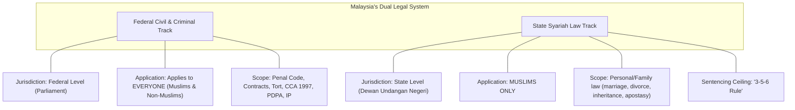

> [!warning] The Syariah Sentencing Limit ("3-5-6 Rule")
> Under the *Syariah Courts (Criminal Jurisdiction) Act 1965 (Act 355)*, Syariah criminal punishments are strictly capped at:
> - Maximum **3 years** imprisonment
> - Maximum fine of **RM5,000**
> - Maximum **6 strokes** of the cane

### Criminal Law vs. Civil Law

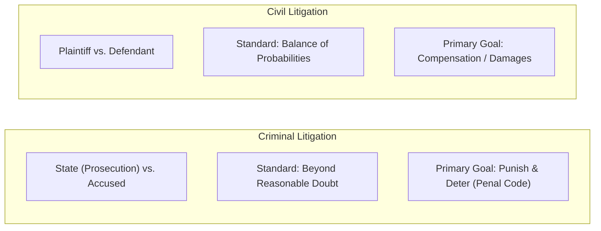

- **Anatomy of a Crime**:
  - A crime is an illegal act or **omission** (failure to act when legally obligated) prohibited by an Act of Parliament.
  - **Attempt Counts**: Attempting to commit a computer crime carries criminal liability even if the technical breach fails.
  - **Strict Elements**: The prosecution must prove every distinct element of an offence; if a single element is disproven, the charge fails.
- **Five Primary Routes into Civil Court**:
  1. **Tort Claims**: Civil wrongs causing injury, negligence, or harm.
  2. **Breach of Contract Claims**: Broken business agreements (e.g., failure of an IT software vendor to deliver contracted deliverables).
  3. **Equitable Claims**: Requests for fair injunctions rather than pure monetary awards.
  4. **Class Action Claims**: Representative lawsuits brought by an aggregated group of plaintiffs.
  5. **Complaints Against Public Authorities**: Judicial reviews against municipal or governmental overreach.

### Separation of Powers & Court Hierarchy
1. **The Legislature**: Debates and passes laws (Parliament at Federal level: *Dewan Rakyat* and *Dewan Negara*; State Assemblies: *Dewan Undangan Negeri*).
2. **The Executive**: Enforces and implements laws via the Prime Minister, Cabinet, and ministries.
3. **The Judiciary**: Interprets laws, hears prosecutions, and resolves civil disputes.
- **Court Jurisdiction Limits**:
  - **High Court**: Unlimited monetary jurisdiction; constitutional reach; cannot hear matters exclusively reserved for Syariah courts.
  - **Subordinate Courts (Sessions and Magistrates' Courts)**: Bound by strict **Monetary Jurisdiction** (statutory damage caps) and **Geographic Jurisdiction** (authorized regional boundaries). Exceeding these limits renders a judgment null and void on appeal.

---

## 1.5 Malaysian Cyber Law Landscape & Digital Watchdogs

### Key Cyber Legislation in Malaysia

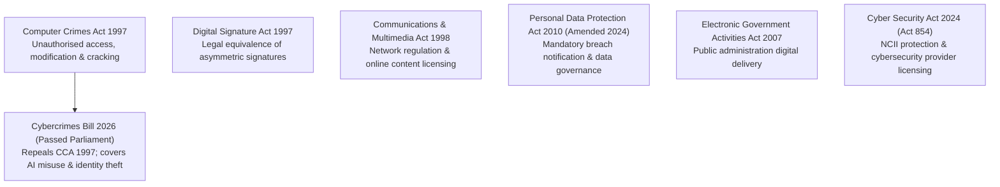

- **Computer Crimes Act 1997 (CCA 1997)**:
  - `Section 3`: Unauthorised access to computer material (hacking).
  - `Section 4`: Unauthorised access with intent to commit or facilitate a further offence (e.g., accessing a database to commit fraud).
  - `Section 5`: Unauthorised modification of computer contents (tampering, data wiping).
  - `Section 6`: Wrongful communication of passwords or access codes.
- **Cyber Security Act 2024 (Act 854)**:
  - Gazetted on 26 June 2024; in force from **26 August 2024**.
  - Establishes the **National Cyber Security Committee**.
  - Protects **National Critical Information Infrastructure (NCII)** across vital sectors (Banking & Finance, Energy, Healthcare, Transportation, Water, Government, InfoComm).
  - Imposes mandatory cybersecurity licensing for service providers and regulatory oversight via NACSA.
- **Communications and Multimedia Act 1998 (CMA 1998)**:
  - Regulates telecommunications infrastructure, Internet service providers, and online content transmission.
  - Effective 1 January 2025: Imposes mandatory licensing obligations on major social media and messaging platforms operating in Malaysia exceeding designated user thresholds.
- **Personal Data Protection Act 2010 & 2024 Amendments**:
  - Governs processing of personal data in commercial transactions.
  - *Historical Context*: In 2017, a massive breach exposed **46.2 million Malaysian mobile subscriber records** (IC numbers, addresses, SIM details). At that time, no mandatory breach disclosure existed.
  - *2024 Amendments*: Formally introduced mandatory **Data Breach Notifications** to the Commissioner and affected data subjects, defined **Data Controller vs. Processor** obligations, formalized the role of **Data Protection Officers (DPO)**, mandated **Data Protection Impact Assessments (DPIA)**, and regulated **Automated Decision-Making / Profiling**.

### Malaysian Digital Watchdogs Matrix

| Agency / Entity | Primary Functional Responsibility | Incident Escalation Trigger |
| :--- | :--- | :--- |
| **NACSA** (National Cyber Security Agency) | National cybersecurity coordination, NCII defense, Cyber Security Act 2024 implementation | Critical infrastructure cyberattacks, national threats |
| **MCMC** (Malaysian Communications & Multimedia Commission) | Regulates internet platforms, telcos, digital broadcast, and digital signature CAs | Unlicensed platforms, content defamation, telecom abuse |
| **PDPC** (Personal Data Protection Commissioner) | Administers and enforces the PDPA 2010/2024 | Data leaks, corporate privacy misuse, breach reporting |
| **PDRM** (Royal Malaysia Police - Commercial Crime / Cyber) | Criminal investigations, arrests, digital search and seizure under CCA 1997 / Penal Code | Scams, commercial fraud, unauthorized intrusions |
| **CyberSecurity Malaysia (CSM)** | Specialized technical incident response, digital forensics, capacity building | Forensic analysis, malware triage, technical assistance |
| **Attorney General's Chambers (AGC)** | State prosecution and government legal advisory | Formal filing of criminal charges in court |

---

# Topic 2: Legal Issues in IT

## 2.1 Digital Signatures & Cryptographic Foundations

> [!info] Definition: Digital Signature
> An electronic signature mathematically tied to both the signatory's identity and the document's content, verifying authenticity, integrity, and non-repudiation in electronic transactions.

### The Four Essential Security Properties
1. **Confidentiality**: Ensuring ciphertext can only be decrypted and read by the authorized recipient.
2. **Identity Authentication**: Mathematically proving that the message originated from the specific signer.
3. **Non-Repudiation**: The signer cannot plausibly deny having executed the transaction.
4. **Data Integrity**: Guarantees that not a single bit of the document has been altered since the signature was applied.

### Cryptographic Workflow
Digital signatures combine two fundamental components: a **cryptographic hash function** and **asymmetric public-key cryptography**.

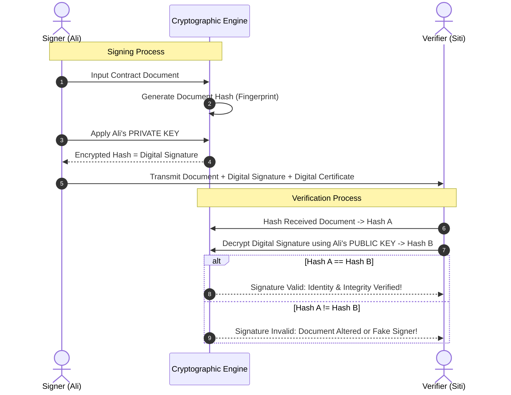

### Statutory Framework: Digital Signature Act 1997 (DSA 1997)
- **Commencement**: In force since **1 October 1998**; administered by **MCMC**.
- **Legal Equivalence Rule**: An electronic message possesses the exact same legal validity, enforceability, and effect as a signed paper document **if and only if** two cumulative conditions are met:
  1. It bears a valid digital signature covering the document in its entirety.
  2. The signature is verifiable by the public key listed in a valid digital certificate issued by an **MCMC-licensed Certification Authority (CA)**.

### Licensed Certification Authorities in Malaysia
Only digital certificates issued by CAs licensed under the DSA 1997 carry full statutory legal weight:
1. **Pos Digicert Sdn Bhd**
2. **MSC Trustgate.Com Sdn Bhd**
3. **Telekom Applied Business Sdn Bhd**
4. **Raffcomm Technologies Sdn Bhd**

> [!warning] Non-Signable Documents under DSA 1997
> Due to high fraud risks, solemnity, and strict physical witness requirements, the following documents **cannot** be executed via digital signatures:
> 1. **Powers of Attorney** (authorizing an agent to act on one's legal behalf)
> 2. **Wills and Codicils** (testamentary distribution of estates and amendments)
> 3. **Trusts** (legal arrangements holding property for beneficiaries)
> 4. **Negotiable Instruments** (promissory notes, cheques, drafts)

---

## 2.2 Domain Names, Trademarks & Cyberspace Disputes

### The Core Conflict: Trademarks vs. Domain Registrations
- **Trademarks**: Granted by geographical intellectual property offices to protect commercial goodwill and brand identity.
- **Domain Names**: Assigned globally on a **"first come, first served"** basis. Owning a registered trademark does not automatically confer ownership of the corresponding web domain.

### Four Problematic Domain Registration Categories

| Category | Definition | Real-World Example | Primary Perpetrator Motive |
| :--- | :--- | :--- | :--- |
| **Cybersquatting** | Registering a domain identical or confusingly similar to an established trademark in bad faith | `madonna.com` registered by Dan Parisi for adult entertainment | Extort trademark owner into buying domain at exorbitant markup, or block owner |
| **Typosquatting** | Registering domains exploiting common keyboard or phonetic misspellings of trademarks | `dicitionary.com` vs. `dictionary.com` | Phishing, scamming, malware distribution, or illicit advertising revenue |
| **Gripe Sites** | Incorporating a target's trademark into a domain dedicated to criticism or complaint | `lockheedsucks.com` vs. `lockheed.com` | Public protest, exposing corporate misconduct (clashes with Freedom of Expression) |
| **Foreign Language Variation** | Translating a protected brand name into another language for domain registration | Registering the direct Malay or Mandarin translation of a global brand | Siphon international brand traffic; exploit cross-border linguistic confusion |

> [!example] Landmark Precedent: Madonna v. Parisi (WIPO 2000)
> Pop icon Madonna filed a WIPO complaint against Dan Parisi, who operated `madonna.com` as an adult entertainment site. WIPO held that Parisi lacked legitimate rights to the name and registered it in bad faith, ordering the immediate transfer of the domain to Madonna.

### Domain Dispute Resolution via MYNIC
In Malaysia, the **Malaysian Network Information Centre (MYNIC)** administers the `.my` country-code top-level domain. Since 2003, it has provided the **Domain Name Dispute Resolution Service** as an expedited, cost-effective alternative to protracted court litigation.

To succeed in a MYNIC domain dispute, the complainant must prove **all three** grounds:
1. **Reasonable Similarity**: The disputed domain name is identical or confusingly similar to a trademark or service mark in which the complainant has rights.
2. **No Legitimate Right or Interest**: The respondent has no legitimate commercial right, license, or bona fide interest in the name.
3. **Bad Faith Registration and Use**: The domain was registered and is being used in bad faith (e.g., hoarding for resale, disrupting competitors, confusing consumers).
- **Remedies Available**: If proven, the administrative panel can either **Cancel** the domain registration or **Transfer** the domain to the trademark owner.

---

## 2.3 Trade Secrets & Intellectual Property Protection

> [!info] Trade Secret
> Confidential proprietary business information (algorithms, chemical formulas, pricing models, customer databases) that provides a commercial competitive edge as long as it remains confidential.

### Lawful Methods of Breaching Confidentiality
Unlike patents, trade secrets offer **no monopoly rights against independent discovery**:
1. **Reverse Engineering**:
   - The process of deconstructing a legally purchased product to discover its underlying architecture, code, or chemical formula.
   - *Example*: Purchasing a commercially available soft drink and chemically deducing its formula to produce an identical beverage is **entirely lawful** under intellectual property law.
2. **Employee Mobility & Knowledge Retention**:
   - When key technical staff move to competing organizations, they carry non-tangible general experience, domain knowledge, and memory.
   - While Non-Disclosure Agreements (NDAs) legally prohibit stealing source code files or confidential documents, they cannot erase internalized skills, creating unavoidable information leakage.

---

## 2.4 Antitrust, Anticompetition & Market Regulation

### Purpose of Antitrust Legislation
Antitrust law prevents anti-competitive collusive agreements, prohibits the abuse of dominant market power, and stops unwarranted monopolies from forming. By forcing organizations to compete aggressively, antitrust laws foster technological innovation, ensure market efficiency, and protect consumer pricing.

### The Four Prohibited Anti-Competitive Practices
1. **Price Fixing**: Colluding with direct market competitors to artificially set, raise, or stabilize retail prices (e.g., competing retail chains agreeing on price floors).
2. **Cartel Formation & Market Sharing**: Secretly carving up geographical territories or customer segments to eliminate active rivalry (e.g., "you take the northern corridor, we take the southern corridor").
3. **Predatory Pricing**: Deliberately slashing prices below operational cost to bankrupt smaller competitors, followed by monopolistic price hikes once rivals exit.
4. **Monopoly Abuse**: Exploiting dominant market share to stifle competitors (e.g., mandatory tying/bundling of unrelated software products, or refusing interoperability).

### Malaysian Regulatory Framework: Competition Act 2010
- **Enforcement Authority**: The **Malaysia Competition Commission (MyCC)**.
- **Concentrated Markets**: Sectors dominated by a handful of large operators (such as Malaysia's mobile telecommunications sector: CelcomDigi, Maxis) are subjected to strict regulatory surveillance.

> [!example] Landmark Case: The MAS & AirAsia Collaboration Agreement
> - **2011**: Malaysia Airlines (MAS) and AirAsia entered a comprehensive Collaboration Agreement, effectively partitioning commercial flight routes to avoid direct head-to-head competition.
> - **2014**: MyCC concluded the agreement violated Section 4 of the Competition Act 2010 (market sharing) and fined each airline **RM10 million**.
> - **2016–2021**: The dispute underwent a decade-long judicial journey: overturned by the Competition Appeal Tribunal (2016), reinstated by the High Court (2018), and finally dismissed by the Federal Court on procedural judicial review grounds (2021).

---

## 2.5 Cyberspace Jurisdiction & Cross-Border Enforcement

> [!info] Cyberspace Jurisdiction Dilemma
> **Jurisdiction** is the constitutional and statutory authority of a court to adjudicate a dispute. While sovereign legal systems are tethered to physical borders, cyberspace is **borderless, ubiquitous, instantaneous, and accessible worldwide**.

### Passive vs. Interactive Websites
Courts evaluate cross-border online jurisdiction using the level of commercial interactivity:

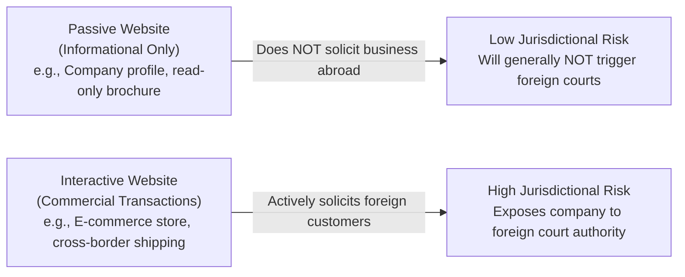

> [!example] Landmark Precedent: Yahoo! v. France (2000)
> French anti-racism organizations sued Yahoo! in a Paris court because French citizens could access auctions of Nazi memorabilia hosted on Yahoo!'s US servers. Although Nazi memorabilia sales were fully protected in the US under the First Amendment, the French court ruled that because the content **reached French territory**, French criminal law applied. Yahoo! was ordered to deploy IP-filtering to block French users, demonstrating that **courts assert jurisdiction where online content produces harm, not merely where the server is physically housed**.

### Enforcement Hurdles in International Cybercrime
1. **Jurisdiction Shopping**: Sophisticated cybercriminals deliberately locate command infrastructure in states with nonexistent cyber laws, weak extradition treaties, or corrupted law enforcement.
2. **Deficits in Technical Forensics**: Many local policing units lack trained forensic examiners capable of establishing unbroken chains of digital custody.
3. **Forensic Anti-Detection**: Criminals systematically route traffic through bulletproof VPN chains, use anonymizing networks (Tor), wipe server logs, and use ephemeral memory exploits, eliminating evidentiary audit trails.

---

# Topic 3: Computer Crime and Computer Network Security

## 3.1 Computer Crime vs. Cybercrime

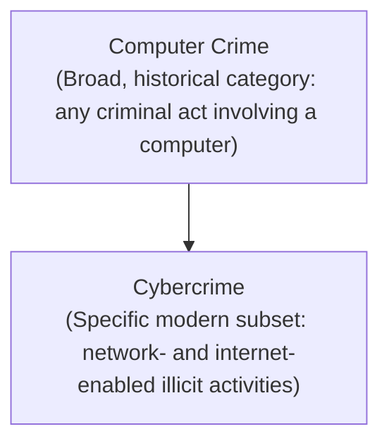

- **Core Difference**: Every cybercrime is a computer crime, but not every computer crime is a cybercrime. Computer crime encompasses offline physical hardware sabotage and early mainframe abuse predating the ARPANET/Internet. Cybercrime represents the internet-era evolution of these offenses.

### Statutory Prohibitions in Computer Crime Legislation
Computer crime legislation universally criminalizes unauthorized acts across five domains:
1. **Improper Access**: Gaining entry into a computer system or network without lawful authority.
2. **Data Offences**: Altering, damaging, deleting, copying, or exfiltrating proprietary records without permission.
3. **Introducing Malware**: Knowingly injecting viruses, worms, or Trojan code into computing infrastructure.
4. **Fraud and System Interference**: Using computers to orchestrate deception or deliberately disrupting service availability.
5. **Identity & Service Theft**: Forging electronic transmission headers, impersonating credentials, or siphoning paid cloud/network bandwidth.

### The Legislative Transition: Computer Crimes Act 1997 vs. Cybercrimes Bill 2026

> [!important] Crucial Legal Update for Examinations
> - **Law Currently in Force**: The **Computer Crimes Act 1997 (Act 563)** remains the governing statute on hacking and computer misuse in Malaysia today.
> - **Upcoming Replacement**: In **July 2026**, Parliament passed the **Cybercrimes Bill 2026** through both houses (*Dewan Rakyat* and *Dewan Negara*). It is currently awaiting **Royal Assent** from the Yang di-Pertuan Agong and official publication in the **Gazette** to set its formal commencement date.
> - **Why Replace It?**: The 1997 Act is nearly 30 years old and lacks explicit statutory definitions for modern online phenomena such as **identity theft, AI-assisted exploitation, deepfake manipulation, and cloud infrastructure sabotage**.

---

## 3.2 The Nine Faces of Cybercrime

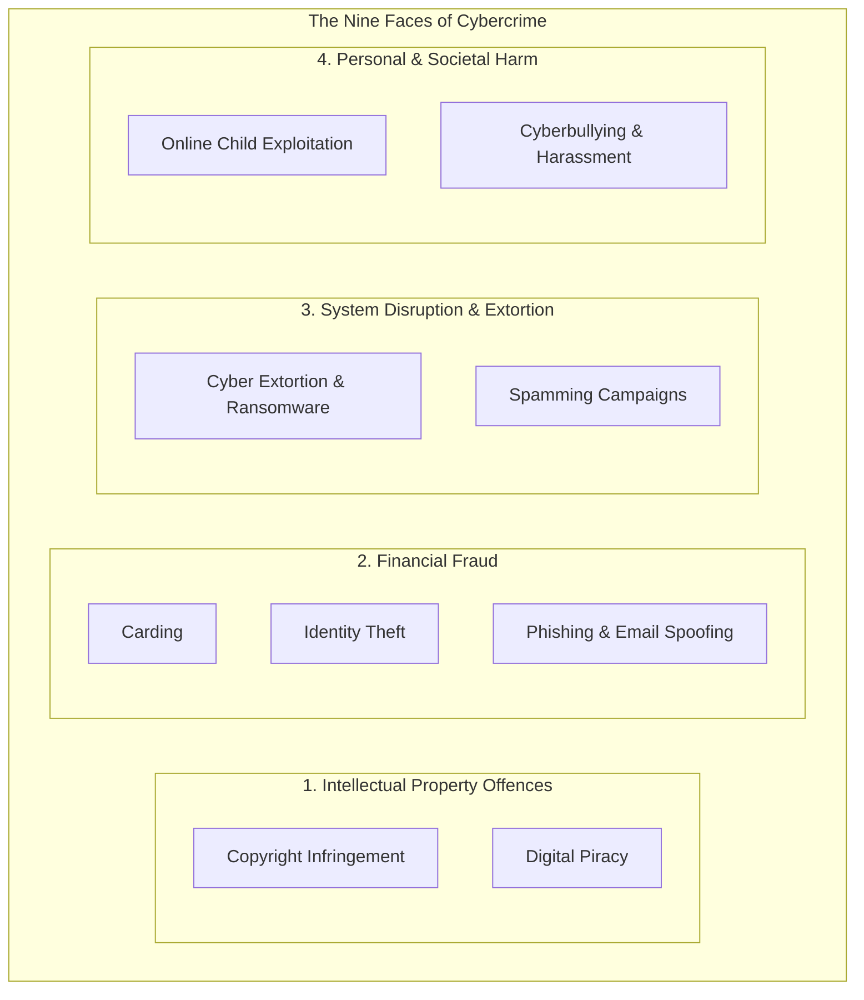

### Comprehensive Breakdown

1. **Copyright Infringement**:
   - Unauthorized reproduction, public distribution, or modification of legally protected intellectual property (e.g., sharing unauthorized textbook PDFs, mirroring proprietary digital artwork).
2. **Online Child Pornography & Exploitation**:
   - Visual depictions of minors engaged in sexually explicit conduct. 
   - *Universal Criminality*: Unlike adult pornography laws which vary by jurisdiction, child sexual abuse material is universally illegal worldwide.
   - *Malaysian Statute*: Under the *Sexual Offences Against Children Act 2017*, the entire operational chain is criminalized: **producing, sharing, buying, exchanging, selling, possessing, and even merely accessing** such material.
3. **Digital Piracy**:
   - Unauthorized illicit duplication and commercial syndication of copyrighted audio, video games, cracked software, and unauthorized video streams.
4. **Cyber Extortion (Ransomware)**:
   - Leveraging digital disruption or malicious access to extort ransom payments.
   - Attackers deploy cryptographic ransomware to encrypt entire enterprise databases or threaten public leakage of exfiltrated records unless cryptocurrency is paid.
5. **Identity Theft**:
   - Unlawfully acquiring and exploiting an individual's personal identifiers (IC number, banking credentials, biometric data) to obtain fraudulent loans, deplete bank balances, or evade criminal detection.
6. **Phishing & Email Spoofing**:
   - Using deceptive emails with forged transmission headers to trick recipients into revealing passwords, credit card numbers, or MFA tokens.
   - *Inspection Safeguards*: Scrutinizing domain sender headers for subtle misspellings, identifying manufactured emotional urgency ("Act immediately or be arrested"), inspecting hyperlink target URLs via hovering, and verifying generic greetings.
7. **Spamming**:
   - Automated mass distribution of unsolicited, irrelevant electronic messages used as a primary carrier vector for phishing URLs, malware payloads, and fraudulent scams.
8. **Carding**:
   - Trafficking and executing fraudulent transactions using stolen credit card credentials (primary account number, expiration date, CVV code, and billing ZIP).
9. **Cyberbullying**:
   - Deliberate, repetitive online harassment, doxxing, or character defamation across social networks and gaming forums intended to induce emotional trauma and psychological distress.

---

## 3.3 Security Threats: Viruses, Worms, and Trojans

All three represent forms of **malware** (malicious software), yet each operates on distinct technical mechanisms:

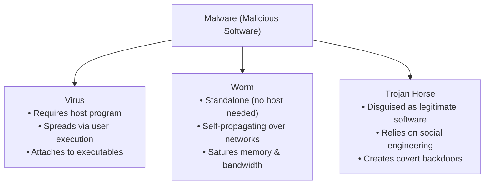

### Malware Comparison Table

| Feature | Computer Virus | Computer Worm | Trojan Horse |
| :--- | :--- | :--- | :--- |
| **Host Program Requirement** | **Yes**: Must attach to an executable file or document macro | **No**: Standalone, independent executable code | **No**: Standalone program disguised as a harmless/useful tool |
| **Replication Mechanism** | Replicates by injecting its code into other local programs | Replicates automatically and exponentially across networks | **Does not self-replicate**; relies on users downloading/installing |
| **Transmission Vector** | Shared files, infected USB flash drives, email attachments | Exploits unpatched network port/daemon vulnerabilities | Phony utility downloads, cracked games, disguised attachments |
| **Primary Operational Impact** | File corruption, operating system crash, data destruction | Severe bandwidth consumption and memory exhaustion | Provides backdoor control, data exfiltration, system surveillance |
| **Memory Hook** | **The Passenger** (needs a vehicle) | **The Driver** (travels autonomously) | **The Gift** (Greek horse hiding soldiers) |

### Notable Historical Virus Case Studies
- **Brain Virus (1986)**: The first IBM PC-compatible virus, created by two Pakistani brothers (Basit and Amjad Farooq Alvi) to track illegal copies of medical software. It infected 360KB floppy disk boot sectors. Though technically non-malicious (displaying a copyright notice), it proved that self-replicating code could spread across the globe.
- **Michelangelo Virus (1991)**: Designed to trigger every year on March 6 (artist Michelangelo's birthday). It overwrote critical master boot records and FAT file systems on an estimated **two million PCs worldwide**, causing irrecoverable data loss.
- **Melissa Macro Virus (1999)**: Written by David L. Smith as a Microsoft Word macro. Upon opening, it hijacked Microsoft Outlook to blast copies of itself to the first **50 contacts** in the victim's address book, infecting over **100,000 corporate and military computers** within its first week. Smith was apprehended and sentenced to **20 months in federal prison** and a **$5,000 fine**.

---

## 3.4 Unauthorised Access, Hacking & Statutory Penalties

> [!info] Legal Essence of Hacking
> Hacking is legally defined as **unauthorised access** to a computer system or network. The exact same technical keystrokes (running a penetration test script) are fully legal when authorized by contract, but constitute a serious crime when executed without permission.

### The Hacker Ethics
A historical cultural norm within computing subcultures holding that information, source code, and computing access should be freely accessible and shared collectively. While hacker ethics fostered collaborative breakthroughs (and the open-source movement), it provides **zero legal defense** against criminal charges of unauthorized intrusion.

> [!example] Real-World Case: EasyJet Cyberattack (May 2020)
> Attackers compromised the systems of budget carrier EasyJet, gaining access to the personal travel itineraries of **9 million customers** and the full credit card records (including CVV security codes) of over **2,000 passengers**. The airline discovered the breach in January but required four months to determine its scope, highlighting the severe commercial and regulatory repercussions of unauthorized network access.

### The Hacker Classification Spectrum

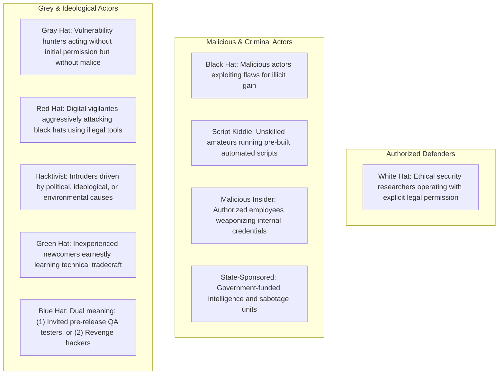

### Statutory Penalties under the Computer Crimes Act 1997

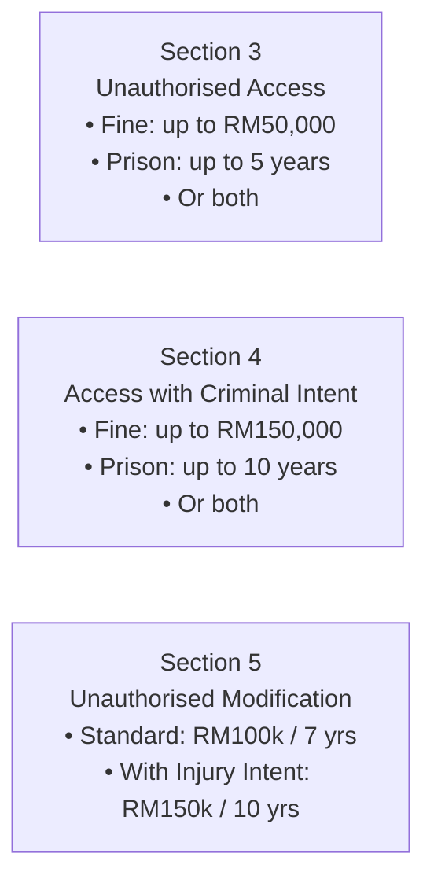

| Section | Offense Description | Maximum Fine | Maximum Imprisonment |
| :--- | :--- | :--- | :--- |
| **Section 3** | Unauthorised access to computer material (basic hacking/intrusion) | **RM 50,000** | Up to **5 years**, or both |
| **Section 4** | Unauthorised access with intent to commit or facilitate a further criminal offense (e.g., fraud, extortion) | **RM 150,000** | Up to **10 years**, or both |
| **Section 5** | Unauthorised modification of computer contents (tampering, data wiping, ransomware) | **RM 100,000** | Up to **7 years**, or both |
| **Section 5 (Aggravated)** | Unauthorised modification committed with intent to cause physical injury or damage | **RM 150,000** | Up to **10 years**, or both |
| **Section 6** | Wrongful communication of passwords, access codes, or decryption keys | Discretionary statutory penalty | Fines and imprisonment |

---

## 3.5 Cyberterrorism and Denial of Service (DoS/DDoS) Attacks

> [!info] Cyberterrorism
> The premeditated use of disruptive cyberattacks by recognized terrorist entities against computers, networks, and public critical infrastructure to generate mass fear, physical destruction, or systemic collapse in furtherance of political, religious, or ideological objectives.

### Denial of Service: Accidental Outage vs. Malicious Attack
- **Natural / Accidental Failure**: Web servers display `404 Not Found` or `503 Service Unavailable` when an unexpected surge of legitimate users simultaneously overwhelms server bandwidth or database connection pools (e.g., concert ticket drops, exam result releases).
- **Deliberate DoS Attack**: Malicious actors deliberately forge millions of fraudulent network packets to artificially overwhelm server memory, connection sockets, or bandwidth. The target server collapses because it cannot distinguish between valid user requests and forged attack packets.

### DoS vs. DDoS Architecture

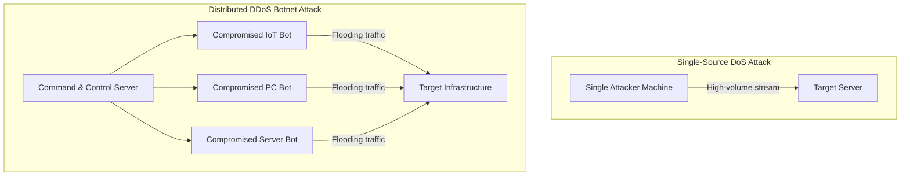

- **DoS (Denial of Service)**: Single attack vector originating from a single IP address/host; relatively straightforward to mitigate by blocking the offending IP address at the firewall.
- **DDoS (Distributed Denial of Service)**: Coordinated, distributed attack utilizing a botnet of thousands of geographically dispersed, compromised zombie hosts (PCs, IoT smart cameras, routers). Mitigating DDoS is difficult because incoming traffic appears from thousands of unique, legitimate IP addresses worldwide.

### Specialized Volumetric Attack Topologies
1. **Smurf Attack (ICMP Amplification)**:
   ```mermaid
   sequenceDiagram
       autonumber
       actor Attacker
       participant Broadcast as Intermediate Broadcast Network (Amplifier)
       actor Target as Target Victim Server
       
       Attacker->>Broadcast: Send ICMP Echo Request (Ping)<br>[SPOOFED Source IP = Target's IP]
       Note over Broadcast: Broadcasts packet to ALL nodes in network
       Broadcast->>Target: 100s of ICMP Echo Replies flood victim simultaneously!
       Note over Target: Target bandwidth & CPU exhausted
   ```
   - The attacker transmits ICMP Echo Request (ping) packets to a network broadcast address, spoofing the source IP address to match the target victim.
   - Every node on the broadcast amplifier network responds by sending an ICMP Echo Reply directly to the unsuspecting target, amplifying traffic hundreds of times and inducing immediate system paralysis.
2. **Email Bombing**: Flooding an organization's mail gateway with massive volumes of automated messages to fill disk quotas, crash mail transfer agents, and halt corporate communication.
3. **Worm Flooding**: Releasing aggressive, fast-propagating worms whose automated propagation consumes entire network backbones.
4. **Data Exfiltration alongside Disruption**: Blinding security operations center (SOC) analysts with a loud volumetric DDoS smoke screen while quietly exfiltrating sensitive database records through an alternate pathway.

### Multi-Layered Organizational Defense Strategies

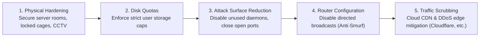

1. **Physical Infrastructure Hardening**: Restricting physical access to server rooms, wiring closets, and emergency power supplies to prevent physical tampering.
2. **Disk Quota Enforcement**: Implementing strict operating-system-level disk storage ceilings to stop rogue processes or email bombs from exhausting available disk space.
3. **Attack Surface Reduction**: Auditing and terminating unused services, background daemons, and open ports; every active listening port represents a potential attack gateway.
4. **Anti-Smurf Network Configuration**: Disabling IP-directed broadcasts on edge routers and firewalls, eliminating the ability of external attackers to weaponize local network subnets as broadcast amplifiers.
5. **Upstream Rate Limiting & Edge Scrubbing**: Deploying Web Application Firewalls (WAF) and Anycast DNS routing networks to inspect and absorb anomalous traffic surges before they hit core servers.

---

## 3.6 Quick Revision Checklist & Self-Test Questions

> [!tip] Quick Revision Self-Test
> Verify your exam readiness across the three topics with these key questions:

- [ ] **Q1**: What is the key distinction between a computer virus and a computer worm?
  - *Answer*: A virus requires an executable host program and human execution to spread; a worm is an independent, standalone program that replicates autonomously across computer networks.
- [ ] **Q2**: Which legal statute currently governs hacking in Malaysia, and what is the status of the Cybercrimes Bill 2026?
  - *Answer*: The *Computer Crimes Act 1997* is the law in force today. The *Cybercrimes Bill 2026* passed both houses of Parliament in July 2026 and is awaiting Royal Assent and gazetting before replacing it.
- [ ] **Q3**: What are the statutory maximum penalties under Sections 3, 4, and 5 of the Computer Crimes Act 1997?
  - *Answer*: Section 3: RM50,000 / 5 yrs; Section 4: RM150,000 / 10 yrs; Section 5: RM100,000 / 7 yrs (RM150,000 / 10 yrs if intending physical injury).
- [ ] **Q4**: What are the two cryptographic ingredients required to construct a digital signature, and which key is used for signing?
  - *Answer*: A cryptographic hash function and asymmetric key pair. Signing is performed using the signer's **private key**; verification is performed using the signer's **public key**.
- [ ] **Q5**: Name the four documents that cannot be executed via digital signatures under Malaysia's Digital Signature Act 1997.
  - *Answer*: Powers of Attorney, Wills and Codicils, Trusts, and Negotiable Instruments.
- [ ] **Q6**: What three grounds must a complainant prove to prevail in a MYNIC domain dispute?
  - *Answer*: (1) The domain is identical or confusingly similar to their trademark; (2) The respondent has no legitimate rights or interests; and (3) The domain was registered and used in bad faith.
- [ ] **Q7**: In Malaysia's dual legal system, what constitutional rule resolves conflicts between federal and state laws?
  - *Answer*: **Article 75 of the Federal Constitution**: Federal law prevails over inconsistent state enactments, including Syariah laws.
- [ ] **Q8**: What is a Smurf attack, and how is it mitigated at the router level?
  - *Answer*: An amplification attack sending ICMP echo requests with spoofed victim IP addresses to an IP broadcast network; mitigated by disabling directed broadcasts on routers.
