# UBEA2053 Malaysian Economy — Comprehensive Course Notes

> [!abstract] Course Overview
> These master notes provide a rigorous, comprehensive synthesis of **UBEA2053 / MPU33013 / MPU33143 Malaysian Economy** directly derived from the official lecture materials. Covering the economic history of Malaya/Malaysia from British colonial rule to present-day transformation visions, they detail national development planning frameworks (NEP, NDP, NVP, NTP, SPV2030, TN50), agricultural modernization, industrialization and master plans (IMP1 to NIMP 2030), the services sector transition, foreign direct investment (FDI) and global value chains, and macro-financial crisis management (1985, 1997/98, 2008/09, and 2020).

---

## Quick Navigation
- [[#Topic 1: Brief History of Malaysian Economic Development and Planning Frameworks]]
  - [[#1.1 Concepts of Economic Development, Growth, and Classification]]
  - [[#1.2 Historical Growth Trajectory and Macroeconomic Shocks (1961–2025)]]
  - [[#1.3 Theories of Growth and Structural Transformation]]
  - [[#1.4 The Malaysian Economic Planning Architecture (Long, Medium, and Short-Term)]]
  - [[#1.5 British Colonial Economic Policies (1800s–1957) and the Dual Economy]]
  - [[#1.6 Post-Independence Laissez-Faire Era (1957–1970) and the 1969 Watershed]]
  - [[#1.7 The New Economic Policy (NEP: 1971–1990)]]
  - [[#1.8 The National Development Policy (NDP: 1991–2000) and Vision 2020]]
  - [[#1.9 The National Vision Policy (NVP: 2001–2010) and Knowledge-Based Economy]]
  - [[#1.10 The National Transformation Policy (NTP: 2011–2020) and ETP]]
  - [[#1.11 Shared Prosperity Vision 2030 (SPV 2030) and TN50]]
- [[#Topic 2: The Agricultural Sector in Malaysia]]
  - [[#2.1 The Strategic Importance of Agriculture in Malaysia's Economy]]
  - [[#2.2 Historical Evolution and Structural Changes]]
  - [[#2.3 National Agricultural Policies (NAP 1 to DAN 2.0)]]
  - [[#2.4 The Oil Palm Subsector: Growth, Success Factors, and Structural Challenges]]
  - [[#2.5 The Rubber Subsector: From Estate Dominance to Downstream Manufacturing]]
  - [[#2.6 The Cocoa Subsector: From Bean Cultivation to Global Grinding Hub]]
  - [[#2.7 The Political Economy of Paddy and Rice Farming]]
  - [[#2.8 Marine Fisheries and the Aquaculture Revolution]]
  - [[#2.9 Cross-Cutting Structural Challenges in Malaysian Agriculture]]
- [[#Topic 3: The Industrial and Manufacturing Sector of Malaysia]]
  - [[#3.1 The Strategic Importance of Manufacturing: Engine of Export Growth]]
  - [[#3.2 The Five Historical Phases of Industrialisation]]
  - [[#3.3 The Evolution of Industrial Master Plans (IMP1 to NIMP 2030)]]
  - [[#3.4 Small and Medium Enterprises (SMEs / MSMEs) in Manufacturing]]
  - [[#3.5 Structural Challenges and the Future: "Made by Malaysia"]]
- [[#Topic 4: The Services Sector of Malaysia]]
  - [[#4.1 The Services Sector Paradox: Scale vs. Labor Productivity]]
  - [[#4.2 The Role of the State: Provider, Regulator, and Promoter]]
  - [[#4.3 The Four Modes of Services Trade Under WTO GATS]]
  - [[#4.4 The Financial Sector: Evolution, Restructuring, and Islamic Finance Hub]]
  - [[#4.5 Foreign Visitors as Services Exports: Tourism, Healthcare, and Higher Education]]
  - [[#4.6 National Champions, Privatisation, and Associated Service Ecosystems]]
  - [[#4.7 Strategic Challenges: Escalating to High-Value Services]]
- [[#Topic 5: Foreign Direct Investment (FDI) and Globalisation in the Malaysian Economy]]
  - [[#5.1 The Strategic Significance of Foreign Direct Investment (FDI)]]
  - [[#5.2 Historical Waves of FDI Inflows into Malaysia]]
  - [[#5.3 Determinants and Geographical Origins of FDI in Malaysia]]
  - [[#5.4 The Transition from "Quantity FDI" to "Quality FDI"]]
  - [[#5.5 Globalisation and the Rise of Global Value Chains (GVCs)]]
  - [[#5.6 Malaysia's Position in Global Value Chains: Backward vs. Forward Linkages]]
  - [[#5.7 Case Study: Foreign Investment in Malaysia's Semiconductor Industry]]
- [[#Topic 6: Economic and Financial Crises in Malaysia: Causes, Consequences, and Policy Responses]]
  - [[#6.1 Overview of Malaysia's Four Post-Independence Recessions]]
  - [[#6.2 The 1985–1986 Public Debt and Commodity Crisis]]
  - [[#6.3 The 1997–1998 Asian Financial Crisis (AFC)]]
  - [[#6.4 The 2008–2009 Global Financial Crisis (GFC)]]
  - [[#6.5 The 2020 COVID-19 Pandemic Shock and V-Shaped Economic Recovery]]
  - [[#6.6 Emerging 21st-Century Structural Risks for Malaysia]]

---

# Topic 1: Brief History of Malaysian Economic Development and Planning Frameworks

## 1.1 Concepts of Economic Development, Growth, and Classification

> [!info] Definition: Economic Growth vs. Economic Development
> - **Economic Growth**: A quantitative measure representing an increase in a country's real Gross Domestic Product (GDP) or Gross National Income (GNI) per capita over time.
> - **Economic Development**: A multidimensional process whereby simple, low-income national economies are transformed into modern industrial, knowledge-driven economies. It encompasses both **quantitative expansion** (income, output) and **qualitative improvements** (poverty eradication, structural transformation, reduction of income inequality, institutional modernization, improved healthcare, literacy, and environmental sustainability).

### World Bank Country Classification Framework
The World Bank classifies global economies annually based on Gross National Income (GNI) per capita (Atlas method, in current USD):

| Income Category | Historical 1985 Threshold | Modern World Bank Threshold (2024/2025 Benchmark) |
| :--- | :--- | :--- |
| **Low-Income Economies** | $< \$400$ | $\le \$1,145$ |
| **Lower-Middle-Income Economies** | $\$400 - \$4,000$ | $\$1,146 - \$4,515$ |
| **Upper-Middle-Income Economies** | (Part of Middle-Income) | $\$4,516 - \$14,005$ |
| **High-Income Economies** | $> \$4,000$ | $> \$14,005$ |

> [!note] Malaysia's Classification and the Middle-Income Trap
> Malaysia has been classified as an **Upper-Middle-Income Country** since 1992. As of 2023/2024, Malaysia's GNI per capita reached approximately $\$11,800 - \$12,000$, placing it near the high-income threshold ($\approx \$14,005$). However, Malaysia faces the **Middle-Income Trap**—a development plateau where a nation loses its low-cost labor competitive advantage to emerging peers (Vietnam, Indonesia) but has not yet developed the high-tech innovation, domestic R&D depth, and skilled human capital required to compete with advanced nations (Singapore, South Korea).

---

## 1.2 Historical Growth Trajectory and Macroeconomic Shocks (1961–2025)

Malaysia has sustained one of the most remarkable growth records in the developing world, transitioning from an agrarian colonial supplier of tin and natural rubber into a diversified regional manufacturing powerhouse.

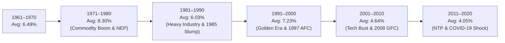

### Multi-Decade GDP Growth Rates (World Bank Data)
- **1961–1970**: Average annual growth of **$6.49\%$** (Post-independence import-substitution and agricultural stabilization).
- **1971–1980**: Average annual growth of **$8.30\%$** (Commodity boom, high oil prices, and state-led NEP implementation).
- **1981–1990**: Average annual growth of **$6.03\%$** (Heavy industrialization drive followed by the 1985 commodity collapse and subsequent deregulation).
- **1991–2000**: Average annual growth of **$7.23\%$** (The "Golden Age" of manufacturing exports; rapid capital inflows).
- **2001–2010**: Average annual growth of **$4.64\%$** (Post-AFC consolidation, global dot-com electronics slump, and the 2008–2009 Global Financial Crisis).
- **2011–2020**: Average annual growth of **$4.05\%$** (Moderating potential output, institutional reforms, culminating in the 2020 COVID-19 contraction).

### Historical Growth Extremes
- **Highest Recorded Real GDP Growth**: **$+11.70\%$** in **1973** (driven by unprecedented global price spikes for crude petroleum, palm oil, rubber, and tin).
- **Lowest Recorded Real GDP Growth**: **$-7.36\%$** in **1998** (the height of the Asian Financial Crisis; real GDP contracted by $7.4\%$).

### Chronology of Major External Shocks and Economic Crises
1. **Mid-1970s**: Global Stagflation and OPEC Oil Shocks.
2. **Mid-1980s (1985–1986)**: Collapse of primary commodity prices (tin, petroleum, palm oil), soaring external debt denominated in appreciating Japanese Yen following the Plaza Accord, and a cyclical downturn in the global semiconductor market.
3. **1997–1998**: Asian Financial Crisis (AFC); severe currency depreciation, massive capital flight, corporate debt default, and banking sector distress.
4. **2001**: Global electronics industry slump following the bursting of the US dot-com bubble.
5. **2008–2009**: Global Financial Crisis (GFC); collapse of international trade demand in the US and Europe.
6. **2020**: COVID-19 Global Pandemic; strict nationwide Movement Control Orders (MCO), supply chain disruptions, and global economic shutdown.

---

## 1.3 Theories of Growth and Structural Transformation

### The Fisher-Clark Theory of Structural Changes
The **Fisher-Clark Theory** postulates that economic development follows a predictable three-stage transition across economic sectors in terms of both **output (GDP share)** and **employment share**:

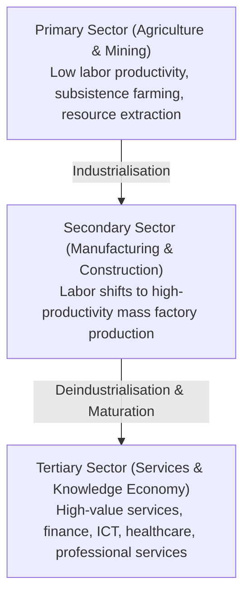

1. **Primary Stage**: Output and employment are dominated by agriculture, forestry, fishing, and mining.
2. **Secondary Stage**: Growth accelerates through industrialization, capital accumulation, and mass manufacturing.
3. **Tertiary Stage**: As real per capita incomes rise, consumption patterns shift toward services (education, recreation, healthcare, finance), while manufacturing productivity growth reduces the relative labor required to produce physical goods.

### The Critical Role of Agriculture in Early Development
- The agricultural transformation represents the mandatory springboard for industrialization.
- By modernizing agriculture, a developing nation:
  1. Creates rural employment and raises household incomes, lifting millions out of subsistence poverty.
  2. Generates agricultural export surpluses to finance capital equipment imports.
  3. Frees rural labor to migrate into emerging urban manufacturing factories without causing food shortages.

### Deindustrialisation: Natural vs. Premature
- **Natural Deindustrialisation**: A positive development observed in advanced economies (US, Western Europe, Japan). Rapid productivity growth in manufacturing (due to automation and advanced robotics) means fewer workers produce greater physical output, while rising consumer wealth directs spending toward services. Manufacturing employment falls significantly, accompanied by a moderate decline in manufacturing GDP share.
- **Premature Deindustrialisation**: Occurs in developing nations when the manufacturing share of GDP and employment peaks and contracts at much lower income levels than historically achieved by advanced economies, before the nation has built endogenous technical capabilities.

---

## 1.4 The Malaysian Economic Planning Architecture (Long, Medium, and Short-Term)

Malaysia implements a structured, hierarchical national planning framework coordinated by the **Economic Planning Unit (EPU)** (now the Ministry of Economy) in collaboration with the **Ministry of Finance (MOF)** and **Bank Negara Malaysia (BNM)**:

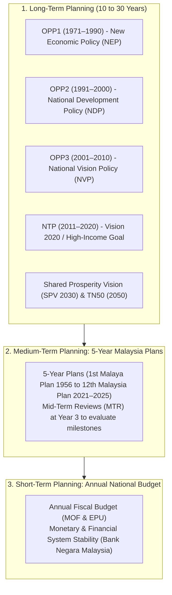

### 1.4.1 Long-Term Perspective Planning
- **Outline Perspective Plans (OPP)** set the multi-decade strategic trajectory and national ideological objectives.
- *Shift from 20-Year to 10-Year Horizons*: The government transitioned from rigid 20-year horizons (OPP1: 1971–1990) to 10-year plans (OPP2: 1991–2000; OPP3: 2001–2010; NTP: 2011–2020). Twenty years proved excessively long in an era of rapid technological disruption, market volatility, and geopolitical unpredictability.

### 1.4.2 Medium-Term Planning (Five-Year Development Plans)
- Five-year plans operationalize long-term goals by:
  1. Establishing explicit macroeconomic growth targets (real GDP, inflation, per capita income).
  2. Allocating development expenditure budgets across federal ministries, infrastructure projects, and promoted sectors.
  3. Guiding private sector capital investment through fiscal incentives, tax holidays, and regulatory signposting.
- **Mid-Term Review (MTR)**: Conducted during the third year of each plan to evaluate performance, reallocate funding, and adjust policies to shifting economic conditions.

### 1.4.3 Short-Term Planning (Annual Fiscal & Monetary Management)
- **Annual National Budget**: Prepared by the Ministry of Finance and tabled annually in Parliament by the Minister of Finance / Prime Minister, allocating operational and development budgets.
- **Monetary Policy**: Executed independently by Bank Negara Malaysia (BNM) via the Overnight Policy Rate (OPR), statutory reserve requirements, and foreign exchange market management to preserve price stability and financial sector integrity.

---

## 1.5 British Colonial Economic Policies (1800s–1957) and the Dual Economy

British colonial policy in Malaya was driven by British industrial requirements, establishing structural distortions that persisted long after independence:

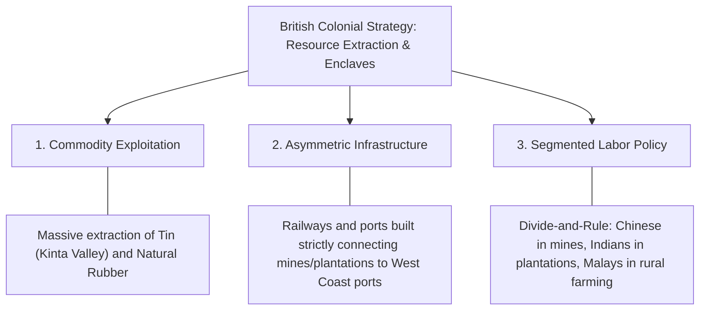

### Key Characteristics of the Colonial Malayan Economy
1. **Primary Resource Exploitation**: Malaya was organized as an export enclave to supply raw industrial inputs (tin and rubber) to the British Empire and global markets.
2. **Asymmetric Export Infrastructure**: Public expenditure was allocated almost exclusively to transport infrastructure (ports, railways, telegraphs, coastal highways) facilitating the movement of rubber and tin to Penang and Singapore. The rural indigenous interior remained neglected.
3. **Segmented Labor & "Divide-and-Rule" Policy**:
   - The British facilitated mass immigration from Southern China to work in the tin mines and urban commerce.
   - Indentured and assisted labor was imported from Southern India to tap rubber on European-owned plantation estates.
   - The indigenous Malay population was encouraged to remain in traditional subsistence agriculture (padi farming) and coastal fishing.
4. **Birth of the "Dual Economy"**: Created two isolated, parallel economic worlds:
   - A highly monetized, modern, foreign- and Chinese-dominated export sector along the West Coast urban belt.
   - A stagnant, non-monetized traditional rural peasant sector dominated by indigenous Malays.
5. **Vulnerability to External Terms of Trade Shocks**: Excessive reliance on just two commodities (rubber and tin) exposed Malaya to extreme boom-and-bust cycles dictated by world commodity prices.

---

## 1.6 Post-Independence Laissez-Faire Era (1957–1970) and the 1969 Watershed

Following independence in 1957, the Alliance government pursued a predominantly **laissez-faire** economic approach:
- Government policy supported private enterprise (dominated by British agency houses and domestic Chinese capital).
- Public development expenditure under the **First Malaya Plan (1956–1960)** and **Second Malaya Plan (1961–1965)** focused on rural infrastructure, agricultural drainage, and land resettlement via the **Federal Land Development Authority (FELDA)**, established in 1956.
- **First Malaysia Plan (1966–1970)** initiated early import-substitution industrialization.

### The May 13, 1969 Racial Riots
Despite respectable aggregate macroeconomic growth, economic inequality widened dramatically along ethnic lines:
- By 1970, the national poverty rate stood at an alarming **$49.3\%$**, with rural Malay households experiencing poverty rates exceeding $65\%$.
- Corporate equity ownership was severely skewed: foreign capital owned **$63.3\%$**, non-Bumiputera (predominantly Chinese) owned **$34.3\%$**, and Bumiputeras owned a negligible **$2.4\%$**.
- Income disparities and the perception that political power (held by Malays) was divorced from economic wealth (held by non-Malays and foreigners) erupted in the deadly racial riots of **May 13, 1969**. This led to a declaration of national emergency, suspension of parliament, and the complete abandonment of laissez-faire capitalism.

---

## 1.7 The New Economic Policy (NEP: 1971–1990)

Launched under the **Second Malaysia Plan (1971–1975)** and the **First Outline Perspective Plan (OPP1)**, the NEP transformed the state into an active, interventionist manager of the economy.

> [!important] The Overarching Objective of the NEP: National Unity
> The fundamental objective of the NEP was to achieve **National Unity** through a **Two-Pronged Strategy**:
> 1. **Prong 1: Eradication of Poverty Regardless of Race**:
>    - Raising income levels and employment opportunities for all Malaysians by improving rural agriculture infrastructure, providing subsidized inputs (fertilizer, irrigation), and expanding access to education, healthcare, clean water, and electricity.
> 2. **Prong 2: Restructuring Society to Eliminate the Identification of Race with Economic Function**:
>    - Eliminating the colonial ethnic division of labor.
>    - Transforming the corporate ownership structure to ensure that by 1990, Bumiputeras would own at least **$30\%$** of corporate equity (with $40\%$ for other Malaysians and $30\%$ for foreign investors).
>    - Creating a **Bumiputera Commercial and Industrial Community (BCIC)**.

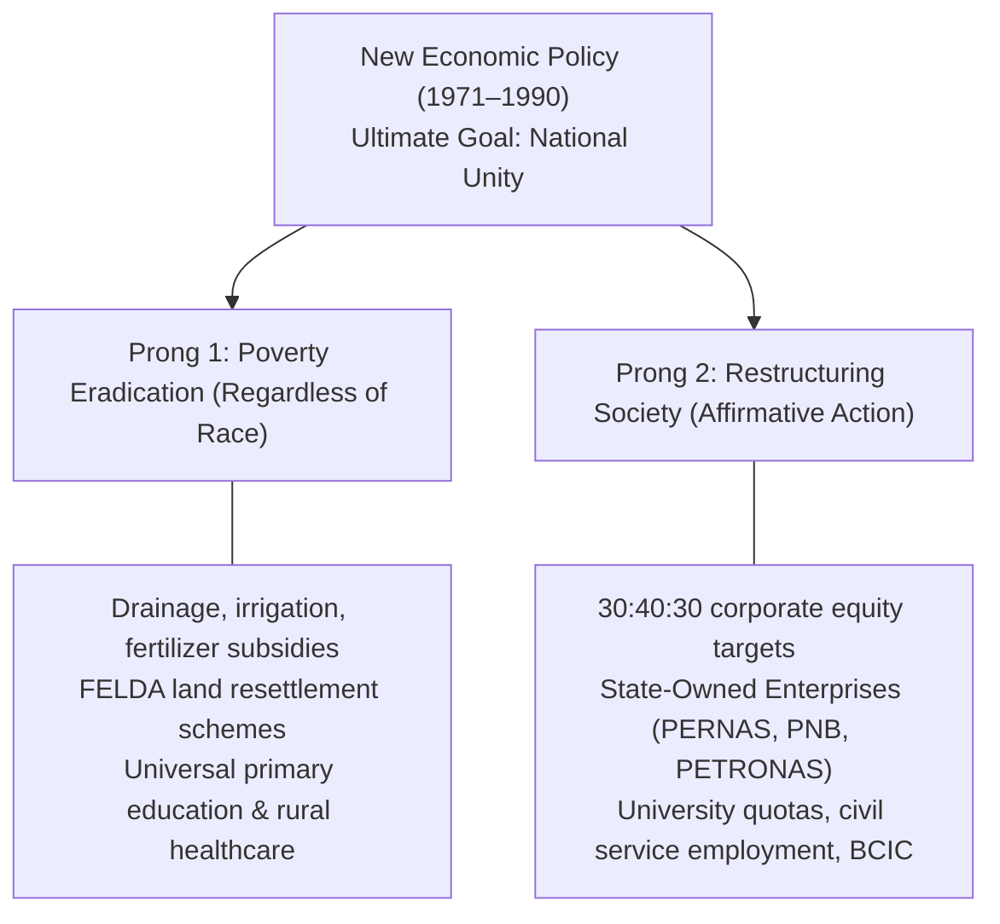

### Strategic Instruments of the NEP
- **State-Owned Enterprises & Trust Agencies**: The government established public trust agencies—including **PERNAS**, **Permodalan Nasional Berhad (PNB)**, **MARA**, and **PETRONAS**—to acquire corporate assets and corporate shares in trust on behalf of the Bumiputera community.
- **Affirmative Action / Positive Discrimination**: Enforced quotas in university admissions, government scholarships, public sector employment, business licenses, commercial permits, and residential housing discounts.
- **Growth with Equity**: The policy explicitly emphasized that restructuring was to take place within an expanding economy, ensuring no ethnic group experienced absolute deprivation or property confiscation.

### Achievements and Criticisms of the NEP
- **Achievements**:
  - Dramatic decline in absolute poverty: Poverty plummeted from **$49.3\%$ in 1970** to **$15.0\%$ in 1990** (and further to $7.8\%$ by 2019).
  - Bumiputera corporate equity ownership increased substantially from **$2.4\%$ in 1970** to approximately **$19.3\%$ in 1990**.
  - Emergence of a sizable, educated Malay middle class, professional community, and corporate managerial class.
- **Criticisms and Side-Effects**:
  - Failed to hit the arbitrary $30\%$ equity ownership target by 1990.
  - Wealth concentration: Corporate equity gains were largely concentrated among politically connected elites rather than the broad mass of rural Bumiputeras.
  - Inter-ethnic tensions, perceived marginalization among non-Bumiputeras, capital flight, and the emigration of skilled professionals ("Brain Drain").

---

## 1.8 The National Development Policy (NDP: 1991–2000) and Vision 2020

The **National Development Policy (NDP)** succeeded the NEP, embodied in the **Second Outline Perspective Plan (OPP2)** and launched alongside Prime Minister Dr. Mahathir Mohamad's **Vision 2020** (*Wawasan 2020*).

### Core Shifts from NEP to NDP
1. **Focus on Hardcore Poverty**: Shifted emphasis from general relative poverty to the eradication of **hardcore poverty** (households earning less than half the Poverty Line Income - PLI).
2. **Quality Over Quantity in BCIC**: Focused on nurturing genuinely resilient, self-reliant Bumiputera entrepreneurs rather than relying strictly on numerical quota compliance.
3. **Private Sector as the Primary Engine of Growth**: Scaled back direct public sector commercial expansion, embarking on widespread **Privatization** (telecommunications, energy, highways, ports) and industrial deregulation.
4. **Human Resource Development**: Emphasized technical and vocational education, science, and engineering to support advanced manufacturing.

> [!info] The Nine Challenges of Vision 2020
> Introduced in 1991, **Vision 2020** aimed to transform Malaysia into a fully developed, industrialized nation by the year 2020 across all dimensions—economic, political, social, psychological, and spiritual. Its nine central challenges focused on establishing a united Malaysian nation (*Bangsa Malaysia*), a psychologically liberated society, a mature democratic society, a fully moral and ethical community, a liberal and tolerant society, a scientific and progressive culture, a caring society, an economically just society, and a prosperous economy.

---

## 1.9 The National Vision Policy (NVP: 2001–2010) and the Knowledge-Based Economy

Operationalized under the **Third Outline Perspective Plan (OPP3)** and the 8th and 9th Malaysia Plans, the **National Vision Policy (NVP)** aimed to build a resilient, competitive nation:

- **Key Strategic Pillars**:
  1. Developing Malaysia into a **Knowledge-Based Economy (K-Economy)** where wealth creation is driven by intellectual capital, software, R&D, and innovation rather than physical labor.
  2. Sustaining rapid economic growth while strengthening macroeconomic resilience against global shocks (in the wake of the 1997 Asian Financial Crisis).
  3. Enhancing human capital development through educational reform.
  4. Addressing regional disparities, particularly between Peninsular Malaysia and the East Malaysian states of Sabah and Sarawak.
  5. Environmental sustainability and natural resource conservation.

---

## 1.10 The National Transformation Policy (NTP: 2011–2020)

Launched under Prime Minister Najib Razak, the **National Transformation Policy (NTP)** was formulated to propel Malaysia past the middle-income trap into high-income advanced nation status by 2020:

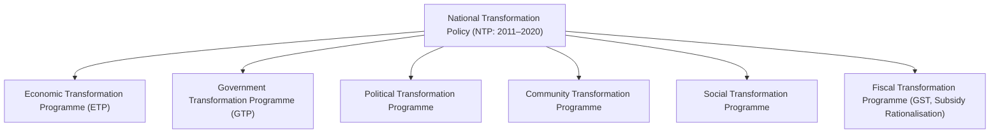

### The Economic Transformation Programme (ETP)
- Led by the Performance Management and Delivery Unit (**PEMANDU**).
- Identified **12 National Key Economic Areas (NKEAs)** representing sectors capable of driving significant GNI growth (e.g., Oil, Gas & Energy; Palm Oil & Rubber; Financial Services; Tourism; E&E; Wholesale & Retail; Communications Content & Infrastructure).
- Implemented through specific **Entry Point Projects (EPPs)** designed to mobilize private sector capital expenditure.
- Introduced the **Goods and Services Tax (GST)** in 2015 under the Fiscal Transformation Programme to broaden the federal tax base away from volatile petroleum royalties.

---

## 1.11 Shared Prosperity Vision 2030 (SPV 2030) and National Transformation 2050 (TN50)

### Why Vision 2020 Was Reset: The Inception of SPV 2030
By 2019, it was evident that Malaysia would not achieve full developed-nation status by 2020:
- Labor productivity growth remained modest.
- Wage growth lagged behind corporate profitability, leaving labor share of income low ($\approx 35\%$).
- The economy remained heavily dependent on low-skilled foreign manual labor.
- Income inequality, regional development gaps (Sabah and Sarawak lagging), and the youth cost-of-living squeeze intensified.

On **October 5, 2019**, the government launched the **Shared Prosperity Vision 2030 (SPV 2030)**:

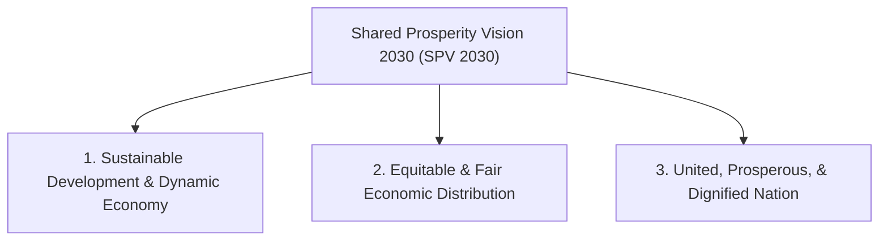

> [!info] Core Mandate of SPV 2030
> SPV 2030 is a national commitment to ensure that **every Malaysian enjoys the fruits of sustainable economic development**, shifting the national policy obsession away from headline GDP figures toward **fair, inclusive, and equitable wealth distribution** across income groups (B40, M40), ethnic communities, and geographic regions.

#### Key Targets of SPV 2030 & The 12th Malaysia Plan (12MP: 2021–2025)
- **12th Malaysia Plan (12MP)** serves as the operational roadmap for SPV 2030:
  - Federal development expenditure of **RM400 billion** allocated for 12MP (compared to RM248.5b spent under 11MP).
  - Target average annual GDP growth of **$4.5\% - 5.5\%$**.
  - Target average monthly household income to reach **RM10,000 by 2025**.
  - Narrowing the GDP per capita gap between the central region (Klang Valley) and Sabah/Sarawak.
  - Raising national R&D expenditure to **$5.2\%$ of GDP** by 2025 (up from $\approx 1\%$ in 2020), with the private sector funding $70\%$.
  - Nation-wide **5G digital infrastructure** rollout with RM15 billion private-sector co-investment.
  - Climate pledge: Reducing national greenhouse gas (GHG) emission intensity by **$45\%$ of GDP by 2030** relative to 2005 levels.

### National Transformation 2050 (TN50)
- Drafted between 2017 and 2019 as a bottom-up, 30-year participatory initiative engaging over 1.5 million youth to anticipate demographic aging, Fourth Industrial Revolution (4IR) automation, climate shocks, and global economic transformations leading into 2050.


---

# Topic 2: The Agricultural Sector in Malaysia

## 2.1 The Strategic Importance of Agriculture in Malaysia's Economy

While Malaysia has industrialized rapidly over the past five decades, the agricultural sector remains a foundational pillar of the national economy:

> [!info] Core Economic Contributions of Malaysian Agriculture
> - **GDP Contribution**: Directly contributes between **$7\%$ and $12\%$** of national GDP (reaching RM99.5 billion or $7.3\%$ in 2018).
> - **Employment**: Employs approximately **$12\% - 16\%$** of the national labor force (over 1.5 million workers).
> - **Export Earnings**: A major earner of net foreign exchange through commercial plantation commodities (palm oil, rubber, timber) and processed agro-based products.
> - **Food Security and Poverty Alleviation**: Agriculture remains the primary livelihood for rural households; transforming agriculture directly reduces extreme poverty and stabilizes domestic food supplies.

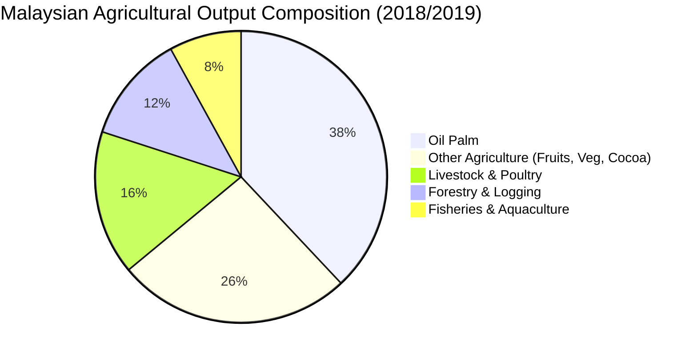

---

## 2.2 Historical Evolution and Structural Changes

Malaysia's agricultural sector evolved through four distinct historical phases:

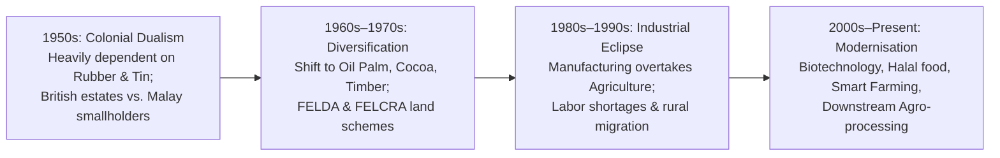

### 2.2.1 The 1950s: Colonial Dualism and Rubber Dominance
- The economy inherited extreme colonial **dualism**:
  - A modern, highly capitalized estate plantation sector owned primarily by British agency houses (Guthrie, Harrisons & Crosfield, Sime Darby).
  - A traditional, impoverished, low-yield peasant smallholder sector operated by indigenous Malays.
- The country was dangerously dependent on natural rubber and tin, making national income hostage to international commodity price gyrations.

### 2.2.2 The 1960s–1970s: Planned Agricultural Diversification
- The post-independence government initiated deliberate crop diversification into **oil palm**, **cocoa**, **timber**, and **pepper**.
- **The Role of FELDA (Federal Land Development Authority)**: Established in 1956, FELDA cleared millions of hectares of virgin jungle to resettle landless rural Malay families, granting each settler household 10–12 acres of oil palm or rubber land, modern housing, and access to central processing mills.

### 2.2.3 The 1980s–1990s: Industrial Eclipse and Emerging Constraints
- Under the heavy industrialization drive, the manufacturing sector surpassed agriculture as the main engine of GDP growth and export revenue.
- Rural youth migrated to urban assembly factories, causing acute agricultural labor shortages, farm abandonment, and rising dependency on low-skilled Indonesian and Bangladeshi migrant workers.

### 2.2.4 2000s to Present: Knowledge-Based Agriculture and Agrofood Modernization
- Focus shifted toward commercialization, unlocking biotechnology, precision farming (IoT sensors, automated irrigation, drones), high-value niche crops (MD2 pineapples, Musang King durian), and strengthening downstream supply chains.

---

## 2.3 National Agricultural Policies (NAP 1 to DAN 2.0)

To coordinate public expenditure, land use, and market incentives, the federal government implemented five successive agricultural policy frameworks:

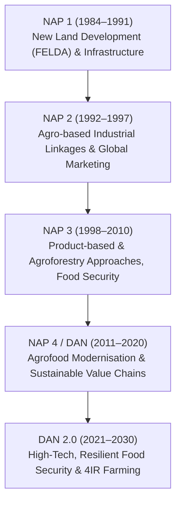

### 2.3.1 First National Agricultural Policy (NAP 1: 1984–1991)
- **Primary Objectives**: Maximize agricultural income through efficient resource utilization and revitalize the sector's contribution to national GDP; increase domestic food production (paddy, fruits, vegetables, poultry).
- **Core Strategies**:
  - Massive new land development via FELDA and FELCRA to eliminate uneconomic, fragmented farm plots.
  - Subsidized input schemes (fertilizers, high-yield seeds, drainage/irrigation infrastructure).
  - Modernization of rural village institutions to stem rural-to-urban youth migration.

### 2.3.2 Second National Agricultural Policy (NAP 2: 1992–1997)
- **Primary Objectives**: Deepen inter-sectoral linkages between agriculture and manufacturing; achieve sustainable agricultural growth; accelerate modern technology adoption.
- **Core Strategies**:
  - Integration of off-farm agro-processing activities with manufacturing export strategies.
  - Greater commercial private-sector participation and R&D funding.
  - Global marketing and export promotion for processed food products.

### 2.3.3 Third National Agricultural Policy (NAP 3: 1998–2010)
- **Strategic Context**: Formulated immediately following the 1997 Asian Financial Crisis, when the sharp depreciation of the Ringgit caused Malaysia's national food import bill to surge.
- **Two Foundational Approaches**:
  1. **Product-Based Approach**: Identified new market niches requiring product innovation:
     - *Agro-Eco-Tourism*: Homestays, agricultural park visits, jungle trekking, and farm stays.
     - *Halal Food Hub*: Exploiting Malaysia's global reputation as a progressive Muslim nation to capture market share in international Halal food processing.
     - *Biotechnology & Herbal Medicine*: Commercial extraction of indigenous bio-resources (e.g., Tongkat Ali, Kacip Fatimah, Gamat, Virgin Coconut Oil).
  2. **Agroforestry Approach**: Integrating commercial timber forestry with agricultural crop cultivation and livestock grazing to optimize scarce land resources.

### 2.3.4 Fourth National Agricultural Policy / National Agrofood Policy (DAN: 2011–2020)
- Addressed rising global commodity price volatility and climate change impacts.
- Promoted complete supply chain integration (from farm to fork) to raise farmer incomes and national food self-sufficiency ratios.

### 2.3.5 National Agrofood Policy 2.0 (DAN 2.0: 2021–2030)
- **Vision**: Develop a sustainable, resilient, and high-technology agrofood sector that guarantees national food security and improves farmer welfare.
- **Key Focus Areas**:
  - Incorporating 4IR technologies (drones, AI pest detection, IoT precision fertigation).
  - Elevating domestic food self-sufficiency ratios (SSR) to insulate against geopolitical supply disruptions.
  - Ensuring environmental sustainability and climate-smart agriculture.

---

## 2.4 The Oil Palm Subsector: Growth, Success Factors, and Structural Challenges

The oil palm (*Elaeis guineensis*) industry is the undisputed crown jewel of Malaysian commercial agriculture:

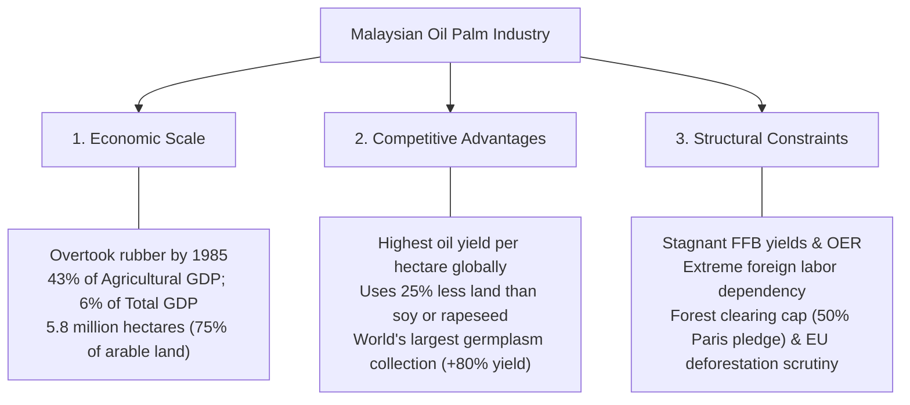

### Historical Ascendancy
- Introduced commercially in 1917, oil palm expanded aggressively after the 1960s as rubber prices stagnated.
- By **1985**, oil palm overtook rubber as Malaysia's primary agricultural commodity, accounting for nearly $30\%$ of total agricultural output.
- By **2016/2017**, oil palm occupied **5.8 million hectares** ($75\%$ of Malaysia's total cultivated land area), contributing **$43\%$ to agricultural GDP** and employing over 440,000 workers.

### Five Core Drivers of Global Success
1. **Surging Global Demand**: Global palm oil consumption increased from under 1 million metric tons in the 1960s to over 62 million tons by 2015, driven by population growth, food processing, oleochemicals, and biofuels.
2. **Exceptional Yield and Land-Use Efficiency**: Oil palm produces **4 to 10 times more oil per hectare** than competing temperate oilseeds (soybean, sunflower, rapeseed). While oil palm uses $25\%$ less land per unit of output, soybean oil production costs are $20\%$ higher and rapeseed higher still.
3. **Downstream Industrial Integration**: Malaysia integrated upstream plantations with local refineries, manufacturing specialized oleochemicals, biodiesel, shortenings, cosmetics, and specialty fats.
4. **Institutional Smallholder Mobilization**: Agencies such as **FELDA**, **FELCRA**, and **RISDA** integrated over 100,000 landless smallholders into commercial estate farming contracts, ensuring stable incomes and shared processing profits.
5. **R&D and Genomic Breeding**: The **Malaysian Palm Oil Board (MPOB)** accumulated the world's largest oil palm germplasm collection from West Africa and Latin America, developing elite tissue-culture clones that increased fresh fruit bunch (FFB) yields by up to $80\%$.

### Severe Structural Vulnerabilities and Problems
1. **Stagnant Productivity**: National average FFB yields have remained plateaued around **18–20 tonnes per hectare** for over two decades, while the Oil Extraction Rate (OER) has struggled to surpass $20\%$.
2. **Extreme Dependency on Cheap Foreign Labor**: Upstream harvesting of tall palms remains unmechanized, relying overwhelmingly on low-skilled foreign labor. Severe worker shortages during border closures (e.g., COVID-19) resulted in billions of Ringgit in unharvested, rotting fruit.
3. **Arable Land Ceilings**: In compliance with the **2015 Paris Climate Agreement**, Malaysia pledged to permanently maintain at least **$50\%$ of its total landmass under natural forest cover**. Consequently, the government halted new primary forest clearing for oil palm, forcing future output growth to come exclusively from yield intensification.
4. **Environmental, Social, and Governance (ESG) Backlash**: The sector faces intense international scrutiny regarding deforestation, peatland drainage, loss of orangutan habitats, indigenous land disputes, and allegations of forced labor, leading to European Union (EU) Deforestation Regulations (EUDR) and import bans.

---

## 2.5 The Rubber Subsector: From Estate Dominance to Downstream Manufacturing

### The Retreat of Upstream Rubber Cultivation
- Rubber cultivation declined from peak production of **1.6 million tonnes** in the late 1970s to under 650,000 tonnes by 2016.
- Commercial plantation conglomerates systematically clear-felled low-yielding rubber estates and replanted them with lucrative oil palm. The number of rubber estates collapsed from **2,249 in 1967 to only 173 by 2016**.
- Today, **$95\%$ of raw rubber output is produced by smallholders** supported by RISDA, while private commercial capital has exited upstream tapping.

### The Downstream Manufacturing Triumph
Despite upstream output contraction, Malaysia converted its 120-year institutional experience in elastomer chemistry into a multi-billion-dollar downstream manufacturing triumph:
- Building on research by the **Malaysian Rubber Board (LGM)**, Malaysia became the undisputed global leader in manufactured latex goods.
- Supplies over **$60\% - 65\%$ of the world's medical examination and surgical gloves** (led by domestic corporate giants Top Glove, Hartalega, Kossan, and Supermax), alongside catheters, latex threads, and specialized industrial rubber components.

---

## 2.6 The Cocoa Subsector: From Bean Cultivation to Global Grinding Hub

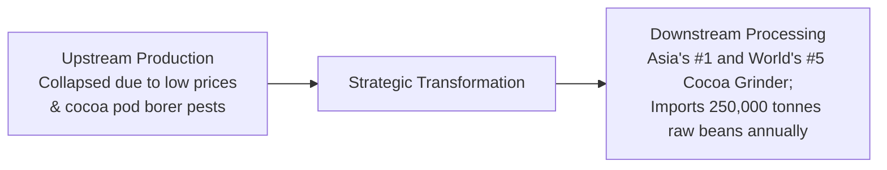

- **Upstream Collapse**: Domestic cocoa bean production plummeted after 1990 due to depressed world cocoa prices (US$1,000–$2,000/tonne vs. US$4,000 in 1977) and devastating infestations of the **cocoa pod borer** pest (*Conopomorpha cramerella*). Cultivation shifted geographically from Peninsular Malaysia to Sabah before shrinking drastically.
- **The Grinding Hub Paradox**: Although domestic farmers produce less than 100,000 tonnes of beans annually, Malaysia expanded its processing capacity to become the **largest cocoa grinder in Asia and the fifth-largest globally**. To meet the grinding capacity of over 350,000 tonnes, Malaysian grinders import over 250,000 tonnes of raw beans annually from West Africa (Ghana, Ivory Coast) to export high-value cocoa butter, cocoa powder, and chocolate confectionery worldwide.

---

## 2.7 The Political Economy of Paddy and Rice Farming

Rice is Malaysia's primary staple food crop, but government rice policy illustrates the acute tension between **national food security goals** and **economic efficiency**:

> [!warning] The High Financial and Opportunity Cost of Rice Protectionism
> - **Budget Burden**: In 2011, **$57\%$ of the entire Ministry of Agriculture budget** was consumed by rice price subsidies, fertilizer subsidies, and cash transfers (averaging $45\%$ in 2017).
> - **Consumer Cost**: To protect domestic rice farmers and the national sole-importer monopoly (**BERNAS**), the government imposes quantitative import quotas and price floors. As a result, Malaysian consumers pay rice prices significantly above world market parity—creating a protectionist regime comparable to Japan.
> - **High Opportunity Cost**: A landmark simulation study by the International Rice Research Institute (IRRI) demonstrated that if farmers in high-yield irrigated granary areas were permitted to diversify land into high-value vegetables, fruits, or aquaculture, **household farmer incomes would increase by approximately $50\%$**.

---

## 2.8 Marine Fisheries and the Aquaculture Revolution

- **Wild Capture Depletion**: Marine fish catches in coastal inshore waters have plateaued or declined due to chronic overfishing, illegal trawling, and coral reef destruction.
- **Aquaculture Expansion**: The Department of Fisheries actively incentivized aquaculture to bridge the widening protein supply gap:
  - Total annual production value of aquaculture exceeds **RM3 billion**.
  - **Key Marine Commodities**: Marine shrimp farming (accounting for $24.8\%$ of volume and $41.3\%$ of value), freshwater fish (tilapia, catfish), hybrid groupers (pioneered by Universiti Malaysia Sabah's BMRI), seaweed cultivation in Sabah, and exotic ornamental fish exports.

---

## 2.9 Cross-Cutting Structural Challenges in Malaysian Agriculture

| Critical Challenge | Underlying Causes & Real-World Impacts |
| :--- | :--- |
| **Aging Farming Demographics** | Average farmer age exceeds 55; youths reject manual farming (*3D: Dirty, Difficult, Dangerous*), causing severe inter-generational transition gaps. |
| **Heavy Foreign Labor Dependency** | Inability to automate harvesting creates dangerous reliance on migrant workers vulnerable to immigration policy shifts and international border closures. |
| **Low 4IR Technology Adoption** | High capital costs for precision sensors, automated drone spraying, and automated climate greenhouses restrict modern adoption to large corporate estates; smallholders remain traditional. |
| **Land Fragmentation** | Inherited subdivision under customary and Islamic inheritance laws reduces farm plots to uneconomic fractions of a hectare, preventing economies of scale. |
| **Low Standard Conformance** | Slow uptake of **MyGAP (Malaysian Good Agricultural Practices)** certification hampers export access to premium international supermarkets. |


---

# Topic 3: The Industrial and Manufacturing Sector of Malaysia

## 3.1 The Strategic Importance of Manufacturing: Engine of Export Growth

Although the services sector has expanded to comprise approximately $60\%$ of GDP, the **manufacturing sector** remains the vital economic engine of Malaysia:

> [!info] Key Empirical Indicators of Malaysian Manufacturing
> - **GDP Share**: Contributes approximately **$23\%$ of national GDP** (peaked at $31\%$ in 2000).
> - **Merchandise Exports**: Accounts for nearly **$85\%$ of total national merchandise export earnings**, heavily driven by Electrical and Electronics (E&E).
> - **Employment**: Directly employs approximately **$2.9\text{ million}$ workers** (around $17\% - 18\%$ of the national workforce).
> - **Private Capital Investment**: Captures roughly **one-third of all approved capital investments** (MIDA).

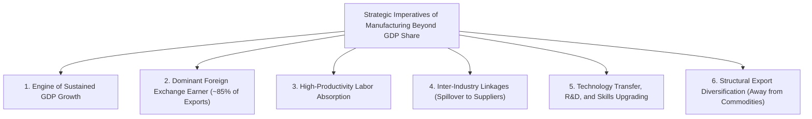

### The Six Drivers of Manufacturing Significance
1. **Engine of Growth**: Historically propelled Malaysia's rapid GDP expansion (averaging over $8\%$ annually during the late 1980s and 1990s).
2. **Exports and Foreign Exchange**: Earns the critical foreign currency reserves needed to finance national capital equipment imports.
3. **Productive Employment**: Absorbed surplus rural agricultural labor into formal, higher-wage industrial employment.
4. **Inter-Industry Linkages**: Drives deep supply chain connections by purchasing intermediate components from local engineering and packaging suppliers.
5. **Technology and Skills Diffusion**: Serves as the primary conduit for international technology transfer, advanced manufacturing techniques, and technical workforce training through Foreign Direct Investment (FDI).
6. **Macroeconomic Diversification**: Successfully insulated the national economy from catastrophic swings in global tin and rubber commodity prices.

---

## 3.2 The Five Historical Phases of Industrialisation

Malaysia's industrial transformation is characterized by five distinct strategy shifts, alternating between producing for a protected domestic market and competing in global export markets:

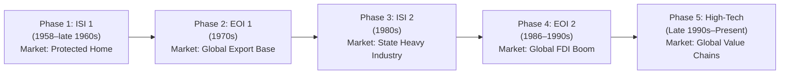

### Comparative Summary of the Five Industrial Phases

| Phase | Historical Period | Strategic Policy Paradigm | Primary Policy Instruments | Core Structural Flaw / Trigger for Transition |
| :--- | :--- | :--- | :--- | :--- |
| **ISI 1** | 1958–late 1960s | First-Stage Import Substitution (Consumer goods) | Pioneer Industries Ordinance 1958, tariffs, tax holidays, MIDA | Narrow domestic market, low value-addition, rent-seeking. |
| **EOI 1** | 1970s | First-Stage Export Orientation (Labor-intensive) | Free Trade Zone Act 1971, Investment Incentives Act 1968 | Enclave dualism; lack of backward linkages to domestic SMEs. |
| **ISI 2** | 1980s | Second-Stage Heavy Import Substitution | HICOM (1980), Proton, Perwaja Steel, sovereign borrowing | Huge financial losses, excess capacity, small home market. |
| **EOI 2** | 1986–1990s | Second-Stage FDI-Led Export Boom | Promotion of Investments Act 1986, Plaza Accord FDI wave | Acute labor shortages, rising wages, trap in low-margin OEM assembly. |
| **High-Tech** | Late 1990s–Now | Innovation, Digital Economy & Advanced Packaging | Multimedia Super Corridor (MSC), NIMP 2030, NSS (2024) | Premature deindustrialisation, middle-income trap, STEM talent gap. |

---

### Detailed Analysis of Each Industrial Phase

#### 3.2.1.1 Phase 1: First-Stage Import Substitution (ISI 1: 1958–late 1960s)
- **Objective**: Replace imported consumer goods (beverages, biscuits, tobacco, simple plastics) with domestically manufactured goods to conserve foreign exchange.
- **Policy Tools**:
  - *Pioneer Industries Ordinance 1958*: Granted multi-year corporate tax holidays to newly registered manufacturing firms.
  - *Protective Import Tariffs*: The **Effective Rate of Protection (ERP)** rose steadily from $25\%$ in 1962 to $50\%$ in 1966, $65\%$ in 1969, and $70\%$ by 1972.
  - *Institutional Enablers*: Establishment of the Malaysian Industrial Development Finance (**MIDF**) in 1960 and the Federal Industrial Development Authority (**FIDA**, later **MIDA**) in 1967.
- **Why ISI 1 Stalled**:
  - *Small Domestic Market*: Malaya's population was only 8–10 million with low purchasing power; factories reached saturation quickly, operating well below minimum efficient scale.
  - *Low Value-Added*: Foreign multinationals established "screwdriver" assembly plants that imported completely knocked-down (CKD) kits, performing only final packaging locally.
  - *Rent-Seeking*: Protected domestic manufacturers lobbied politicians for indefinite tariff shields rather than investing in competitive efficiency.

---

#### 3.2.1.2 Phase 2: First-Stage Export-Oriented Industrialisation (EOI 1: 1970s)
- **Trigger for Change**: Severe urban unemployment, saturation of the domestic market, and the urgent mandate under the NEP (1971) to absorb rural Malay youth into urban factory employment.
- **Policy Tools**:
  - **Free Trade Zone Act 1971**: Established specialized industrial enclaves—most famously **Bayan Lepas in Penang** and Sungei Way in Selangor. Firms inside Free Trade Zones (FTZs) imported raw materials and capital machinery **100% duty-free**, provided the finished goods were exported.
  - Attracted multinational semiconductor giants (the "Eight Samurai" in Penang, including Intel in 1972, AMD, National Semiconductor, and Hewlett-Packard).
- **Achievements & Structural Weaknesses**:
  - *Success*: Created hundreds of thousands of manufacturing jobs quickly, absorbing young female workers into light assembly.
  - *Weakness (Enclave Dualism)*: FTZs operated as foreign-owned islands divorced from the domestic economy. MNCs imported all components and exported finished IC chips, developing virtually zero backward linkages with domestic Malaysian engineering firms.

---

#### 3.2.1.3 Phase 3: Second-Stage Heavy Import Substitution (ISI 2: 1980s)
- **Ideological Rationale**: Inspired by South Korea and Japan, Prime Minister Dr. Mahathir Mohamad initiated heavy industrialization to:
  1. Deepen backward supply linkages by producing basic industrial raw materials locally (steel, cement, automotive components).
  2. Reduce vulnerability to imported capital goods.
  3. Create an advanced industrial class of Malay engineers and technical managers under the NEP.
- **The Vehicle: HICOM**:
  - The **Heavy Industries Corporation of Malaysia (HICOM)** was established in 1980 as a state-owned holding corporation.
  - Key Megaprojects: **Proton** (the National Car project in 1983, partnering with Mitsubishi), **Perwaja Steel** in Terengganu, and large-scale national cement plants (Kedah Cement, Perak-Hanjoong).

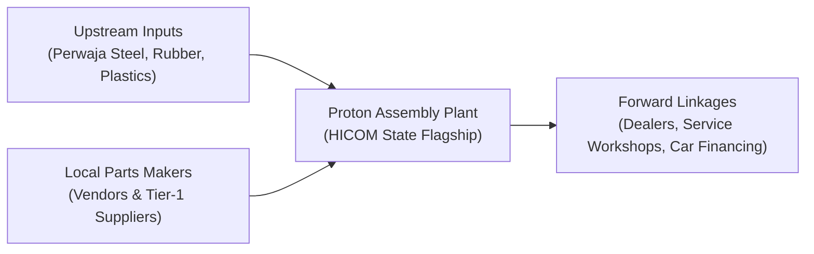

- **Why Heavy Industry Stumbled**:
  - *Scale Inefficiencies*: Heavy industries require massive production runs to lower unit costs. Proton was designed for 110,000 cars annually but sold only ~30,000 units during the 1987 recession. Domestic cement capacity was double total national demand.
  - *Financial Losses and Sovereign Debt*: Heavy industry was funded via sovereign external loans denominated in Japanese Yen. Following the **1985 Plaza Accord**, the Yen appreciated dramatically against the Ringgit, doubling Malaysia's foreign debt-servicing obligations and plunging state enterprises into multi-billion-ringgit losses.

---

#### 3.2.1.4 Phase 4: Second-Stage FDI-Led Export Boom (EOI 2: 1986–1990s)
- **Trigger for Change**: The devastating 1985 economic recession forced the government to abandon state-led heavy industrial expansion and aggressively court foreign direct investment.
- **Policy Tools**:
  - **Promotion of Investments Act 1986 (PIA)**: Drastically liberalized investment rules, offering pioneer status with $100\%$ tax exemptions for up to 10 years, and crucially, **relaxed NEP equity rules**, permitting $100\%$ foreign equity ownership for export-oriented manufacturers.
  - *FDI Tidal Wave*: Coincided perfectly with the post-Plaza Accord relocation of Japanese, Taiwanese, and South Korean electronics and consumer goods factories searching for lower-cost manufacturing bases in Southeast Asia.
- **The Limits of EOI 2**:
  - Rapid expansion exhausted domestic labor reserves, creating acute labor shortages and wage inflation.
  - Malaysian firms remained trapped as **Original Equipment Manufacturers (OEM)**, executing low-margin contract manufacturing without owning the intellectual property, design, or global marketing brands.

---

#### 3.2.1.5 Phase 5: High-Tech, Innovation, and Modern Industrial Policy (Late 1990s–Present)
- **Strategic Direction**: Transitioning from labor-intensive manual assembly toward capital-intensive, automated, and digitally driven manufacturing.
- **Initiatives**:
  - **Multimedia Super Corridor (MSC)** established in 1996 to foster domestic ICT and software engineering.
  - **New Industrial Master Plan 2030 (NIMP 2030)** launched in 2023.
  - **National Semiconductor Strategy (NSS)** launched in 2024 to advance domestic companies into Integrated Circuit (IC) chip design and front-end fabrication.

---

## 3.3 The Evolution of Industrial Master Plans (IMP1 to NIMP 2030)

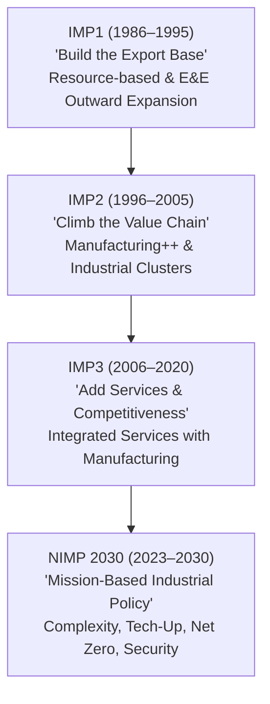

### 3.3.1 First Industrial Master Plan (IMP1: 1986–1995) — "Building the Export Base"
- **Focus**: Identified **12 priority industries**:
  - *7 Resource-Based*: Rubber products, palm oil processing, food processing, wood-based products, chemicals/petrochemicals, non-ferrous metals, non-metallic minerals.
  - *5 Non-Resource-Based*: Electrical & electronics (E&E), transport equipment, machinery, iron and steel, textiles and apparel.
- **Legacy**: Transformed Malaysia's export composition; manufactured goods soared from roughly **one-third of total merchandise exports in 1985 to over $80\%$ by 1995**.

---

### 3.3.2 Second Industrial Master Plan (IMP2: 1996–2005) — "Climbing the Value Chain"
- **Strategic Concept: Manufacturing++**:
  - Introduced Stan Shih's famous **Smile Curve (1992)** to national economic planning:

```
Value Added
High   |    \                                         /
       |     \ (R&D, IC Design)             (Branding, /
       |      \                              Marketing)
Medium |       \                                     /
       |        \                                   /
Low    |         \_______[ Assembly & Testing ]____/
       +--------------------------------------------------- Value Chain Stage
                         Malaysia's Historical Position
```

- Manufacturing policies had concentrated strictly on the bottom trough of the curve (low-value assembly and contract testing).
- **Manufacturing++** mandated shifting investments along both ends of the curve:
  - *Upstream*: Into R&D, product conceptualization, chip design, and prototyping.
  - *Downstream*: Into international distribution logistics, brand creation, and global marketing.
- **Cluster-Based Industrial Development**: Promoted geographically concentrated ecosystems of specialized suppliers, testing labs, universities, and service providers (e.g., the Penang E&E Cluster).

---

### 3.3.3 Third Industrial Master Plan (IMP3: 2006–2020) — "Towards Global Competitiveness"
- **New Dimension**: The first master plan to explicitly integrate **services alongside manufacturing** over a 15-year planning horizon.
- Targeted **12 manufacturing subsectors** and **8 high-growth services subsectors** (logistics, ICT, healthcare, education, engineering consultancy).
- Aimed to counter intense competitive pressure from China (following its 2001 WTO accession) and India by moving away from low-cost labor competition into high-productivity, knowledge-intensive operations.

---

### 3.3.4 New Industrial Master Plan 2030 (NIMP 2030: 2023–2030)
Formulated by the Ministry of Investment, Trade and Industry (MITI), NIMP 2030 abandons traditional sectoral targeting in favor of **Mission-Based Industrial Policy**:

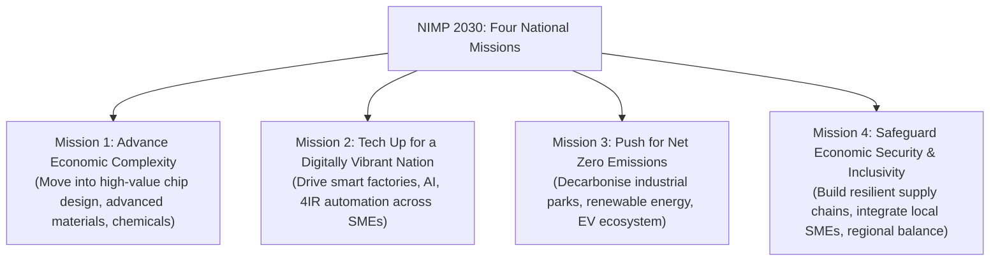

#### Targets for 2030:
- Manufacturing Value-Added targeted to reach **RM587.5 billion**.
- Create **3.3 million high-skilled jobs**, with median industrial wages rising to **RM4,510 per month**.
- Flagship Implementation: **National Semiconductor Strategy (NSS 2024)**, allocating RM25 billion to establish Malaysia as a global leader in outsourced semiconductor assembly and test (OSAT), front-end chip design, and advanced silicon packaging.

---

## 3.4 Small and Medium Enterprises (SMEs / MSMEs) in Manufacturing

Small and Medium Enterprises represent the fundamental backbone of Malaysia's industrial fabric:

> [!info] SME Corp. Malaysia Official Definitions (2013 Revision)
> Enterprises are classified into three size tiers based on either **Sales Turnover** OR **Full-Time Employees**:
> 
> | Enterprise Tier | Manufacturing Sector Thresholds | Services & Other Sectors Thresholds |
> | :--- | :--- | :--- |
> | **Micro-Enterprise** | Sales $< \text{RM300,000}$ **OR** $< 5$ Employees | Sales $< \text{RM300,000}$ **OR** $< 5$ Employees |
> | **Small Enterprise** | Sales $\text{RM300,000} - < \text{RM15m}$ **OR** $5 - < 75$ Employees | Sales $\text{RM300,000} - < \text{RM3m}$ **OR** $5 - < 30$ Employees |
> | **Medium Enterprise** | Sales $\text{RM15m} - \le \text{RM50m}$ **OR** $75 - \le 200$ Employees | Sales $\text{RM3m} - \le \text{RM20m}$ **OR** $30 - \le 75$ Employees |

### The SME Economic Footprint
- Micro, Small, and Medium Enterprises (MSMEs) account for **$96\% - 97\%$ of all business establishments** in Malaysia.
- Contribute approximately **$38\% - 40\%$ of national GDP** and employ nearly **$48\%$ of the national labor force**.
- However, **over $75\%$ of all MSMEs are micro-enterprises** operating simple food stalls, personal services, and retail shops with minimal productivity.

### Key Roles and Structural Bottlenecks of Manufacturing SMEs
- **Vital Supply Chain Roles**: Act as specialized Tier-2 and Tier-3 vendors supplying precision machining, stamping, plastic injection molding, and packaging services to multinational electronics and automotive assemblers.
- **Chronic Bottlenecks**:
  1. *Under-Capitalization and Credit Constraints*: Commercial banks demand physical collateral, restricting access to debt financing for high-risk equipment investments.
  2. *Sluggish Digital & 4IR Adoption*: High costs prevent small machine shops from retrofitting IoT sensors or purchasing robotic arms.
  3. *Inability to Scale Up*: Very few Malaysian SMEs successfully cross the chasm from small subcontracting workshops to large, multinational corporations.

---

## 3.5 Structural Challenges and the Future: "Made by Malaysia"

Despite its immense export success, Malaysia's manufacturing sector faces five critical structural challenges:

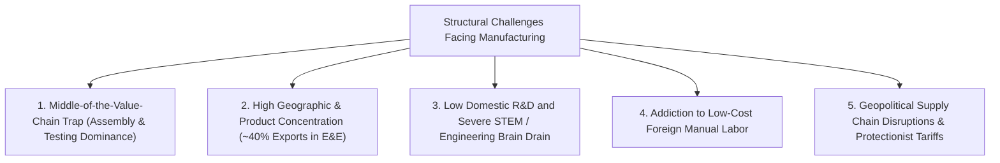

1. **The Assembly Trap**: Malaysia dominates global backend testing and packaging ($13\%$ of global OSAT market share), but possesses very few domestic firms engaged in high-margin front-end wafer fabrication, IC intellectual property, or proprietary product branding.
2. **Product Concentration Risks**: Over $40\%$ of total merchandise exports remain concentrated in a single sector: Electrical and Electronics. Cyclical downturns in global semiconductor demand directly impact national GDP.
3. **Low R&D and Skills Gaps**: National gross expenditure on R&D (GERD) has languished near $1\%$ of GDP for decades. Local universities produce insufficient numbers of semiconductor design engineers, while top engineering graduates emigrate to Singapore for higher compensation.
4. **Cheap Labor Addiction**: Access to millions of low-wage migrant workers reduced corporate incentives to automate, perpetuating labor-intensive assembly processes and suppressing real domestic wages.
5. **Geopolitical Realignment & "China+1"**: The US-China tech war presents both a profound opportunity and a major risk. While Malaysia has benefited from "China+1" factory relocations (attracting massive investments from Intel, Infineon, and Texas Instruments), it faces rising risks from US export controls, semiconductor sanctions, and potential blanket tariffs.

> [!tip] The Strategic Leap: From "Made in Malaysia" to "Made by Malaysia"
> To escape the middle-income trap, Malaysia must shift from simply hosting foreign factories that stamp goods as **"Made in Malaysia"** toward cultivating home-grown champions that design, engineer, and market proprietary intellectual property globally as **"Made by Malaysia"**.


---

# Topic 4: The Services Sector of Malaysia

## 4.1 The Services Sector Paradox: Scale vs. Labor Productivity

The services sector is the dominant giant of the modern Malaysian economy, yet it presents a fundamental developmental puzzle:

> [!info] The Services Sector in Numbers (DOSM Data)
> - **GDP Contribution**: Generates approximately **$60\%$ of Malaysia's GDP**, dwarfing manufacturing ($23\%$) and agriculture ($7\%$).
> - **Employment**: Employs over **$63\%$ of the national workforce** (approximately $10.5\text{ million}$ out of $16.7\text{ million}$ total workers).
> - **Services Trade Balance**: Recorded **RM278 billion in services exports in 2025**; achieved a **RM5.3 billion services trade surplus**, the first positive balance since 2011.


### The Productivity Dilemma
Despite its overwhelming macroeconomic weight, **labor productivity in services is lower than in manufacturing**:
- In 2025/2026, a manufacturing worker generated an average output value of **RM35,700 per quarter**, whereas an average services worker produced only **RM24,900**—falling below the national labor productivity average (RM26,200).
- *The Core Insight*: The services sector is massive because it is **labor-absorptive**, acting as a sponge for millions of workers, but is weighed down by a long tail of traditional, low-margin activities.

### Traditional vs. Modern Services Subsectors
The sector is fundamentally bifurcated into two distinct operational worlds:

| Category | Typical Subsectors | Productivity & Workforce Characteristics |
| :--- | :--- | :--- |
| **Traditional Services** | Wholesale & retail trade, food & beverage (*kedai makan*, *mamak* stalls), accommodation, personal services, general civil administration. | Low capital intensity, highly fragmented, reliant on low-skilled labor and foreign workers, modest wages, low automation. |
| **Modern Services** | Banking, finance, takaful, ICT, software engineering, cloud data centers, professional legal/accounting/engineering services, medical tourism. | High capital and technology intensity, high skill requirements, high value-addition per worker, strongly exportable. |

---

## 4.2 The Role of the State: Provider, Regulator, and Promoter

The Malaysian government maintains an active, multi-faceted relationship with the services sector:
1. **The State as Provider**: Employs approximately **1.3 million civil servants**, directly managing universal public primary/secondary schools, general hospitals, public universities, police forces, and municipal infrastructure.
2. **The State as Regulator**:
   - **Bank Negara Malaysia (BNM)**: Regulates commercial banks, investment banks, digital banks, insurance, and payment systems.
   - **Securities Commission (SC)**: Regulates capital markets, stockbroking, and asset management on Bursa Malaysia.
   - **Malaysian Communications and Multimedia Commission (MCMC)**: Regulates telecommunications, internet service providers, and digital broadcasting.
3. **The State as Promoter**:
   - **Tourism Malaysia**: Promotes international leisure and cultural travel.
   - **Malaysia Healthcare Travel Council (MHTC)**: Promotes private medical tourism globally.
   - **Education Malaysia Global Services (EMGS)**: Markets Malaysian higher education to international students.

---

## 4.3 The Four Modes of Services Trade Under WTO GATS

Unlike physical merchandise that travels on cargo container ships, services are intangible and are traded internationally across **Four Modes of Supply** defined by the World Trade Organization's General Agreement on Trade in Services (GATS):

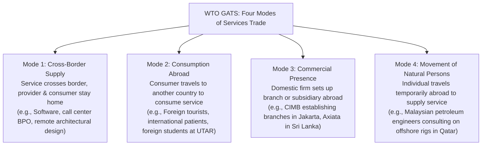

---

## 4.4 The Financial Sector: Evolution, Restructuring, and Islamic Finance Hub

Malaysia's banking and capital market system evolved through five deliberate stages:

```mermaid
flowchart TD
    S1["1. Pre-1959 Colonial Era<br>British banks (Standard Chartered, HSBC) finance raw export trade"] --> S2["2. 1959–1970 Foundation<br>Establishment of Bank Negara Malaysia (1959) & domestic banks"]
    S2 --> S3["3. 1971–1990 NEP Restructuring<br>State acquisition of banks; Islamic Banking Act 1983"]
    S3 --> S4["4. 1997–2000s Post-Crisis Mergers<br>Danaharta, Danamodal, & consolidation into 10 anchor banking groups"]
    S4 --> S5["5. 2010s–Present Hub & Digital Banks<br>Global Sukuk leadership & licensing of 5 digital banks (2022)"]
```

### 4.4.1 Pre-1959 Colonial Era
- Dominated by British imperial banks (The Chartered Bank, The Hongkong and Shanghai Banking Corporation) established to provide trade credit and exchange settlement for British rubber plantations and tin mining syndicates.

### 4.4.2 1959–1970: Laying Institutional Foundations
- **Bank Negara Tanah Melayu (BNM)** was established in January 1959 to issue national currency, manage exchange reserves, and supervise commercial banks.
- Establishment of the Malayan Stock Exchange (1960) and specialized development finance institutions (MIDF, Bank Pertanian).

### 4.4.3 1971–1990: NEP Ownership Restructuring
- In 1970, foreign banks controlled **$52.2\%$** of total commercial banking assets, Chinese family banks held **$24.3\%$**, and Bumiputeras held a meager **$3.3\%$**.
- Under the NEP, the state actively intervened to shift financial ownership:
  - Following a bank run in 1966, BNM assumed control of **Malayan Banking Berhad (Maybank)**; ownership was subsequently vested in state investment trust **Permodalan Nasional Berhad (PNB)**.
  - State investment vehicles acquired controlling equity stakes in major private banks. By 1986, **Bumiputera and state agencies controlled 60%–70% of total commercial banking assets**, holding 8 of the top 10 domestic commercial banks.
  - **Islamic Banking Act 1983**: Enacted to establish **Bank Islam Malaysia Berhad (BIMB)**, inaugurating dual-system Shariah-compliant commercial banking.

---

### 4.4.4 1997–2000s: The Asian Financial Crisis and Forced Consolidation
The 1997 crisis triggered severe corporate debt defaults, causing non-performing loans (NPLs) to skyrocket and threatening systemic insolvency among under-capitalized finance companies and smaller banks.

```mermaid
flowchart TD
    Crisis["1997 Asian Financial Crisis: Banking Vulnerabilities"]
    Crisis --> DH["Pengurusan Danaharta Nasional<br>(Asset management vehicle: carved out and resolved bad loans)"]
    Crisis --> DM["Danamodal Nasional Berhad<br>(Injected fresh capital into distressed commercial banks)"]
    Crisis --> CDRC["Corporate Debt Restructuring Committee<br>(Mediation platform for viable debt workouts)"]
    
    DH & DM & CDRC --> Merger["Forced Consolidation (2000)<br>54 financial institutions merged into 10 Anchor Banking Groups"]
```

- **The Resolution Machinery**:
  1. **Danaharta**: Bought bad debts and NPLs from banks at fair market value, freeing bank balance sheets to resume private lending.
  2. **Danamodal**: Injected government equity capital to recapitalize distressed banks.
  3. **Corporate Debt Restructuring Committee (CDRC)**: Mediated out-of-court debt workouts between viable corporations and creditor banks.
- **Forced Consolidation (2000)**:
  - BNM mandated that 54 fragmented domestic commercial banks, merchant banks, and finance companies merge into **10 well-capitalized Anchor Banking Groups** (Maybank, CIMB, Public Bank, RHB Bank, Hong Leong Bank, AmBank, Affin Bank, Alliance Bank, Southern Bank, and Multi-Purpose Bank).
  - This created large, resilient banking institutions capable of surviving global liquidity shocks and expanding across ASEAN.

---

### 4.4.5 2010s to Present: Global Islamic Finance Leadership and Fintech

#### Malaysia as the Global Hub for Islamic Finance
- **Operational Scale**: Islamic banking accounts for approximately **$48\%$ of total commercial banking financing** in Malaysia (up from virtually $0\%$ in 1983).
- **Core Principles**: Prohibition of *Riba* (usury/interest), *Gharar* (excessive ambiguity), and *Maysir* (gambling); financing is asset-backed and operates on profit-and-loss sharing contracts (*Mudarabah*, *Musharakah*, *Murabahah*, *Ijarah*).
- **Global Sukuk Market**: Malaysia pioneered the global sovereign and corporate **Sukuk** (Islamic bond) market, consistently accounting for over **$40\% - 50\%$ of all global Sukuk issuances**.
- **Legislative Consolidation**: Enactment of the **Islamic Financial Services Act 2013 (IFSA)** established a comprehensive, modern end-to-end regulatory and Shariah governance framework.

#### Digital Banking Transformation
- In 2022, Bank Negara Malaysia issued **five digital banking licences** (e.g., GXBank, Boost Bank, AEON Bank).
- Operating branchless on cloud infrastructures, digital banks utilize alternative digital footprints, e-wallet transaction histories, and AI credit scoring to deliver instant micro-credit to underserved segments (gig economy workers, micro-merchants, university students) via the **"3-1-0" credit model** (apply in 3 minutes, approve in 1 second, zero human intervention).

---

## 4.5 Foreign Visitors as Services Exports: Tourism, Healthcare, and Higher Education

When an international visitor enters Malaysia and spends foreign currency on domestic goods and services, that expenditure represents an **invisible services export (GATS Mode 2: Consumption Abroad)**:

```mermaid
flowchart TD
    Visitors["Foreign Visitor Inflows (Mode 2 Services Exports)"]
    Visitors --> T["1. Leisure & Eco-Tourism<br>(42.2m arrivals, RM111b spend, RM49b travel surplus in 2025)"]
    Visitors --> M["2. Medical Tourism (MHTC)<br>(1.84m healthcare travellers, RM3.3b hospital revenue)"]
    Visitors --> E["3. International Higher Education<br>(155,000 foreign students, RM billions in fees & living expenses)"]
```

### 4.5.1 General Tourism and Travel Services
- **Macroeconomic Weight**:
  - Recorded **$42.2\text{ million}$ foreign visitor arrivals** in 2025.
  - Foreign visitors spent **RM111 billion**, accounting for **$39.8\%$ of total services exports**.
  - Generated a **RM49 billion net travel surplus** (foreigners spent far more in Malaysia than outbound Malaysian travelers spent abroad).
  - Sustains approximately **$3.7\text{ million}$ tourism-linked jobs** ($22\%$ of national employment).
- **Tourism Diversification**: Spans eco-tourism (Langkawi UNESCO Geopark, Taman Negara, Mulu Caves, Sipadan diving), urban shopping tourism (duty-free zones), and MICE (Meetings, Incentives, Conferences, Exhibitions).

### 4.5.2 Medical Tourism: Healthcare Travel
- Coordinated nationally by the **Malaysia Healthcare Travel Council (MHTC)** under the Ministry of Health.
- In 2025, Malaysia treated **$1.84\text{ million}$ healthcare travelers** (predominantly from Indonesia, but expanding rapidly from China, India, Singapore, and the Middle East), generating **RM3.3 billion** in direct private hospital receipts (targeting RM7 billion by 2030).
- **Core Competitive Advantages**:
  - *Affordability*: High-complexity treatments (cardiac surgery, IVF, oncology, orthopedics) cost roughly $20\% - 30\%$ of Singapore rates and $10\%$ of US costs.
  - *Quality and Trust*: Internationally accredited private hospitals (JCI, MSQH), English-speaking and multilingual specialists, and immediate doctor access with zero waiting lists.

### 4.5.3 International Higher Education Hub
- Malaysia hosts approximately **155,000 international students** from over 160 countries (aiming for 250,000 by 2030).
- **Drivers of Student Inflows**:
  - Significantly lower tuition fees and living costs compared to Australia, the UK, or the US.
  - Presence of prestigious foreign branch campuses (Monash University, University of Nottingham, Xiamen University, Curtin University, University of Southampton).
  - English-medium instruction, political stability, and a welcoming, multicultural, Halal-friendly environment.

---

## 4.6 National Champions, Privatisation, and Associated Service Ecosystems

During the late 1980s and 1990s, the Malaysian government privatized key state utilities and monopolies, creating powerful Government-Linked Companies (GLCs):

### 4.6.1 Telecommunications: From Departmental Monopoly to 5G Infrastructure
- **Historical Transition**:
  - *Pre-1987*: Operated as a government civil service department (*Jabatan Telekom Malaysia*); infamous for bureaucratic delays and multi-year waiting times for landline installations.
  - *1987*: Corporatized into **Telekom Malaysia (TM)**; listed on the stock exchange in 1990 under national privatization policy.
  - *1990s*: Mobile market liberalized; multiple private competitors entered (Celcom, Maxis, Digi, TimeCel).
  - *2022*: Landmark consolidation: Celcom and Digi merged to create **CelcomDigi**, establishing Malaysia's largest telecommunications conglomerate.
- **5G National Architecture**:
  - In 2021, the government founded **Digital Nasional Berhad (DNB)** as a state-owned Single Wholesale Network (SWN) to deploy national 5G infrastructure cost-effectively.
  - In 2024/2025, the government transitioned to a **Dual-5G Network model**, awarding the second national 5G license to U Mobile to drive network redundancy and commercial competition.
  - National broadband penetration exceeded $98.8\%$ in populated areas by 2025, providing the digital highway for e-commerce, cloud data centers, and fintech.

### 4.6.2 Automotive Industry: The Embedded Service Ecosystem
- While Proton (1985) and Perodua (1994) were founded as manufacturing projects behind high tariff walls, automotive manufacturing catalyzes a massive **downstream services ecosystem**:
  - In 2017, China's **Zhejiang Geely Holding Group** acquired a $49.9\%$ equity stake in Proton, revitalizing the brand with modern SUV platforms and export engineering.
  - In 2025, total national vehicle sales reached a historic record of **820,752 units**, led by Perodua ($\approx 44\%$ market share).
  - *The Multiplier in Services*: Every new vehicle sale activates multiple service industries: hire-purchase auto financing (commercial banks), auto insurance and takaful, authorized dealership commissions, aftermarket mechanical maintenance workshops, and online used-car trading platforms (Carsome, MyTukar).

---

## 4.7 Strategic Challenges: Escalating to High-Value Services

To escape the middle-income trap, Malaysia's services sector must navigate five structural constraints:

```mermaid
flowchart TD
    SC["Structural Constraints in Services"]
    SC --> R1["1. Low Labor Productivity in Traditional Retail, F&B, & Hospitality"]
    SC --> R2["2. Acute Shortage of High-End Digital, AI, & Specialized Engineering Talent"]
    SC --> R3["3. Proliferation of Low-Productivity Informal Micro-Enterprises"]
    SC --> R4["4. Heavy Exposure to Global Liberalization Under WTO GATS"]
    SC --> R5["5. Over-Reliance on Low-Wage Migrant Workers in Services"]
```

1. **Persistent Productivity Gaps**: Over two-thirds of services jobs remain concentrated in low-value wholesale/retail and food preparation. Raising overall services productivity requires widespread adoption of point-of-sale automation, automated logistics, and digital inventory management.
2. **STEM and Digital Talent Shortages**: The rapid influx of regional artificial intelligence (AI) hyperscale data centers (attracting tens of billions in investments from Microsoft, Google, AWS, and Nvidia into Johor and Cyberjaya) creates extreme demand for cloud architects, cybersecurity specialists, and data engineers that local universities struggle to supply.
3. **The Services Equivalent of "Made by Malaysia"**: Transitioning from consuming foreign digital platforms (Grab, Shopee, Netflix, Google) toward exporting high-value, home-grown professional and digital services across ASEAN.


---

# Topic 5: Foreign Direct Investment (FDI) and Globalisation in the Malaysian Economy

## 5.1 The Strategic Significance of Foreign Direct Investment (FDI)

Foreign Direct Investment (FDI) has served as the indispensable catalyst for Malaysia's economic modernization and export industrialization since independence:

```mermaid
flowchart TD
    FDI["Four Core Contributions of FDI to Malaysian Development"]
    FDI --> C1["1. Capital Formation & Non-Debt Financing"]
    FDI --> C2["2. High-Skilled Employment & Human Capital"]
    FDI --> C3["3. Technology Transfer & Advanced Machinery"]
    FDI --> C4["4. Global Value Chain Integration for Domestic SMEs"]
    
    C1 --- D1["Injects foreign equity capital, supplementing domestic savings to expand GDP without adding public debt."]
    C2 --- D2["MNCs create skilled engineering and managerial jobs, raising local wage levels and technical capabilities."]
    C3 --- D3["Imports sophisticated equipment, proprietary software, and managerial organizational know-how."]
    C4 --- D4["Embeds local component vendors into multinational global supply networks."]
```

> [!info] Why FDI Matters Beyond Capital Injection
> 1. **Capital and GDP Growth**: Supplements domestic capital accumulation; foreign firms build physical factories, install advanced assembly lines, and generate corporate tax revenues.
> 2. **Employment and Skills Modernization**: Upgrades the skills of local technicians, operators, and executives through structured corporate training and international secondments.
> 3. **Technology Spillovers**: Introduces cutting-edge manufacturing processes, automation systems, and quality control certifications (ISO) that domestic firms cannot generate independently.
> 4. **Global Value Chain (GVC) Integration**: Provides domestic SMEs with immediate access to multi-billion-dollar global procurement networks.

---

## 5.2 Historical Waves of FDI Inflows into Malaysia

FDI flows into Malaysia have been heavily dictated by shifting waves of global geopolitics, commodity prices, and international trade regimes:

```mermaid
flowchart LR
    W1["Mid-1970s<br>Cold War Realignment &<br>Commodity Price Boom"] --> W2["Early 1980s<br>Global Recession &<br>Commodity Price Slump"]
    W2 --> W3["Mid-1980s–2000<br>Hyper-Globalisation Era<br>(Plaza Accord & PIA 1986)"]
    W3 --> W4["2001–2015<br>China's WTO Accession &<br>Regional Investment Shift"]
    W4 --> W5["2016–Present<br>Geopolitical Decoupling &<br>'China+1' Resurgence"]
```

### Chronology of FDI Waves
1. **Mid-1970s Surge**: Driven by high commodity prices (petroleum, rubber) and early multinational semiconductor offshore moves to Free Trade Zones (Bayan Lepas).
2. **Early 1980s Contraction**: Depressed global demand, sovereign debt crises in the developing world, and domestic state intervention under the heavy industrialization drive.
3. **Mid-1980s to 2000 (The Golden Age of Hyper-Globalisation)**:
   - Sparked by the **September 1985 Plaza Accord**, which forced massive appreciation of the Japanese Yen. Japanese and Taiwanese electronics conglomerates relocated manufacturing bases across Southeast Asia.
   - Malaysia capitalized on this via the **Promotion of Investments Act 1986**, offering $100\%$ foreign equity ownership and pioneer status tax holidays.
4. **2001–2015 Consolidation (The Rise of China)**: China's accession to the WTO in December 2001 drew massive global manufacturing FDI away from Southeast Asia into coastal Chinese provinces.
5. **2016 to Present (Geo-fragmentation and "China+1")**:
   - The eruption of US-China trade tensions, technology sanctions, and export controls prompted multinational firms to adopt the **"China+1" diversification strategy**.
   - As a neutral, politically stable, English-speaking nation with world-class semiconductor infrastructure, Malaysia experienced a major resurgence in approved FDI (capturing massive expansions from Intel, Infineon, Texas Instruments, and hyperscale AI data centers).

---

## 5.3 Determinants and Geographical Origins of FDI in Malaysia

According to the Department of Statistics Malaysia (DOSM) International Investment Position, three foundational forces dictate FDI inflows:

```mermaid
flowchart TD
    Origins["Three Determinants of Malaysian FDI Inflows"]
    Origins --> Geo["1. Geography (Hub-and-Spoke Connectivity)"]
    Origins --> PN["2. Production Networks (Interconnected Supply Chains)"]
    Origins --> Geopol["3. Geoeconomics (Neutral Non-Alignment)"]
    
    Geo --- A1["Singapore is consistently Malaysia's largest FDI source, acting as the regional headquarters and financial conduit for global capital."]
    PN --- A2["Multinational corporate networks: United States, Japan, South Korea, Germany, and the Netherlands dominate E&E and chemicals."]
    Geopol --- A3["US-China geopolitical rivalry benefits Malaysia via nearshoring, friendshoring, and supply chain de-risking."]
```

### Sectoral Destination of FDI: Services Surpasses Manufacturing
- Contrary to popular perception, the **services sector has overtaken manufacturing as the largest cumulative recipient of FDI**, followed closely by manufacturing.
- Together, **Services and Manufacturing account for approximately $90\%$ of total net FDI inflows**.
- *Services FDI Inflows*: Concentrated in financial institutions, wholesale & retail trade, telecommunications, and hyperscale cloud/AI data centers.
- *Manufacturing FDI Inflows*: Heavily concentrated in Electrical and Electronics (E&E), medical devices, basic metals, and specialty chemicals.

---

## 5.4 The Transition from "Quantity FDI" to "Quality FDI"

In modern industrial policy, the debate is no longer about how many billions of Ringgit in foreign investment can be attracted, but **the qualitative nature of that capital**:

| Challenge Dimension | The "Quantity FDI" Reality | The "Quality FDI" Aspiration (NIMP 2030) |
| :--- | :--- | :--- |
| **Labor Market Impact** | Creates high volumes of low-skilled manual assembly jobs, encouraging reliance on low-wage foreign migrant labor. | Creates high-paying engineering, IC design, data science, and managerial positions for domestic graduates. |
| **Technology Diffusion** | Advanced equipment remains locked inside foreign-owned factories with minimal knowledge spillover to domestic firms. | Mandates joint development, local vendor development programs, and domestic research collaborations. |
| **SME Integration** | Multinationals import components from established foreign suppliers, bypassing domestic engineering shops. | Deepens local procurement, integrating domestic Tier-1 and Tier-2 engineering vendors into global supply chains. |
| **Environmental & Resource Costs** | Energy-intensive, water-hungry facilities (e.g., massive data centers and rare-earth refineries like Lynas) strain domestic power grids and water supplies. | Incentivizes green, low-carbon, energy-efficient investments aligned with national Net Zero 2050 targets. |

---

## 5.5 Globalisation and the Rise of Global Value Chains (GVCs)

### Drivers of Modern Globalisation
Since the late 1980s, the global economy experienced three structural transformations that lowered the costs of international trade:
1. **Dramatic Tariff Reductions**: Coordinated multilateral trade liberalization under GATT and the formation of the World Trade Organization (WTO) in 1995.
2. **Containerization Revolution**: Standardized shipping containers slashed intermodal maritime freight costs and loading times.
3. **Information & Communication Technology (ICT)**: The internet, enterprise resource planning (ERP) software, and fiber-optic undersea cables reduced international communication costs to near zero.

### The Concept of the Global Value Chain (GVC)

> [!info] Definition: Global Value Chain (GVC)
> A **Global Value Chain** refers to the full range of activities—including basic research, design, raw material extraction, component fabrication, final assembly, global logistics, marketing, and post-sales support—fragmented across multiple geographic borders to bring a finished product to market.

```mermaid
flowchart LR
    Design["1. R&D & Architecture<br>(United States / Europe)"] --> Fab["2. Silicon Wafer Fab<br>(Taiwan / South Korea)"]
    Fab --> Packaging["3. OSAT Assembly & Testing<br>(Malaysia - Penang / Kulim)"]
    Packaging --> Final["4. Consumer Device Assembly<br>(Vietnam / China)"]
    Final --> Retail["5. Global Retail & Branding<br>(Worldwide Markets)"]
```

- Unlike traditional 19th-century trade (where Country A exported raw rubber to Country B in exchange for finished wool), **GVC trade involves goods crossing international borders multiple times as intermediate components** before reaching the final consumer.

---

## 5.6 Malaysia's Position in Global Value Chains: Backward vs. Forward Linkages

Economists dissect a country's GVC integration using two metrics:

```mermaid
flowchart TD
    GVC_Metrics["GVC Participation Metrics"]
    GVC_Metrics --> FVA["Backward Linkage (Foreign Value-Added: FVA)<br>Share of imported foreign components embodied in Malaysia's exports"]
    GVC_Metrics --> DVA["Forward Linkage (Domestic Value-Added: DVA)<br>Share of Malaysian domestic content embodied in other nations' exports"]
```

### 5.6.1 Strong Backward Linkages (Downstream Specialization)
- Malaysia displays **substantially stronger backward linkages than forward linkages**.
- This indicates that Malaysia is positioned primarily **downstream** in the manufacturing value chain: local factories import high-value intermediate components (e.g., raw silicon wafers, microprocessors, specialized chemicals) from the US, Japan, and Taiwan, perform labor-intensive packaging, assembly, and testing, and re-export the finished modules.
- The high share of Foreign Value-Added (FVA) in Malaysian E&E exports highlights heavy import-dependence for core components.

### 5.6.2 Deepening Domestic Value-Added (DVA) Intensity
- In recent years, Malaysia has progressively increased its **Domestic Value-Added (DVA)** intensity in machinery and E&E:
  - Local engineering firms have expanded into automated optical inspection (AOI) equipment, precision tooling, and cleanroom automation.
- *Asymmetric Global Absorption of Malaysia's DVA*:
  - **Absorbed as Final Products**: Malaysian DVA exported to the US, China, and Japan is absorbed primarily as final consumer or industrial goods.
  - **Absorbed as Intermediate Inputs**: Malaysian DVA exported to Singapore and Vietnam is re-processed, re-assembled, and re-exported to third countries, positioning Malaysia as an upstream/midstream intermediate supplier within ASEAN.

---

## 5.7 Case Study: Foreign Investment in Malaysia's Semiconductor Industry

The semiconductor subsector represents Malaysia's most successful, sophisticated integration into global high-technology value chains:

```mermaid
flowchart TD
    Semi["Malaysia's Semiconductor Ecosystem"]
    Semi --> OSAT["1. Global OSAT Hub<br>(Accounts for ~13% of world semiconductor packaging & testing)"]
    Semi --> Techp["2. Emergence of Domestic Techpreneurs<br>(ViTrox, Inari Amertron, Pentamaster, Greatech)"]
    Semi --> NSS["3. National Semiconductor Strategy (NSS 2024)<br>(RM25b push into IC design, front-end fab, advanced packaging)"]
```

### The World Bank (2021) Semiconductor Assessment
1. **Pioneering Footprint**: Sparked by Intel's first offshore assembly facility in Penang in 1972, Malaysia built a critical mass of multinational assembly, packaging, and test operations across Penang, Kulim High-Tech Park (Kedah), and Melaka.
2. **Nurturing Domestic "Techpreneurs"**:
   - Former engineers trained within multinational corporations branched out to establish globally competitive domestic technology firms:
     - **Inari Amertron**: Leading outsourced semiconductor assembly and test provider for radio frequency (RF) chips in smartphones.
     - **ViTrox Corporation**: Global designer of automated 3D optical inspection equipment for printed circuit boards and semiconductor chips.
     - **Pentamaster & Greatech Technology**: World-class providers of factory automation, robotics, and precision handling systems.
3. **Advancing to Front-End Chip Design**: Under the **National Semiconductor Strategy (NSS 2024)**, Malaysia is funding domestic integrated circuit (IC) design parks (e.g., the Malaysia Semiconductor Accelerator in Puchong), incentivizing local design houses to develop proprietary silicon architectures rather than relying solely on foreign assembly contracts.


---

# Topic 6: Economic and Financial Crises in Malaysia: Causes, Consequences, and Policy Responses

## 6.1 Overview of Malaysia's Four Post-Independence Recessions

Since gaining independence in 1957, the Malaysian economy has navigated four major macroeconomic recessions:

```mermaid
flowchart LR
    R1["1. 1985–1986<br>Public Debt & Commodity Crisis<br>GDP: -1.0% (1985)"] --> R2["2. 1997–1998<br>Asian Financial Crisis (AFC)<br>GDP: -7.4% (1998)"]
    R2 --> R3["3. 2008–2009<br>Global Financial Crisis (GFC)<br>GDP: -1.5% (2009)"]
    R3 --> R4["4. 2020<br>COVID-19 Global Pandemic<br>GDP: -5.6% (2020)"]
```

| Crisis Episode | Nature of the Shock | Deepest GDP Contraction | Primary Drivers & Catalysts | Core Policy Response |
| :--- | :--- | :--- | :--- | :--- |
| **1985–1986 Crisis** | Fiscal & Sovereign Debt Crisis; Commodity Price Collapse | **$-1.0\%$** (1985) | Volcker rate hikes, collapse of tin/oil prices, Plaza Accord Yen surge doubling external debt. | Fiscal austerity, Promotion of Investments Act 1986, privatization, industrial deregulation. |
| **1997–1998 AFC** | Capital Account Reversal, Currency & Banking Meltdown | **$-7.4\%$** (1998) | Speculative currency attacks, capital flight, pseudo-dollar peg, unhedged private debt. | Unorthodox capital controls, RM3.80/USD peg, rejection of IMF, Danaharta, Danamodal, CDRC. |
| **2008–2009 GFC** | External Trade Demand Contraction | **$-1.5\%$** (2009) | US subprime mortgage collapse, global credit freeze, collapse in worldwide trade. | RM67b fiscal stimulus (10% of GDP), OPR rate cuts (2.00%), blanket deposit guarantee. |
| **2020 Pandemic** | Dual Supply & Demand Shock (Health Emergency) | **$-5.6\%$** (2020) | Worldwide COVID-19 lockdowns, supply chain halts, MCO domestic business closures. | RM530b stimulus (PRIHATIN, PENJANA), loan moratoriums, mass vaccination (PICK), National Recovery Plan. |

---

## 6.2 The 1985–1986 Public Debt and Commodity Crisis

### 6.2.1 Internal Vulnerabilities: Heavy Industrialization and Fiscal Deficits
- **State-Led Spending**: Following the implementation of the NEP and the 1981 launch of Prime Minister Dr. Mahathir Mohamad's heavy industrialization drive (HICOM), the federal government engaged in aggressive deficit financing.
- **External Borrowing**: The government and Non-Financial Public Enterprises (NFPEs) borrowed heavily from abroad—predominantly sovereign loans denominated in **Japanese Yen** under the "Look East Policy".

```mermaid
flowchart TD
    Shocks["The Triple Shocks of the 1985 Crisis"]
    Shocks --> V["1. The Volcker Shock (1979–1982)"]
    Shocks --> C["2. Collapse of Commodity Prices"]
    Shocks --> P["3. The 1985 Plaza Accord (The Tipping Point)"]
    
    V --- D1["US Fed Chair Paul Volcker raised interest rates sharply to crush US inflation, inducing global recession and spiking world borrowing costs."]
    C --- D2["World prices of crude petroleum, palm oil, tin, and rubber plummeted, slashing federal tax revenues."]
    P --- D3["Major central banks forced rapid Japanese Yen appreciation; the Yen doubled against the Ringgit, doubling Malaysia's debt-servicing burden."]
```

### 6.2.2 The External Triggers and the Plaza Accord Shock
- **The Volcker Shock**: US interest rate hikes plunged the world into recession, dampening global demand for raw industrial materials.
- **The Plaza Accord (September 1985)**: The G5 nations agreed to depreciate the US dollar against the Japanese Yen and German Deutsche Mark. As the Yen appreciated dramatically, Malaysia's Yen-denominated sovereign debt exploded in Ringgit terms, making debt servicing unsustainable and triggering Malaysia's first post-independence recession in 1985 (real GDP contracted by $1.0\%$).

### 6.2.3 Policy Responses and Structural Reforms
The government responded with structural deregulation and open-market reforms:
1. **Severe Public Expenditure Cuts**: Deeply slashed development spending to restore fiscal sustainability.
2. **Promotion of Investments Act 1986 (PIA)**: Relaxed foreign equity ownership rules, allowing $100\%$ foreign ownership for export manufacturers.
3. **Privatization & Deregulation**: Corporatized and privatized major state assets (telecoms, ports, roads) to curb public payrolls.
4. **Corporate Tax Reductions**: Abolished the excess profit tax and reduced the corporate income tax rate to stimulate private business investment.
5. **Strengthened Prudential Banking Oversight**: Introduced new central bank regulations in 1989 to stabilize commercial banking balance sheets.

---

## 6.3 The 1997–1998 Asian Financial Crisis (AFC)

### 6.3.1 The Build-up: Roaring Nineties and Capital Account Liberalization
- Following the 1985 recovery, Malaysia enjoyed a decade of unprecedented economic expansion (averaging $>8\%$ GDP growth annually).
- Under the **Washington Consensus** and the **McKinnon-Shaw financial liberalization paradigm**, East Asian economies dismantled capital account controls, welcoming massive inflows of short-term foreign portfolio capital ("hot money").

```mermaid
flowchart TD
    Vuln["Four Structural Pillars of the Asian Financial Crisis"]
    Vuln --> V1["1. Financial Sector Liberalization without Strict Oversight"]
    Vuln --> V2["2. Microeconomic Flaws & Unhedged Corporate Borrowing"]
    Vuln --> V3["3. Macroeconomic Mismatches (The 'Pseudo-Dollar Peg')"]
    Vuln --> V4["4. Market Dynamics (Asymmetric Information & Herd Panic)"]
    
    V1 --- E1["Rapid credit expansion into speculative real estate and stock markets rather than productive capacity."]
    V2 --- E2["Crony capitalism and implicit state guarantees encouraged over-leveraged, unhedged corporate expansion."]
    V3 --- E3["Ringgit hovered near RM2.50/USD, creating an illusion of zero exchange risk that discouraged foreign debt hedging."]
    V4 --- E4["Sudden loss of investor confidence triggered self-fulfilling regional bank runs and violent capital flight."]
```

### 6.3.2 The Unraveling (July 1997)
- On **July 2, 1997**, the Bank of Thailand surrendered its defense of the Thai Baht, devaluing the currency and triggering contagion across Southeast Asia.
- International currency speculators (hedge funds) attacked the Malaysian Ringgit. Short-term foreign capital reversed violently.
- The Ringgit collapsed from approximately **RM2.50 per USD in early 1997 to an all-time intraday low of RM4.88 per USD in January 1998**.
- The Kuala Lumpur Stock Exchange (KLSE Composite Index) plummeted by nearly $80\%$, wiping out hundreds of billions in paper wealth.
- Corporate debt defaults cascaded into banking distress; real GDP contracted by a devastating **$-7.4\%$ in 1998**.

---

### 6.3.3 Malaysia's Unorthodox Policy Responses: The Capital Controls and Peg

While Thailand, Indonesia, and South Korea accepted emergency bailouts from the International Monetary Fund (IMF)—which mandated punishing interest rate hikes and severe fiscal austerity—Prime Minister Dr. Mahathir Mohamad rejected the IMF entirely, pioneering an **unorthodox heterodox response**:

```mermaid
flowchart TD
    Resp["Malaysia's Unorthodox Four-Pillar Crisis Strategy"]
    Resp --> C1["1. Selective Capital Controls (Sept 1, 1998)"]
    Resp --> C2["2. Fixed Exchange Rate Peg (Sept 2, 1998)"]
    Resp --> C3["3. Aggressive Counter-Cyclical Easing"]
    Resp --> C4["4. Institutional Resolution Machinery"]
    
    C1 --- A1["Banned offshore Ringgit trading; mandated a 12-month holding period for foreign portfolio capital to eliminate currency speculation."]
    C2 --- A2["Hard-pegged the Ringgit at RM3.80 per USD, providing immediate price stability for businesses."]
    C3 --- A3["Rejected IMF interest rate hikes; slashed domestic interest rates and launched large expansionary infrastructure budgets."]
    C4 --- A4["Established Danaharta (NPLs), Danamodal (bank recapitalisation), and CDRC (corporate debt workouts)."]
```

> [!important] The Three Institutional Pillars of Financial Rehabilitation
> 1. **Pengurusan Danaharta Nasional Berhad**: The national asset management company that acquired **RM52.5 billion in non-performing loans** from distressed banks at fair market value, achieving an average loan recovery rate of $58\%$.
> 2. **Danamodal Nasional Berhad**: Injected **RM7.6 billion in fresh equity capital** into 10 vulnerable domestic banking institutions to restore capital adequacy ratios above regulatory minimums.
> 3. **Corporate Debt Restructuring Committee (CDRC)**: Successfully mediated out-of-court debt restructuring agreements for over 50 large corporate conglomerates.

- **Outcome**: The capital controls halted speculative currency depreciation and gave the central bank independence to lower interest rates without triggering further capital outflows. The economy rebounded strongly, expanding by **$6.1\%$ in 1999** and **$8.9\%$ in 2000**.

---

## 6.4 The 2008–2009 Global Financial Crisis (GFC)

### 6.4.1 Roots in the Western Financial System
The 2008 crisis originated in the United States financial system:
- Prolonged low interest rates by the US Federal Reserve fueled a massive residential housing bubble.
- Predominance of **subprime predatory lending** (NINJA loans: *No Income, No Job, No Assets*).
- Wall Street investment banks bundled toxic mortgages into **Mortgage-Backed Securities (MBS)** and **Collateralized Debt Obligations (CDOs)**, which credit rating agencies falsely rated AAA.
- Financial institutions operated with astronomical leverage (up to 33:1).
- In **September 2008**, the bankruptcy of investment bank **Lehman Brothers** froze global interbank wholesale credit markets, dragging the US and Europe into deep recession.

### 6.4.2 Impact on the Malaysian Economy: A Pure Trade Shock
- In stark contrast to 1997, **Malaysia's financial and banking system remained robust and completely stable**.
- Domestic commercial banks held virtually zero exposure to toxic US subprime mortgages or exotic derivatives, protected by strict post-1997 BNM prudential lending rules.
- **The Transmission Channel**: The crisis hit Malaysia as an **external trade shock**:
  - Global consumer demand in the US and Europe collapsed, crushing exports of Malaysian electronics, palm oil, and crude oil.
  - Real GDP contracted by **$-1.5\%$ in 2009**, but recovered rapidly to **$+7.2\%$ in 2010**.

```mermaid
flowchart TD
    GFC_Resp["Malaysia's Macroeconomic Defense Against the 2008 GFC"]
    GFC_Resp --> FS["1. Robust Fiscal Stimulus (RM67b Injected - ~10% of GDP)"]
    GFC_Resp --> ME["2. Aggressive Monetary Easing (OPR Slashed to 2.00%)"]
    GFC_Resp --> FX["3. Exchange Rate Flexibility (Floating Ringgit as Shock Absorber)"]
    GFC_Resp --> DG["4. Blanket Deposit Guarantee (Covered 100% of Bank Deposits)"]
    
    FS --- B1["Package 1 (RM7b): Fast-tracked infrastructure, schools, public housing.<br>Package 2 (RM60b): Credit guarantees, retrenchment safety nets, cash aid."]
    ME --- B2["BNM cut Overnight Policy Rate by 150 bps; slashed Statutory Reserve Requirement to 1.0% to inject billions in banking liquidity."]
    FX --- B3["Allowed Ringgit to depreciate naturally against the USD to absorb export shock, avoiding foreign reserve depletion."]
    DG --- B4["Jointly with Singapore and Hong Kong, guaranteed all bank deposits through 2010 to completely eliminate bank runs."]
```

---

## 6.5 The 2020 COVID-19 Pandemic Shock and V-Shaped Economic Recovery

The COVID-19 crisis was an unprecedented economic event: a dual **public health emergency** and a synchronized **global supply and demand shock**:

```mermaid
flowchart LR
    COVID["COVID-19 Pandemic Outbreak (Early 2020)"]
    COVID --> Supply["Supply Shock: Factory closures, global supply halts, border closures"]
    COVID --> Demand["Demand Shock: Domestic MCO confinement, lost incomes, collapsed travel"]
    Supply & Demand --> Drop["Real GDP Contraction: -5.6% (2020)<br>(Peak cost: RM2.4 billion / day during MCO)"]
    Drop --> VRec["V-Shaped Recovery: +3.3% (2021) and +8.7% (2022)"]
```

### 6.5.1 The Magnitude of the Economic Contraction
- The implementation of the nationwide **Movement Control Order (MCO 1.0)** on March 18, 2020 effectively halted all non-essential business operations.
- DOSM estimated that nationwide economic shutdowns cost the economy approximately **RM2.4 billion per day** during peak closures.
- Tourism, aviation, food services, retail, and construction ground to a complete standstill. Real GDP contracted by **$-5.6\%$ in 2020**—the sharpest economic downturn since the 1998 Asian Financial Crisis.

### 6.5.2 Fiscal and Monetary Countermeasures
To prevent mass corporate insolvencies and household destitution, the federal government and Bank Negara Malaysia deployed historic emergency lifelines:
- **Direct Stimulus Packages**: Successive financial aid programs (**PRIHATIN**, **PENJANA**, **KITA PRIHATIN**, **PERMAI**, **PEMERKASA**, **PEMULIH**) injected over **RM530 billion** in combined fiscal injections, loan guarantees, and wage subsidies.
- **Targeted Cash Transfers**: Direct cash distributions (*Bantuan Prihatin Nasional*) provided vital living support to bottom-tier B40 and M40 households.
- **Automatic Loan Moratoriums**: BNM mandated a blanket 6-month loan repayment moratorium on all individual and SME bank loans, preventing widespread household defaults.
- **EPF Special Withdrawals**: Allowed distressed workers to make emergency early withdrawals from their Employees Provident Fund retirement accounts (i-Lestari, i-Sinar, i-Citra).
- **Historic Monetary Easing**: Bank Negara slashed the Overnight Policy Rate (OPR) to a historic low of **$1.75\%$**.

### 6.5.3 The National Recovery Plan (NRP) and V-Shaped Rebound
- The government launched the **National Recovery Plan (NRP)** in mid-2021, moving away from blunt nationwide lockdowns toward a structured, four-phase reopening roadmap dictated by three data thresholds: daily COVID-19 case counts, ICU bed capacity utilization, and adult vaccination rates.
- The **National COVID-19 Immunisation Programme (PICK)** achieved one of the fastest mass vaccination rollouts globally.
- Malaysia fully reopened international borders on **April 1, 2022**.
- Supported by pent-up domestic consumer demand, high commodity prices, and surging global semiconductor exports, the economy staged a classic **V-shaped recovery**: expanding by **$+3.3\%$ in 2021** and roaring back by **$+8.7\%$ in 2022**.

---

## 6.6 Emerging 21st-Century Structural Risks for Malaysia

As Malaysia moves deeper into the 2020s and toward 2030, the economy faces five complex global and domestic risks:

```mermaid
flowchart TD
    Risks["Emerging Macroeconomic Headwinds"]
    Risks --> R1["1. Asymmetric Trade Dependence on China & Global Decoupling"]
    Risks --> R2["2. Weaponisation of International Tariffs ('Reciprocal Tariffs')"]
    Risks --> R3["3. Geopolitical Tech Blockades in Advanced Semiconductors"]
    Risks --> R4["4. Resource & Environmental Strain of Hyperscale AI Data Centers"]
    Risks --> R5["5. Fiscal Deficits, Subsidy Burdens, & Demographic Aging"]
```

1. **Trade Dependency and US-China Geopolitics**: China is Malaysia's largest bilateral merchandise trading partner, while the US is Malaysia's largest foreign investor and primary export destination for high-value tech. Balancing non-aligned diplomatic neutrality amid escalating US-China tech decoupling and potential secondary sanctions is a delicate challenge.
2. **Rising Global Protectionism**: Emerging US trade policy threats (such as proposed blanket tariffs or "reciprocal tariffs") threaten export-dependent nations like Malaysia whose trade-to-GDP ratio exceeds $130\%$.
3. **The Data Center Energy and Water Dilemma**: While Malaysia has emerged as Southeast Asia's fastest-growing data center hub (especially in southern Johor and Cyberjaya), hyperscale AI computing facilities consume immense quantities of clean water and electricity while creating relatively few direct, permanent high-skilled jobs. Policies must mandate renewable energy integration to preserve national Net Zero 2050 climate goals.
4. **Domestic Fiscal Consolidation**: Sustained annual budget deficits since 1998 have expanded federal statutory debt to near the statutory ceiling of $65\%$ of GDP. Fiscal reforms—including targeted diesel and petrol (RON95) subsidy rationalization, broadening the tax base, and reforming civil service pension liabilities—are critical to rebuild sovereign fiscal buffers against future global crises.
