# UCCD2044 Object-Oriented Programming Practices — Comprehensive Short Notes

> [!abstract] Course Summary Overview
> These short notes synthesize all 12 core lecture units of **UCCD2044 Object-Oriented Programming Practices** into a high-yield, structured reference directly derived from the official lecture slides. Designed for exam preparation, conceptual clarity, and rapid code lookup.

---

## Quick Navigation
- [[#Topic 1: Introduction to Java & Object-Oriented Programming (OOP)]]
- [[#Topic 2: Methods & Parameter Passing]]
- [[#Topic 3: Objects and Classes]]
- [[#Topic 4: Arrays & Multi-Dimensional Data Structures]]
- [[#Topic 5: Class Relationships & Inheritance Basics]]
- [[#Topic 6: Inheritance & Polymorphism]]
- [[#Topic 7: Abstract Classes and Interfaces]]
- [[#Topic 8: GUI Programming with JavaFX]]
- [[#Topic 9: Event-Driven Programming]]
- [[#Topic 10: Exception Handling and File Input/Output]]
- [[#Topic 11: Java Database Programming (JDBC)]]
- [[#Topic 12: Threads and Multithreading]]

---

# Topic 1: Introduction to Java & Object-Oriented Programming (OOP)

## 1.1 Procedural vs. Object-Oriented Programming
- **Procedural Programming (POP)**:
  - Focuses on procedures/functions (operations) acting upon separate, shared global data.
  - Top-down architecture; lacks data protection; difficult to maintain and scale as project complexity grows.
- **Object-Oriented Programming (OOP)**:
  - Models real-world entities into **objects** that encapsulate both **data fields** (attributes/state) and **methods** (behaviors).
  - Programs consist of networks of collaborating, message-passing objects.

| Dimension | Procedure-Oriented Programming (POP) | Object-Oriented Programming (OOP) |
| :--- | :--- | :--- |
| **Design Approach** | Top-down design | Object-focused / Bottom-up design |
| **Data Protection** | Data is shared globally; no security | Encapsulated; data hidden within objects |
| **Code Reusability** | Limited reusability | High reusability via inheritance & composition |
| **Maintenance** | Hard to modify; changes ripple across code | Modular; easy to maintain and refactor |
| **Trade-offs** | Faster initial execution, lower memory overhead | Requires significant upfront planning; larger runtime size |

## 1.2 The Class–Object Relationship
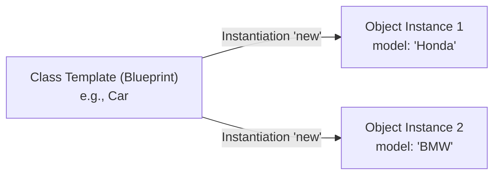
- **Class**: A compile-time blueprint/template defining common attributes (instance variables) and behaviors (instance methods). A class cannot perform work on its own.
- **Object (Instance)**: A concrete runtime manifestation instantiated from a class template via the `new` operator. Each object possesses its own distinct state in memory.

## 1.3 Java Architecture & Compilation Workflow
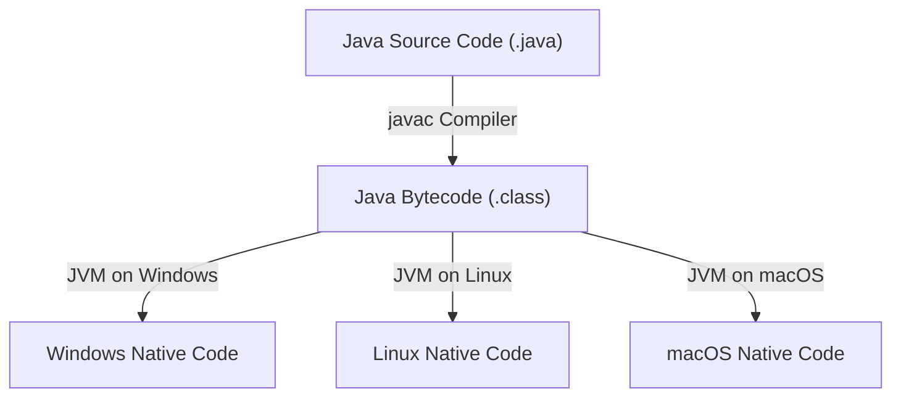
- **"Write Once, Run Anywhere" (WORA)**: Java code is not compiled directly into machine-dependent binaries (unlike C/C++). Instead, `javac` compiles `.java` source code into intermediate **bytecode** (`.class`).
- **JVM (Java Virtual Machine)**: An interpreter/runtime engine tailored to each operating system that interprets and translates bytecode into host machine instructions.
- **JDK vs. JRE**:
  - **JDK (Java Development Kit)**: Complete environment containing compiler (`javac`), tools, and JRE needed to write and compile programs.
  - **JRE (Java Runtime Environment)**: Runtime bundle containing the JVM and standard libraries required solely to run precompiled `.class` bytecode.
- **Java Platforms**: Java SE (Standard Edition for desktop/general use), Java EE (Enterprise Edition for server-side apps), Java ME (Micro Edition for embedded devices/mobile).

## 1.4 Program Anatomy & Execution Rules
```java
// Welcome.java - Class name must exactly match the file name (case-sensitive)
public class Welcome {
    // Execution always begins at the static main method
    public static void main(String[] args) {
        System.out.println("Welcome to Java!");
    }
}
```
- **Static vs. Instance Methods in Unit 1**:
  - `static`: Belongs to the class rather than an object instance; can be invoked without instantiating an object (e.g., `ClassName.methodName()`).
  - Non-static: Must be invoked through an instantiated object (e.g., `objectName.methodName()`).
- **Standard Library Packages**: Classes in `java.lang` (such as `System`, `String`, `Math`) are imported automatically by the compiler. All other packages require explicit imports (e.g., `import java.util.Scanner;`).

## 1.5 Primitive vs. Reference Types & Memory Allocation
Java divides data types into two distinct categories:

| Feature | Primitive Types | Reference Types |
| :--- | :--- | :--- |
| **Storage Content** | Stores the actual literal value directly | Stores the **memory address (pointer)** referencing an object |
| **Memory Location** | Stored on the **Stack** | Reference variable on **Stack**; actual object on **Heap** |
| **Default Field Value** | `0` (numbers), `false` (boolean), `\u0000` (char) | `null` (references nothing) |
| **Creation** | Direct assignment (`int x = 10;`) | Usually instantiated with `new` (`Car c = new Car();`) |

### The 8 Primitive Data Types
| Data Type | Category | Size | Range / Representation |
| :--- | :--- | :--- | :--- |
| `byte` | Integer | 1 byte (8 bits) | $-128$ to $127$ |
| `short` | Integer | 2 bytes (16 bits) | $-32,768$ to $32,767$ |
| `int` | Integer | 4 bytes (32 bits) | $-2^{31}$ to $2^{31} - 1$ |
| `long` | Integer | 8 bytes (64 bits) | $-2^{63}$ to $2^{63} - 1$ (requires `L` suffix: `1000L`) |
| `float` | Floating-point | 4 bytes (32 bits) | $\approx \pm 3.4 \times 10^{38}$ (7 decimal digits; requires `f` suffix: `10.5f`) |
| `double` | Floating-point | 8 bytes (64 bits) | $\approx \pm 1.7 \times 10^{308}$ (15 decimal digits; default floating type) |
| `char` | Character | 2 bytes (16 bits) | Unicode characters (`\u0000` to `\uFFFF`), supports ASCII ($0$ to $127$) |
| `boolean` | Logical | 1 bit | `true` or `false` |

> [!important] Casting Rules
> - **Widening (Implicit)**: Automatic conversion from smaller range to larger range (e.g., `int` $\to$ `double`). Safe; no precision lost.
> - **Narrowing (Explicit)**: Manual conversion from larger range to smaller range using `(targetType)` (e.g., `int a = (int)7.89;`). Potential loss of precision or integer overflow.

## 1.6 Core Syntax, Operators & Programming Errors
- **Integer Division**: Dividing two integers performs truncation (e.g., `5 / 2 == 2`). To obtain fractional results, at least one operand must be floating-point (e.g., `5.0 / 2 == 2.5`).
- **Constants**: Declared using the `final` keyword (e.g., `final int MAX = 100;`). Reassignment causes compile error. *(Note: `const` is a reserved keyword in Java but is not used).*
- **Three Categories of Errors**:
  1. **Syntax Errors**: Detected by the compiler before execution (e.g., missing semicolons, unmatched quotes).
  2. **Runtime Errors**: Causes abnormal termination during execution (e.g., division by zero `ArithmeticException`, out-of-bounds indexing).
  3. **Logic Errors**: Program runs to completion without crashes but yields incorrect results (e.g., using integer division `(9 / 5) * 35` instead of `(9.0 / 5) * 35`).

---

# Topic 2: Methods & Parameter Passing

## 2.1 Method Anatomy & Signature
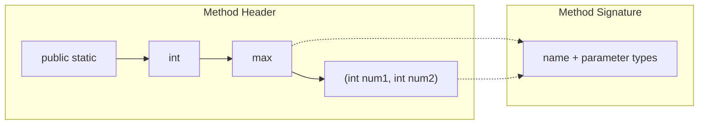
- **Method Header Components**:
  - **Modifiers**: `public static` (access level and static status).
  - **Return Value Type**: Data type of value returned, or `void` if no value is returned.
  - **Method Name**: Identifier following camelCase convention.
  - **Formal Parameters**: Variables declared in the method header to receive incoming values.
- **Method Signature**: The combination of **method name** and **parameter list** (types, order, count). *Return type is NOT part of the signature.*
- **Method Return Caution**: Every execution branch of a value-returning method must guarantee a return statement. If the compiler cannot prove a return will be reached, compilation fails.

## 2.2 Activation Records & Call Stack Execution
- Each method call creates an **activation record (stack frame)** pushed onto the call stack.
- The stack frame contains local variables and parameters.
- When the method finishes execution (`return`), its frame is popped off the stack, and execution resumes in the calling method.

## 2.3 Variable Scope
- **Local Variable**: A variable declared inside a method or block. Scope begins at declaration and extends to the end of the enclosing block `{}`.
- **Nesting Rules**: A local variable cannot be declared twice within nested blocks, but non-nested blocks in the same method may reuse the same variable name.

## 2.4 Pass-by-Value (Primitives)
> [!note] Java Pass-by-Value Rule
> Java uses **strictly pass-by-value** for all parameters.
> When a primitive variable is passed into a method, only a **copy of its literal value** is copied into the formal parameter variable. Any modifications made to the parameter inside the method have **zero effect** on the caller's original variable.

## 2.5 Method Overloading & Ambiguous Invocation
- **Method Overloading**: Multiple methods in the same class sharing the **same name** but having **different parameter lists** (different count, different types, or different order of types).
- **Ambiguous Invocations**:
  ```java
  public static double max(int num1, double num2) { ... }
  public static double max(double num1, int num2) { ... }
  
  // Invoking max(1, 2) causes COMPILE ERROR!
  // Both parameters are int, and compiler cannot determine which method to match.
  ```

## 2.6 The `java.lang.Math` Utility Class
- Constants: `Math.PI` ($\approx 3.14159$), `Math.E` ($\approx 2.71828$).
- Common Static Methods:
  - **Trig**: `Math.sin(rad)`, `Math.cos(rad)`, `Math.toRadians(deg)`.
  - **Exponents**: `Math.exp(a)`, `Math.log(a)`, `Math.pow(base, exp)`, `Math.sqrt(a)`.
  - **Rounding**: `Math.ceil(x)` (rounds up to double), `Math.floor(x)` (rounds down to double), `Math.rint(x)` (rounds to nearest integer, even number if equidistant), `Math.round(x)` (returns `int` or `long`).
  - **Random Numbers**:
    $$x \in [0.0, 1.0) \implies a + (\text{int})(\text{Math.random}() \times b) \in [a, a + b - 1]$$

---

# Topic 3: Objects and Classes

## 3.1 OOP Fundamentals & UML Notation
An object models a real-world entity with:
1. **Identity**: Unique memory location distinguishing it from other objects.
2. **State (Attributes)**: Represented by data fields and their current values.
3. **Behavior (Actions)**: Represented by methods that can be called on the object.

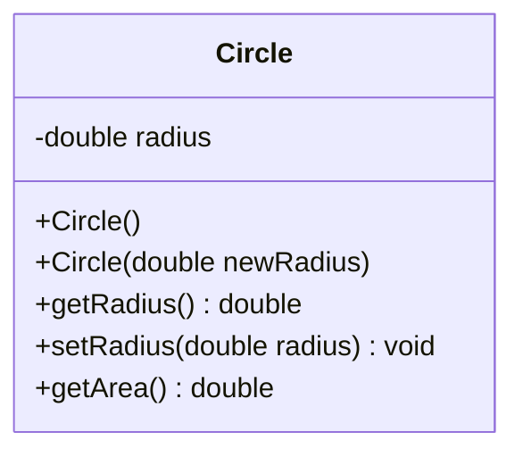
- **UML Visibility Modifiers**:
  - `-` : `private`
  - `+` : `public`
  - `#` : `protected`
  - `~` : default (package-private)
  - Underline: `static` variable or method

## 3.2 Constructors & 9 Essential Rules
Constructors are special methods invoked via `new` to construct and initialize objects:
1. Constructors can be **overloaded**.
2. **Default Constructor**: If no constructor is written, compiler generates a default no-arg constructor with an empty body.
3. If **any** explicit constructor is defined, the compiler will **not** generate the default no-arg constructor.
4. Default constructors are generated **only** by the compiler.
5. Constructors are **not inherited** by subclasses.
6. Constructors can be declared `private` (preventing outside instantiation, e.g., Singleton pattern).
7. The compiler-generated default constructor shares the same access modifier as its class.
8. Subclass constructors always invoke the superclass constructor (`super()`).
9. The first statement in any constructor body must be a call to `this(...)` or `super(...)`.

### Copy Constructor Pattern
```java
public class Student {
    private int stuNum;
    public Student(int sn) { this.stuNum = sn; }
    // Copy Constructor: accepts another instance of the same class
    public Student(Student other) { this.stuNum = other.stuNum; }
}
```

## 3.3 Default Field Values vs. Local Variables
- **Data fields** of an object receive automatic default values upon instantiation:
  - Numeric primitives (`byte`, `short`, `int`, `long`, `float`, `double`): `0` or `0.0`
  - `boolean`: `false`
  - `char`: `\u0000` (null character)
  - Object reference types: `null`
- **Local variables** defined within methods do **not** receive default values. Using uninitialized local variables produces a compile-time error.

## 3.4 The `this` Reference Keyword
1. **Disambiguate Shadowed Fields**: Used to reference instance fields when local parameter names are identical:
   ```java
   public Student(int stuNum) {
       this.stuNum = stuNum; // this.stuNum is instance field; stuNum is parameter
   }
   ```
2. **Explicit Constructor Chaining**: Invoking another overloaded constructor in the same class:
   ```java
   public Student() {
       this(100); // Must be the FIRST statement in constructor
   }
   ```

## 3.5 Reference Types, Memory Layout & Garbage Collection
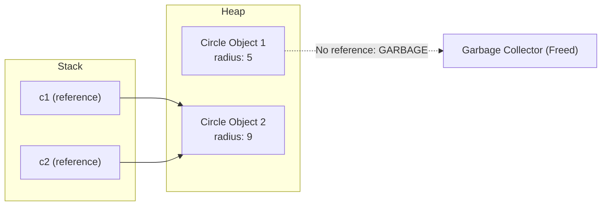
- When assigning reference variables (`c1 = c2;`), the **memory address** is copied, not the object. Both variables now point to the identical object on the heap.
- **Garbage Collection (GC)**: Any heap object that no longer has active references pointing to it becomes orphan memory ("garbage") and is automatically deallocated by the JVM.

## 3.6 Passing Objects to Methods: Pass-by-Sharing
- When an object reference is passed to a method, the reference itself is passed by value (the memory address is copied).
- Both caller and callee reference the same underlying heap object.
- Any mutations made to the object's fields inside the method **persist** after the method finishes.

## 3.7 Encapsulation & Visibility Modifiers
> [!important] Encapsulation (Data Hiding)
> Data fields should always be declared `private` to shield internal state from unauthorized external tampering. Provide controlled access via `public` **getters (accessors)** and **setters (mutators)** with input validation.

| Access Modifier | Inside Same Class | Inside Same Package | Subclass (Other Package) | World (Everywhere) |
| :--- | :---: | :---: | :---: | :---: |
| `public` | Yes | Yes | Yes | Yes |
| `protected` | Yes | Yes | Yes | No |
| *default* (package) | Yes | Yes | No | No |
| `private` | Yes | No | No | No |

## 3.8 Immutable Objects and Classes
An object whose internal content cannot be modified after creation is **immutable**.
Requirements for an immutable class:
1. All data fields must be `private`.
2. Provide **no mutator (setter)** methods.
3. No accessor method should return a direct reference to a mutable data field (return a cloned copy instead).

## 3.9 Static vs. Instance Members
- **Instance Variables/Methods**: Each object has its own copy. Methods can access both instance and static members.
- **Static Variables/Methods**: Belong to the class itself; shared across all instances. Only one copy exists in memory.
  > [!caution] Static Constraint
  > A `static` method **cannot** access non-static instance fields or call non-static instance methods directly because it has no `this` context!

## 3.10 Common Utility Classes
- **`String`**: Immutable character sequence. String literals are stored in the JVM's **Interned String Pool** to optimize memory.
  - `s1.equals(s2)`: Compares character contents (use this for strings, NEVER use `==`).
  - `s1.compareTo(s2)`: Lexicographical order ($<0, 0, >0$).
  - Methods: `charAt(i)`, `length()`, `substring(begin, end)`, `toLowerCase()`, `trim()`, `replace()`, `split(regex)`.
- **`StringBuilder`**: Mutable character buffer. Use when appending/modifying strings iteratively (`append()`, `insert()`, `delete()`, `reverse()`).
- **`Character`**: Static evaluation methods (`Character.isDigit(c)`, `isLetter(c)`, `isUpperCase(c)`).

---

# Topic 4: Arrays & Multi-Dimensional Data Structures

## 4.1 Array Declaration, Creation & Memory
- An array is a fixed-size indexed collection of elements sharing the same data type.
- Arrays are **objects** stored on the heap:
  ```java
  int[] numbers;             // Declares array reference variable on Stack
  numbers = new int[6];      // Allocates array of 6 integers on Heap
  int[] list = {10, 20, 30}; // Declaration + initialization shorthand
  ```
- **Array Length**: Accessed via the read-only property `.length` (e.g., `numbers.length`). The size is immutable once allocated.
- **Default Elements**: Numeric arrays initialize to `0`, boolean to `false`, char to `\u0000`, object arrays to `null`.

## 4.2 Array Copying
> [!warning] Assignment `a2 = a1` is NOT a Copy!
> Assigning `a2 = a1;` merely copies the reference address; both variables will point to the same array.
>
> To make an actual copy:
> 1. **Loop**: Copy element by element into a newly sized array.
> 2. **`System.arraycopy()` Utility**:
>    ```java
>    System.arraycopy(sourceArray, srcPos, targetArray, tarPos, length);
>    ```

## 4.3 Enhanced For-Loop (For-Each)
- Simplifies read-only traversal:
  ```java
  for (int val : numbers) {
      System.out.println(val);
  }
  ```
- **5 Situations where Enhanced For-Loop CANNOT be used**:
  1. To modify or overwrite array elements.
  2. To traverse elements in reverse order.
  3. To access a subset or skip elements.
  4. To traverse multiple arrays simultaneously.
  5. When the numeric index (`i`) of the element is needed.

## 4.4 Arrays of Objects
- An array of objects is an **array of references**.
  ```java
  BankAccount[] accounts = new BankAccount[3]; // All 3 elements are initially null!
  for (int i = 0; i < accounts.length; i++) {
      accounts[i] = new BankAccount(100.0);    // Must instantiate each object individually
  }
  ```

## 4.5 Multi-Dimensional Arrays
- A 2D array in Java is implemented as an **array of arrays** (rows can theoretically vary in size — "ragged arrays"):
  ```java
  double[][] matrix = new double[3][4]; // 3 rows, 4 columns
  int rowCount = matrix.length;         // Returns 3 (number of rows)
  int colCount = matrix[0].length;      // Returns 4 (number of columns in row 0)
  ```
- Processed using nested loops: outer loop iterates through rows, inner loop iterates through columns.

---

# Topic 5: Class Relationships & Inheritance Basics

## 5.1 Classification of Class Relationships
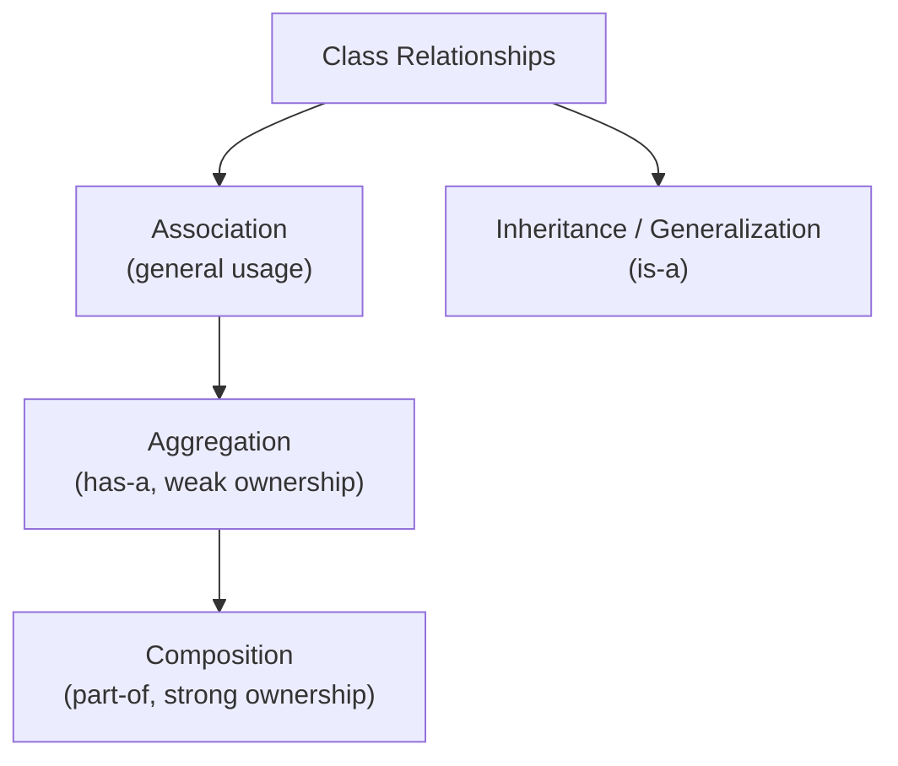

## 5.2 Association
- Represents a general semantic relationship between two or more classes (e.g., *Student takes Course*, *Faculty teaches Course*).
- Characterized by:
  - **Multiplicity**: Numbers at the connection ends (`1`, `*`, `0..*`, `1..*`, `5..60`).
  - **Roles**: Labels specifying the entity's function in the relation.
  - **Implementation**: Typically represented using reference fields or collections (e.g., `ArrayList<Course>`).

## 5.3 Aggregation vs. Composition
| Criterion | Aggregation | Composition |
| :--- | :--- | :--- |
| **Relationship Type** | "Has-a" relationship | "Part-of" relationship |
| **Coupling Strength** | Weak association | Strong association |
| **Lifecycle Dependency** | Child can exist **independently** of parent | Child **cannot exist** without parent |
| **UML Symbol** | Empty/Hollow diamond ($\diamondsuit$) | Filled/Solid diamond ($\blacklozenge$) |
| **Real-world Example** | `Team` and `Player` (Player exists without Team) | `Human` and `Heart` (Heart cannot exist without Human) |

## 5.4 Inheritance (Generalization & Specialization)
- **Generalization**: Moving common attributes and methods up into a general **superclass** (base/parent class).
- **Specialization**: Extending the superclass into specific **subclasses** (derived/child classes) using the `extends` keyword.
- Models an **"Is-a" relationship** (e.g., *Dog is an Animal*, *Circle is a GeometricObject*).
- **Single Inheritance Rule**: A Java class can directly extend **only one** superclass (`class Sub extends Super`). All Java classes inherit from `java.lang.Object`.

## 5.5 Calling Superclass Constructors & The `super` Keyword
- Subclasses do **not** inherit superclass constructors.
- Subclass constructors must invoke superclass constructors using `super()` or `super(arguments)`.
  > [!important] Constructor Chaining Rules
  > 1. `super(...)` must be the **very first statement** in the subclass constructor.
  > 2. If neither `super(...)` nor `this(...)` is written explicitly, the compiler inserts `super()` implicitly.
  > 3. If a superclass defines overloaded constructors but has **no no-arg constructor**, any subclass constructor **must explicitly call `super(args)`**; otherwise a compile error occurs.

---

# Topic 6: Inheritance & Polymorphism

## 6.1 Method Overriding
- **Method Overriding**: When a subclass provides its own specific implementation of an inherited non-static method with the **exact same signature and return type**.
- **Rules of Overriding**:
  - `private` methods cannot be overridden (they are not visible outside).
  - `static` methods cannot be overridden; redefining a static method in a subclass simply **hides** the parent's static method.
  - To access an overridden superclass method from inside the subclass, use `super.methodName()`.
- **`@Override` Annotation**: Informs the compiler that the method is intended to override a superclass method. If the method signatures fail to match, the compiler issues an immediate error.

## 6.2 Overloading vs. Overriding Cheat Sheet
| Feature | Overloading | Overriding |
| :--- | :--- | :--- |
| **Location** | Same class or across inherited classes | Across superclass and subclass (inheritance only) |
| **Method Name** | Must be identical | Must be identical |
| **Parameter List** | **Must be different** | **Must be identical** |
| **Return Type** | Can be different | Must be identical (or covariant) |
| **Binding Time** | Resolved at **Compile time** (Static binding) | Resolved at **Runtime** (Dynamic binding) |

## 6.3 Polymorphism & Dynamic Binding
```java
Animal ani = new Dog(); // Declared type: Animal; Actual object type: Dog
ani.makeSound();        // Outputs "Woof" (Dog's method is invoked dynamically)
```
- **Polymorphism**: "Many forms" — A superclass reference variable can hold a reference to an instance of any of its subclasses.
- **Dynamic Binding**: The decision of which method implementation to execute is made at runtime by the JVM based on the **actual object type**, not the declared reference type.
- **Generic Programming**: Enables writing modular methods that accept the superclass type (e.g., `void show(Animal a)`), allowing them to process any current or future subclass seamlessly.

## 6.4 The `Object` Class Methods
Every class inherits from `java.lang.Object`:
- **`toString()`**: Default returns `ClassName@hashCodeHex`. Classes should override it to return human-readable text representations.
- **`equals(Object obj)`**: Default implementation checks reference equality (`this == obj`). Override to evaluate field equality:
  ```java
  @Override
  public boolean equals(Object obj) {
      if (obj instanceof Circle) {
          return this.radius == ((Circle)obj).radius;
      }
      return false;
  }
  ```

## 6.5 Casting Objects & `instanceof`
- **Upcasting**: Casting a subclass instance to a superclass reference variable (e.g., `Animal a = new Dog();`). Always safe and implicit.
- **Downcasting**: Casting a superclass reference back to a subclass variable (e.g., `Dog d = (Dog)a;`). Requires explicit cast syntax.
- **`instanceof` Operator**: Guards against `ClassCastException` by checking runtime type before downcasting:
  ```java
  if (myAnimal instanceof Dog) {
      Dog d = (Dog) myAnimal;
      d.playFetch();
  }
  ```

## 6.6 The `final` Modifier Summary
- `final class`: Cannot be extended (prevents inheritance, e.g., `java.lang.String`, `Math`).
- `final method`: Cannot be overridden by subclasses.
- `final variable`: Constant; value cannot be reassigned once initialized.

## 6.7 `ArrayList<E>` Generic Collection
- Dynamic-sized array list storing object references:
  - `list.add(element)`: Appends to end.
  - `list.add(index, element)`: Inserts at index.
  - `list.get(index)`: Retrieves element.
  - `list.set(index, element)`: Updates element.
  - `list.remove(index)` / `list.remove(object)`: Removes element.
  - `list.size()`: Returns current element count.

---

# Topic 7: Abstract Classes and Interfaces

## 7.1 Abstract Classes
- Declared with the `abstract` keyword. Represents an abstract generic concept that **cannot be instantiated** with `new`.
- **Abstract Methods**: Contain a method header without a body (terminated by `;`):
  ```java
  public abstract double getArea();
  ```
- **Rules**:
  - Any class containing at least one abstract method **must** be declared abstract.
  - A concrete subclass extending an abstract class **must implement all** inherited abstract methods; otherwise the subclass must also be declared abstract.
  - An abstract class can have constructors (invoked by subclass constructors via `super()`), static methods, and instance variables.

## 7.2 Interfaces
- An interface is a class-like contract specifying **what** an object must do without dictating **how**.
- Defined with the `interface` keyword and implemented via `implements`.
- **Implicit Interface Modifiers**:
  - All variables are implicitly `public static final` (constants).
  - All methods are implicitly `public abstract` instance methods.
- **Multiple Interfaces**: Java does not allow multiple class inheritance (`extends`), but a class may implement **multiple interfaces** separated by commas:
  ```java
  public class Chicken extends Animal implements Edible, Comparable<Chicken>
  ```

## 7.3 The `Comparable<T>` Interface
- Belongs to `java.lang` and defines the natural ordering of objects:
  ```java
  public interface Comparable<E> {
      public int compareTo(E o);
  }
  ```
- Returns:
  - Negative integer if `this < o`
  - Zero (`0`) if `this == o`
  - Positive integer if `this > o`
- Enables custom objects to be sorted directly using `Arrays.sort(array)`.

## 7.4 Abstract Class vs. Interface Comparison
| Criterion | Abstract Class | Interface |
| :--- | :--- | :--- |
| **Inheritance** | Single inheritance (`extends Class`) | Multiple implementation (`implements I1, I2`) |
| **Variables** | No restrictions (can have instance & static fields) | Only `public static final` constants |
| **Constructors** | Has constructors (called via `super()`) | **No constructors** |
| **Methods** | Can have concrete and abstract methods | Purely abstract methods (pre-Java 8) |
| **Design Intent** | Models an **"is-a"** identity template | Models a **"can-do"** role or capability |
| **Hierarchy** | Bound to class hierarchy | Unrelated classes can implement the same interface |

---

# Topic 8: GUI Programming with JavaFX

## 8.1 Java GUI Framework Evolution
- **AWT (Abstract Windows Toolkit)**: Heavyweight, platform-dependent peers, prone to native OS bugs.
- **Swing**: Lightweight pure-Java components built on AWT; flexible but dated look.
- **JavaFX**: Modern, high-performance UI library featuring hardware-accelerated 2D/3D graphics, media, Web views, CSS styling, and FXML.

## 8.2 Structure of a JavaFX Application
```java
import javafx.application.Application;
import javafx.scene.Scene;
import javafx.scene.control.Button;
import javafx.stage.Stage;

public class MyJavaFX extends Application {
    @Override
    public void start(Stage primaryStage) {
        Button btn = new Button("OK");
        Scene scene = new Scene(btn, 200, 250);
        primaryStage.setTitle("My Window");
        primaryStage.setScene(scene);
        primaryStage.show();
    }
    public static void main(String[] args) {
        launch(args); // Entry point: launches JavaFX runtime
    }
}
```

## 8.3 The Theater Analogy (Stage, Scene, Node)
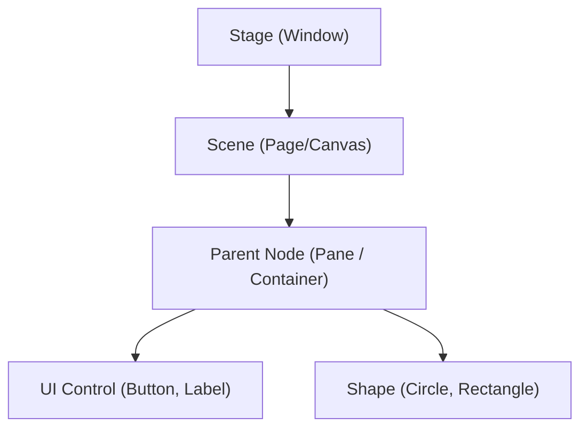
- **Stage**: The primary top-level window (created automatically by the JVM and passed into `start()`). Additional stages can be constructed.
- **Scene**: A container holding the visual graph of scene nodes.
- **Node**: Any visual component (`Parent`, `Control`, `Shape`, `ImageView`).

## 8.4 JavaFX Layout Panes
| Pane | Layout Strategy | Key Configuration Methods |
| :--- | :--- | :--- |
| **`Pane`** | Base canvas; manual absolute positioning | `pane.getChildren().add(node)` |
| **`StackPane`** | Places nodes centered on top of each other in a stack | Useful for overlaying text on shapes |
| **`FlowPane`** | Arranges nodes in a row/column; wraps when filled | `setHgap(px)`, `setVgap(px)`, `setOrientation()` |
| **`GridPane`** | Arranges nodes in a 2D grid matrix of rows and columns | `add(node, colIndex, rowIndex, colSpan, rowSpan)` |
| **`BorderPane`** | Divides layout into 5 zones: Top, Bottom, Left, Right, Center | `setTop()`, `setBottom()`, `setLeft()`, `setRight()`, `setCenter()` |
| **`HBox`** | Arranges child nodes in a single horizontal row | `setSpacing(px)`, `setAlignment(Pos)` |
| **`VBox`** | Arranges child nodes in a single vertical column | `setSpacing(px)`, `setPadding(new Insets(...))` |

## 8.5 Property Binding
- Binds a target property to a source observable property so that target updates automatically when source changes:
  ```java
  // Automatically keeps the circle centered when the window/pane resizes
  circle.centerXProperty().bind(pane.widthProperty().divide(2));
  circle.centerYProperty().bind(pane.heightProperty().divide(2));
  ```

## 8.6 Coordinate System, Shapes & Styling
- **Coordinate System**: Measured in screen pixels with `(0, 0)` at the **top-left corner**. $X$ increases to the right; $Y$ increases downward.
- **Shapes**: `Line`, `Circle`, `Rectangle`, `Ellipse`, `Arc`, `Text`.
  - Properties: `setFill(Color)`, `setStroke(Color)`, `setStrokeWidth(pixels)`.
- **JavaFX CSS**: Styled with the `-fx-` prefix (e.g., `node.setStyle("-fx-border-color: red; -fx-background-color: lightgray;");`).

---

# Topic 9: Event-Driven Programming

## 9.1 Event-Driven Programming Architecture
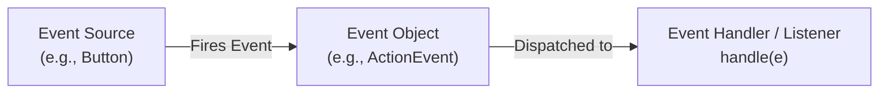
- In procedural programming, execution order is pre-determined by code. In event-driven programming, code executes in response to asynchronous user actions (mouse clicks, keystrokes, timers).
- **Core Triangle**:
  1. **Event Source Object**: Generates the event (e.g., `Button`).
  2. **Event Object**: Encapsulates state info about what occurred (e.g., `ActionEvent`).
  3. **Event Handler (Listener)**: Implements `EventHandler<T>` and contains the callback logic in `handle(T e)`.

## 9.2 Four Ways to Implement Event Handlers
1. **External / Separate Class**: Standard class implementing `EventHandler<ActionEvent>`.
2. **Inner Class**: Defined inside the enclosing `Application` class; has direct access to outer private fields.
3. **Anonymous Inner Class**: Inlined handler without a class name:
   ```java
   btn.setOnAction(new EventHandler<ActionEvent>() {
       @Override
       public void handle(ActionEvent e) {
           System.out.println("Clicked");
       }
   });
   ```
4. **Lambda Expressions (Java 8+, Preferred)**: For Single Abstract Method (SAM) interfaces:
   ```java
   btn.setOnAction(e -> System.out.println("Clicked"));
   ```

## 9.3 Common UI Controls & Registration Summary
| Control | Fired Event Type | Registration Method | Key Interaction Methods |
| :--- | :--- | :--- | :--- |
| **`Button`** | `ActionEvent` | `setOnAction(handler)` | `setText()`, `setGraphic()` |
| **`TextField`** | `ActionEvent` (on Enter key) | `setOnAction(handler)` | `getText()`, `setText()`, `setEditable()` |
| **`CheckBox`** | `ActionEvent` | `setOnAction(handler)` | `isSelected()`, `setSelected(boolean)` |
| **`RadioButton`** | `ActionEvent` | `setOnAction(handler)` | `setToggleGroup(group)`, `isSelected()` |
| **`ComboBox<T>`** | `ActionEvent` | `setOnAction(handler)` | `getItems().addAll()`, `getValue()`, `setValue()` |
| **`TextArea`** | Text Input | Wrapped in `ScrollPane` | `setPrefRowCount()`, `setWrapText(true)` |

## 9.4 Mouse & Key Events
- **`MouseEvent`**: Triggered by mouse movements, clicks, drags.
  - Registration: `setOnMousePressed()`, `setOnMouseReleased()`, `setOnMouseClicked()`, `setOnMouseDragged()`.
  - Coordinates: `e.getX()`, `e.getY()`. Button detected: `e.getButton() == MouseButton.PRIMARY`.
- **`KeyEvent`**: Triggered by keyboard input.
  - Registration: `setOnKeyPressed()`, `setOnKeyReleased()`, `setOnKeyTyped()`.
  - Key codes: `e.getCode()` (`KeyCode.UP`, `DOWN`, `ENTER`), `e.getText()`.
  - Must call `node.requestFocus()` to enable the node to receive key events.

---

# Topic 10: Exception Handling and File Input/Output

## 10.1 The Java Exception Hierarchy
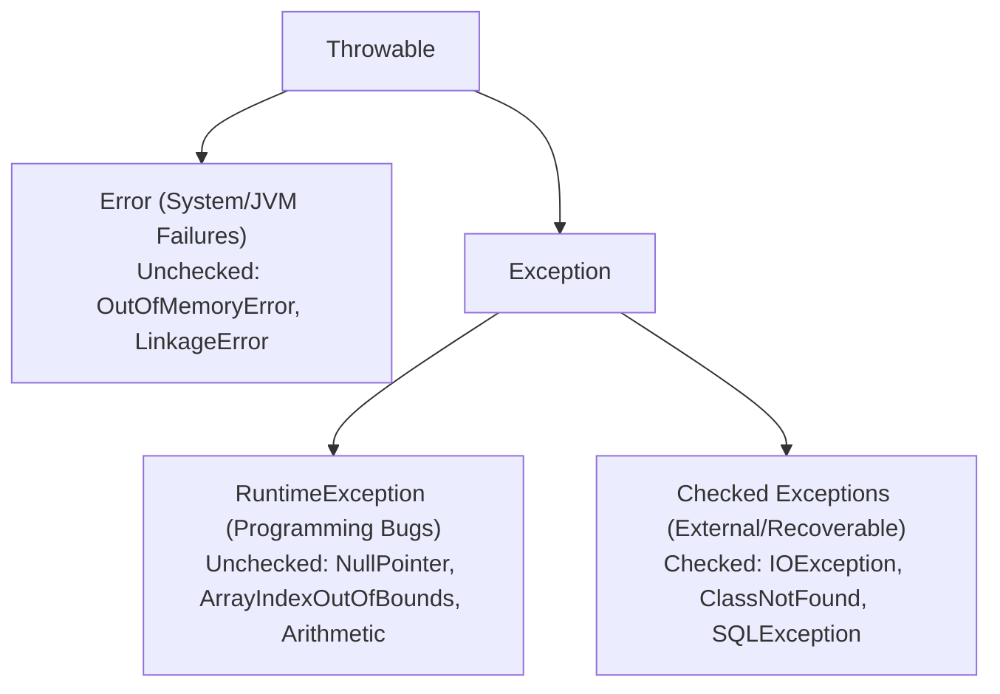
- **Checked Exceptions**: Compiler verifies that the code handles them. Must either be caught in a `try-catch` block or declared in the method header via `throws`.
- **Unchecked Exceptions (`RuntimeException` and `Error`)**: Caused by programming defects or fatal JVM errors. Compiler does not mandate explicit handling.

## 10.2 Exception Handling Syntax (`try-catch-finally`)
```java
try {
    // Code that might throw an exception
} catch (FileNotFoundException ex) {
    // Specific subclass exception handler MUST COME FIRST
} catch (IOException ex) {
    // Superclass exception handler comes after
} finally {
    // ALWAYS executes regardless of whether an exception was thrown or caught
    // Used for releasing system resources (closing files, DB connections)
}
```
> [!caution] Catch Block Ordering
> Handler blocks must be ordered from **most specific (subclass)** to **most general (superclass)**. Placing a superclass catch block before a subclass catch block results in an "unreachable code" compile error!

- **Key Keywords**:
  - `throw`: Used in method body to explicitly throw an exception object (`throw new IllegalArgumentException("Invalid");`).
  - `throws`: Used in method header declaration to declare potential exceptions (`public void run() throws IOException`).

## 10.3 Defining Custom Exceptions
```java
public class InvalidRadiusException extends Exception {
    private double radius;
    public InvalidRadiusException(double radius) {
        super("Invalid radius: " + radius);
        this.radius = radius;
    }
    public double getRadius() { return radius; }
}
```

## 10.4 File I/O: Text vs. Binary
| Feature | Text Files | Binary Files |
| :--- | :--- | :--- |
| **Data Representation** | Sequence of characters (encoded as ASCII/Unicode) | Raw byte representation identical to RAM storage |
| **Encoding Overhead** | Requires encoding on write, decoding on read | No conversion; exact bytes transferred |
| **Human Readable** | Yes (open in Notepad) | No (raw binary data) |
| **Storage Efficiency** | Less compact | Highly compact and faster execution |
| **Key Writing Classes** | `PrintWriter`, `FileWriter` | `FileOutputStream`, `DataOutputStream` |
| **Key Reading Classes** | `Scanner`, `File` | `FileInputStream`, `DataInputStream` |

### Text File Operations
```java
// Writing Text (Append Mode = true)
PrintWriter out = new PrintWriter(new FileWriter("data.txt", true));
out.println("Hello World");
out.close();

// Reading Text
Scanner in = new Scanner(new File("data.txt"));
while (in.hasNext()) {
    String line = in.nextLine();
}
in.close();
```

### Binary File Operations & EOF Detection
```java
// Writing Binary Data
DataOutputStream out = new DataOutputStream(new FileOutputStream("data.dat"));
out.writeInt(42);
out.writeDouble(3.14);
out.writeUTF("Hello");
out.close();

// Reading Binary Data: Detect end-of-file using EOFException
DataInputStream in = new DataInputStream(new FileInputStream("data.dat"));
boolean eof = false;
while (!eof) {
    try {
        int x = in.readInt();
    } catch (EOFException e) {
        eof = true; // Expected loop termination
    }
}
in.close();
```

---

# Topic 11: Java Database Programming (JDBC)

## 11.1 Relational Database & SQL Review
- **Relational Model**: Data structured into two-dimensional tables (**relations**) consisting of rows (**tuples/records**) and columns (**attributes/fields**).
- **Keys**: **Primary Key** uniquely identifies each row; **Foreign Key** enforces referential integrity between related tables.
- **Basic SQL Syntax**:
  - `CREATE TABLE Staff (id INT, sName VARCHAR(20), PRIMARY KEY(id));`
  - `INSERT INTO Staff VALUES (1, 'Steven');`
  - `SELECT sName FROM Staff WHERE id = 1;`
  - `UPDATE Staff SET sName = 'John' WHERE id = 1;`
  - `DELETE FROM Staff WHERE id = 1;`
  - `DROP TABLE Staff;`

## 11.2 JDBC Architecture & The 4 Core Interfaces
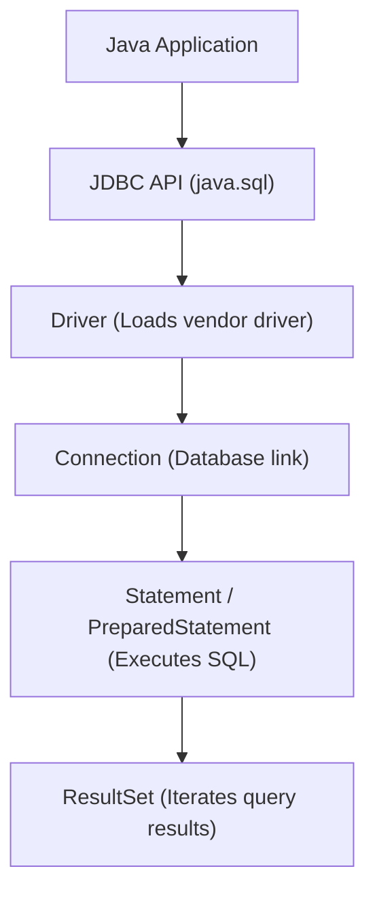

## 11.3 Standard 6-Step JDBC Workflow
```java
import java.sql.*;

public class JdbcDemo {
    public static void main(String[] args) throws SQLException, ClassNotFoundException {
        // Step 1: Load the JDBC Driver class
        Class.forName("com.mysql.jdbc.Driver");
        
        // Step 2: Establish connection via DriverManager
        Connection conn = DriverManager.getConnection("jdbc:mysql://localhost/test", "root", "password");
        
        // Step 3: Create Statement object
        Statement st = conn.createStatement();
        
        // Step 4: Execute SQL
        // Use executeUpdate() for CREATE, INSERT, UPDATE, DELETE
        st.executeUpdate("INSERT INTO Staff VALUES (1, 'Alice')");
        // Use executeQuery() for SELECT queries (returns ResultSet)
        ResultSet rs = st.executeQuery("SELECT id, sName FROM Staff");
        
        // Step 5: Process ResultSet row-by-row
        while (rs.next()) {
            int id = rs.getInt(1);          // Column indexing starts at 1
            String name = rs.getString(2);
            System.out.println(id + "\t" + name);
        }
        
        // Step 6: Close database resources
        rs.close();
        st.close();
        conn.close();
    }
}
```

## 11.4 `PreparedStatement` (Parameterized Queries)
- Precompiled SQL statements improving performance and preventing SQL injection:
  ```java
  String sql = "INSERT INTO Staff (id, sName, dept) VALUES (?, ?, ?)";
  PreparedStatement pstmt = conn.prepareStatement(sql);
  pstmt.setInt(1, 101);             // 1-based parameter index
  pstmt.setString(2, "Bob");
  pstmt.setString(3, "Engineering");
  pstmt.executeUpdate();            // Note: no SQL argument passed here!
  ```

## 11.5 Database Metadata Inspection
- **`DatabaseMetaData`**: Database-wide metadata via `conn.getMetaData()` (URL, username, product name, driver version, table lists via `getTables()`).
- **`ResultSetMetaData`**: Metadata describing the schema of a specific `ResultSet` via `rs.getMetaData()`:
  - `rsMetaData.getColumnCount()`: Total number of columns.
  - `rsMetaData.getColumnName(i)`: Name of column $i$.

---

# Topic 12: Threads and Multithreading

## 12.1 Concurrency Foundations
- **Multitasking**: The OS running multiple independent programs/processes simultaneously.
  - **Process**: Heavyweight; has its own separate memory address space. Context switching between processes has high overhead.
- **Multithreading**: Subdividing execution within a single program into multiple concurrent execution paths.
  - **Thread**: Lightweight process; all threads inside a process share the same memory space and heap. Inexpensive communication.

## 12.2 The Thread Lifecycle
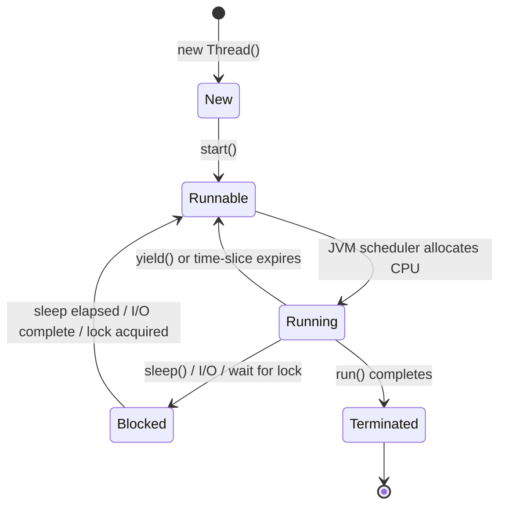
- **Thread States**:
  - **New**: Instantiated but not started.
  - **Runnable / Ready**: Eligible to run; waiting in the OS queue for CPU time.
  - **Running**: Actively executing on a CPU core.
  - **Blocked / Waiting**: Inactive; waiting for I/O, sleep timer, or lock release.
  - **Terminated**: Method `run()` finishes execution; cannot be restarted.

## 12.3 Creating Threads in Java
### Approach 1: Implementing `Runnable` (Preferred)
```java
// Decouples task logic from thread execution mechanism
public class MyTask implements Runnable {
    @Override
    public void run() {
        System.out.println("Task running");
    }
}
// Client execution:
Thread thread = new Thread(new MyTask());
thread.start(); // Spawns new thread and invokes run() asynchronously
```
> [!important] `.start()` vs. `.run()`
> Always call `thread.start()` to spawn a new asynchronous execution path. Calling `thread.run()` directly does NOT create a new thread; it simply executes `run()` synchronously inside the current caller thread!

### Approach 2: Extending `Thread`
```java
public class MyThread extends Thread {
    @Override
    public void run() { ... }
}
new MyThread().start();
```

## 12.4 Controlling Threads & Deprecated Methods
- `Thread.sleep(millis)`: Pauses current thread for specified milliseconds (throws checked `InterruptedException`).
- `Thread.yield()`: Voluntarily gives up current CPU time slice to other ready threads.
- `setPriority(int priority)`: Ranges from `Thread.MIN_PRIORITY` (1) to `Thread.MAX_PRIORITY` (10); default is `Thread.NORM_PRIORITY` (5).
- `thread.join()`: Caller thread pauses and waits until the target `thread` finishes execution before continuing.
- `thread.isAlive()`: Returns `true` if thread has started and not yet terminated.
- **Deprecated Methods**: `stop()`, `suspend()`, and `resume()` are inherently unsafe and should never be used (they leave monitors locked, causing deadlocks).

## 12.5 Thread Pools & `ExecutorService`
Instead of manually spawning threads for every task (high thread-creation overhead), use a thread pool to manage worker threads:
```java
import java.util.concurrent.*;

// Create pool with fixed 3 worker threads
ExecutorService executor = Executors.newFixedThreadPool(3);

for (int i = 0; i < 10; i++) {
    executor.execute(new MyTask(i));
}
executor.shutdown(); // Reject new tasks, complete queued tasks
```

## 12.6 Concurrency Conflicts: Race Conditions & Synchronization
- **Race Condition**: A concurrency flaw occurring when multiple threads access and mutate shared data simultaneously without coordination, resulting in corrupted or unpredictable state.
- **Critical Region**: A block of code accessing a shared resource that must be executed by only one thread at a time (mutual exclusion).

### Three Techniques for Mutual Exclusion
1. **`synchronized` Method**:
   ```java
   public synchronized void deposit(double amount) {
       balance += amount; // Implicitly acquires object lock before entry
   }
   ```
2. **`synchronized` Block**:
   ```java
   public void deposit(double amount) {
       synchronized(this) {
           balance += amount; // Locks only the critical region
       }
   }
   ```
3. **Explicit Locks (`ReentrantLock`)**:
   ```java
   private Lock lock = new ReentrantLock();

   public void deposit(double amount) {
       lock.lock(); // Explicitly acquire lock
       try {
           balance += amount;
       } finally {
           lock.unlock(); // Always release lock in finally block to prevent deadlock
       }
   }
   ```
