# UCCD2103 Operating Systems — Comprehensive Course Notes

> [!abstract] Course Study Notes Overview
> These master notes provide a comprehensive, rigorous synthesis of the core lecture units of **UCCD2103 Operating Systems** directly derived from the official lecture materials. Designed for in-depth conceptual mastery, technical interview readiness, and exam preparation, they cover computer system structures, CPU concurrency, process lifecycle and PCB architecture, thread models (ULT/KLT/SMP), microkernel designs, POSIX process/thread creation (`fork`, `pthread`), mutual exclusion, synchronization primitives (semaphores, mutexes, monitors), and message passing.

---

## Quick Navigation
- [[#Topic 1: Introduction to Operating Systems and Computer System Structures]]
  - [[#1.1 Overview of Computer System Organization and Architecture]]
  - [[#1.2 Computer System Structure: The Four Key Components]]
  - [[#1.3 Computer-System Operation and Concurrent Execution]]
  - [[#1.4 What is an Operating System?]]
  - [[#1.5 The Dual Roles of an Operating System]]
  - [[#1.6 The Kernel vs. System Software]]
  - [[#1.7 Computer Startup: The Bootstrapping Process]]
  - [[#1.8 Evolution of Operating Systems]]
  - [[#1.9 Major Advances in Operating System Design]]
  - [[#1.10 Common Causes of System Software Errors]]
  - [[#1.11 Operating System Architectural Approaches]]
  - [[#1.12 Multiprocessor Architectures and Hardware Evolution]]
  - [[#1.13 The Memory Hierarchy]]
- [[#Topic 2: Process Description and Control]]
  - [[#2.1 The Concept and Definition of a Process]]
  - [[#2.2 System Booting and the Master Boot Record (MBR)]]
  - [[#2.3 The Three Components of a Process and the Process Image]]
  - [[#2.4 Structure of the Process Control Block (PCB)]]
  - [[#2.5 Process Traces, Dispatching, and Instruction Cycles]]
  - [[#2.6 Process Creation and Termination]]
  - [[#2.7 Process State Models]]
  - [[#2.8 Queue Management: Single vs. Multiple Blocked Queues]]
  - [[#2.9 Suspended Processes and the Seven-State Model]]
  - [[#2.10 Comprehensive State Transition Exercises and Walkthroughs]]
  - [[#2.11 Operating System Control Structures]]
  - [[#2.12 Modes of Execution: User Mode vs. Kernel Mode]]
  - [[#2.13 Detailed Steps in Process Creation and Process Switching]]
- [[#Topic 3: Threads, Symmetric Multiprocessing (SMP), and Microkernels]]
  - [[#3.1 Concepts of Multithreading: Process vs. Thread]]
  - [[#3.2 Benefits and Drawbacks of Threads]]
  - [[#3.3 Practical Uses of Threads in Single-User and Multiprocessor Systems]]
  - [[#3.4 Remote Procedure Calls (RPC) Using Threads]]
  - [[#3.5 Thread Implementation Models: ULT vs. KLT vs. Combined]]
  - [[#3.6 Multiprocessor Systems and Symmetric Multiprocessing (SMP)]]
  - [[#3.7 Microkernel Architecture: Design, Benefits, and Case Studies]]
  - [[#3.8 Real-World Process and Thread Models: Windows vs. Linux]]
- [[#Topic 4: Process and Thread Creation, Concurrency, Mutual Exclusion, and Synchronization]]
  - [[#4.1 Process Creation and Management in Unix/Linux: `fork()` and `wait()`]]
  - [[#4.2 Thread Creation and Management: POSIX Threads (`pthreads`)]]
  - [[#4.3 Foundations of Concurrency]]
  - [[#4.4 Key Concurrency Terminology]]
  - [[#4.5 Difficulties of Concurrency and Race Condition Case Studies]]
  - [[#4.6 The Six Requirements for Mutual Exclusion]]
  - [[#4.7 Hardware Approaches to Mutual Exclusion]]
  - [[#4.8 Semaphores: Counting Semaphores and Binary Semaphores]]
  - [[#4.9 Mutexes: Lock Ownership vs. Semaphores]]
  - [[#4.10 The Producer / Consumer Problem]]
  - [[#4.11 Monitors: High-Level Language Synchronization]]
  - [[#4.12 Message Passing: Synchronization and Communication]]

---

# Topic 1: Introduction to Operating Systems and Computer System Structures

## 1.1 Overview of Computer System Organization and Architecture

A modern general-purpose computer system consists of one or more Central Processing Units (CPUs) and multiple device controllers connected through a shared system bus that provides access to shared main memory.

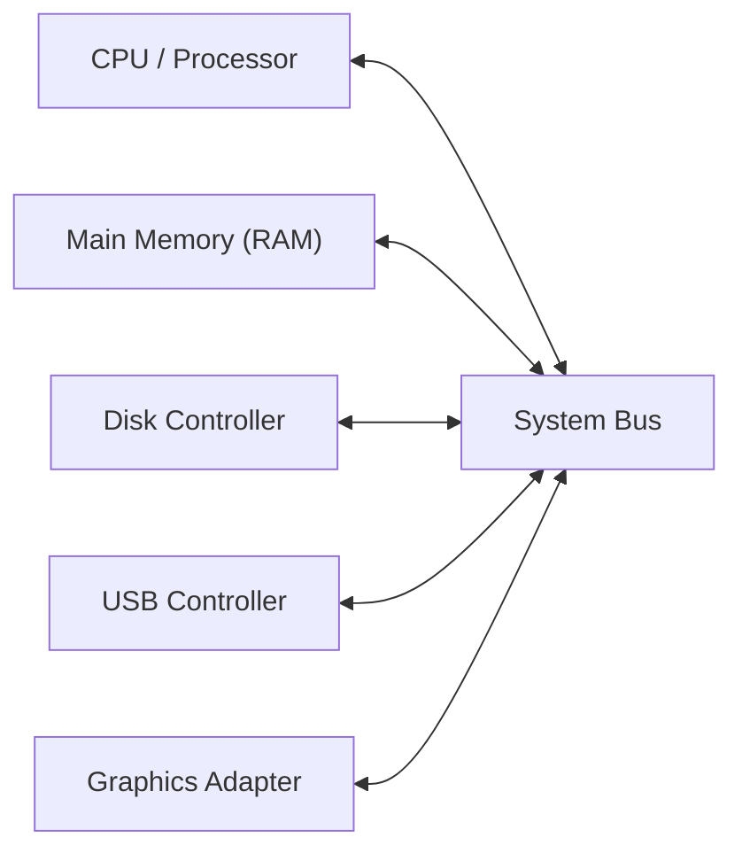

> [!info] Definition: Computer System Hardware Organization
> The physical hardware components of a computer system comprise:
> 1. **Processors (CPUs)**: The computation engines that execute machine instructions.
> 2. **Main Memory**: Volatile storage that holds currently executing programs and data.
> 3. **Device Controllers**: Dedicated processing chips managing specific peripheral devices (disks, display, network, audio).
> 4. **System Bus & Motherboard**: The interconnect communication pathway enabling concurrent data transfer between CPUs, memory, and device controllers.

> [!note] Key Operational Principle: Bus Contention
> Because multiple CPUs and device controllers execute concurrently, they compete for memory cycles across the common system bus. Memory controller hardware arbitrates access to ensure synchronized, ordered data transfer.

---

## 1.2 Computer System Structure: The Four Key Components

A computer system can be divided into four distinct conceptual components:

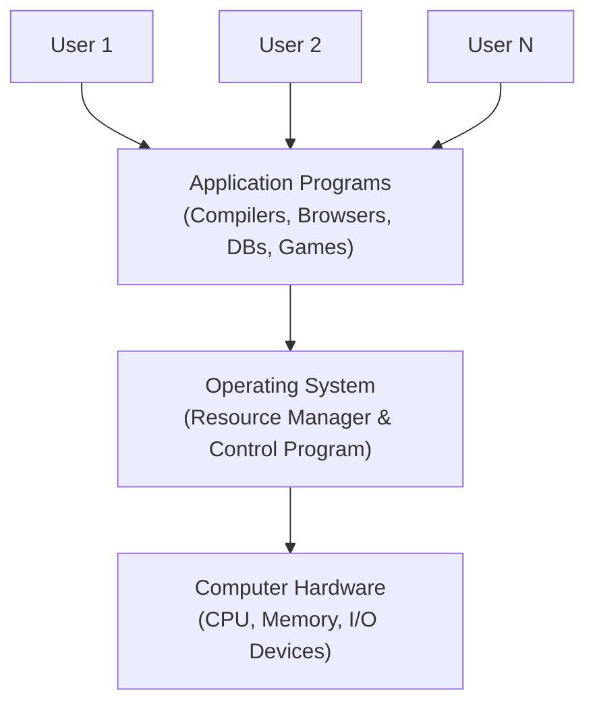

1. **Computer Hardware**:
   - Provides basic computing resources.
   - Core units: CPU, main memory, and Input/Output (I/O) devices.
2. **Operating System**:
   - Controls and coordinates the use of hardware among various applications and users.
   - Acts as an intermediary between the user/software and the raw physical hardware.
3. **Application Programs**:
   - Define the ways in which system resources are mobilized to solve users' computing problems.
   - Examples: Word processors, compilers, web browsers, database management systems, spreadsheets, video games.
4. **Users**:
   - The entities demanding computation: people, automated batch jobs, machine sensors, or other networked computers.

---

## 1.3 Computer-System Operation and Concurrent Execution

The execution of a computer system relies on coordinated concurrency between the processor and device controllers:

- **Concurrent Execution**: I/O devices and the CPU execute concurrently. While the CPU executes instructions for one program, device controllers independently handle data movement for peripheral devices.
- **Device Controllers**: Each controller is specialized for a particular device type (e.g., NVMe/SATA controller for storage, NIC for networking, GPU for graphics).
- **Local Buffers**: Each device controller contains a local buffer memory.
- **Data Transfer Mechanism**:
  1. The CPU initiates an I/O operation by writing control registers in the device controller.
  2. The device controller transfers data from the physical peripheral device into its internal local buffer.
  3. The controller moves data between its local buffer and main memory (or initiates Direct Memory Access - DMA).
  4. Once the transfer is complete, the device controller informs the CPU by raising an **interrupt**.

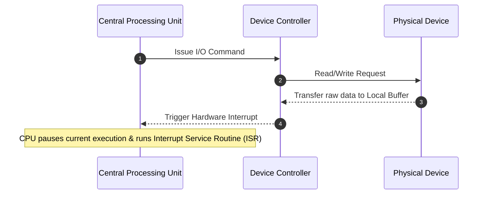

---

## 1.4 What is an Operating System?

> [!info] Definition: Operating System (OS)
> An **Operating System** is an essential system software program that acts as an interface between application software and computer hardware, controlling and managing the execution of all programs and system resources.

### Primary Objectives of an Operating System
An operating system is designed to achieve three foundational objectives:

1. **Convenience**:
   - Makes the computer system convenient, intuitive, and easy to use.
   - Hides the low-level complexities of bare hardware through high-level abstractions (such as files, directories, processes, and virtual memory).
2. **Efficiency**:
   - Allows computer system resources (CPU, memory, storage, I/O devices) to be used in an optimal and cost-effective manner.
3. **Ability to Evolve**:
   - Built with a modular architecture that permits effective development, testing, and introduction of new system functions without interfering with existing services.
   - Adapts to new hardware advances (e.g., multicore processors, SSDs), newly demanded services, and maintenance bug fixes (kernel patches).

---

## 1.5 The Dual Roles of an Operating System

The operating system fulfills two distinct, vital roles in computing systems:

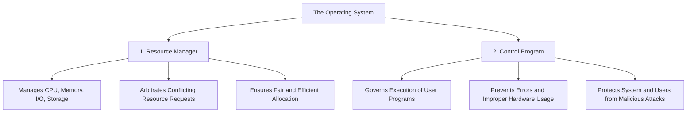

### 1.5.1 OS as a Resource Manager
- The computer hardware represents a finite collection of shared resources: processor time, memory space, file storage space, and I/O devices.
- The OS allocates these resources to specific programs and users.
- When facing conflicting requests from concurrent processes, the OS arbitrates decisions to guarantee fair, deadlock-free, and efficient resource allocation.

### 1.5.2 OS as a Control Program
- Governs the execution of user programs to prevent runtime errors, illegal operations, and improper access to hardware instructions.
- Implements protection boundaries so that an error in one user program cannot crash another program or compromise the operating system itself.

### User View vs. System View
The perceived role of an OS varies drastically depending on the operational environment:

| Computing Environment | Primary User Expectation | Primary OS Focus |
| :--- | :--- | :--- |
| **Personal Computer (Desktop / Laptop)** | Maximum convenience, rapid responsiveness, ease of use. | Usability and user experience; resource utilization is secondary. |
| **Mainframe / Enterprise Server** | Multiple simultaneous users accessing shared resources. | Maximum resource utilization, fairness, and system throughput. |
| **Dedicated Workstations** | Dedicated local compute power with access to network servers. | Balance between local responsiveness and network resource sharing. |
| **Mobile / Handheld Devices** | Smooth touch UI, continuous connectivity, responsiveness. | Usability, battery power management, and constrained memory conservation. |
| **Embedded Systems (e.g., Automotive ECU)** | Little or no user interface; autonomous real-time operation. | High reliability, deterministic execution, and direct sensor/actuator control. |

---

## 1.6 The Kernel vs. System Software

> [!warning] Common Fallacy: GUI is the Operating System
> A common misconception is to equate the Graphical User Interface (GUI) with the Operating System. The GUI is merely an application program or desktop shell that ships alongside the OS. Many embedded systems, enterprise servers, and supercomputers run robust operating systems without any GUI.

> [!info] Definition: Kernel
> The **Kernel** is the core program running at all times on the computer (in privileged supervisor mode). Everything outside the kernel is either:
> - **System Programs**: Utility programs that ship with the operating system to support system management (e.g., command interpreters, file managers, service daemons).
> - **Application Programs**: User-installed software designed to accomplish specific domain tasks (e.g., web browsers, compilers, word processors).

---

## 1.7 Computer Startup: The Bootstrapping Process

When a computer system is powered on or rebooted, it must locate and load the operating system into memory before any user task can begin:

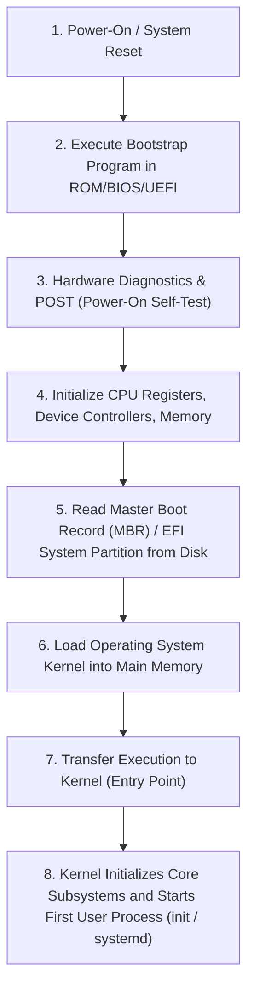

- **Bootstrap Program**: A small, initial firmware program located in non-volatile read-only memory (ROM or EPROM, traditionally known as BIOS or modern UEFI).
- **Core Startup Tasks**:
  1. Initializes all hardware components (registers, memory management unit, device controllers).
  2. Executes the Power-On Self-Test (POST).
  3. Scans secondary storage drives for bootable partitions containing the Master Boot Record (MBR) or EFI bootloader.
  4. Loads the OS kernel binary into main memory and begins executing kernel code in privileged mode.

---

## 1.8 Evolution of Operating Systems

Operating systems evolved historically through distinct phases driven by economic imperatives (maximizing processor utilization against astronomical hardware costs) and advancements in computer architecture:

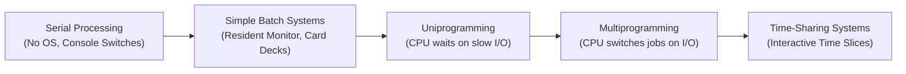

### 1.8.1 Serial Processing (Late 1940s to Mid-1950s)
- **Architecture**: No operating system. Programmers interacted directly with bare computer hardware.
- **Operation**: Machines were operated from a main console consisting of display indicator lights, toggle switches, paper tape/punch-card readers, and line printers. Programs in machine code were entered manually.
- **Fatal Bottlenecks**:
  - *Scheduling Bottleneck*: Users booked hard blocks of computer time on sign-up sheets. If a program crashed early, the remaining time was wasted; if it ran over, subsequent users were delayed.
  - *Setup Time Bottleneck*: Substantial time was wasted mounting magnetic tapes, loading compilers, reading punch cards, and setting up paper printers for every run.

### 1.8.2 Simple Batch Systems (Late 1950s to 1960s)
- **Economic Motivation**: Early mainframes cost millions of dollars; idle processor time during human setup was unacceptable.
- **The Resident Monitor**:
  - A small software program permanently residing in low memory that automatically controlled the sequence of program execution.
  - Users submitted jobs on punch cards to a human operator, who batched similar jobs together on magnetic tape.
  - The resident monitor read each job sequentially, transferred control to the user program, and upon completion, regained control to load the next job.

### 1.8.3 Uniprogramming vs. Multiprogramming
Even with batch monitors, processors remained severely underutilized because I/O devices (card readers, magnetic tapes, printers) were orders of magnitude slower than electronic processor instructions.

```
Uniprogramming:
CPU:    [ Execute P1 ]-------------[ Wait for I/O ]-------------[ Execute P1 ]
I/O:    ---------------[ I/O Operation ]--------------------------------------
        (Processor remains completely idle during I/O transfer)

Multiprogramming:
CPU:    [ Execute P1 ]-[ Execute P2 ]-[ Execute P3 ]-[ Execute P1 ]
I/O:    ---------------[ P1 I/O ]-----[ P2 I/O ]------------------
        (Processor immediately context-switches to another ready job)
```

> [!note] Comparative Mechanism
> - **Uniprogramming**: The processor can hold only one user program in memory alongside the resident monitor. When the program issues an I/O request, the processor must sit idle until the hardware transfer finishes.
> - **Multiprogramming**: Main memory is partitioned to hold the OS and multiple concurrent user programs ($P_1, P_2, \dots, P_n$). When $P_1$ pauses to wait for I/O, the operating system's CPU scheduler immediately switches processor execution to $P_2$. This drastically improves processor utilization and system throughput.

### 1.8.4 Time-Sharing Systems
- While multiprogramming maximized batch throughput, it provided zero interactivity.
- **Time-Sharing**: Uses multiprogramming to support multiple interactive users simultaneously connected through terminals.
- The processor allocates a brief slice of execution time (a time quantum, typically $10\text{ ms} - 100\text{ ms}$) to each user in rapid succession. Because the switching occurs so quickly, each user experiences the illusion of having a dedicated computer.

---

## 1.9 Major Advances in Operating System Design

The design of modern operating systems represents one of computer science's greatest engineering achievements, anchored by four foundational advances:

### 1.9.1 The Process Concept
A process is a program in execution, consisting of executable machine instructions, associated data, and an execution context (registers, stack, program counter) maintained by the OS.

### 1.9.2 Memory Management
The operating system has five principal storage management responsibilities:
1. **Process Isolation**: Prevents independent concurrent processes from reading or overwriting each other's memory spaces.
2. **Automatic Allocation and Management**: Dynamically allocates memory regions to programs as required, transparent to the application programmer.
3. **Support of Modular Programming**: Allows programmers to define, link, expand, and shrink program modules dynamically.
4. **Protection and Access Control**: Governs controlled memory sharing among cooperating processes while enforcing strict read/write/execute permissions.
5. **Long-Term Storage**: Implements persistent storage via the **File System**, where information is organized into named logical objects (files and directories).
   - *Virtual Memory*: A hardware/software facility allowing programs to address memory from a logical perspective without being constrained by physical RAM limits.

### 1.9.3 Information Protection and Security
Protects sensitive data and hardware resources from unauthorized access, accidental corruption, or malicious tampering. Focuses on four core dimensions:
- **Availability**: Guaranteeing the system and its resources remain operational and accessible without denial of service.
- **Confidentiality**: Ensuring sensitive information cannot be viewed by unauthorized users or processes.
- **Data Integrity**: Protecting stored programs and data against unauthorized or accidental modification.
- **Authenticity**: Verifying the true identity of users and the valid origin of messages and transactions.

### 1.9.4 Scheduling and Resource Management
Allocates computing resources (CPU cycles, memory frames, I/O bandwidth) among active processes according to three core policy criteria:
- **Fairness**: Ensuring all competing processes of equal priority receive equitable shares of system resources without starvation.
- **Differential Responsiveness**: Tailoring resource allocation to meet distinct workload requirements (e.g., favoring I/O-bound interactive processes over long-running batch jobs to improve user responsiveness).
- **Efficiency**: Maximizing system throughput, minimizing average job turnaround time, and maximizing processor utilization.

---

## 1.10 Common Causes of System Software Errors

Because operating systems manage concurrent, asynchronous activities, subtle software defects can arise that are notoriously difficult to reproduce and diagnose:

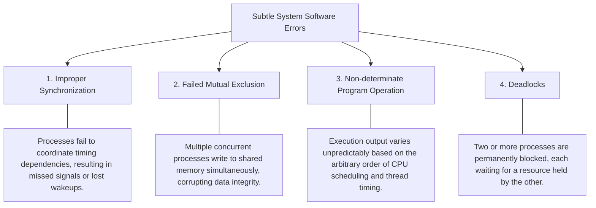

> [!danger] Key Concurrency Hazards
> - **Improper Synchronization**: Occurs when asynchronous events or signals arrive out of order, leading to unhandled state transitions.
> - **Failed Mutual Exclusion**: Occurs when multiple threads enter a critical section concurrently without synchronization, producing race conditions.
> - **Non-determinate Program Operation**: Results when the final program output is dependent on the arbitrary interleaving of processor instructions.
> - **Deadlock**: A permanent freeze where process A holds Resource 1 and requests Resource 2, while process B holds Resource 2 and requests Resource 1.

---

## 1.11 Operating System Architectural Approaches

To manage extreme complexity, various architectural paradigms have guided OS kernel design:

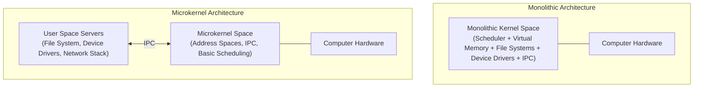

### 1.11.1 Monolithic Kernel Architecture
- **Structure**: All major operating system services—process scheduling, memory management, file systems, networking, and hardware device drivers—reside inside a single massive program running in privileged kernel mode.
- **Advantages**: Highly efficient; function calls between internal subsystems execute directly with zero IPC overhead.
- **Disadvantages**: Lack of isolation; a single fault or bug in a third-party device driver can corrupt kernel memory and crash the entire machine.

### 1.11.2 Microkernel Architecture
- **Structure**: Assigns only the bare minimum essential functions to the privileged kernel space:
  1. Low-level address space management.
  2. Interprocess Communication (IPC).
  3. Primitive thread scheduling.
- All non-essential services (device drivers, file systems, virtual memory managers, networking protocols) run as separate user-space daemon processes.
- **Advantages**:
  - *Extensibility*: New services can be added without modifying or recompiling the kernel.
  - *Reliability*: If a device driver or file system crashes, it fails safely in user space and can be restarted without crashing the operating system.
  - *Portability*: Only the tiny microkernel needs to be adapted to new processor architectures.
- **Disadvantage**: Performance overhead caused by repeated user-to-kernel context switching and message-passing IPC.

### 1.11.3 Multithreading
- A process is partitioned into lightweight dispatchable units of execution called **threads**.
- All threads belonging to the same process share that process's address space, open files, and system resources, but maintain independent execution contexts (registers, program counters, and runtime stacks).
- Enables fine-grained parallel execution across multicore processors.

---

## 1.12 Multiprocessor Architectures and Hardware Evolution

Modern operating systems are engineered to exploit diverse parallel hardware configurations:

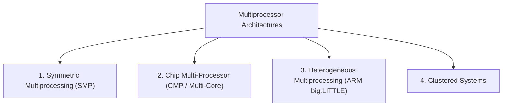

### 1.12.1 Symmetric Multiprocessing (SMP)
- An SMP system consists of two or more identical, general-purpose processors of comparable capability.
- These processors share a common physical main memory and I/O subsystems connected via a high-speed system bus.
- All processors can execute identical instructions; no single processor is permanently master or slave.
- The operating system scheduler assigns processes or threads dynamically across all available processors.
- **OS Challenges**: The kernel itself must be fully reentrant and multithreaded; synchronization primitives (locks, spinlocks) must protect shared kernel data structures from concurrent CPU access.

### 1.12.2 Chip Multi-Processor (CMP / Multi-Core) Architecture
- Integrates two or more complete independent processor execution cores onto a single piece of silicon (die).
- Each individual core includes its own instruction pipeline, execution units, and private Level 1 (L1) data/instruction caches.
- Modern multicore processors incorporate dedicated Level 2 (L2) caches and shared Level 3 (L3) caches.

#### Case Studies: Cache Hierarchy and Topology
The physical arrangement of shared caches directly dictates operating system scheduling efficiency:

```
Intel Core i7-990X Architecture:
[ Core 1 ]  [ Core 2 ]  [ Core 3 ]  [ Core 4 ]  [ Core 5 ]  [ Core 6 ]
   |           |           |           |           |           |
 [L1/L2]     [L1/L2]     [L1/L2]     [L1/L2]     [L1/L2]     [L1/L2]
   \___________ \___________ \_____|_____/ ___________/ ___________/
                                   |
                       [ Shared 12MB L3 Cache ]

AMD Ryzen 3000 Series (Zen 2 - Chiplet Design):
+-------------------------+     +-------------------------+
| Core Complex (CCX 0)    |     | Core Complex (CCX 1)    |
| [C0] [C1] [C2] [C3]     |     | [C4] [C5] [C6] [C7]     |
|   Shared 16MB L3 #1     |     |   Shared 16MB L3 #2     |
+-------------------------+     +-------------------------+
             \                               /
              \--- Interconnect Bus (IF) ---/
```

- **Intel Core i7-990X**: Features 6 physical cores connected to a single monolithic shared L3 cache. Thread migration between cores incurs minimal cache invalidation latency.
- **AMD Ryzen 3000 (Zen 2)**: Divides 16 physical cores across multiple Core Complex Dies (CCDs), where groups of 4 cores share a localized 16MB L3 cache slice. If the OS scheduler migrates a thread from CCX 0 to CCX 1, the thread loses its cache locality, causing significant memory latency penalties. Modern OS schedulers must be **topology-aware** to prevent unnecessary cross-die migrations.

### 1.12.3 Heterogeneous Multiprocessing (HMP - ARM big.LITTLE)
- Pairs high-performance, power-hungry CPU cores ("big" cores, e.g., Cortex-X / Cortex-A78) with highly energy-efficient cores ("LITTLE" cores, e.g., Cortex-A55).
- **OS Scheduling Dilemma**: The OS scheduler must dynamically inspect process characteristics:
  - Intensive background computing or heavy gaming tasks are scheduled on "big" cores for maximum performance.
  - Low-intensity background daemons and idle UI tasks are scheduled on "LITTLE" cores to dramatically conserve battery power.

### 1.12.4 Clustered Systems
- Combines multiple independent, stand-alone computer nodes connected via a high-speed local area network (LAN) into a unified computing resource.
- Provides high availability: if one physical node crashes, clustering software migrates the application workload to surviving nodes without downtime.

---

## 1.13 The Memory Hierarchy

System designers balance three competing physical constraints when architecting computer storage:
1. **Amount (Capacity)**: How many bytes can be stored.
2. **Speed (Access Latency)**: How fast the processor can read and write data.
3. **Expense (Cost per Bit)**: The manufacturing financial cost.

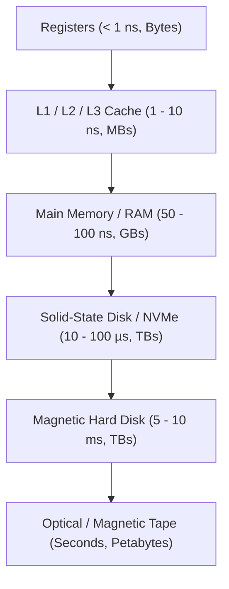

### Hierarchy Progression Rules
As you traverse down the memory hierarchy pyramid:
1. **Decreasing Cost per Bit**: High-speed static RAM registers are extremely costly per byte; magnetic tape and hard disks are cheap.
2. **Increasing Storage Capacity**: Registers hold a few hundred bytes; flash/disk storage holds tens of terabytes.
3. **Increasing Access Time**: Reading from registers takes under $1\text{ ns}$; reading from an SSD takes microseconds ($10^{-6}\text{ s}$); reading from a magnetic disk takes milliseconds ($10^{-3}\text{ s}$).
4. **Decreasing Frequency of Access by the Processor**: Supported by the **Principle of Locality** (temporal and spatial locality), which ensures that over $90\%$ of processor memory requests are satisfied by high-level caches and RAM, preventing the slow lower layers from throttling processor performance.


---

# Topic 2: Process Description and Control

## 2.1 The Concept and Definition of a Process

The fundamental concept of the process is the core foundation upon which all modern multitasking operating systems are constructed.

> [!info] Definitions: What is a Process?
> A **Process** can be defined from multiple technical perspectives:
> 1. **A program in execution**: A passive collection of instructions stored on disk (an executable binary) becomes an active process when loaded into main memory.
> 2. **An instance of a program running on a computer**: Multiple processes can execute identical code concurrently (e.g., three separate instances of a text editor), each maintaining separate data and execution states.
> 3. **The entity that can be assigned to and executed on a processor**: The fundamental dispatchable unit scheduled by the OS.
> 4. **A unit of activity**: Characterized by the execution of a sequential stream of machine instructions, a current execution state, and an associated set of system resources.

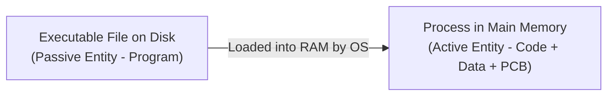

---

## 2.2 System Booting and the Master Boot Record (MBR)

Before any process can be scheduled, the computer hardware must initialize and locate the operating system:

- **Power-On & Firmware**: When power is supplied, the processor begins execution at a fixed firmware address (BIOS/UEFI in ROM).
- **Disk Identification**: The BIOS searches bootable secondary storage drives for a disk sector containing the 2-byte hexadecimal **Magic Number** `0xAA55` at the end of the first sector.
- **Master Boot Record (MBR)**:
  - Resides at Cylinder 0, Head 0, Sector 1 (the first 512 bytes of the disk).
  - Contains primary bootstrap code, the disk signature, and the 64-byte Partition Table.
  - The partition table supports up to **4 primary partitions**. If more than four logical divisions are required, an **Extended Partition** containing linked Logical Block Addressing (LBA) structures must be created.
- **Hand-off to OS**: The BIOS loads the MBR into memory at physical address `0x7C00` and jumps to it, initiating the chain of bootloaders (e.g., GRUB, Windows Boot Manager) that loads the operating system kernel into memory.

---

## 2.3 The Three Components of a Process and the Process Image

A complete process is not merely code; it comprises three interconnected components known collectively as the **Process Image**:

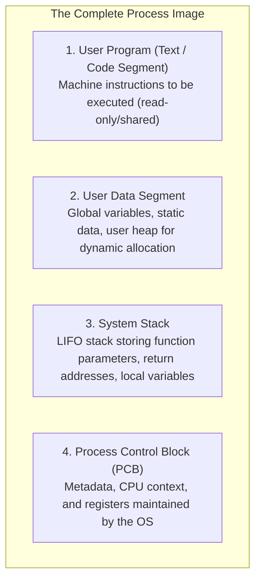

1. **User Program (Code Segment)**:
   - The compiled machine instructions to be fetched and executed by the CPU. This memory region is typically marked read-only to prevent self-modification.
2. **User Data Segment**:
   - Modifiable user space containing initialized global variables, static variables, uninitialized data (BSS), and dynamically allocated heap memory (`malloc` / `new`).
3. **System Stack (Runtime Stack)**:
   - Each process has one or more Last-In-First-Out (LIFO) stacks used to store activation records, procedure parameters, calling return addresses, and local variables during nested function calls and system calls.
4. **Process Control Block (PCB)**:
   - The critical data structure constructed and maintained by the OS to store all execution context and control information needed to manage the process.

---

## 2.4 Structure of the Process Control Block (PCB)

The PCB is the physical manifestation of a process in the operating system kernel. It contains eight categories of vital information:

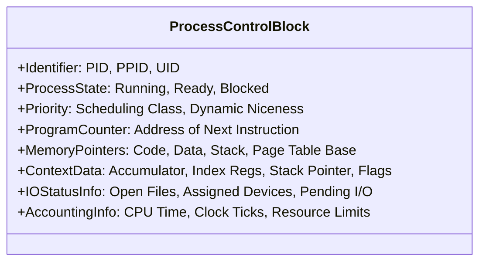

| PCB Element Category | Technical Description & Contained Fields |
| :--- | :--- |
| **Identifiers** | Unique numeric tags: Process Identifier (**PID**), Parent Process Identifier (**PPID**), and User Identifier (**UID**). |
| **Process State** | The current operational status of the process (e.g., Running, Ready, Blocked, Ready/Suspend, Exit). |
| **Priority Level** | Scheduling priority relative to other processes; determines CPU dispatching preference. |
| **Program Counter (PC)** | Memory address of the next machine instruction in the program to be fetched and executed. |
| **Memory Pointers** | Pointers to the process's text and data segments in memory, plus base/limit registers or page/frame table descriptors. |
| **Context Data (Processor State)** | Contents of CPU hardware registers when the process is not running (Data Registers, Address Registers, Stack Pointer `SP`, Program Status Word `PSW` condition flags). |
| **I/O Status Information** | Outstanding I/O requests, lists of I/O devices currently assigned to the process, active file descriptors, and communication sockets. |
| **Accounting Information** | Cumulative CPU execution time used, elapsed wall-clock time, memory usage limits, account numbers, and process billing metrics. |

---

## 2.5 Process Traces, Dispatching, and Instruction Cycles

To understand how an operating system creates the illusion of simultaneous multi-process execution, we examine the **Process Trace**:

> [!info] Definition: Process Trace
> A **Process Trace** is the sequential listing of the exact machine instruction sequence that executes for a particular process during its lifetime.

### The Role of the Dispatcher
The **Dispatcher** is the core operating system program that switches the physical processor from one executing process to another:
- To prevent a single computation-heavy process from monopolizing the processor, the OS enforces an instruction quantum (e.g., maximum 6 instruction cycles per burst).
- When the quantum expires or an I/O system call is issued, hardware generates a clock interrupt or software trap.
- Control transfers immediately to the Dispatcher code, which saves the current process context, selects a new process, and restores its state.

```
Instruction Interleaving Timeline Example:
[ Process A: 6 cycles ] ---> [ Dispatcher: Context Switch ] ---> [ Process B: 4 cycles (I/O call) ] ---> [ Dispatcher ] ---> [ Process C: 6 cycles ]
```

---

## 2.6 Process Creation and Termination

### Four Principal Events That Cause Process Creation

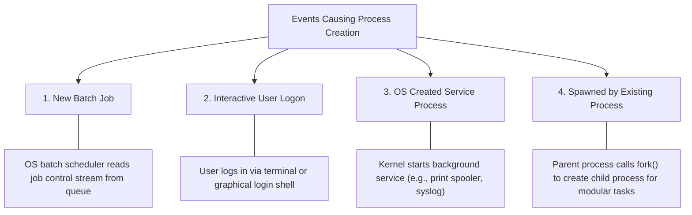

1. **New Batch Job**: The operating system is provided with a batch job control stream (historically on tape or punch cards; currently in cluster batch queues like Slurm). When resources free up, the OS creates a new process to execute the job.
2. **Interactive Logon**: A user authenticates at a physical terminal or remote SSH session. The OS creates a shell process (e.g., `bash`, `cmd.exe`) to handle user input.
3. **Created by OS to Provide a Service**: The OS spawns autonomous background processes (daemons or services) to handle system-wide tasks like print spooling, network packet monitoring, or scheduled disk indexing.
4. **Spawned by an Existing Process**: For modular programming or concurrency, an existing user process issues a system call (e.g., `fork()` in Unix/Linux) to spawn a child process.

### Reasons for Process Termination

An executing process may terminate due to voluntary completion or involuntary operational faults:

| Termination Cause | Detailed Operational Explanation |
| :--- | :--- |
| **Normal Completion** | The process executes a voluntary termination system call (e.g., `exit()` or `return 0`). |
| **Time Limit Exceeded** | The process ran longer than the total maximum processor time specified by the OS or user. |
| **Memory Unavailable** | The process requested more virtual or physical memory than the operating system can allocate. |
| **Bounds Violation** | The process attempted to access a memory address outside its allocated address space (segmentation fault). |
| **Protection Error** | Attempted to perform an unauthorized action, such as writing to a read-only file or executing data memory. |
| **Arithmetic Error** | An invalid mathematical operation occurred, such as division by zero or numerical overflow. |
| **Time Overrun** | The process waited longer than a specified maximum time for an external synchronization event. |
| **I/O Failure** | An unrecoverable hardware error occurred during an I/O operation (e.g., disk sector read error, broken network socket). |
| **Invalid Instruction** | The CPU attempted to execute a non-existent machine instruction code (often due to corrupted memory or wrong branch jumps). |
| **Privileged Instruction** | The user-space process attempted to execute a CPU instruction reserved strictly for supervisor/kernel mode. |
| **Data Misuse** | An operational data item is of the incorrect data type or was referenced uninitialized. |
| **OS Intervention** | The system operator or system administrator manually terminates the process (e.g., `kill -9`), or kernel terminates it to break deadlock. |
| **Parent Termination (Cascading)** | When a parent process terminates, many operating systems automatically terminate all of its descendant child processes. |
| **Parent Request** | The parent process possesses the authorization handle to arbitrarily terminate or abort its child process. |

---

## 2.7 Process State Models

Operating systems track processes through formalized state transition models:

### 2.7.1 The Two-State Process Model
The most primitive conceptual model divides processes into two states:
- **Running**: The process is currently executing on the CPU.
- **Not-Running**: The process is paused, waiting to execute.


> [!warning] Inefficiency of the Two-State Single Queue
> Under a single "Not-Running" queue, the OS dispatcher cannot simply pick the process that has waited longest because that process might be blocked waiting for an I/O device. The dispatcher would have to scan the entire queue repeatedly, creating severe scheduling overhead.

---

### 2.7.2 The Five-State Process Model

To solve the limitation of the two-state model, non-running processes are split into **Ready** (can execute immediately) and **Blocked** (waiting for an external event):

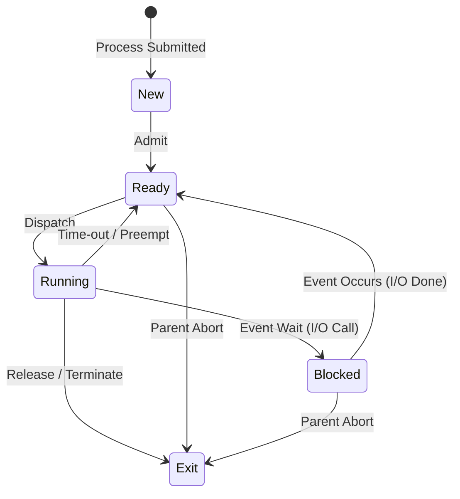

#### Detailed State Descriptions
1. **New**: A process that has just been created and defined by its PCB, but has not yet been admitted to the pool of executable processes (its code/data is not yet loaded into main memory).
2. **Ready**: The process is fully loaded in main memory and is ready to execute as soon as the CPU scheduler allocates processor time.
3. **Running**: The process currently occupies the processor and has its instructions being decoded and executed.
4. **Blocked (Waiting)**: The process cannot execute even if the CPU were free, because it is waiting for an external event (such as disk I/O transfer completion, network packet arrival, or child exit signal).
5. **Exit**: The process has terminated execution and has been released from the active scheduling pool; the OS retains its PCB temporarily to allow parent processes to collect return exit codes.

#### Five-State Transitions
- **New $\rightarrow$ Ready (Admit)**: The OS admits the new process when sufficient main memory and system tables are available.
- **Ready $\rightarrow$ Running (Dispatch)**: When selecting a new process to run, the OS scheduler picks a process from the Ready queue based on priority.
- **Running $\rightarrow$ Ready (Time-out / Preemption)**: Occurs when the running process consumes its allocated time quantum, or when a higher-priority process transitions to Ready.
- **Running $\rightarrow$ Blocked (Event Wait)**: The process initiates an asynchronous operation or requests an OS service via a system call (e.g., `read()` from disk).
- **Blocked $\rightarrow$ Ready (Event Occurs)**: The requested hardware interrupt arrives indicating the I/O operation or awaited signal has completed.
- **Running $\rightarrow$ Exit (Release)**: The process finishes normal execution or aborts due to an unhandled fatal exception.

---

### 2.7.3 Queue Management: Single vs. Multiple Blocked Queues

In a multi-process environment, queue architecture directly governs OS throughput:

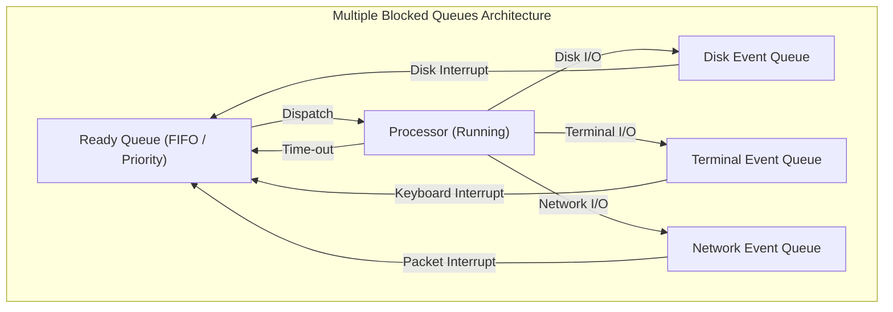

- **Single Blocked Queue**: When an I/O event completes, the OS must scan through every entry in the single blocked queue to discover which process was waiting for that specific event. This creates $O(N)$ overhead per interrupt.
- **Multiple Blocked Queues**: The OS establishes a dedicated FIFO queue for each hardware device or event type (e.g., disk queue, serial queue, timer queue). When an interrupt fires for that device, the OS immediately dequeues the head process in $O(1)$ constant time and moves it to the Ready queue.

---

## 2.8 Suspended Processes and the Seven-State Model

### Why Process Suspension (Swapping) is Necessary
The CPU operates at gigahertz speeds (nanosecond cycles), whereas secondary storage I/O operates at millisecond speeds. Consequently, in a multiprogramming system with limited physical RAM, **all active processes in memory may eventually become blocked waiting for I/O**.

If all processes in RAM are blocked:
- The CPU would sit completely idle.
- To prevent CPU underutilization, the OS performs **Swapping**: it moves the process image of blocked processes from physical RAM to secondary storage (the disk swap partition/file).
- Swapping frees physical RAM frames, allowing the OS to load a new or previously suspended ready process into memory.

### The Two Suspended States
1. **Blocked/Suspend**: The process resides on disk swap space, and is waiting for an external event to occur.
2. **Ready/Suspend**: The process resides on disk swap space, but is ready to execute immediately as soon as it is swapped back into physical RAM.

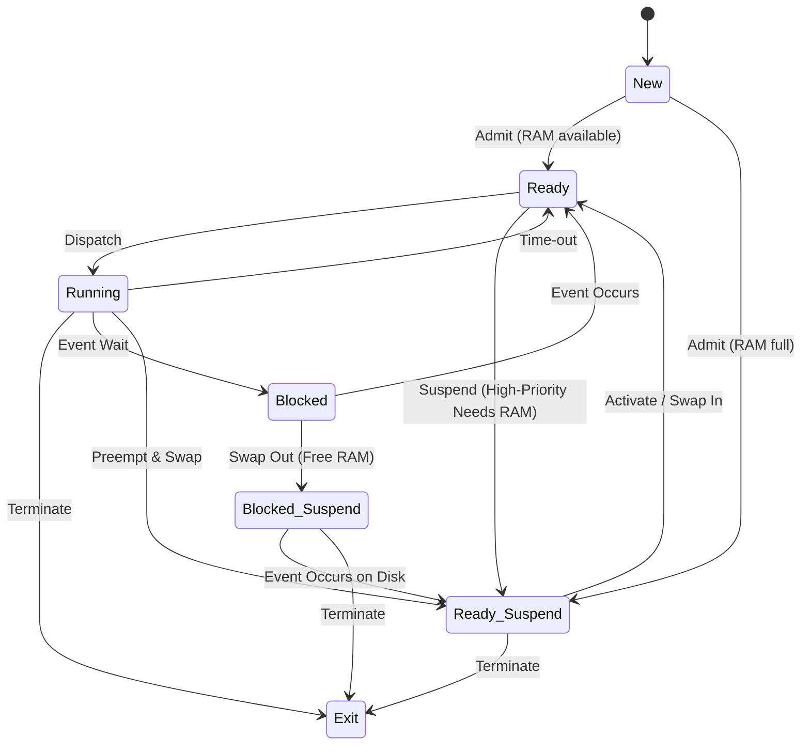

#### Seven-State Transition Mechanics
- **Blocked $\rightarrow$ Blocked/Suspend**: When no processes in RAM are ready, or when a ready process demands more physical memory, the OS swaps out blocked processes to disk.
- **Blocked/Suspend $\rightarrow$ Ready/Suspend**: The external I/O event for which the suspended process was waiting completes while the process is still on disk.
- **Ready/Suspend $\rightarrow$ Ready (Activate)**: Occurs when physical RAM is freed, or when a Ready/Suspend process possesses higher priority than any process currently in RAM.
- **Ready $\rightarrow$ Ready/Suspend**: If a high-priority blocked process requires memory, the OS may suspend a lower-priority ready process rather than a higher-priority blocked one.
- **New $\rightarrow$ Ready/Suspend**: When a new process is spawned but physical memory is completely exhausted, the OS creates its PCB and immediately allocates its address space in swap.

#### Primary Reasons for Process Suspension
1. **Swapping**: The OS frees up sufficient main memory to bring in a ready-to-run process.
2. **Other OS Internal Reasons**: The OS suspects the process of generating anomalies (e.g., thrashing, periodic security audits).
3. **Interactive User Request**: A user halts program execution for debugging or backgrounding (e.g., typing `Ctrl+Z` in a Unix terminal).
4. **Timing Constraints**: A background process executes periodically (e.g., once every hour) and is suspended between intervals.
5. **Parent Process Request**: A parent process suspends execution of a child to inspect, coordinate, or modify its operation.

---

## 2.9 Comprehensive State Transition Exercises and Walkthroughs

> [!example] Exercise 1: Five-State Model Execution Trace
> **Scenario**: Process $A$ is submitted as a new job with the following execution timeline:
> 1. Process $A$ executes.
> 2. Time-out occurs (clock interrupt).
> 3. Process $A$ continues to execute.
> 4. Process $A$ requests and waits for an I/O operation.
> 5. Process $A$ resumes execution.
> 6. Process $A$ terminates.
> 
> **Sequential State Progression**:
> $$\text{New} \xrightarrow{\text{Admit}} \text{Ready} \xrightarrow{\text{Dispatch}} \text{Running} \xrightarrow{\text{Time-out}} \text{Ready} \xrightarrow{\text{Dispatch}} \text{Running} \xrightarrow{\text{I/O Wait}} \text{Blocked} \xrightarrow{\text{I/O Done}} \text{Ready} \xrightarrow{\text{Dispatch}} \text{Running} \xrightarrow{\text{Exit}} \text{Terminated}$$

> [!example] Exercise 2: Seven-State Model Execution Trace
> **Scenario**: Process $Q$ is created and executed under memory pressure:
> 1. Process $Q$ is submitted and ready to run in the queue.
> 2. Process $Q$ is swapped out of main memory to provide space for the currently running process.
> 3. The currently running process terminates; Process $Q$ is selected for execution.
> 4. Process $Q$ issues an I/O request.
> 5. The I/O request finishes; Process $Q$ continues execution.
> 6. A timer interrupt occurs after some time.
> 7. The user explicitly terminates Process $Q$.
> 
> **Sequential State Progression**:
> 1. $\text{New} \rightarrow \text{Ready}$ (admitted to main memory queue)
> 2. $\text{Ready} \rightarrow \text{Ready/Suspend}$ (swapped out to disk to free RAM)
> 3. $\text{Ready/Suspend} \rightarrow \text{Ready} \rightarrow \text{Running}$ (swapped back into RAM and dispatched)
> 4. $\text{Running} \rightarrow \text{Blocked}$ (issues synchronous I/O request)
> 5. $\text{Blocked} \rightarrow \text{Ready} \rightarrow \text{Running}$ (I/O finishes, process placed in Ready, then scheduled)
> 6. $\text{Running} \rightarrow \text{Ready}$ (clock interrupt preempts process)
> 7. $\text{Ready} \rightarrow \text{Exit}$ (user sends kill signal while process waits in Ready queue)

---

## 2.10 Operating System Control Structures

To maintain absolute authority over the machine, the operating system constructs and links four master control table architectures:

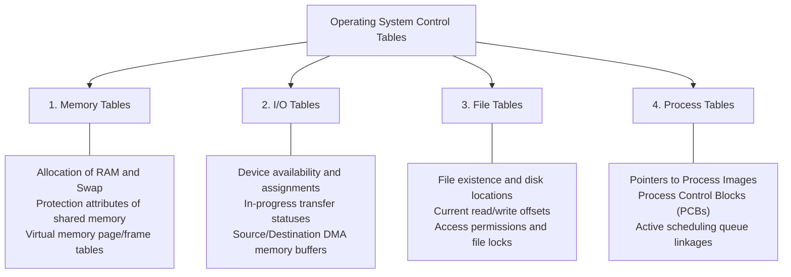

1. **Memory Tables**:
   - Manage both primary (RAM) and secondary (virtual swap) memory.
   - Maintain records of frame allocation, free lists, page tables, and memory protection bits governing shared memory boundaries.
2. **I/O Tables**:
   - Track peripheral devices (available vs. assigned to specific processes).
   - Maintain status of active data transfers and pointers to memory buffers reserved for Direct Memory Access (DMA).
3. **File Tables**:
   - Track active files open across the entire operating system.
   - Record storage block addresses, current file seek pointers, file descriptors, and locking states.
4. **Process Tables**:
   - Master directory of all process images.
   - Maps process IDs to their respective PCB memory locations and scheduling queues.

---

## 2.11 Modes of Execution: User Mode vs. Kernel Mode

Hardware microprocessors provide at least two distinct operational privilege modes to safeguard the kernel:


- **User Mode (Less-Privileged / Ring 3)**:
  - User application software executes strictly in this mode.
  - The CPU hardware actively restricts instruction execution: programs cannot directly read/write I/O ports, disable interrupts, or manipulate memory mapping registers.
- **Kernel Mode (System / Supervisor / Control Mode / Ring 0)**:
  - The operating system kernel executes in this privileged mode.
  - The CPU can execute all instructions, including control registers, page table registers, and direct hardware I/O commands.

> [!note] Mode Switch vs. Process Switch
> - **Mode Switch**: A transition from User Mode to Kernel Mode (e.g., when a program invokes a system call like `getpid()`). The CPU saves minimal hardware registers on the kernel stack and executes the kernel routine on behalf of the *same* process. **The process state does not change.** It incurs very low overhead.
> - **Process Switch (Context Switch)**: A full switch from one executing process to a completely different process. It requires saving all CPU context to the old PCB, updating scheduling queues, invalidating memory mappings (flushing the CPU Translation Lookaside Buffer - TLB), switching page directories, and loading the new process's context. It incurs substantial overhead (thousands of clock cycles).

---

## 2.12 Detailed Steps in Process Creation and Process Switching

### Seven Architectural Steps in Process Creation
When an OS creates a new process, it executes seven sequential operations:
1. **Assign a Unique Process Identifier (PID)**: A new numeric slot is reserved in the primary process table.
2. **Allocate Space for the Process Image**: Contiguous or paged memory is allocated to hold the user program code, user data segment, heap, user stack, and private kernel stack.
3. **Initialize the Process Control Block (PCB)**:
   - State is set to `New`.
   - Program counter is initialized to the program entry point (`main`).
   - Stack pointer is initialized to the base of the user stack.
   - CPU registers are zeroed or set to system defaults; priority is assigned.
4. **Set Up System Linkages**: The new PCB is inserted into the appropriate scheduling linked list (e.g., Ready queue or New queue).
5. **Create / Expand Other Data Structures**: Billing, resource tracking, and file descriptor tables are instantiated.

### When to Initiate a Process Switch
A process switch is triggered by three categories of system events:
1. **Hardware Interrupts**:
   - *Clock Interrupt*: Time slice expired; running process moved to `Ready`.
   - *I/O Interrupt*: An asynchronous device transfer finished; the waiting process is moved from `Blocked` to `Ready`.
   - *Memory Fault*: Virtual address is not currently in RAM (Page Fault); process is moved to `Blocked` while the page is fetched from disk.
2. **Traps (Software Exceptions)**:
   - Caused by an error inside the running process (e.g., division by zero, invalid memory address). The OS moves the process to `Exit` or invokes an error handler.
3. **Supervisor Calls (System Calls)**:
   - The user program voluntarily invokes an OS service requiring a wait (e.g., `read()` from a terminal or file), moving the process to `Blocked`.

### Seven Architectural Steps in Process Switching
When the dispatcher switches execution from Process $P_A$ to Process $P_B$:
1. **Save CPU Context**: The hardware Program Counter, Processor Status Word (`PSW`), and general registers of $P_A$ are pushed onto its kernel stack or saved into its PCB.
2. **Update PCB of Running Process**: The state of $P_A$ is changed from `Running` to `Ready`, `Blocked`, or `Ready/Suspend`.
3. **Move PCB to Appropriate Queue**: $P_A$'s PCB is linked into the corresponding Ready or Blocked queue.
4. **Select Another Process for Execution**: The CPU scheduler evaluates priority algorithms and selects $P_B$ from the Ready queue.
5. **Update PCB of Selected Process**: The state of $P_B$ is transitioned from `Ready` to `Running`.
6. **Update Memory-Management Data Structures**: The CPU Memory Management Unit (MMU) is reprogrammed: base/limit registers are updated, the Page Directory Base Register (`CR3` in x86) is switched to point to $P_B$'s page tables, and the processor's Translation Lookaside Buffer (TLB) is flushed.
7. **Restore CPU Context**: The hardware registers, stack pointer, and program counter of $P_B$ are popped from its PCB/stack into physical CPU registers, and execution resumes where $P_B$ previously stopped.


---

# Topic 3: Threads, Symmetric Multiprocessing (SMP), and Microkernels

## 3.1 Concepts of Multithreading: Process vs. Thread

In traditional operating system designs, the concept of a process encompassed two distinct characteristics:
1. **Resource Ownership**: A process is allocated a virtual address space to hold the process image, and is granted control of system resources (main memory, I/O channels, open file descriptors).
2. **Scheduling / Execution**: A process is an execution path (a stream of instructions) dispatched and executed on a processor.

Modern operating systems decouple these two characteristics:

```mermaid
flowchart TD
    subgraph TraditionalProcess ["Traditional Single-Threaded Process"]
        P1["Process: Resource Ownership + Single Execution Thread"]
    end
    subgraph ModernProcess ["Modern Multithreaded Process"]
        P2["Process: Unit of Resource Ownership (Address Space, Files)"]
        P2 --> T1["Thread 1: Dispatchable Execution Unit"]
        P2 --> T2["Thread 2: Dispatchable Execution Unit"]
        P2 --> T3["Thread N: Dispatchable Execution Unit"]
    end
```

> [!info] Definitions: Process vs. Thread
> - **Process (Unit of Resource Ownership)**: A collection of one or more threads and associated system resources. The OS allocates a protected virtual address space to house the process code, data, and heap.
> - **Thread (Unit of Dispatching / Lightweight Process)**: A dispatchable unit of work that executes sequentially on a processor, possesses an execution state, and can be preempted or interrupted.

### Per-Thread vs. Shared Process Resources
Within a multithreaded process, certain elements are private to each thread, while others are shared across all threads:

| Private to Each Thread (Per-Thread State) | Shared Across All Threads in Process |
| :--- | :--- |
| **Thread Execution State** (Running, Ready, Blocked) | **Virtual Address Space** (Code, Data, Heap) |
| **Saved Processor Context** (Program Counter, CPU Registers) | **Global Variables & Static Memory** |
| **Execution Stacks** (Private User Stack & Kernel Stack) | **Open File Descriptors & Network Sockets** |
| **Static Storage for Thread-Local Variables (TLS)** | **I/O Device Allocations & Privileges** |
| **Scheduling Priority & Thread Control Block (TCB)** | **Inter-Process Communication (IPC) Channels** |

---

## 3.2 Benefits and Drawbacks of Threads

### Key Benefits of Threads
Operating systems gain substantial performance improvements by using threads instead of separate processes:

1. **Faster Creation Time**: Creating a new thread within an existing process is up to **10 times faster** than creating a new process, because the OS does not need to duplicate address spaces, page tables, or file handles.
2. **Faster Termination Time**: Terminating a thread requires freeing only its local stack and TCB, avoiding the extensive cleanup of whole address spaces.
3. **Faster Context Switching**: Switching execution between two threads belonging to the *same* process is vastly faster than switching between different processes. The CPU does not switch memory contexts; base/limit registers remain unchanged, the page directory does not reload, and the CPU Translation Lookaside Buffer (TLB) is not flushed.
4. **Enhanced Communication Efficiency**: Communication between threads within the same process occurs directly via shared global variables in memory. This eliminates the overhead of kernel traps, system calls, and message buffers required by Inter-Process Communication (IPC).

### Drawbacks and Pitfalls of Multithreading
1. **Lack of Memory Protection**: Because all threads share a single address space, there is zero memory isolation between them. An unhandled exception, wild pointer overwrite, or stack overflow in one thread can corrupt data belonging to other threads and crash the entire process.
2. **Concurrency Hazards**: Unsynchronized access to shared data structures leads to race conditions, deadlocks, and non-deterministic software bugs that are difficult to reproduce and debug.

---

## 3.3 Practical Uses of Threads in Single-User and Multiprocessor Systems

Modern desktop and server applications leverage multithreading to achieve high responsiveness and throughput:

```mermaid
flowchart TD
    App["Spreadsheet / Word Processor Application"]
    App --> UI["Thread 1: Interactive User Interface<br>(Reads keyboard/mouse, updates display immediately)"]
    App --> Calc["Thread 2: Background Engine<br>(Recalculates complex formula matrix)"]
    App --> Spell["Thread 3: Asynchronous Checker<br>(Continuous spell & grammar validation)"]
    App --> Save["Thread 4: Periodic Auto-Save<br>(Writes backup file to disk every 60 seconds)"]
```

1. **Foreground and Background Work**:
   - In interactive applications, one thread manages user interface events (keystrokes, mouse clicks) to ensure immediate responsiveness, while background threads handle compute-heavy operations.
2. **Asynchronous Processing**:
   - A word processor executes background spell-checking and auto-pagination without interrupting the user's typing.
3. **Speed of Execution and Overlapped I/O**:
   - In network and file operations, one thread can issue a blocking I/O request (such as reading a file from disk or fetching data from a remote server) while other threads continue local computation.
4. **Modular Program Structure**:
   - Complex software pipelines can be structured cleanly into discrete, specialized cooperating threads.

---

## 3.4 Remote Procedure Calls (RPC) Using Threads

> [!info] Definition: Remote Procedure Call (RPC)
> A **Remote Procedure Call (RPC)** is a client/server communication abstraction allowing a program on one computer to execute a subroutine on a remote host using conventional local function call/return syntax.

```mermaid
sequenceDiagram
    autonumber
    participant T1 as Client Thread 1 (Local Work)
    participant T2 as Client Thread 2 (RPC Caller)
    participant Srv as Remote Server Host
    
    Note over T2: T2 calls Remote Function
    T2->>Srv: Send RPC Request across Network
    Note over T2: T2 enters Blocked State (Waiting for reply)
    Note over T1: T1 continues local CPU processing simultaneously!
    Srv-->>T2: Return RPC Result Packet
    Note over T2: T2 unblocks and transitions to Ready/Running
```

- **Unithreaded RPC**: When a single-threaded program invokes an RPC, the entire process blocks while network packets travel across the network and the server computes the response. The local CPU sits idle.
- **Multithreaded RPC**: The RPC request is dispatched on Thread 2, which blocks awaiting the network response. Meanwhile, Thread 1 continues executing local computation on the CPU, overlapping network latency with local processor cycles.

---

## 3.5 Thread Implementation Models: ULT vs. KLT vs. Combined

Operating systems support threads through three primary architectural models:

```mermaid
flowchart TD
    subgraph ULT ["1. User-Level Threads (ULT)"]
        U1["User Thread 1"] & U2["User Thread 2"] --> TL["User-Space Thread Library"]
        TL --> KP1["Single Kernel Process Entity"]
        KP1 --> K1["Kernel (Unaware of ULTs)"]
    end
    subgraph KLT ["2. Kernel-Level Threads (KLT)"]
        KT1["Thread 1"] & KT2["Thread 2"]
        KT1 --> KS1["Kernel Thread 1 (TCB)"]
        KT2 --> KS2["Kernel Thread 2 (TCB)"]
        KS1 & KS2 --> K2["Kernel Scheduler"]
    end
    subgraph Combined ["3. Combined Hybrid (Many-to-Many)"]
        HU1["User Thread"] & HU2["User Thread"] & HU3["User Thread"] --> HUL["User Thread Library"]
        HUL --> LWP1["Lightweight Process (LWP 1)"]
        HUL --> LWP2["Lightweight Process (LWP 2)"]
        LWP1 & LWP2 --> HK["Kernel-Level Threads"]
    end
```

### 3.5.1 User-Level Threads (ULT)
- **Architecture**: All thread management (creation, scheduling, synchronization, and context switching) is executed completely in user space by a runtime thread library.
- The kernel has **no knowledge** of the individual threads; it manages and schedules only the single enclosing process.
- **Advantages**:
  1. *Extremely Fast Context Switching*: Thread switching does not require kernel mode privileges; no mode switch, trap, or register reload via supervisor mode is needed.
  2. *Customized Scheduling*: The application can implement specialized scheduling algorithms (e.g., priority queues, deadline scheduling) tailored to its workload without altering the OS kernel.
  3. *High Portability*: ULT libraries can execute on any operating system without requiring kernel modifications.
- **Disadvantages**:
  1. *Blocking System Call Flaw*: When one user thread executes a blocking system call (e.g., synchronous disk read), the operating system blocks the *entire process*, halting all other user threads in that process even if they are ready to run.
  2. *Cannot Exploit Multiprocessors*: The kernel assigns only a single processor core to the process; user-level threads cannot execute concurrently across multiple physical CPU cores.

---

### 3.5.2 Kernel-Level Threads (KLT)
- **Architecture**: All thread management is handled directly by the operating system kernel. There is no thread library code running in user space that hides threads from the kernel.
- The kernel maintains context information for the process as a whole and for each individual thread (via Thread Control Blocks - TCBs).
- **Advantages**:
  1. *True Parallelism*: The kernel scheduler can simultaneously dispatch multiple threads from the exact same process onto separate physical processor cores.
  2. *Non-Blocking Concurrency*: If one thread in a process blocks on an I/O system call, the kernel can immediately schedule another ready thread from the same process.
  3. *Multithreaded Kernel Routines*: Kernel functions themselves can be structured as multithreaded daemons.
- **Disadvantage**:
  - *Context Switch Overhead*: Switching execution between two threads in the same process requires a mode switch into kernel mode (Ring 0), incurring higher latency than pure user-level switches.

---

### 3.5.3 Combined / Hybrid Approaches (Many-to-Many Model)
- **Architecture**: Combines the benefits of ULT and KLT:
  - Thread creation and the majority of scheduling are handled in user space by an application thread library.
  - A large pool of User-Level Threads is dynamically multiplexed onto a smaller or equal number of Kernel-Level Threads (historically called **Lightweight Processes - LWPs** in Solaris).
- **Benefits**:
  - Multiple threads can run in parallel on separate processor cores.
  - Most thread switches occur in user space without kernel mode overhead.
  - A blocking system call by one thread does not stall the entire application, as the kernel can allocate another LWP.

---

## 3.6 Multiprocessor Systems and Symmetric Multiprocessing (SMP)

Operating systems classify multiprocessor architectures into two broad categories based on memory coupling:

```mermaid
flowchart TD
    MP["Multiprocessor Architectures"]
    MP --> LC["1. Loosely Coupled (Distributed Memory / Clusters)"]
    MP --> TC["2. Tightly Coupled (Shared Memory / SMP)"]
    
    LC --- D1["Processors have private RAM and I/O<br>Communicate via network packet message-passing"]
    TC --- D2["Processors share physical RAM and system bus<br>Communicate via shared memory variables"]
```

### Master/Slave vs. Symmetric Multiprocessing (SMP)
When managing multiple shared-memory processors, operating systems historically utilized two control strategies:

1. **Master/Slave Architecture**:
   - The OS kernel always executes on a single dedicated processor (the "Master").
   - All other processors ("Slaves") execute only user application programs.
   - If a slave processor requires an OS service (e.g., file I/O or memory allocation), it generates an interrupt to the master and waits.
   - *Failure Point*: The master processor constitutes a severe performance bottleneck and a single point of system failure.
2. **Symmetric Multiprocessing (SMP)**:
   - The OS kernel can execute on **any** available processor.
   - Each processor independently schedules processes or threads from a common pool of ready entities.
   - *Engineering Complexity*: The kernel code must be fully reentrant and thread-safe. Critical kernel data structures (scheduling queues, memory maps) must be protected by fine-grained mutual exclusion locks (such as spinlocks) to prevent concurrent processor race conditions.

### Multiprocessor OS Design Considerations
Designing an SMP operating system introduces five critical engineering challenges:
1. **Simultaneous Concurrent Processes**: Multiple processors execute kernel routines simultaneously, requiring robust synchronization primitives.
2. **Scheduling and Processor Affinity**:
   - The scheduler must load-balance tasks across cores while respecting **Processor Affinity**:
     - *Soft Affinity*: The scheduler attempts to assign a ready thread back to the same CPU core it last ran on, maximizing the reuse of cached data still lingering in that core's L1/L2 caches.
     - *Hard Affinity*: The OS allows processes to explicitly bind threads to specific CPU cores (using CPU affinity masks).
3. **Synchronization**: Hardware atomic instructions (e.g., `test_and_set`, `compare_and_swap`) must ensure mutually exclusive access to shared kernel locks across independent CPU memory buses.
4. **Memory Management and Cache Coherency**: Hardware cache snooping protocols (MESI) ensure cache coherency; changes to virtual page tables on one CPU require **TLB Shootdown** interrupts to invalidate stale cache entries on all other CPUs.
5. **Reliability and Fault Tolerance**: If a single processor suffers a hardware crash, the OS must isolate the faulty core and continue executing workloads across surviving processors.

---

## 3.7 Microkernel Architecture: Design, Benefits, and Case Studies

### Microkernel Design Philosophy
Early operating systems were built as **Monolithic Kernels**, where all core services (process management, virtual memory, file systems, network protocol stacks, device drivers) executed in privileged supervisor mode inside a single large binary.

In contrast, a **Microkernel** assigns only the absolute minimum essential mechanisms to privileged kernel space:

```mermaid
flowchart TD
    subgraph MicrokernelArchitecture ["Microkernel System Architecture"]
        subgraph UserSpace ["User Mode (Ring 3) - User Space Servers & Applications"]
            App["User Application"]
            FS["File System Server"]
            Net["Network Protocol Server"]
            DiskD["Disk Device Driver"]
            AudioD["Audio Device Driver"]
        end
        subgraph KernelSpace ["Kernel Mode (Ring 0) - Pure Microkernel"]
            MK["Primitive Scheduling + Low-level Memory Mapping + Inter-Process Communication (IPC)"]
        end
        App <-->|IPC Message| FS
        FS <-->|IPC Message| DiskD
        DiskD <-->|IPC Message| MK
    end
```

### The Four Essential Functions of a Microkernel
1. **Low-Level Memory Management**: Maps virtual memory pages to physical frames (the high-level paging policy and swap management reside in a user-space memory pager).
2. **Inter-Process Communication (IPC)**: The core mechanism of the microkernel; facilitates fast, secure message passing between user-space servers and clients.
3. **I/O and Hardware Interrupt Management**: Maps physical hardware interrupts into IPC messages delivered to the appropriate user-space device driver.
4. **Primitive Thread Scheduling**: Dispatches threads based on basic priority algorithms.

### Seven Strategic Benefits of Microkernel Architecture
1. **Uniform Interface**: Applications access all system services (whether low-level disk access or high-level file operations) through a uniform message-passing IPC interface.
2. **Extensibility**: New system services and APIs can be introduced simply by starting a new user-mode daemon, without recompiling or rebooting the kernel.
3. **Flexibility**: Existing operating system features can be customized, stripped down, or swapped out dynamically.
4. **Portability**: Virtually all hardware-specific code is confined to the tiny microkernel, making porting to new processor architectures straightforward.
5. **Reliability and Fault Isolation**: User-space servers execute in isolated address spaces. If a complex network driver or file system crashes, it throws a standard user-mode exception, leaving the microkernel intact.
6. **Distributed System Support**: Because components interact strictly via message passing, messages can be routed across a network cable to remote servers transparently.
7. **Object-Oriented Design**: Enforces modular component boundaries with clean interface definitions.

---

### Case Study: The MINIX 3 Microkernel Architecture

Developed by Andrew S. Tanenbaum, **MINIX 3** exemplifies extreme microkernel reliability and self-healing architecture:

```mermaid
flowchart TD
    subgraph L4 ["Layer 4: User Processes (Shell, Editors, Web Browsers)"]
        UP["User Programs"]
    end
    subgraph L3 ["Layer 3: System Servers (User Space)"]
        PM["Process Manager"]
        VFS["Virtual File System"]
        RS["Reincarnation Server"]
    end
    subgraph L2 ["Layer 2: Device Drivers (User Space)"]
        DD1["Disk Driver"]
        DD2["Network Driver"]
        DD3["TTY Driver"]
    end
    subgraph L1 ["Layer 1: The Microkernel (~4,000 Lines of Code in Ring 0)"]
        Core["Scheduling + Message Passing + Interrupt Handling"]
    end
    
    L4 <--> L3
    L3 <--> L2
    L2 <--> L1
```

> [!tip] Extra Notes: The MINIX 3 Reincarnation Server
> In MINIX 3, all hardware device drivers run as isolated user processes in Layer 2. The **Reincarnation Server** continuously monitors heartbeat pings from every device driver. If a disk or network driver enters an infinite loop, corrupts its stack, or crashes:
> 1. The Reincarnation Server detects the failure.
> 2. It kills the faulty driver process.
> 3. It immediately instantiates a fresh copy of the driver from disk, restoring full hardware functionality transparently without requiring a system reboot.

---

## 3.8 Real-World Process and Thread Models: Windows vs. Linux

Operating systems adopt distinct architectural philosophies when implementing processes and threads:

### 3.8.1 The Windows Process and Thread Model
Windows employs a purely object-oriented kernel architecture where processes and threads are instantiated as executive kernel objects:

```mermaid
flowchart TD
    subgraph EPROCESS ["Windows Executive Process Object (EPROCESS)"]
        EP_ID["Process ID (PID)"]
        EP_TOKEN["Access Security Token"]
        EP_VM["Virtual Address Space Descriptor"]
        EP_HANDLES["Object Handle Table (Files, Semaphores)"]
        EP_THREADS["List of ETHREAD Objects"]
    end
    
    subgraph ETHREAD ["Windows Executive Thread Object (ETHREAD)"]
        ET_ID["Thread ID (TID)"]
        ET_CTX["Saved CPU Context (Registers, PC)"]
        ET_STACK["User Stack & Kernel Stack Pointers"]
        ET_STATE["Thread State (Ready, Standby, Running)"]
        ET_AFFINITY["Processor Affinity Mask"]
    end
    
    EP_THREADS --> ETHREAD
```

- **Executive Process (`EPROCESS`)**: Encapsulates resource ownership. Provides a private virtual address space, security credentials, an object handle table, and a base priority.
- **Executive Thread (`ETHREAD`)**: Encapsulates execution dispatching. Contains the thread execution state, scheduling priority, thread context registers, user/kernel stacks, and a pointer back to its parent `EPROCESS`.
- **Windows Thread States**:
  - *Ready*: Waiting for CPU allocation.
  - *Standby*: Selected to run next on a specific CPU core.
  - *Running*: Actively executing instructions.
  - *Waiting*: Blocked waiting for an I/O event or synchronization object.
  - *Transition*: Ready to run, but its kernel execution stack is paged out to disk.
  - *Terminated*: Execution finished; object pending deallocation.
- **Windows SMP & Soft Affinity**: The Windows scheduler defaults to **Soft Affinity**: it attempts to reassign a ready thread to the same CPU core that previously executed it, preserving warm L1/L2 cache lines.

---

### 3.8.2 The Linux Task and Thread Model
In sharp contrast to Windows' separate process and thread objects, Linux implements an elegant, unified design:

> [!info] The Linux Philosophy: Everything is a Task
> In Linux, there is no fundamental internal distinction between a process and a thread. The kernel represents all executing entities uniformly as **tasks** using the `struct task_struct` data structure.

- A "thread" in Linux is simply a task that happens to share memory and resources with other tasks.
- **The `clone()` System Call**:
  Linux creates tasks using the versatile `clone()` system call. By supplying specific bitwise flags, the caller dictates exactly what resources are shared between the parent and child task:

```mermaid
flowchart LR
    Fork["Traditional fork()<br>(Zero sharing - New Address Space)"] --- CCall["clone() System Call"]
    PThread["pthread_create()<br>(Shares Address Space & Files)"] --- CCall
```

| `clone()` Flag | Shared Resource when Flag is Set |
| :--- | :--- |
| `CLONE_VM` | The child task shares the same virtual memory address space (Page Tables). |
| `CLONE_FS` | The child task shares file system root, current working directory, and umask. |
| `CLONE_FILES` | The child task shares the table of open file descriptors. |
| `CLONE_SIGHAND` | The child task shares the table of signal handlers. |
| `CLONE_THREAD` | The child task is placed into the same thread group (shares TGID/PID). |

- When `CLONE_VM`, `CLONE_FILES`, and `CLONE_FS` are enabled, `clone()` produces a lightweight thread.
- When none of these flags are set, `clone()` produces a completely isolated traditional Unix process (identical to `fork()`).


---

# Topic 4: Process and Thread Creation, Concurrency, Mutual Exclusion, and Synchronization

## 4.1 Process Creation and Management in Unix/Linux: `fork()` and `wait()`

In modern Unix and POSIX-compliant operating systems, process creation is implemented using the `fork()` and `wait()` family of system calls:

```mermaid
sequenceDiagram
    autonumber
    participant Parent as Parent Process
    participant Kernel as Operating System Kernel
    participant Child as New Child Process
    
    Parent->>Kernel: fork() System Call
    Kernel->>Child: Duplicate Address Space & Allocate New PID
    Kernel-->>Parent: Returns Child PID (e.g., 2048)
    Kernel-->>Child: Returns 0 (Indicates Child Context)
    Parent->>Kernel: wait(&stat_val) (Blocks until Child finishes)
    Note over Child: Child executes independent task
    Child->>Kernel: exit(0) System Call
    Kernel-->>Parent: Unblocks wait(), returns terminated Child PID
```

### The `fork()` System Call
- **Header Files**: `<sys/types.h>`, `<unistd.h>`
- **Function Prototype**: `pid_t fork(void);`
- **Behavior**:
  - Creates a new child process that is an almost exact clone of the parent.
  - The child process executes the same code but possesses its own distinct address space, data segment, user stack, and duplicate file descriptors.
- **Return Values**:
  - **Negative value ($-1$)**: Fork failed (system process limit reached or memory exhausted).
  - **Zero ($0$)**: Returned inside the newly created child process.
  - **Positive integer ($>0$)**: Returned inside the parent process; represents the unique **PID** of the newly spawned child.

### Complete C Code Implementation: `fork()` Execution Trace

```c
#include <sys/types.h>
#include <unistd.h>
#include <stdio.h>
#include <stdlib.h>

int main() {
    pid_t pid;
    char *message;
    int n;

    printf("fork program starting\n");
    pid = fork();

    switch(pid) {
        case -1:
            perror("fork failed");
            exit(1);
        case 0:
            // Child process executes this block
            message = "This is the child";
            n = 5;
            break;
        default:
            // Parent process executes this block
            message = "This is the parent";
            n = 3;
            break;
    }

    for (; n > 0; n--) {
        puts(message);
        sleep(1);
    }
    exit(0);
}
```

### Waiting for Child Termination: `wait()` and Status Inspection Macros
A parent process coordinates execution or retrieves termination results using the `wait()` system call:
- **Header Files**: `<sys/types.h>`, `<sys/wait.h>`
- **Function Prototype**: `pid_t wait(int *stat_val);`
- Suspends execution of the parent process until one of its child processes terminates.
- Returns the PID of the terminated child, storing its encoded exit status into the integer pointed to by `stat_val`.

```c
#include <sys/types.h>
#include <sys/wait.h>
#include <stdio.h>
#include <stdlib.h>

void monitor_child(pid_t pid) {
    if (pid != 0) {
        int stat_val;
        pid_t child_pid;

        // Block parent until child finishes
        child_pid = wait(&stat_val);
        printf("Finished: PID = %d\n", child_pid);

        // Inspect termination status using standard POSIX macros
        if (WIFEXITED(stat_val)) {
            printf("Child terminated normally with Exit Code: %d\n", WEXITSTATUS(stat_val));
        } else {
            printf("Child terminated abnormally\n");
        }
    }
}
```

> [!info] POSIX Status Inspection Macros
> - `WIFEXITED(stat_val)`: Evaluates to non-zero (true) if the child process terminated normally (via `exit()` or returning from `main`).
> - `WEXITSTATUS(stat_val)`: Extracts the low-order 8 bits of the child exit status code; only valid when `WIFEXITED` evaluates to true.

---

## 4.2 Thread Creation and Management: POSIX Threads (`pthreads`)

POSIX Threads (`pthreads`) defines a standard C language programming interface for creating and managing kernel/user threads:

```mermaid
flowchart LR
    Main["Main Thread"] -->|pthread_create()| Worker["Worker Thread"]
    Main -->|pthread_join() Blocks| Wait["Waiting for Result"]
    Worker -->|Computes & pthread_exit()| Done["Thread Terminated"]
    Done -. Returns Result .-> Wait
```

### Core POSIX Thread API Functions
1. **`pthread_create`**:
   ```c
   int pthread_create(pthread_t *thread, 
                      pthread_attr_t *attr, 
                      void *(*start_routine)(void *), 
                      void *arg);
   ```
   - `thread`: Pointer to a `pthread_t` variable where the thread ID is stored.
   - `attr`: Pointer to thread attributes (stack size, scheduling policy); pass `NULL` for default attributes.
   - `start_routine`: Pointer to the function to be executed by the thread (takes `void*`, returns `void*`).
   - `arg`: Pointer to arguments passed to `start_routine`.
   - *Return Value*: Returns $0$ on success, or an error code on failure.
2. **`pthread_exit`**:
   ```c
   void pthread_exit(void *retval);
   ```
   - Terminates the calling thread and returns a pointer (`retval`) to any thread waiting on `pthread_join`.
3. **`pthread_join`**:
   ```c
   int pthread_join(pthread_t th, void **thread_return);
   ```
   - Suspends the calling thread until target thread `th` terminates.
   - Retrieves the return value passed to `pthread_exit`.

### Complete C Code Implementation: `pthread` Parameter Passing and Joining

```c
#include <stdio.h>
#include <unistd.h>
#include <stdlib.h>
#include <string.h>
#include <pthread.h>

void *thread_function(void *arg);
char message[] = "Hello World";

int main() {
    int res;
    pthread_t a_thread;
    void *thread_result;

    // 1. Create a new thread executing thread_function with argument 'message'
    res = pthread_create(&a_thread, NULL, thread_function, (void *)message);
    if (res != 0) {
        perror("Thread creation failed");
        exit(EXIT_FAILURE);
    }

    printf("Waiting for thread to finish...\n");

    // 2. Wait for the thread to terminate and capture its return value
    res = pthread_join(a_thread, &thread_result);
    if (res != 0) {
        perror("Thread join failed");
        exit(EXIT_FAILURE);
    }

    printf("Thread joined, returned: %s\n", (char *)thread_result);
    printf("Message is now: %s\n", message);
    exit(EXIT_SUCCESS);
}

void *thread_function(void *arg) {
    printf("thread_function is running. Argument: %s\n", (char *)arg);
    sleep(3);
    strcpy(message, "Bye!");
    pthread_exit("Thank you for the CPU time");
}
```

---

## 4.3 Foundations of Concurrency

Concurrency is the central challenge in operating system engineering. It arises across three distinct operational contexts:
1. **Multiple Applications**: Multiprogramming allows multiple independent user applications to share processor execution time.
2. **Structured Applications**: A single complex application is partitioned into a cooperating network of concurrent processes or threads.
3. **Operating System Structure**: The OS kernel itself is structured as a collection of concurrent processes and kernel threads executing across multiple cores.

### Concurrency Design Issues
Managing concurrency requires addressing four core design dimensions:
- **Inter-Process Communication (IPC)**: Passing data safely between independent execution paths.
- **Resource Sharing and Competition**: Coordinating access to non-shareable resources (printers, memory buffers, disk blocks).
- **Process Synchronization**: Coordinating the timing and execution sequence of cooperating processes.
- **Processor Allocation**: Scheduling CPU cores dynamically among competing threads.

---

## 4.4 Key Concurrency Terminology

| Term | Formal Computer Science Definition |
| :--- | :--- |
| **Critical Section** | A section of code within a process that accesses shared resources (shared variables, memory buffers, files, devices) and which **must not** be executed while another process is executing in a corresponding section. |
| **Mutual Exclusion** | The fundamental requirement that when one process is executing inside a critical section accessing shared resources, no other process is permitted to enter a critical section accessing any of those shared resources. |
| **Race Condition** | A flaw where multiple processes or threads read and write a shared data item, and the final output value is non-deterministic, depending strictly on the relative timing and arbitrary interleaving of processor instructions. |
| **Deadlock** | A permanent freeze where two or more processes are unable to proceed because each is waiting for a resource currently held by another process in the group. |
| **Starvation** | A situation where a runnable process is indefinitely bypassed and overlooked by the scheduler; although ready to proceed, it is never allocated CPU time. |

---

## 4.5 Difficulties of Concurrency and Race Condition Case Studies

Operating systems encounter three severe difficulties when managing concurrent processes:
1. **Unsynchronized Sharing of Global Resources**: If two concurrent threads read and write to the same shared variable without synchronization, the interleaving of machine instructions leads to corruption.
2. **Optimal Resource Allocation**: If Process $A$ acquires an exclusive I/O device and is subsequently suspended by the OS, other processes requiring that channel are stalled.
3. **Non-Deterministic Bugs**: Errors resulting from race conditions are timing-dependent and rarely reproducible in a debugger.

### Case Study 1: The Character Echo Procedure
Consider an echo routine that reads a character from the keyboard into global variable `c_in`, copies it to `c_out`, and outputs it:

```c
void echo() {
    c_in = getchar();
    c_out = c_in;
    putchar(c_out);
}
```

```
Interleaving on a Single CPU (Preemption Hazard):
Process P1: c_in = getchar();  // P1 reads 'x', stored in shared global c_in
[ Context Switch to P2 ]
Process P2: c_in = getchar();  // P2 reads 'y', overwriting shared c_in with 'y'!
Process P2: c_out = c_in;
Process P2: putchar(c_out);    // Prints 'y'
[ Context Switch back to P1 ]
Process P1: c_out = c_in;      // P1 fetches c_in (which is now 'y' instead of 'x'!)
Process P1: putchar(c_out);    // Prints 'y'! (The original character 'x' is lost!)
```

### Case Study 2: Order of Execution Race Condition
- Two threads, $P_3$ and $P_4$, share global variables $b = 1$ and $c = 2$.
- $P_3$ executes: `b = b + c;`
- $P_4$ executes: `c = b + c;`
- **If $P_3$ runs first**:
  - $b = 1 + 2 = 3$
  - $c = 3 + 2 = 5$
  - Final State: $b = 3, c = 5$.
- **If $P_4$ runs first**:
  - $c = 1 + 2 = 3$
  - $b = 1 + 3 = 4$
  - Final State: $b = 4, c = 3$.
- Because the final values depend entirely on thread scheduling order, a **Race Condition** exists.

---

## 4.6 The Six Requirements for Mutual Exclusion

Any valid software or hardware mechanism enforcing mutual exclusion must satisfy six mandatory criteria:

```mermaid
flowchart TD
    Reqs["Six Mandatory Requirements for Mutual Exclusion"]
    Reqs --> R1["1. Single Entry: Only one process at a time in the critical section"]
    Reqs --> R2["2. Non-Interference: A process halted outside its critical section cannot block others"]
    Reqs --> R3["3. No Deadlock or Starvation: Access cannot be delayed indefinitely"]
    Reqs --> R4["4. Immediate Access: A process enters without delay if critical section is free"]
    Reqs --> R5["5. No Speed Assumptions: Correctness holds regardless of CPU count or speeds"]
    Reqs --> R6["6. Finite Duration: A process remains inside its critical section for finite time only"]
```

1. **Strict Mutual Exclusion**: Only one process at a time is permitted inside the critical section for a shared resource.
2. **No Interference Outside Critical Section**: A process that halts or crashes in its non-critical section must not prevent other processes from accessing the critical section.
3. **No Deadlock or Starvation**: Processes requesting access to a critical section must not be delayed indefinitely; deadlock and starvation must be impossible.
4. **Immediate Access**: When no process is currently in a critical section, any process that requests entry must be granted immediate access without delay.
5. **No Speed Assumptions**: No assumptions may be made regarding the relative speeds of processes or the number of hardware processors.
6. **Finite Duration**: A process must remain inside its critical section for a finite duration only.

---

## 4.7 Hardware Approaches to Mutual Exclusion

Operating systems leverage hardware mechanisms to satisfy mutual exclusion primitives:

### 4.7.1 Interrupt Disabling
In a uniprocessor architecture, concurrent processes cannot truly execute instructions simultaneously; interleaving occurs only when hardware interrupts preempt the running process.
- **Mechanism**: A process disables all hardware interrupts before entering its critical section, and reenables interrupts upon exiting.
- **Severe Drawbacks**:
  - *Degraded Efficiency*: The processor's ability to handle asynchronous I/O and clock ticks is disabled.
  - *Multiprocessor Ineffectiveness*: Disabling interrupts on one CPU does not prevent processes running on other CPUs from accessing shared memory.

### 4.7.2 Special Machine Instructions: Compare-and-Swap and Exchange
Modern CPUs provide atomic instructions that execute atomically within a single memory bus cycle (locking the memory bus to prevent conflicting access by other processors).

#### The `compare_and_swap` Instruction

```c
int compare_and_swap(int *word, int testval, int newval) {
    int oldval;
    oldval = *word;
    if (oldval == testval) {
        *word = newval;
    }
    return oldval;
}
```

```c
// Mutual Exclusion Protocol Using compare_and_swap
const int n = /* number of processes */;
int bolt = 0; // Shared lock variable

void P(int i) {
    while (true) {
        // Spinlock: busy-wait until bolt is 0, then atomically set bolt to 1
        while (compare_and_swap(&bolt, 0, 1) == 1)
            /* do nothing - spin */;
        
        /* Critical Section */
        
        bolt = 0; // Release lock
        
        /* Remainder Section */
    }
}
```

#### The `exchange` Instruction

```c
void exchange(int *register_val, int *memory_val) {
    int temp = *memory_val;
    *memory_val = *register_val;
    *register_val = temp;
}
```

```c
// Mutual Exclusion Protocol Using exchange
int bolt = 0; // Shared lock variable

void P(int i) {
    int key = 1; // Local private variable
    while (true) {
        do {
            exchange(&key, &bolt);
        } while (key != 0); // Spin until key captures 0 (meaning bolt was 0)
        
        /* Critical Section */
        
        bolt = 0; // Release lock
        
        /* Remainder Section */
    }
}
```

### Advantages and Disadvantages of Machine-Instruction Hardware Approaches
- **Advantages**:
  1. Applicable to any number of processes on uniprocessor or shared-memory multiprocessor architectures.
  2. Simple, verifiable, and supports multiple distinct critical sections.
- **Disadvantages**:
  1. **Busy-Waiting (Spinlocks)**: A waiting process consumes 100% of CPU cycles spinning in a loop doing no productive work.
  2. **Starvation Possible**: The selection of the next process to enter the critical section is arbitrary; a waiting process can be starved indefinitely.
  3. **Priority Inversion Deadlock**: If a low-priority process acquires the lock and is preempted by a high-priority process, the high-priority process spins forever on the CPU, preventing the low-priority process from ever running to release the lock!

---

## 4.8 Semaphores: Counting Semaphores and Binary Semaphores

To eliminate wasteful busy-waiting, operating systems provide **Semaphores**:

> [!info] Definition: Semaphore
> A **Semaphore** is an integer-valued synchronization variable maintained by the kernel, accessible only through initialization and two atomic primitive operations: `semWait` (historically known as Dijkstra's $P$) and `semSignal` (Dijkstra's $V$).

### 4.8.1 Counting (General) Semaphore Primitives
A counting semaphore maintains an integer count and a queue of blocked processes:

```c
struct semaphore {
    int count;
    queueType queue;
};

void semWait(semaphore s) {
    s.count--;
    if (s.count < 0) {
        // Place calling process into s.queue
        // Block calling process (transition to Blocked state)
    }
}

void semSignal(semaphore s) {
    s.count++;
    if (s.count <= 0) {
        // Remove a process P from s.queue
        // Place process P on the Ready list
    }
}
```

> [!note] Semantic Meaning of Semaphore Values
> - If $s.\text{count} \ge 0$: The count represents the **number of processes** that can issue `semWait` without blocking.
> - If $s.\text{count} < 0$: The absolute value $|s.\text{count}|$ represents the **number of processes currently blocked** and waiting in the semaphore queue.

---

### 4.8.2 Binary Semaphore Primitives
A binary semaphore restricts its value strictly to $0$ or $1$:

```c
struct binary_semaphore {
    enum {zero, one} value;
    queueType queue;
};

void semWaitB(binary_semaphore s) {
    if (s.value == one) {
        s.value = zero;
    } else {
        // Place calling process into s.queue
        // Block calling process
    }
}

void semSignalB(binary_semaphore s) {
    if (s.queue is empty()) {
        s.value = one;
    } else {
        // Remove a process P from s.queue
        // Place process P on the Ready list
    }
}
```

---

### Mutual Exclusion Implementation Using Counting Semaphores

```c
const int n = /* number of processes */;
semaphore s = 1; // Initialized to 1

void P(int i) {
    while (true) {
        semWait(s);
        
        /* Critical Section */
        
        semSignal(s);
        
        /* Remainder Section */
    }
}

void main() {
    parbegin(P(1), P(2), ..., P(n));
}
```

> [!example] Practical Example: The Two Chefs and Frying Pan B
> - **Problem**: Two chefs, $P$ and $Q$, receive an order. Chef $P$ must prepare 5 sandwiches (frying ham in pan $B$); Chef $Q$ must prepare 5 hotdog burgers (frying eggs in pan $B$). Shared pan $B$ can hold only one chef's food at a time.
> - **Binary Semaphore Solution**:
> 
> ```c
> binary_semaphore B = 1; // Frying Pan B Lock
> 
> // Chef P (Frying Ham)              // Chef Q (Frying Eggs)
> int h = 0;                          int e = 0;
> while (h < 5) {                     while (e < 5) {
>     semWaitB(B);                        semWaitB(B);
>     fry_ham();                          fry_egg();
>     semSignalB(B);                      semSignalB(B);
>     h++;                                e++;
> }                                   }
> ```

---

## 4.9 Mutexes: Lock Ownership vs. Semaphores

> [!info] Mutex Definition and Ownership
> A **Mutex** (Mutual Exclusion Lock) is a specialized binary synchronization primitive designed specifically for mutual exclusion.
> - **Key Distinction from Semaphores**: A mutex has **Ownership**. Only the specific thread that successfully acquired (locked) the mutex is permitted to release (unlock) it.
> - In contrast, any thread can issue `semSignal` on a semaphore to wake up waiting threads (signaling mechanism).

```c
pthread_mutex_t lock = PTHREAD_MUTEX_INITIALIZER;

void P(int i) {
    pthread_mutex_lock(&lock);
    
    /* Critical Section */
    
    pthread_mutex_unlock(&lock);
}
```

---

## 4.10 The Producer / Consumer Problem

The classic Producer/Consumer problem models cooperating concurrent processes sharing a bounded buffer:
- One or more **Producers** generate data items and place them into a shared buffer.
- A **Consumer** removes items from the buffer one at a time.
- **Constraints**:
  1. Only one agent (producer or consumer) may access the buffer at any given time.
  2. The Producer cannot deposit an item into a **full buffer**.
  3. The Consumer cannot remove an item from an **empty buffer**.

```mermaid
flowchart LR
    P["Producer Process"] -->|Appends item if buffer not full| B["Shared Buffer [ 0 ... N-1 ]"]
    B -->|Takes item if buffer not empty| C["Consumer Process"]
```

### 4.10.1 Flaw in Naive Binary Semaphore Solution (Infinite Buffer)
When tracking item count $n$ using a shared integer and binary semaphores `s` (mutual exclusion) and `delay` (empty wait):
- If the consumer exhausts the buffer ($n = 0$), it checks `if (n == 0) semWaitB(delay);`.
- If the consumer is preempted between resetting $n = 0$ and testing the condition, the producer can increment $n$ and issue `semSignalB(delay)` before the consumer ever executes `semWaitB(delay)`.
- This causes an unmatched signal, leading to $n = -1$ where the consumer consumes a non-existent item!
- **Fix**: Introduce an auxiliary local variable `m` inside the consumer's critical section to capture the buffer state atomically.

### 4.10.2 General / Counting Semaphore Solution (Infinite Buffer)

```c
/* Program: ProducerConsumer_InfiniteBuffer */
semaphore s = 1; // Enforces mutual exclusion on buffer access
semaphore n = 0; // Counts number of available items in buffer

void producer() {
    while (true) {
        produce();
        semWait(s);
        append();
        semSignal(s);
        semSignal(n); // Signal available item
    }
}

void consumer() {
    while (true) {
        semWait(n); // Wait until at least one item exists
        semWait(s); // Lock buffer access
        take();
        semSignal(s);
        consume();
    }
}

void main() {
    parbegin(producer, consumer);
}
```

> [!danger] Critical Ordering Rule: Deadlock Hazard
> In the consumer, `semWait(n)` **must** precede `semWait(s)`. If they were inverted:
> ```c
> semWait(s); // Consumer locks empty buffer
> semWait(n); // Consumer blocks waiting for item!
> ```
> The consumer holds lock `s` while blocked on `n`. The producer arrives to deposit an item but immediately blocks on `semWait(s)`. Both processes are permanently **Deadlocked**!

---

### 4.10.3 Finite / Bounded Buffer Solution (Circular Buffer)

In realistic systems, storage is finite. The buffer is organized as a circular array of size `sizeofbuffer`:

```c
/* Program: BoundedBuffer_FiniteStorage */
const int sizeofbuffer = 10;
semaphore s = 1;                  // Mutual exclusion lock
semaphore n = 0;                  // Number of available items
semaphore e = sizeofbuffer;       // Number of empty buffer slots

void producer() {
    while (true) {
        produce();
        semWait(e); // Ensure at least one empty slot exists
        semWait(s); // Acquire exclusive buffer lock
        
        append();   // b[in] = v; in = (in + 1) % sizeofbuffer;
        
        semSignal(s); // Release lock
        semSignal(n); // Increment available item count
    }
}

void consumer() {
    while (true) {
        semWait(n); // Ensure at least one item exists
        semWait(s); // Acquire exclusive buffer lock
        
        take();     // w = b[out]; out = (out + 1) % sizeofbuffer;
        
        semSignal(s); // Release lock
        semSignal(e); // Increment empty slot count
        
        consume();
    }
}

void main() {
    parbegin(producer, consumer);
}
```

---

## 4.11 Monitors: High-Level Language Synchronization

Although semaphores are powerful, complex programs with distributed `semWait` and `semSignal` calls are prone to programmer errors. **Monitors** provide a high-level programming language construct that guarantees mutual exclusion automatically:

```mermaid
flowchart TD
    subgraph Monitor ["Monitor Architecture"]
        EntryQ["Entry Queue (Processes waiting to enter monitor)"] -->|One at a time| Active["Active Process in Monitor Procedure"]
        Active -->|cwait(notempty)| CondQ1["Condition Variable Queue: notempty"]
        Active -->|cwait(notfull)| CondQ2["Condition Variable Queue: notfull"]
        CondQ1 -. csignal(notempty) .-> Active
        CondQ2 -. csignal(notfull) .-> Active
    end
```

### Chief Characteristics of a Monitor
1. **Encapsulation**: Local variables and shared data are accessible strictly by the procedures defined inside the monitor.
2. **Implicit Mutual Exclusion**: Only **one process** may be executing inside the monitor at any given instant. Any other process calling a monitor procedure is automatically placed in the Entry Queue.
3. **Condition Variables**: Synchronization is achieved using condition variables accessed via two operations:
   - `cwait(c)`: Calling process is suspended on condition queue `c`, temporarily releasing its exclusive monitor lock.
   - `csignal(c)`: Wakes up one process waiting in condition queue `c`.

### Bounded Buffer Solution Using a Monitor

```pascal
monitor boundedbuffer;
    char buffer[N];
    int nextin, nextout, count;
    condvar notfull, notempty;

    procedure append(char x) {
        if (count == N) 
            cwait(notfull); // Buffer is full; sleep on notfull queue
        
        buffer[nextin] = x;
        nextin = (nextin + 1) % N;
        count++;
        
        csignal(notempty);  // Wake up sleeping consumer
    }

    procedure take(char *x) {
        if (count == 0) 
            cwait(notempty); // Buffer is empty; sleep on notempty queue
        
        *x = buffer[nextout];
        nextout = (nextout + 1) % N;
        count--;
        
        csignal(notfull);   // Wake up sleeping producer
    }

{
    // Monitor Initialization
    nextin = 0;
    nextout = 0;
    count = 0;
}
```

---

## 4.12 Message Passing: Synchronization and Communication

Message passing provides both **Synchronization** (enforcing mutual exclusion) and **Communication** (exchanging data) without relying on shared physical memory. It operates across single-system and distributed network environments.

### The Message Passing Primitives
```c
send(destination, message);
receive(source, message);
```

### Synchronization Styles
1. **Blocking Send, Blocking Receive (Rendezvous)**: Both sender and receiver block until the message is delivered. Provides tight synchronization.
2. **Non-Blocking Send, Blocking Receive**: The sender deposits the message into a kernel buffer and continues execution immediately. The receiver blocks until the message arrives. This is the most common asynchronous design.
3. **Non-Blocking Send, Non-Blocking Receive**: Neither party waits; if no message exists, the receiver continues immediately with an error/status code.

### Addressing Paradigms: Direct vs. Indirect Addressing
- **Direct Addressing**:
  - The `send` primitive specifies the exact destination process identifier: `send(P, message);`.
  - The `receive` primitive can specify an explicit source process: `receive(Q, message);`, or accept messages from any source.
- **Indirect Addressing (Mailboxes / Ports)**:
  - Messages are sent to and retrieved from an intermediate queue called a **Mailbox**.
  - Decouples sender and receiver lifetimes.
  - *Port*: A specialized mailbox associated with a single receiver and multiple senders (many-to-one relationship).

```mermaid
flowchart LR
    S1["Sender Process 1"] & S2["Sender Process 2"] -->|send(box, msg)| Box["Shared Mailbox / Message Queue"]
    Box -->|receive(box, msg)| R1["Receiver Process"]
```

### Mutual Exclusion Implementation Using Message Passing

```c
const int n = /* number of processes */;
mailbox box;

void P(int i) {
    message msg;
    while (true) {
        // 1. Blocking receive: acts as lock acquisition
        receive(box, msg);
        
        /* Critical Section */
        
        // 2. Non-blocking send: deposits token message back into mailbox (lock release)
        send(box, msg);
        
        /* Remainder Section */
    }
}

void main() {
    create_mailbox(box);
    send(box, null); // Initialize mailbox with a single dummy token message
    parbegin(P(1), P(2), ..., P(n));
}
```

> [!note] How Mutual Exclusion is Enforced with Messages
> - The mailbox is primed with a single token message.
> - When Process $P_1$ calls `receive(box, msg)`, it extracts the token and enters its critical section.
> - If Process $P_2$ attempts to enter, its `receive(box, msg)` blocks because the mailbox is currently empty.
> - When $P_1$ exits the critical section, it invokes `send(box, msg)`, returning the token to the mailbox and unblocking the next waiting process.
